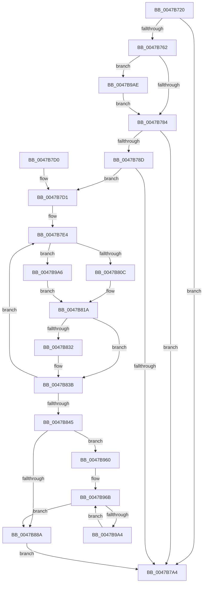

# PpmEventDomainPerfStateChange

- RVA: `0x0047B720`–`0x0047B9F8` (길이 `728` bytes)
- VA: `0x000000014047B720`
- 실행 섹션: `.text`
- PDB 이름 있음: `예`; PDB Function 태그: `아니요`
- unwind 정보 RVA: `0x000AD6D4`
- 디코드: `160`개 명령, `728/728` bytes 표시
- 미해석 바이트: `0` (있으면 어셈블리에 `.byte`로 보존)

> 이 문서는 커널 이미지의 기계어와 PDB 기호를 분석해 생성했습니다. 4번과 5번은 함수 원형과 자료형을 바이너리 사용 방식에서 추정한 C 해석이며 원본 소스 복구 결과는 아닙니다.

## 1. Dependencies

- 직접 호출 지점: **5**; 고유 호출 대상: **5**
- 직접 호출자로 확인된 함수: **1**
- RIP 상대 이미지 참조: **8**

### Outgoing calls
- `0x0047B79B` → [EtwEventEnabled](../39/EtwEventEnabled_function_00392450.md) (function, `0x00392450`)
- `0x0047B7AE` → [_security_check_cookie](../6A/_security_check_cookie_function_006AC640.md) (function, `0x006AC640`)
- `0x0047B824` → [KeAndGroupAffinityEx](../2C/KeAndGroupAffinityEx_function_002CF6B0.md) (function, `0x002CF6B0`)
- `0x0047B956` → [EtwWriteEx](../25/EtwWriteEx_function_0025F0D0.md) (function, `0x0025F0D0`)
- `0x0047B9EE` → [PpmFireWmiEvent](../5D/PpmFireWmiEvent_function_005D9678.md) (function, `0x005D9678`)

### Direct callers
- [PpmPerfApplyDomainState](../2C/PpmPerfApplyDomainState_function_002CD470.md) at `0x002CDB4B`

### Static image references
- `0x0047B742` → RVA `0x00E0A740` (`.data`; read)
- `0x0047B776` → RVA `0x00E678CC` (`.data`; read)
- `0x0047B784` → RVA `0x00E67A39` (`.data`; read)
- `0x0047B78D` → RVA `0x00F083E8` (`.data`; read)
- `0x0047B794` → RVA `0x0001A360` (`.rdata`; read)
- `0x0047B7F8` → RVA `0x00FC7120` (`ALMOSTRO`; read)
- `0x0047B80F` → RVA `0x00FC7128` (`ALMOSTRO`; read)
- `0x0047B9BB` → RVA `0x00024CC8` (`.rdata`; read)

## 2. Other-region calls and transfers

- 다른 실행 섹션으로 향하는 call: **0**
- 별도 외부 분기/꼬리 이동을 확인하지 못했습니다.

## 3. Assembly (complete function range)

```asm
0047B720  48 8B C4                        mov rax, rsp
0047B723  48 89 58 10                     mov qword ptr [rax + 0x10], rbx
0047B727  48 89 70 18                     mov qword ptr [rax + 0x18], rsi
0047B72B  48 89 78 20                     mov qword ptr [rax + 0x20], rdi
0047B72F  55                              push rbp
0047B730  41 56                           push r14
0047B732  41 57                           push r15
0047B734  48 8D A8 E8 F9 FF FF            lea rbp, [rax - 0x618]
0047B73B  48 81 EC 00 07 00 00            sub rsp, 0x700
0047B742  48 8B 05 F7 EF 98 00            mov rax, qword ptr [rip + 0x98eff7]
0047B749  48 33 C4                        xor rax, rsp
0047B74C  48 89 85 F0 05 00 00            mov qword ptr [rbp + 0x5f0], rax
0047B753  45 33 F6                        xor r14d, r14d
0047B756  48 8B D9                        mov rbx, rcx
0047B759  44 39 B1 30 01 00 00            cmp dword ptr [rcx + 0x130], r14d
0047B760  75 42                           jne 0x14047b7a4
0047B762  8B 81 28 03 00 00               mov eax, dword ptr [rcx + 0x328]
0047B768  89 44 24 44                     mov dword ptr [rsp + 0x44], eax
0047B76C  8B 81 3C 03 00 00               mov eax, dword ptr [rcx + 0x33c]
0047B772  89 44 24 48                     mov dword ptr [rsp + 0x48], eax
0047B776  8B 05 50 C1 9E 00               mov eax, dword ptr [rip + 0x9ec150]
0047B77C  85 C0                           test eax, eax
0047B77E  0F 85 2A 02 00 00               jne 0x14047b9ae
0047B784  44 38 35 AE C2 9E 00            cmp byte ptr [rip + 0x9ec2ae], r14b
0047B78B  74 17                           je 0x14047b7a4
0047B78D  48 8B 0D 54 CC A8 00            mov rcx, qword ptr [rip + 0xa8cc54]
0047B794  48 8D 15 C5 EB B9 FF            lea rdx, [rip - 0x46143b]
0047B79B  E8 B0 6C F1 FF                  call 0x140392450
0047B7A0  84 C0                           test al, al
0047B7A2  75 2D                           jne 0x14047b7d1
0047B7A4  48 8B 8D F0 05 00 00            mov rcx, qword ptr [rbp + 0x5f0]
0047B7AB  48 33 CC                        xor rcx, rsp
0047B7AE  E8 8D 0E 23 00                  call 0x1406ac640
0047B7B3  4C 8D 9C 24 00 07 00 00         lea r11, [rsp + 0x700]
0047B7BB  49 8B 5B 28                     mov rbx, qword ptr [r11 + 0x28]
0047B7BF  49 8B 73 30                     mov rsi, qword ptr [r11 + 0x30]
0047B7C3  49 8B 7B 38                     mov rdi, qword ptr [r11 + 0x38]
0047B7C7  49 8B E3                        mov rsp, r11
0047B7CA  41 5F                           pop r15
0047B7CC  41 5E                           pop r14
0047B7CE  5D                              pop rbp
0047B7CF  C3                              ret
0047B7D0  CC                              int3
0047B7D1  41 0F B7 C6                     movzx eax, r14w
0047B7D5  41 0F B7 FE                     movzx edi, r14w
0047B7D9  66 89 44 24 40                  mov word ptr [rsp + 0x40], ax
0047B7DE  41 BF 01 00 00 00               mov r15d, 1
0047B7E4  0F B7 C0                        movzx eax, ax
0047B7E7  48 8D 95 F0 03 00 00            lea rdx, [rbp + 0x3f0]
0047B7EE  48 C1 E0 04                     shl rax, 4
0047B7F2  0F 57 C0                        xorps xmm0, xmm0
0047B7F5  48 03 D0                        add rdx, rax
0047B7F8  66 3B 3D 21 B9 B4 00            cmp di, word ptr [rip + 0xb4b921]
0047B7FF  0F 11 02                        movups xmmword ptr [rdx], xmm0
0047B802  66 89 7A 08                     mov word ptr [rdx + 8], di
0047B806  0F 83 9A 01 00 00               jae 0x14047b9a6
0047B80C  0F B7 C7                        movzx eax, di
0047B80F  48 8D 0D 12 B9 B4 00            lea rcx, [rip + 0xb4b912]
0047B816  48 8B 0C C1                     mov rcx, qword ptr [rcx + rax*8]
0047B81A  48 89 0A                        mov qword ptr [rdx], rcx
0047B81D  4C 8B C2                        mov r8, rdx
0047B820  48 8D 4B 18                     lea rcx, [rbx + 0x18]
0047B824  E8 87 3E E5 FF                  call 0x1402cf6b0
0047B829  85 C0                           test eax, eax
0047B82B  0F B7 44 24 40                  movzx eax, word ptr [rsp + 0x40]
0047B830  74 09                           je 0x14047b83b
0047B832  66 41 03 C7                     add ax, r15w
0047B836  66 89 44 24 40                  mov word ptr [rsp + 0x40], ax
0047B83B  66 41 03 FF                     add di, r15w
0047B83F  66 83 FF 20                     cmp di, 0x20
0047B843  72 9F                           jb 0x14047b7e4
0047B845  48 C7 44 24 78 04 00 00 00      mov qword ptr [rsp + 0x78], 4
0047B84E  48 8D 4C 24 44                  lea rcx, [rsp + 0x44]
0047B853  48 89 4C 24 70                  mov qword ptr [rsp + 0x70], rcx
0047B858  48 8D 4C 24 48                  lea rcx, [rsp + 0x48]
0047B85D  48 89 4D 80                     mov qword ptr [rbp - 0x80], rcx
0047B861  41 BB 02 00 00 00               mov r11d, 2
0047B867  48 C7 45 88 04 00 00 00         mov qword ptr [rbp - 0x78], 4
0047B86F  48 8D 4C 24 40                  lea rcx, [rsp + 0x40]
0047B874  48 89 4D 90                     mov qword ptr [rbp - 0x70], rcx
0047B878  4C 89 5D 98                     mov qword ptr [rbp - 0x68], r11
0047B87C  45 8D 43 01                     lea r8d, [r11 + 1]
0047B880  66 44 3B F0                     cmp r14w, ax
0047B884  0F 82 D6 00 00 00               jb 0x14047b960
0047B88A  41 8B C8                        mov ecx, r8d
0047B88D  48 8D 83 38 03 00 00            lea rax, [rbx + 0x338]
0047B894  48 03 C9                        add rcx, rcx
0047B897  48 8D 15 C2 EA B9 FF            lea rdx, [rip - 0x46153e]
0047B89E  45 03 C7                        add r8d, r15d
0047B8A1  45 33 C9                        xor r9d, r9d
0047B8A4  48 89 44 CC 70                  mov qword ptr [rsp + rcx*8 + 0x70], rax
0047B8A9  48 8D 83 40 03 00 00            lea rax, [rbx + 0x340]
0047B8B0  48 C7 44 CC 78 04 00 00 00      mov qword ptr [rsp + rcx*8 + 0x78], 4
0047B8B9  41 8B C8                        mov ecx, r8d
0047B8BC  45 03 C7                        add r8d, r15d
0047B8BF  48 03 C9                        add rcx, rcx
0047B8C2  48 89 44 CC 70                  mov qword ptr [rsp + rcx*8 + 0x70], rax
0047B8C7  48 8D 83 44 03 00 00            lea rax, [rbx + 0x344]
0047B8CE  48 C7 44 CC 78 04 00 00 00      mov qword ptr [rsp + rcx*8 + 0x78], 4
0047B8D7  41 8B C8                        mov ecx, r8d
0047B8DA  45 03 C7                        add r8d, r15d
0047B8DD  48 03 C9                        add rcx, rcx
0047B8E0  48 89 44 CC 70                  mov qword ptr [rsp + rcx*8 + 0x70], rax
0047B8E5  48 8D 83 48 03 00 00            lea rax, [rbx + 0x348]
0047B8EC  48 C7 44 CC 78 04 00 00 00      mov qword ptr [rsp + rcx*8 + 0x78], 4
0047B8F5  41 8B C8                        mov ecx, r8d
0047B8F8  45 03 C7                        add r8d, r15d
0047B8FB  48 03 C9                        add rcx, rcx
0047B8FE  48 89 44 CC 70                  mov qword ptr [rsp + rcx*8 + 0x70], rax
0047B903  0F B6 83 58 03 00 00            movzx eax, byte ptr [rbx + 0x358]
0047B90A  48 C7 44 CC 78 04 00 00 00      mov qword ptr [rsp + rcx*8 + 0x78], 4
0047B913  48 8D 4C 24 4C                  lea rcx, [rsp + 0x4c]
0047B918  89 44 24 4C                     mov dword ptr [rsp + 0x4c], eax
0047B91C  41 8B C0                        mov eax, r8d
0047B91F  48 03 C0                        add rax, rax
0047B922  48 89 4C C4 70                  mov qword ptr [rsp + rax*8 + 0x70], rcx
0047B927  48 8D 4C 24 70                  lea rcx, [rsp + 0x70]
0047B92C  48 89 4C 24 38                  mov qword ptr [rsp + 0x38], rcx
0047B931  48 8B 0D B0 CA A8 00            mov rcx, qword ptr [rip + 0xa8cab0]
0047B938  48 C7 44 C4 78 04 00 00 00      mov qword ptr [rsp + rax*8 + 0x78], 4
0047B941  41 8D 40 01                     lea eax, [r8 + 1]
0047B945  89 44 24 30                     mov dword ptr [rsp + 0x30], eax
0047B949  45 33 C0                        xor r8d, r8d
0047B94C  4C 89 74 24 28                  mov qword ptr [rsp + 0x28], r14
0047B951  4C 89 74 24 20                  mov qword ptr [rsp + 0x20], r14
0047B956  E8 75 37 DE FF                  call 0x14025f0d0
0047B95B  E9 44 FE FF FF                  jmp 0x14047b7a4
0047B960  48 8D 95 F0 03 00 00            lea rdx, [rbp + 0x3f0]
0047B967  44 0F B7 C8                     movzx r9d, ax
0047B96B  41 8B C8                        mov ecx, r8d
0047B96E  48 8D 42 08                     lea rax, [rdx + 8]
0047B972  48 03 C9                        add rcx, rcx
0047B975  48 89 44 CC 70                  mov qword ptr [rsp + rcx*8 + 0x70], rax
0047B97A  4C 89 5C CC 78                  mov qword ptr [rsp + rcx*8 + 0x78], r11
0047B97F  41 8D 48 01                     lea ecx, [r8 + 1]
0047B983  48 03 C9                        add rcx, rcx
0047B986  45 03 C3                        add r8d, r11d
0047B989  48 89 54 CC 70                  mov qword ptr [rsp + rcx*8 + 0x70], rdx
0047B98E  48 83 C2 10                     add rdx, 0x10
0047B992  48 C7 44 CC 78 08 00 00 00      mov qword ptr [rsp + rcx*8 + 0x78], 8
0047B99B  4D 2B CF                        sub r9, r15
0047B99E  0F 84 E6 FE FF FF               je 0x14047b88a
0047B9A4  EB C5                           jmp 0x14047b96b
0047B9A6  49 8B CE                        mov rcx, r14
0047B9A9  E9 6C FE FF FF                  jmp 0x14047b81a
0047B9AE  8B 44 24 44                     mov eax, dword ptr [rsp + 0x44]
0047B9B2  4C 8D 4C 24 50                  lea r9, [rsp + 0x50]
0047B9B7  89 44 24 50                     mov dword ptr [rsp + 0x50], eax
0047B9BB  48 8D 15 06 93 BA FF            lea rdx, [rip - 0x456cfa]
0047B9C2  48 8B 41 20                     mov rax, qword ptr [rcx + 0x20]
0047B9C6  41 B8 18 00 00 00               mov r8d, 0x18
0047B9CC  48 8B 49 10                     mov rcx, qword ptr [rcx + 0x10]
0047B9D0  48 89 44 24 60                  mov qword ptr [rsp + 0x60], rax
0047B9D5  48 81 E9 88 00 00 00            sub rcx, 0x88
0047B9DC  8B 44 24 48                     mov eax, dword ptr [rsp + 0x48]
0047B9E0  89 44 24 58                     mov dword ptr [rsp + 0x58], eax
0047B9E4  44 89 74 24 54                  mov dword ptr [rsp + 0x54], r14d
0047B9E9  44 89 74 24 5C                  mov dword ptr [rsp + 0x5c], r14d
0047B9EE  E8 85 DC 15 00                  call 0x1405d9678
0047B9F3  E9 8C FD FF FF                  jmp 0x14047b784
```

## 4. C-style interpretation (structured pseudocode)

```c
__int64 __fastcall PpmEventDomainPerfStateChange(__int64 a1, __int64 a2, __int64 a3, int a4)
{
    __int64 result;
    __int64 v_r14;
    __int64 v_rdi;
    __int64 v_rsp;
    unsigned __int64 v_stack_m18;
    unsigned __int64 v_stack_m688;
    unsigned __int64 v_stack_m690;
    unsigned __int64 v_stack_m6A0;
    unsigned int v_stack_m6A4;
    unsigned int v_stack_m6A8;
    unsigned int v_stack_m6AC;
    unsigned __int64 v_stack_m6B0;
    unsigned __int64 v_stack_m6B4;
    unsigned __int64 v_stack_m6B8;
    unsigned __int64 v_stack_m6BC;
    unsigned __int16 v_stack_m6C0;
    unsigned __int64 v_stack_m6C8;
    unsigned int v_stack_m6D0;
    unsigned int v_stack_m6D4;
    unsigned __int64 v_stack_m6D8;
    unsigned __int64 v_stack_m6E0;

    *(unsigned __int64 *)(v_rsp + 16) = v_rbx;
    *(unsigned __int64 *)(v_rsp + 24) = v_rsi;
    *(unsigned __int64 *)(v_rsp + 32) = v_rdi;
    v_rsp = (v_rsp) - (0x700ULL);
    result = (*(unsigned __int64 *)(v_rip + 10022903)) ^ (v_rsp);
    *(unsigned __int64 *)(v_rsp - 1560 + 1520) = result;
    v_r14 = 0;
    if ((*(unsigned int *)(a1 + 304)) != 0) goto loc_0047B7A4;
    v_stack_m6D4 = (unsigned int)((unsigned int)(*(unsigned int *)(a1 + 808)));
    v_stack_m6D0 = (unsigned int)((unsigned int)(*(unsigned int *)(a1 + 828)));
    if ((unsigned int)((unsigned int)(*(unsigned int *)(v_rip + 10404176))) != 0) goto loc_0047B9AE;
loc_0047B784:
    if ((*(unsigned __int8 *)(v_rip + 10404526)) == 0) goto loc_0047B7A4;
    result = EtwEventEnabled(*(unsigned __int64 *)(v_rip + 11062356), v_rip - 4592699, a3, a4);
    if ((unsigned __int8)(result) != 0) goto loc_0047B7D1;
loc_0047B7A4:
    a1 = (*(unsigned __int64 *)(v_rsp - 1560 + 1520)) ^ (v_rsp);
    result = _security_check_cookie(a1, v_rip - 4592699, a3, a4);
    return result;
loc_0047B7D1:
    v_stack_m6C0 = 0;
loc_0047B7E4:
    result = (0) << (4);
    a2 = (v_rsp - 1560 + 1008) + (result);
    *(unsigned __int64 *)(a2) = v_xmm0;
    *(unsigned __int16 *)(a2 + 8) = 0;
    if (0 >= (*(unsigned __int16 *)(v_rip + 11843873))) goto loc_0047B9A6;
loc_0047B81A:
    *(unsigned __int64 *)(a2) = *(unsigned __int64 *)(v_rip + 11843858 + 0 * 8);
    result = KeAndGroupAffinityEx(*(unsigned __int64 *)(v_stack_m18 + 40) + 24, a2, a2, a4);
    result = v_stack_m6C0;
    if ((unsigned int)(result) != 0) {
        result = (unsigned __int16)((v_stack_m6C0) + (1));
        v_stack_m6C0 = (unsigned __int16)(result);
    }
    v_rdi = (unsigned __int16)((0) + (1));
    if (((unsigned __int16)(v_rdi)) < 32) goto loc_0047B7E4;
    v_stack_m688 = 4;
    v_stack_m690 = v_stack_m6BC;
    *(unsigned __int64 *)(v_rsp - 1560 - 128) = v_stack_m6B8;
    *(unsigned __int64 *)(v_rsp - 1560 - 120) = 4;
    *(unsigned __int64 *)(v_rsp - 1560 - 112) = v_stack_m6C0;
    *(unsigned __int64 *)(v_rsp - 1560 - 104) = 2;
    if (0 < ((unsigned __int16)(result))) goto loc_0047B960;
loc_0047B88A:
    a1 = ((unsigned int)((unsigned int)(2 + 1))) + ((unsigned int)((unsigned int)(2 + 1)));
    a3 = (unsigned int)((2 + 1) + (1));
    a4 = 0;
    *(unsigned __int64 *)(v_stack_m18 + a1 * 8 + 112) = *(unsigned __int64 *)(v_stack_m18 + 40) + 824;
    *(unsigned __int64 *)(v_stack_m18 + a1 * 8 + 120) = 4;
    a3 = (unsigned int)((a3) + (1));
    a1 = ((unsigned int)((unsigned int)(a3))) + ((unsigned int)((unsigned int)(a3)));
    *(unsigned __int64 *)(v_stack_m18 + a1 * 8 + 112) = *(unsigned __int64 *)(v_stack_m18 + 40) + 832;
    *(unsigned __int64 *)(v_stack_m18 + a1 * 8 + 120) = 4;
    a3 = (unsigned int)((a3) + (1));
    a1 = ((unsigned int)((unsigned int)(a3))) + ((unsigned int)((unsigned int)(a3)));
    *(unsigned __int64 *)(v_stack_m18 + a1 * 8 + 112) = *(unsigned __int64 *)(v_stack_m18 + 40) + 836;
    *(unsigned __int64 *)(v_stack_m18 + a1 * 8 + 120) = 4;
    a3 = (unsigned int)((a3) + (1));
    a1 = ((unsigned int)((unsigned int)(a3))) + ((unsigned int)((unsigned int)(a3)));
    *(unsigned __int64 *)(v_stack_m18 + a1 * 8 + 112) = *(unsigned __int64 *)(v_stack_m18 + 40) + 840;
    *(unsigned __int64 *)(v_stack_m18 + a1 * 8 + 120) = 4;
    v_stack_m6B4 = (unsigned int)(*(unsigned __int8 *)(*(unsigned __int64 *)(v_stack_m18 + 40) + 856));
    result = ((unsigned int)((unsigned int)(a3))) + ((unsigned int)((unsigned int)(a3)));
    *(unsigned __int64 *)(v_stack_m18 + result * 8 + 112) = v_stack_m6B4;
    v_stack_m6C8 = v_stack_m690;
    *(unsigned __int64 *)(v_stack_m18 + result * 8 + 120) = 4;
    v_stack_m6D0 = (unsigned int)(a3 + 1);
    a3 = 0;
    v_stack_m6D8 = 0;
    v_stack_m6E0 = 0;
    result = EtwWriteEx(*(unsigned __int64 *)(v_rip + 11061936), v_rip - 4592958, a3, a4);
    goto loc_0047B7A4;
loc_0047B960:
loc_0047B96B:
    a1 = (0) + (0);
    *(unsigned __int64 *)(v_stack_m18 + a1 * 8 + 112) = v_rsp - 1560 + 1008 + 8;
    *(unsigned __int64 *)(v_stack_m18 + a1 * 8 + 120) = 2;
    a1 = (a3 + 1) + (a3 + 1);
    a3 = (unsigned int)((a3) + (2));
    *(unsigned __int64 *)(v_stack_m18 + a1 * 8 + 112) = v_rsp - 1560 + 1008;
    a2 = (v_rsp - 1560 + 1008) + (16);
    *(unsigned __int64 *)(v_stack_m18 + a1 * 8 + 120) = 8;
    a4 = ((unsigned __int16)(result)) - (1);
    if (condition_is_equal) goto loc_0047B88A;
    goto loc_0047B96B;
loc_0047B9A6:
    goto loc_0047B81A;
loc_0047B9AE:
    v_stack_m6B0 = (unsigned int)((unsigned int)(v_stack_m6BC));
    v_stack_m6A0 = *(unsigned __int64 *)(0 + 32);
    a1 = (*(unsigned __int64 *)(0 + 16)) - (136);
    v_stack_m6A8 = (unsigned int)((unsigned int)(v_stack_m6B8));
    v_stack_m6AC = 0;
    v_stack_m6A4 = 0;
    result = PpmFireWmiEvent(a1, v_rip - 4549882, 24, v_stack_m6B0);
    goto loc_0047B784;
}
```

## 5. (Beta) C Style

```c
int64_t PpmEventDomainPerfStateChange(void *Arg1, int64_t Arg2, int64_t Arg3, int32_t Arg4)
{
    uint8_t *arg1 = (uint8_t *)Arg1;

    int64_t result;
    int64_t local_r14;
    int64_t local_rdi;
    int64_t local_rsp;
    uint64_t v_stack_m18;
    uint64_t v_stack_m688;
    uint64_t v_stack_m690;
    uint64_t v_stack_m6A0;
    uint32_t v_stack_m6A4;
    uint32_t v_stack_m6A8;
    uint32_t v_stack_m6AC;
    uint64_t v_stack_m6B0;
    uint64_t v_stack_m6B4;
    uint64_t v_stack_m6B8;
    uint64_t v_stack_m6BC;
    uint16_t v_stack_m6C0;
    uint64_t v_stack_m6C8;
    uint32_t v_stack_m6D0;
    uint32_t v_stack_m6D4;
    uint64_t v_stack_m6D8;
    uint64_t v_stack_m6E0;

    *(uint64_t *)(local_rsp + 0x10) = local_rbx;
    *(uint64_t *)(local_rsp + 0x18) = local_rsi;
    *(uint64_t *)(local_rsp + 0x20) = local_rdi;
    local_rsp = (local_rsp) - (0x700ULL);
    result = (*(uint64_t *)(v_rip + 0x98EFF7)) ^ (local_rsp);
    *(uint64_t *)(local_rsp - 0x618 + 0x5F0) = result;
    local_r14 = 0;
    if ((*(uint32_t *)(arg1 + 0x130)) != 0) goto loc_0047B7A4;
    v_stack_m6D4 = (uint32_t)((uint32_t)(*(uint32_t *)(arg1 + 0x328)));
    v_stack_m6D0 = (uint32_t)((uint32_t)(*(uint32_t *)(arg1 + 0x33C)));
    if ((uint32_t)((uint32_t)(*(uint32_t *)(v_rip + 0x9EC150))) != 0) goto loc_0047B9AE;
loc_0047B784:
    if ((*(uint8_t *)(v_rip + 0x9EC2AE)) == 0) goto loc_0047B7A4;
    result = EtwEventEnabled(*(uint64_t *)(v_rip + 0xA8CC54), v_rip - 4592699, Arg3, Arg4);
    if ((uint8_t)(result) != 0) goto loc_0047B7D1;
loc_0047B7A4:
    Arg1 = (*(uint64_t *)(local_rsp - 0x618 + 0x5F0)) ^ (local_rsp);
    result = _security_check_cookie(Arg1, v_rip - 4592699, Arg3, Arg4);
    return result;
loc_0047B7D1:
    v_stack_m6C0 = 0;
loc_0047B7E4:
    result = (0) << (4);
    Arg2 = (local_rsp - 1560 + 1008) + (result);
    *(uint64_t *)(Arg2) = v_xmm0;
    *(uint16_t *)(Arg2 + 0x8) = 0;
    if (0 >= (*(uint16_t *)(v_rip + 0xB4B921))) goto loc_0047B9A6;
loc_0047B81A:
    *(uint64_t *)(Arg2) = *(uint64_t *)(v_rip + 0xB4B912 + 0x0 * 8);
    result = KeAndGroupAffinityEx(*(uint64_t *)(v_stack_m18 + 0x28) + 24, Arg2, Arg2, Arg4);
    result = v_stack_m6C0;
    if ((uint32_t)(result) != 0) {
        result = (uint16_t)((v_stack_m6C0) + (1));
        v_stack_m6C0 = (uint16_t)(result);
    }
    local_rdi = (uint16_t)((0) + (1));
    if (((uint16_t)(local_rdi)) < 32) goto loc_0047B7E4;
    v_stack_m688 = 4;
    v_stack_m690 = v_stack_m6BC;
    *(uint64_t *)(local_rsp - 0x618 - 0x80) = v_stack_m6B8;
    *(uint64_t *)(local_rsp - 0x618 - 0x78) = 4;
    *(uint64_t *)(local_rsp - 0x618 - 0x70) = v_stack_m6C0;
    *(uint64_t *)(local_rsp - 0x618 - 0x68) = 2;
    if (0 < ((uint16_t)(result))) goto loc_0047B960;
loc_0047B88A:
    Arg1 = ((uint32_t)((uint32_t)(2 + 1))) + ((uint32_t)((uint32_t)(2 + 1)));
    Arg3 = (uint32_t)((2 + 1) + (1));
    Arg4 = 0;
    *(uint64_t *)(v_stack_m18 + arg1 * 8 + 0x70) = *(uint64_t *)(v_stack_m18 + 0x28) + 824;
    *(uint64_t *)(v_stack_m18 + arg1 * 8 + 0x78) = 4;
    Arg3 = (uint32_t)((Arg3) + (1));
    Arg1 = ((uint32_t)((uint32_t)(Arg3))) + ((uint32_t)((uint32_t)(Arg3)));
    *(uint64_t *)(v_stack_m18 + arg1 * 8 + 0x70) = *(uint64_t *)(v_stack_m18 + 0x28) + 832;
    *(uint64_t *)(v_stack_m18 + arg1 * 8 + 0x78) = 4;
    Arg3 = (uint32_t)((Arg3) + (1));
    Arg1 = ((uint32_t)((uint32_t)(Arg3))) + ((uint32_t)((uint32_t)(Arg3)));
    *(uint64_t *)(v_stack_m18 + arg1 * 8 + 0x70) = *(uint64_t *)(v_stack_m18 + 0x28) + 836;
    *(uint64_t *)(v_stack_m18 + arg1 * 8 + 0x78) = 4;
    Arg3 = (uint32_t)((Arg3) + (1));
    Arg1 = ((uint32_t)((uint32_t)(Arg3))) + ((uint32_t)((uint32_t)(Arg3)));
    *(uint64_t *)(v_stack_m18 + arg1 * 8 + 0x70) = *(uint64_t *)(v_stack_m18 + 0x28) + 840;
    *(uint64_t *)(v_stack_m18 + arg1 * 8 + 0x78) = 4;
    v_stack_m6B4 = (uint32_t)(*(uint8_t *)(*(uint64_t *)(v_stack_m18 + 0x28) + 0x358));
    result = ((uint32_t)((uint32_t)(Arg3))) + ((uint32_t)((uint32_t)(Arg3)));
    *(uint64_t *)(v_stack_m18 + result * 8 + 0x70) = v_stack_m6B4;
    v_stack_m6C8 = v_stack_m690;
    *(uint64_t *)(v_stack_m18 + result * 8 + 0x78) = 4;
    v_stack_m6D0 = (uint32_t)(Arg3 + 1);
    Arg3 = 0;
    v_stack_m6D8 = 0;
    v_stack_m6E0 = 0;
    result = EtwWriteEx(*(uint64_t *)(v_rip + 0xA8CAB0), v_rip - 4592958, Arg3, Arg4);
    goto loc_0047B7A4;
loc_0047B960:
loc_0047B96B:
    Arg1 = (0) + (0);
    *(uint64_t *)(v_stack_m18 + arg1 * 8 + 0x70) = local_rsp - 1560 + 1008 + 8;
    *(uint64_t *)(v_stack_m18 + arg1 * 8 + 0x78) = 2;
    Arg1 = (Arg3 + 1) + (Arg3 + 1);
    Arg3 = (uint32_t)((Arg3) + (2));
    *(uint64_t *)(v_stack_m18 + arg1 * 8 + 0x70) = local_rsp - 1560 + 1008;
    Arg2 = (local_rsp - 1560 + 1008) + (16);
    *(uint64_t *)(v_stack_m18 + arg1 * 8 + 0x78) = 8;
    Arg4 = ((uint16_t)(result)) - (1);
    if (condition_is_equal) goto loc_0047B88A;
    goto loc_0047B96B;
loc_0047B9A6:
    goto loc_0047B81A;
loc_0047B9AE:
    v_stack_m6B0 = (uint32_t)((uint32_t)(v_stack_m6BC));
    v_stack_m6A0 = *(uint64_t *)(0 + 0x20);
    Arg1 = (*(uint64_t *)(0 + 0x10)) - (136);
    v_stack_m6A8 = (uint32_t)((uint32_t)(v_stack_m6B8));
    v_stack_m6AC = 0;
    v_stack_m6A4 = 0;
    result = PpmFireWmiEvent(Arg1, v_rip - 4549882, 24, v_stack_m6B0);
    goto loc_0047B784;
}
```

### 관측된 메모리 오프셋

구조체 형식이 확인되지 않은 접근은 인자 기준의 오프셋으로만 기록했습니다.

| 기준 인자 | 오프셋 표현 | 폭 (bit) | 접근 |
|---|---:|---:|---|
| `Arg1` | `+ 0x10` | `64` | `R` |
| `Arg1` | `+ 0x18` | `64` | `R` |
| `Arg1` | `+ 0x20` | `64` | `R` |
| `Arg1` | `+ 0x130` | `32` | `R` |
| `Arg1` | `+ 0x328` | `32` | `R` |
| `Arg1` | `+ 0x338` | `64` | `R` |
| `Arg1` | `+ 0x33C` | `32` | `R` |
| `Arg1` | `+ 0x340` | `64` | `R` |
| `Arg1` | `+ 0x344` | `64` | `R` |
| `Arg1` | `+ 0x348` | `64` | `R` |
| `Arg1` | `+ 0x358` | `8` | `R` |

## 6. Execution-region graph

[열기: 2D/3D 그래프와 함수 탐색 컨트롤 패널](../../../control-panel.html?section=text&rva=0x0047B720&view=graph)

- 2D 그래프는 위에서 아래로 흐르고, 3D 그래프는 빈 공간을 드래그해 회전합니다. Shift+드래그는 이동, 휠은 확대·축소, 함수 노드 선택은 대상 보고서 이동입니다.

### Static fallback


