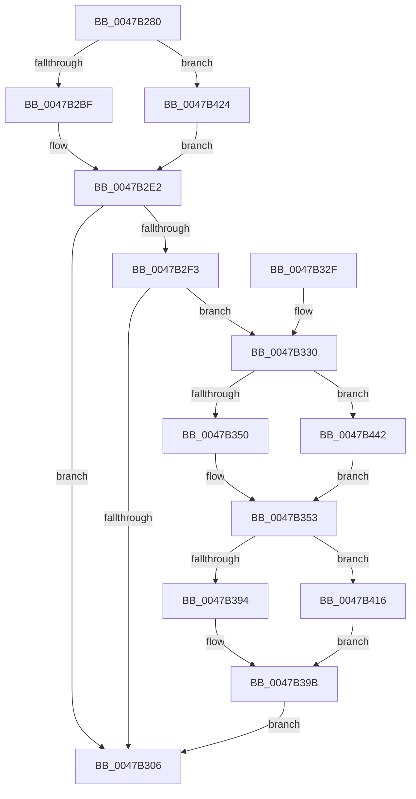

# PpmEventTraceExpectedUtility

- RVA: `0x0047B280`–`0x0047B44C` (길이 `460` bytes)
- VA: `0x000000014047B280`
- 실행 섹션: `.text`
- PDB 이름 있음: `예`; PDB Function 태그: `아니요`
- unwind 정보 RVA: `0x000AD5AC`
- 디코드: `107`개 명령, `460/460` bytes 표시
- 미해석 바이트: `0` (있으면 어셈블리에 `.byte`로 보존)

> 이 문서는 커널 이미지의 기계어와 PDB 기호를 분석해 생성했습니다. 4번과 5번은 함수 원형과 자료형을 바이너리 사용 방식에서 추정한 C 해석이며 원본 소스 복구 결과는 아닙니다.

## 1. Dependencies

- 직접 호출 지점: **3**; 고유 호출 대상: **3**
- 직접 호출자로 확인된 함수: **1**
- RIP 상대 이미지 참조: **7**

### Outgoing calls
- `0x0047B2FD` → [EtwEventEnabled](../39/EtwEventEnabled_function_00392450.md) (function, `0x00392450`)
- `0x0047B30D` → [_security_check_cookie](../6A/_security_check_cookie_function_006AC640.md) (function, `0x006AC640`)
- `0x0047B40C` → [EtwWriteEx](../25/EtwWriteEx_function_0025F0D0.md) (function, `0x0025F0D0`)

### Direct callers
- [PpmPerfApplyProcessorState](../2D/PpmPerfApplyProcessorState_function_002DA4BC.md) at `0x002DA5D8`

### Static image references
- `0x0047B29F` → RVA `0x00E0A740` (`.data`; read)
- `0x0047B2C6` → RVA `0x0001A320` (`.rdata`; read)
- `0x0047B2E2` → RVA `0x00E67A39` (`.data`; read)
- `0x0047B2F3` → RVA `0x00F083E8` (`.data`; read)
- `0x0047B330` → RVA `0x00F0B260` (`.data`; read)
- `0x0047B360` → RVA `0x00F0B268` (`.data`; read)
- `0x0047B428` → RVA `0x0001A330` (`.rdata`; read)

## 2. Other-region calls and transfers

- 다른 실행 섹션으로 향하는 call: **0**
- 별도 외부 분기/꼬리 이동을 확인하지 못했습니다.

## 3. Assembly (complete function range)

```asm
0047B280  48 8B C4                        mov rax, rsp
0047B283  48 89 58 08                     mov qword ptr [rax + 8], rbx
0047B287  48 89 70 10                     mov qword ptr [rax + 0x10], rsi
0047B28B  48 89 78 18                     mov qword ptr [rax + 0x18], rdi
0047B28F  4C 89 70 20                     mov qword ptr [rax + 0x20], r14
0047B293  55                              push rbp
0047B294  48 8D 68 A1                     lea rbp, [rax - 0x5f]
0047B298  48 81 EC D0 00 00 00            sub rsp, 0xd0
0047B29F  48 8B 05 9A F4 98 00            mov rax, qword ptr [rip + 0x98f49a]
0047B2A6  48 33 C4                        xor rax, rsp
0047B2A9  48 89 45 47                     mov qword ptr [rbp + 0x47], rax
0047B2AD  33 F6                           xor esi, esi
0047B2AF  48 8B D9                        mov rbx, rcx
0047B2B2  89 75 C7                        mov dword ptr [rbp - 0x39], esi
0047B2B5  40 38 71 44                     cmp byte ptr [rcx + 0x44], sil
0047B2B9  0F 84 65 01 00 00               je 0x14047b424
0047B2BF  0F B6 81 20 77 FF FF            movzx eax, byte ptr [rcx - 0x88e0]
0047B2C6  48 8D 3D 53 F0 B9 FF            lea rdi, [rip - 0x460fad]
0047B2CD  66 89 45 C7                     mov word ptr [rbp - 0x39], ax
0047B2D1  8A 81 21 77 FF FF               mov al, byte ptr [rcx - 0x88df]
0047B2D7  88 45 C9                        mov byte ptr [rbp - 0x37], al
0047B2DA  48 C7 45 3F 03 00 00 00         mov qword ptr [rbp + 0x3f], 3
0047B2E2  40 38 35 50 C7 9E 00            cmp byte ptr [rip + 0x9ec750], sil
0047B2E9  48 8D 45 C7                     lea rax, [rbp - 0x39]
0047B2ED  48 89 45 37                     mov qword ptr [rbp + 0x37], rax
0047B2F1  74 13                           je 0x14047b306
0047B2F3  48 8B 0D EE D0 A8 00            mov rcx, qword ptr [rip + 0xa8d0ee]
0047B2FA  48 8B D7                        mov rdx, rdi
0047B2FD  E8 4E 71 F1 FF                  call 0x140392450
0047B302  84 C0                           test al, al
0047B304  75 2A                           jne 0x14047b330
0047B306  48 8B 4D 47                     mov rcx, qword ptr [rbp + 0x47]
0047B30A  48 33 CC                        xor rcx, rsp
0047B30D  E8 2E 13 23 00                  call 0x1406ac640
0047B312  4C 8D 9C 24 D0 00 00 00         lea r11, [rsp + 0xd0]
0047B31A  49 8B 5B 10                     mov rbx, qword ptr [r11 + 0x10]
0047B31E  49 8B 73 18                     mov rsi, qword ptr [r11 + 0x18]
0047B322  49 8B 7B 20                     mov rdi, qword ptr [r11 + 0x20]
0047B326  4D 8B 73 28                     mov r14, qword ptr [r11 + 0x28]
0047B32A  49 8B E3                        mov rsp, r11
0047B32D  5D                              pop rbp
0047B32E  C3                              ret
0047B32F  CC                              int3
0047B330  48 8D 05 29 FF A8 00            lea rax, [rip + 0xa8ff29]
0047B337  48 C7 45 EF 08 00 00 00         mov qword ptr [rbp - 0x11], 8
0047B33F  48 89 45 E7                     mov qword ptr [rbp - 0x19], rax
0047B343  48 8B 43 08                     mov rax, qword ptr [rbx + 8]
0047B347  48 85 C0                        test rax, rax
0047B34A  0F 84 F2 00 00 00               je 0x14047b442
0047B350  8B 48 50                        mov ecx, dword ptr [rax + 0x50]
0047B353  48 B8 4B 59 86 38 D6 C5 6D 34   movabs rax, 0x346dc5d63886594b
0047B35D  89 4D D7                        mov dword ptr [rbp - 0x29], ecx
0047B360  48 F7 25 01 FF A8 00            mul qword ptr [rip + 0xa8ff01]
0047B367  8B 43 28                        mov eax, dword ptr [rbx + 0x28]
0047B36A  4C 8B C2                        mov r8, rdx
0047B36D  33 D2                           xor edx, edx
0047B36F  F7 F1                           div ecx
0047B371  49 C1 E8 0B                     shr r8, 0xb
0047B375  8B C8                           mov ecx, eax
0047B377  B8 1F 85 EB 51                  mov eax, 0x51eb851f
0047B37C  41 0F AF C8                     imul ecx, r8d
0047B380  83 C1 32                        add ecx, 0x32
0047B383  F7 E1                           mul ecx
0047B385  C1 EA 05                        shr edx, 5
0047B388  89 55 CB                        mov dword ptr [rbp - 0x35], edx
0047B38B  41 3B D0                        cmp edx, r8d
0047B38E  0F 87 82 00 00 00               ja 0x14047b416
0047B394  41 8B C0                        mov eax, r8d
0047B397  2B C2                           sub eax, edx
0047B399  8B D6                           mov edx, esi
0047B39B  48 8B 0D 46 D0 A8 00            mov rcx, qword ptr [rip + 0xa8d046]
0047B3A2  45 33 C9                        xor r9d, r9d
0047B3A5  89 45 CF                        mov dword ptr [rbp - 0x31], eax
0047B3A8  45 33 C0                        xor r8d, r8d
0047B3AB  48 8D 45 CF                     lea rax, [rbp - 0x31]
0047B3AF  89 55 D3                        mov dword ptr [rbp - 0x2d], edx
0047B3B2  48 89 45 F7                     mov qword ptr [rbp - 9], rax
0047B3B6  48 8B D7                        mov rdx, rdi
0047B3B9  48 8D 45 CB                     lea rax, [rbp - 0x35]
0047B3BD  48 C7 45 FF 04 00 00 00         mov qword ptr [rbp - 1], 4
0047B3C5  48 89 45 07                     mov qword ptr [rbp + 7], rax
0047B3C9  48 8D 45 D3                     lea rax, [rbp - 0x2d]
0047B3CD  48 89 45 17                     mov qword ptr [rbp + 0x17], rax
0047B3D1  48 8D 45 D7                     lea rax, [rbp - 0x29]
0047B3D5  48 89 45 27                     mov qword ptr [rbp + 0x27], rax
0047B3D9  48 8D 45 E7                     lea rax, [rbp - 0x19]
0047B3DD  48 89 44 24 38                  mov qword ptr [rsp + 0x38], rax
0047B3E2  C7 44 24 30 06 00 00 00         mov dword ptr [rsp + 0x30], 6
0047B3EA  48 89 74 24 28                  mov qword ptr [rsp + 0x28], rsi
0047B3EF  48 89 74 24 20                  mov qword ptr [rsp + 0x20], rsi
0047B3F4  48 C7 45 0F 04 00 00 00         mov qword ptr [rbp + 0xf], 4
0047B3FC  48 C7 45 1F 04 00 00 00         mov qword ptr [rbp + 0x1f], 4
0047B404  48 C7 45 2F 04 00 00 00         mov qword ptr [rbp + 0x2f], 4
0047B40C  E8 BF 3C DE FF                  call 0x14025f0d0
0047B411  E9 F0 FE FF FF                  jmp 0x14047b306
0047B416  44 89 45 CB                     mov dword ptr [rbp - 0x35], r8d
0047B41A  8B C6                           mov eax, esi
0047B41C  41 2B D0                        sub edx, r8d
0047B41F  E9 77 FF FF FF                  jmp 0x14047b39b
0047B424  48 8B 41 08                     mov rax, qword ptr [rcx + 8]
0047B428  48 8D 3D 01 EF B9 FF            lea rdi, [rip - 0x4610ff]
0047B42F  8B 50 14                        mov edx, dword ptr [rax + 0x14]
0047B432  89 55 C7                        mov dword ptr [rbp - 0x39], edx
0047B435  48 C7 45 3F 04 00 00 00         mov qword ptr [rbp + 0x3f], 4
0047B43D  E9 A0 FE FF FF                  jmp 0x14047b2e2
0047B442  B9 64 00 00 00                  mov ecx, 0x64
0047B447  E9 07 FF FF FF                  jmp 0x14047b353
```

## 4. C-style interpretation (structured pseudocode)

```c
__int64 __fastcall PpmEventTraceExpectedUtility(__int64 a1, __int64 a2, __int64 a3, int a4)
{
    __int64 result;
    __int64 v_rsi;
    __int64 v_rsp;
    unsigned __int64 v_stack_m8;
    unsigned __int64 v_stack_m98;
    unsigned int v_stack_mA0;
    unsigned __int64 v_stack_mA8;
    unsigned __int64 v_stack_mB0;

    *(unsigned __int64 *)(v_rsp + 8) = v_rbx;
    *(unsigned __int64 *)(v_rsp + 16) = v_rsi;
    *(unsigned __int64 *)(v_rsp + 24) = v_rdi;
    *(unsigned __int64 *)(v_rsp + 32) = v_r14;
    v_rsp = (v_rsp) - (208);
    result = (*(unsigned __int64 *)(v_rip + 10024090)) ^ (v_rsp);
    *(unsigned __int64 *)(v_rsp - 95 + 71) = result;
    v_rsi = 0;
    *(unsigned int *)(v_rsp - 95 - 57) = 0;
    if ((*(unsigned __int8 *)(a1 + 68)) == 0) goto loc_0047B424;
    *(unsigned __int16 *)(v_rsp - 95 - 57) = (unsigned __int16)(*(unsigned __int8 *)(a1 - 35040));
    *(unsigned __int8 *)(v_rsp - 95 - 55) = (unsigned __int8)(*(unsigned __int8 *)(a1 - 35039));
    *(unsigned __int64 *)(v_rsp - 95 + 63) = 3;
loc_0047B2E2:
    *(unsigned __int64 *)(v_rsp - 95 + 55) = v_rsp - 95 - 57;
    if ((*(unsigned __int8 *)(v_rip + 10405712)) == 0) goto loc_0047B306;
    result = EtwEventEnabled(*(unsigned __int64 *)(v_rip + 11063534), v_rip - 4591533, a3, a4);
    if ((unsigned __int8)(result) != 0) goto loc_0047B330;
loc_0047B306:
    a1 = (*(unsigned __int64 *)(v_rsp - 95 + 71)) ^ (v_rsp);
    result = _security_check_cookie(a1, v_rip - 4591533, a3, a4);
    return result;
loc_0047B330:
    *(unsigned __int64 *)(v_rsp - 95 - 17) = 8;
    *(unsigned __int64 *)(v_rsp - 95 - 25) = v_rip + 11075369;
    if (*(unsigned __int64 *)(*(unsigned __int64 *)(v_stack_m8 + 16) + 8) == 0) goto loc_0047B442;
loc_0047B353:
    *(unsigned int *)(v_rsp - 95 - 41) = (unsigned int)((unsigned int)(*(unsigned int *)(*(unsigned __int64 *)(*(unsigned __int64 *)(v_stack_m8 + 16) + 8) + 80)));
    a2 = 0;
    a3 = (v_rip - 4591533) >> (11);
    a1 = (unsigned int)(((unsigned int)((unsigned int)((unsigned int)(*(unsigned int *)(*(unsigned __int64 *)(v_stack_m8 + 16) + 40))))) * ((unsigned int)(a3)));
    a1 = (unsigned int)((a1) + (50));
    a2 = (unsigned int)((a2) >> (5));
    *(unsigned int *)(v_rsp - 95 - 53) = (unsigned int)(a2);
    if (((unsigned int)(a2)) > ((unsigned int)(a3))) goto loc_0047B416;
    result = (unsigned int)(((unsigned int)((unsigned int)(a3))) - ((unsigned int)(a2)));
loc_0047B39B:
    a4 = 0;
    *(unsigned int *)(v_rsp - 95 - 49) = (unsigned int)(result);
    a3 = 0;
    *(unsigned int *)(v_rsp - 95 - 45) = (unsigned int)((unsigned int)((unsigned int)(*(unsigned __int64 *)(v_stack_m8 + 24))));
    *(unsigned __int64 *)(v_rsp - 95 - 9) = v_rsp - 95 - 49;
    *(unsigned __int64 *)(v_rsp - 95 - 1) = 4;
    *(unsigned __int64 *)(v_rsp - 95 + 7) = v_rsp - 95 - 53;
    *(unsigned __int64 *)(v_rsp - 95 + 23) = v_rsp - 95 - 45;
    *(unsigned __int64 *)(v_rsp - 95 + 39) = v_rsp - 95 - 41;
    v_stack_m98 = v_rsp - 95 - 25;
    v_stack_mA0 = 6;
    v_stack_mA8 = *(unsigned __int64 *)(v_stack_m8 + 24);
    v_stack_mB0 = *(unsigned __int64 *)(v_stack_m8 + 24);
    *(unsigned __int64 *)(v_rsp - 95 + 15) = 4;
    *(unsigned __int64 *)(v_rsp - 95 + 31) = 4;
    *(unsigned __int64 *)(v_rsp - 95 + 47) = 4;
    result = EtwWriteEx(*(unsigned __int64 *)(v_rip + 11063366), *(unsigned __int64 *)(v_stack_m8 + 32), a3, a4);
    goto loc_0047B306;
loc_0047B416:
    *(unsigned int *)(v_rsp - 95 - 53) = 0;
    a2 = (unsigned int)((*(unsigned __int64 *)(v_stack_m8 + 32)) - (0));
    goto loc_0047B39B;
loc_0047B424:
    *(unsigned int *)(v_rsp - 95 - 57) = (unsigned int)((unsigned int)(*(unsigned int *)(*(unsigned __int64 *)(*(unsigned __int64 *)(v_rip + 11063366) + 8) + 20)));
    *(unsigned __int64 *)(v_rsp - 95 + 63) = 4;
    goto loc_0047B2E2;
loc_0047B442:
    goto loc_0047B353;
}
```

## 5. (Beta) C Style

```c
int64_t PpmEventTraceExpectedUtility(void *Arg1, int64_t Arg2, int64_t Arg3, int32_t Arg4)
{
    uint8_t *arg1 = (uint8_t *)Arg1;

    int64_t result;
    int64_t local_rsi;
    int64_t local_rsp;
    uint64_t v_stack_m8;
    uint64_t v_stack_m98;
    uint32_t v_stack_mA0;
    uint64_t v_stack_mA8;
    uint64_t v_stack_mB0;

    *(uint64_t *)(local_rsp + 0x8) = local_rbx;
    *(uint64_t *)(local_rsp + 0x10) = local_rsi;
    *(uint64_t *)(local_rsp + 0x18) = local_rdi;
    *(uint64_t *)(local_rsp + 0x20) = local_r14;
    local_rsp = (local_rsp) - (208);
    result = (*(uint64_t *)(v_rip + 0x98F49A)) ^ (local_rsp);
    *(uint64_t *)(local_rsp - 0x5F + 0x47) = result;
    local_rsi = 0;
    *(uint32_t *)(local_rsp - 0x5F - 0x39) = 0;
    if ((*(uint8_t *)(arg1 + 0x44)) == 0) goto loc_0047B424;
    *(uint16_t *)(local_rsp - 0x5F - 0x39) = (uint16_t)(*(uint8_t *)(arg1 - 0x88E0));
    *(uint8_t *)(local_rsp - 0x5F - 0x37) = (uint8_t)(*(uint8_t *)(arg1 - 0x88DF));
    *(uint64_t *)(local_rsp - 0x5F + 0x3F) = 3;
loc_0047B2E2:
    *(uint64_t *)(local_rsp - 0x5F + 0x37) = local_rsp - 95 - 57;
    if ((*(uint8_t *)(v_rip + 0x9EC750)) == 0) goto loc_0047B306;
    result = EtwEventEnabled(*(uint64_t *)(v_rip + 0xA8D0EE), v_rip - 4591533, Arg3, Arg4);
    if ((uint8_t)(result) != 0) goto loc_0047B330;
loc_0047B306:
    Arg1 = (*(uint64_t *)(local_rsp - 0x5F + 0x47)) ^ (local_rsp);
    result = _security_check_cookie(Arg1, v_rip - 4591533, Arg3, Arg4);
    return result;
loc_0047B330:
    *(uint64_t *)(local_rsp - 0x5F - 0x11) = 8;
    *(uint64_t *)(local_rsp - 0x5F - 0x19) = v_rip + 11075369;
    if (*(uint64_t *)(*(uint64_t *)(v_stack_m8 + 0x10) + 0x8) == 0) goto loc_0047B442;
loc_0047B353:
    *(uint32_t *)(local_rsp - 0x5F - 0x29) = (uint32_t)((uint32_t)(*(uint32_t *)(*(uint64_t *)(*(uint64_t *)(v_stack_m8 + 0x10) + 0x8) + 0x50)));
    Arg2 = 0;
    Arg3 = (v_rip - 4591533) >> (11);
    Arg1 = (uint32_t)(((uint32_t)((uint32_t)((uint32_t)(*(uint32_t *)(*(uint64_t *)(v_stack_m8 + 0x10) + 0x28))))) * ((uint32_t)(Arg3)));
    Arg1 = (uint32_t)((Arg1) + (50));
    Arg2 = (uint32_t)((Arg2) >> (5));
    *(uint32_t *)(local_rsp - 0x5F - 0x35) = (uint32_t)(Arg2);
    if (((uint32_t)(Arg2)) > ((uint32_t)(Arg3))) goto loc_0047B416;
    result = (uint32_t)(((uint32_t)((uint32_t)(Arg3))) - ((uint32_t)(Arg2)));
loc_0047B39B:
    Arg4 = 0;
    *(uint32_t *)(local_rsp - 0x5F - 0x31) = (uint32_t)(result);
    Arg3 = 0;
    *(uint32_t *)(local_rsp - 0x5F - 0x2D) = (uint32_t)((uint32_t)((uint32_t)(*(uint64_t *)(v_stack_m8 + 0x18))));
    *(uint64_t *)(local_rsp - 0x5F - 0x9) = local_rsp - 95 - 49;
    *(uint64_t *)(local_rsp - 0x5F - 0x1) = 4;
    *(uint64_t *)(local_rsp - 0x5F + 0x7) = local_rsp - 95 - 53;
    *(uint64_t *)(local_rsp - 0x5F + 0x17) = local_rsp - 95 - 45;
    *(uint64_t *)(local_rsp - 0x5F + 0x27) = local_rsp - 95 - 41;
    v_stack_m98 = local_rsp - 95 - 25;
    v_stack_mA0 = 6;
    v_stack_mA8 = *(uint64_t *)(v_stack_m8 + 0x18);
    v_stack_mB0 = *(uint64_t *)(v_stack_m8 + 0x18);
    *(uint64_t *)(local_rsp - 0x5F + 0xF) = 4;
    *(uint64_t *)(local_rsp - 0x5F + 0x1F) = 4;
    *(uint64_t *)(local_rsp - 0x5F + 0x2F) = 4;
    result = EtwWriteEx(*(uint64_t *)(v_rip + 0xA8D046), *(uint64_t *)(v_stack_m8 + 0x20), Arg3, Arg4);
    goto loc_0047B306;
loc_0047B416:
    *(uint32_t *)(local_rsp - 0x5F - 0x35) = 0;
    Arg2 = (uint32_t)((*(uint64_t *)(v_stack_m8 + 0x20)) - (0));
    goto loc_0047B39B;
loc_0047B424:
    *(uint32_t *)(local_rsp - 0x5F - 0x39) = (uint32_t)((uint32_t)(*(uint32_t *)(*(uint64_t *)(*(uint64_t *)(v_rip + 0xA8D046) + 0x8) + 0x14)));
    *(uint64_t *)(local_rsp - 0x5F + 0x3F) = 4;
    goto loc_0047B2E2;
loc_0047B442:
    goto loc_0047B353;
}
```

### 관측된 메모리 오프셋

구조체 형식이 확인되지 않은 접근은 인자 기준의 오프셋으로만 기록했습니다.

| 기준 인자 | 오프셋 표현 | 폭 (bit) | 접근 |
|---|---:|---:|---|
| `Arg1` | `- 0x88E0` | `8` | `R` |
| `Arg1` | `- 0x88DF` | `8` | `R` |
| `Arg1` | `+ 0x8` | `64` | `R` |
| `Arg1` | `+ 0x28` | `32` | `R` |
| `Arg1` | `+ 0x44` | `8` | `R` |

## 6. Execution-region graph

[열기: 2D/3D 그래프와 함수 탐색 컨트롤 패널](../../../control-panel.html?section=text&rva=0x0047B280&view=graph)

- 2D 그래프는 위에서 아래로 흐르고, 3D 그래프는 빈 공간을 드래그해 회전합니다. Shift+드래그는 이동, 휠은 확대·축소, 함수 노드 선택은 대상 보고서 이동입니다.

### Static fallback


