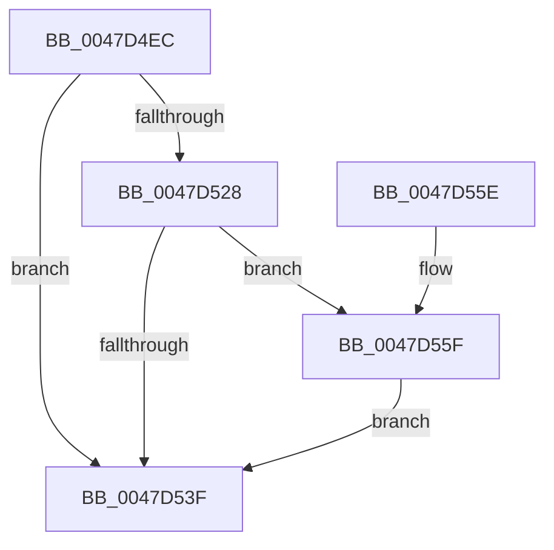

# PpmEventTraceSoftCoreParkingSelection

- RVA: `0x0047D4EC`–`0x0047D70E` (길이 `546` bytes)
- VA: `0x000000014047D4EC`
- 실행 섹션: `.text`
- PDB 이름 있음: `예`; PDB Function 태그: `아니요`
- unwind 정보 RVA: `0x000ADAD8`
- 디코드: `108`개 명령, `546/546` bytes 표시
- 미해석 바이트: `0` (있으면 어셈블리에 `.byte`로 보존)

> 이 문서는 커널 이미지의 기계어와 PDB 기호를 분석해 생성했습니다. 4번과 5번은 함수 원형과 자료형을 바이너리 사용 방식에서 추정한 C 해석이며 원본 소스 복구 결과는 아닙니다.

## 1. Dependencies

- 직접 호출 지점: **3**; 고유 호출 대상: **3**
- 직접 호출자로 확인된 함수: **1**
- RIP 상대 이미지 참조: **4**

### Outgoing calls
- `0x0047D536` → [EtwEventEnabled](../39/EtwEventEnabled_function_00392450.md) (function, `0x00392450`)
- `0x0047D546` → [_security_check_cookie](../6A/_security_check_cookie_function_006AC640.md) (function, `0x006AC640`)
- `0x0047D704` → [EtwWriteEx](../25/EtwWriteEx_function_0025F0D0.md) (function, `0x0025F0D0`)

### Direct callers
- [sub_006F6620](../6F/Unknown_function_006F6620.md) at `0x006F6BC8`

### Static image references
- `0x0047D50A` → RVA `0x00E0A740` (`.data`; read)
- `0x0047D51C` → RVA `0x00E67A39` (`.data`; read)
- `0x0047D528` → RVA `0x00F083E8` (`.data`; read)
- `0x0047D52F` → RVA `0x0001A3B0` (`.rdata`; read)

## 2. Other-region calls and transfers

- 다른 실행 섹션으로 향하는 call: **0**
- 별도 외부 분기/꼬리 이동을 확인하지 못했습니다.

## 3. Assembly (complete function range)

```asm
0047D4EC  48 89 5C 24 08                  mov qword ptr [rsp + 8], rbx
0047D4F1  44 88 4C 24 20                  mov byte ptr [rsp + 0x20], r9b
0047D4F6  44 88 44 24 18                  mov byte ptr [rsp + 0x18], r8b
0047D4FB  55                              push rbp
0047D4FC  56                              push rsi
0047D4FD  57                              push rdi
0047D4FE  48 8D 6C 24 80                  lea rbp, [rsp - 0x80]
0047D503  48 81 EC 80 01 00 00            sub rsp, 0x180
0047D50A  48 8B 05 2F D2 98 00            mov rax, qword ptr [rip + 0x98d22f]
0047D511  48 33 C4                        xor rax, rsp
0047D514  48 89 45 70                     mov qword ptr [rbp + 0x70], rax
0047D518  33 F6                           xor esi, esi
0047D51A  8B FA                           mov edi, edx
0047D51C  40 38 35 16 A5 9E 00            cmp byte ptr [rip + 0x9ea516], sil
0047D523  48 8B D9                        mov rbx, rcx
0047D526  74 17                           je 0x14047d53f
0047D528  48 8B 0D B9 AE A8 00            mov rcx, qword ptr [rip + 0xa8aeb9]
0047D52F  48 8D 15 7A CE B9 FF            lea rdx, [rip - 0x463186]
0047D536  E8 15 4F F1 FF                  call 0x140392450
0047D53B  84 C0                           test al, al
0047D53D  75 20                           jne 0x14047d55f
0047D53F  48 8B 4D 70                     mov rcx, qword ptr [rbp + 0x70]
0047D543  48 33 CC                        xor rcx, rsp
0047D546  E8 F5 F0 22 00                  call 0x1406ac640
0047D54B  48 8B 9C 24 A0 01 00 00         mov rbx, qword ptr [rsp + 0x1a0]
0047D553  48 81 C4 80 01 00 00            add rsp, 0x180
0047D55A  5F                              pop rdi
0047D55B  5E                              pop rsi
0047D55C  5D                              pop rbp
0047D55D  C3                              ret
0047D55E  CC                              int3
0047D55F  48 8B 43 20                     mov rax, qword ptr [rbx + 0x20]
0047D563  4C 8D 04 BF                     lea r8, [rdi + rdi*4]
0047D567  49 C1 E0 07                     shl r8, 7
0047D56B  45 33 C9                        xor r9d, r9d
0047D56E  4C 03 83 08 05 00 00            add r8, qword ptr [rbx + 0x508]
0047D575  49 8D 50 18                     lea rdx, [r8 + 0x18]
0047D579  48 8B 0A                        mov rcx, qword ptr [rdx]
0047D57C  48 21 8D D8 00 00 00            and qword ptr [rbp + 0xd8], rcx
0047D583  48 23 C1                        and rax, rcx
0047D586  48 89 44 24 48                  mov qword ptr [rsp + 0x48], rax
0047D58B  48 8B 43 18                     mov rax, qword ptr [rbx + 0x18]
0047D58F  48 23 C1                        and rax, rcx
0047D592  48 89 54 24 70                  mov qword ptr [rsp + 0x70], rdx
0047D597  48 89 44 24 50                  mov qword ptr [rsp + 0x50], rax
0047D59C  48 8D 15 0D CE B9 FF            lea rdx, [rip - 0x4631f3]
0047D5A3  48 8B 43 28                     mov rax, qword ptr [rbx + 0x28]
0047D5A7  48 23 C1                        and rax, rcx
0047D5AA  40 88 7C 24 40                  mov byte ptr [rsp + 0x40], dil
0047D5AF  48 8B 0D 32 AE A8 00            mov rcx, qword ptr [rip + 0xa8ae32]
0047D5B6  48 89 44 24 58                  mov qword ptr [rsp + 0x58], rax
0047D5BB  48 8D 43 04                     lea rax, [rbx + 4]
0047D5BF  48 89 44 24 60                  mov qword ptr [rsp + 0x60], rax
0047D5C4  48 8D 44 24 48                  lea rax, [rsp + 0x48]
0047D5C9  48 89 45 80                     mov qword ptr [rbp - 0x80], rax
0047D5CD  48 8D 44 24 50                  lea rax, [rsp + 0x50]
0047D5D2  48 89 45 90                     mov qword ptr [rbp - 0x70], rax
0047D5D6  48 8D 44 24 58                  lea rax, [rsp + 0x58]
0047D5DB  48 89 45 A0                     mov qword ptr [rbp - 0x60], rax
0047D5DF  48 8D 85 B8 00 00 00            lea rax, [rbp + 0xb8]
0047D5E6  48 89 45 B0                     mov qword ptr [rbp - 0x50], rax
0047D5EA  48 8D 85 C0 00 00 00            lea rax, [rbp + 0xc0]
0047D5F1  48 89 45 C0                     mov qword ptr [rbp - 0x40], rax
0047D5F5  48 8D 85 C8 00 00 00            lea rax, [rbp + 0xc8]
0047D5FC  48 89 45 D0                     mov qword ptr [rbp - 0x30], rax
0047D600  48 8D 85 D0 00 00 00            lea rax, [rbp + 0xd0]
0047D607  48 89 45 E0                     mov qword ptr [rbp - 0x20], rax
0047D60B  48 8D 85 D8 00 00 00            lea rax, [rbp + 0xd8]
0047D612  48 89 45 F0                     mov qword ptr [rbp - 0x10], rax
0047D616  48 8D 85 E0 00 00 00            lea rax, [rbp + 0xe0]
0047D61D  48 89 45 00                     mov qword ptr [rbp], rax
0047D621  49 8D 40 08                     lea rax, [r8 + 8]
0047D625  48 89 45 10                     mov qword ptr [rbp + 0x10], rax
0047D629  48 8D 85 B0 00 00 00            lea rax, [rbp + 0xb0]
0047D630  48 89 45 20                     mov qword ptr [rbp + 0x20], rax
0047D634  48 8D 85 E8 00 00 00            lea rax, [rbp + 0xe8]
0047D63B  48 89 45 30                     mov qword ptr [rbp + 0x30], rax
0047D63F  48 8D 85 F0 00 00 00            lea rax, [rbp + 0xf0]
0047D646  48 89 45 40                     mov qword ptr [rbp + 0x40], rax
0047D64A  48 8D 44 24 40                  lea rax, [rsp + 0x40]
0047D64F  48 89 45 50                     mov qword ptr [rbp + 0x50], rax
0047D653  49 8D 40 06                     lea rax, [r8 + 6]
0047D657  48 89 45 60                     mov qword ptr [rbp + 0x60], rax
0047D65B  45 33 C0                        xor r8d, r8d
0047D65E  48 8D 44 24 60                  lea rax, [rsp + 0x60]
0047D663  48 C7 44 24 68 02 00 00 00      mov qword ptr [rsp + 0x68], 2
0047D66C  48 89 44 24 38                  mov qword ptr [rsp + 0x38], rax
0047D671  C7 44 24 30 11 00 00 00         mov dword ptr [rsp + 0x30], 0x11
0047D679  48 89 74 24 28                  mov qword ptr [rsp + 0x28], rsi
0047D67E  48 89 74 24 20                  mov qword ptr [rsp + 0x20], rsi
0047D683  48 C7 44 24 78 08 00 00 00      mov qword ptr [rsp + 0x78], 8
0047D68C  48 C7 45 88 08 00 00 00         mov qword ptr [rbp - 0x78], 8
0047D694  48 C7 45 98 08 00 00 00         mov qword ptr [rbp - 0x68], 8
0047D69C  48 C7 45 A8 08 00 00 00         mov qword ptr [rbp - 0x58], 8
0047D6A4  48 C7 45 B8 01 00 00 00         mov qword ptr [rbp - 0x48], 1
0047D6AC  48 C7 45 C8 01 00 00 00         mov qword ptr [rbp - 0x38], 1
0047D6B4  48 C7 45 D8 08 00 00 00         mov qword ptr [rbp - 0x28], 8
0047D6BC  48 C7 45 E8 08 00 00 00         mov qword ptr [rbp - 0x18], 8
0047D6C4  48 C7 45 F8 08 00 00 00         mov qword ptr [rbp - 8], 8
0047D6CC  48 C7 45 08 08 00 00 00         mov qword ptr [rbp + 8], 8
0047D6D4  48 C7 45 18 02 00 00 00         mov qword ptr [rbp + 0x18], 2
0047D6DC  48 C7 45 28 01 00 00 00         mov qword ptr [rbp + 0x28], 1
0047D6E4  48 C7 45 38 04 00 00 00         mov qword ptr [rbp + 0x38], 4
0047D6EC  48 C7 45 48 04 00 00 00         mov qword ptr [rbp + 0x48], 4
0047D6F4  48 C7 45 58 01 00 00 00         mov qword ptr [rbp + 0x58], 1
0047D6FC  48 C7 45 68 02 00 00 00         mov qword ptr [rbp + 0x68], 2
0047D704  E8 C7 19 DE FF                  call 0x14025f0d0
0047D709  E9 31 FE FF FF                  jmp 0x14047d53f
```

## 4. C-style interpretation (structured pseudocode)

```c
__int64 __fastcall PpmEventTraceSoftCoreParkingSelection(__int64 a1, int a2, unsigned __int8 a3, int a4, __int64 a5, __int64 a6, __int64 a7, __int64 a8, __int64 a9, __int64 a10, __int64 a11)
{
    __int64 result;
    __int64 v_rsi;
    __int64 v_rsp;
    unsigned __int64 v_stack_m100;
    unsigned __int64 v_stack_m108;
    unsigned __int64 v_stack_m110;
    unsigned __int64 v_stack_m118;
    unsigned __int64 v_stack_m28;
    unsigned __int64 v_stack_m30;
    unsigned __int64 v_stack_m38;
    unsigned __int64 v_stack_m40;
    unsigned __int64 v_stack_m48;
    unsigned __int64 v_stack_m50;
    unsigned __int64 v_stack_m58;
    unsigned __int64 v_stack_m60;
    unsigned __int64 v_stack_m68;
    unsigned __int64 v_stack_m70;
    unsigned __int64 v_stack_m78;
    unsigned __int64 v_stack_m80;
    unsigned __int64 v_stack_m88;
    unsigned __int64 v_stack_m90;
    unsigned __int64 v_stack_m98;
    unsigned __int64 v_stack_mA0;
    unsigned __int64 v_stack_mA8;
    unsigned __int64 v_stack_mB0;
    unsigned __int64 v_stack_mB8;
    unsigned __int64 v_stack_mC0;
    unsigned __int64 v_stack_mC8;
    unsigned __int64 v_stack_mD0;
    unsigned __int64 v_stack_mD8;
    unsigned __int64 v_stack_mE0;
    unsigned __int64 v_stack_mE8;
    unsigned __int64 v_stack_mF0;
    unsigned __int64 v_stack_mF8;
    unsigned __int8 v_stack_p18;
    unsigned __int8 v_stack_p20;
    unsigned __int64 v_stack_p28;
    unsigned int v_stack_p30;
    unsigned __int64 v_stack_p38;
    unsigned __int8 v_stack_p40;
    unsigned __int64 v_stack_p48;
    unsigned __int64 v_stack_p50;
    unsigned __int64 v_stack_p58;
    unsigned __int64 v_stack_p60;
    unsigned __int64 v_stack_p68;
    unsigned __int64 v_stack_p70;
    unsigned __int64 v_stack_p78;
    unsigned __int64 v_stack_p8;

    v_stack_p8 = v_rbx;
    v_stack_p20 = (unsigned __int8)(a4);
    v_stack_p18 = a3;
    v_rsp = (v_rsp) - (384);
    result = (*(unsigned __int64 *)(v_rip + 10015279)) ^ (v_rsp);
    v_stack_m28 = result;
    v_rsi = 0;
    if ((*(unsigned __int8 *)(v_rip + 10396950)) == 0) goto loc_0047D53F;
    result = EtwEventEnabled(*(unsigned __int64 *)(v_rip + 11054777), v_rip - 4600198, a3, a4);
    if ((unsigned __int8)(result) != 0) goto loc_0047D55F;
loc_0047D53F:
    a1 = (v_stack_m28) ^ (v_rsp);
    result = _security_check_cookie(a1, v_rip - 4600198, a3, a4);
    v_rsp = (v_rsp) + (384);
    return result;
loc_0047D55F:
    a3 = ((unsigned int)(a2) + (unsigned int)(a2) * 4) << (7);
    a4 = 0;
    a3 = (a3) + (*(unsigned __int64 *)(v_stack_p8 + 1288));
    result = (*(unsigned __int64 *)(v_stack_p8 + 32)) & (*(unsigned __int64 *)(a3 + 24));
    v_stack_p48 = result;
    result = (*(unsigned __int64 *)(v_stack_p8 + 24)) & (*(unsigned __int64 *)(a3 + 24));
    v_stack_p70 = a3 + 24;
    v_stack_p50 = result;
    result = (*(unsigned __int64 *)(v_stack_p8 + 40)) & (*(unsigned __int64 *)(a3 + 24));
    v_stack_p40 = (unsigned __int8)((unsigned int)(a2));
    v_stack_p58 = result;
    v_stack_p60 = v_stack_p8 + 4;
    v_stack_m118 = v_stack_p48;
    v_stack_m108 = v_stack_p50;
    v_stack_mF8 = v_stack_p58;
    v_stack_mE8 = v_stack_p20;
    v_stack_mD8 = a5;
    v_stack_mC8 = a6;
    v_stack_mB8 = a7;
    v_stack_mA8 = a8;
    v_stack_m98 = a9;
    v_stack_m88 = a3 + 8;
    v_stack_m78 = v_stack_p18;
    v_stack_m68 = a10;
    v_stack_m58 = a11;
    v_stack_m48 = v_stack_p40;
    v_stack_m38 = a3 + 6;
    a3 = 0;
    v_stack_p68 = 2;
    v_stack_p38 = v_stack_p60;
    v_stack_p30 = 17;
    v_stack_p28 = 0;
    v_stack_p20 = 0;
    v_stack_p78 = 8;
    v_stack_m110 = 8;
    v_stack_m100 = 8;
    v_stack_mF0 = 8;
    v_stack_mE0 = 1;
    v_stack_mD0 = 1;
    v_stack_mC0 = 8;
    v_stack_mB0 = 8;
    v_stack_mA0 = 8;
    v_stack_m90 = 8;
    v_stack_m80 = 2;
    v_stack_m70 = 1;
    v_stack_m60 = 4;
    v_stack_m50 = 4;
    v_stack_m40 = 1;
    v_stack_m30 = 2;
    result = EtwWriteEx(*(unsigned __int64 *)(v_rip + 11054642), v_rip - 4600307, a3, a4);
    goto loc_0047D53F;
}
```

## 5. (Beta) C Style

```c
int64_t PpmEventTraceSoftCoreParkingSelection(void *Arg1, void *Arg2, uint8_t Arg3, int32_t Arg4, int64_t Arg5, int64_t Arg6, int64_t Arg7, int64_t Arg8, int64_t Arg9, int64_t Arg10, int64_t Arg11)
{
    uint8_t *arg1 = (uint8_t *)Arg1;
    uint8_t *arg2 = (uint8_t *)Arg2;

    int64_t result;
    int64_t local_rsi;
    int64_t local_rsp;
    uint64_t v_stack_m100;
    uint64_t v_stack_m108;
    uint64_t v_stack_m110;
    uint64_t v_stack_m118;
    uint64_t v_stack_m28;
    uint64_t v_stack_m30;
    uint64_t v_stack_m38;
    uint64_t v_stack_m40;
    uint64_t v_stack_m48;
    uint64_t v_stack_m50;
    uint64_t v_stack_m58;
    uint64_t v_stack_m60;
    uint64_t v_stack_m68;
    uint64_t v_stack_m70;
    uint64_t v_stack_m78;
    uint64_t v_stack_m80;
    uint64_t v_stack_m88;
    uint64_t v_stack_m90;
    uint64_t v_stack_m98;
    uint64_t v_stack_mA0;
    uint64_t v_stack_mA8;
    uint64_t v_stack_mB0;
    uint64_t v_stack_mB8;
    uint64_t v_stack_mC0;
    uint64_t v_stack_mC8;
    uint64_t v_stack_mD0;
    uint64_t v_stack_mD8;
    uint64_t v_stack_mE0;
    uint64_t v_stack_mE8;
    uint64_t v_stack_mF0;
    uint64_t v_stack_mF8;
    uint8_t v_stack_p18;
    uint8_t v_stack_p20;
    uint64_t v_stack_p28;
    uint32_t v_stack_p30;
    uint64_t v_stack_p38;
    uint8_t v_stack_p40;
    uint64_t v_stack_p48;
    uint64_t v_stack_p50;
    uint64_t v_stack_p58;
    uint64_t v_stack_p60;
    uint64_t v_stack_p68;
    uint64_t v_stack_p70;
    uint64_t v_stack_p78;
    uint64_t v_stack_p8;

    v_stack_p8 = local_rbx;
    v_stack_p20 = (uint8_t)(Arg4);
    v_stack_p18 = Arg3;
    local_rsp = (local_rsp) - (384);
    result = (*(uint64_t *)(v_rip + 0x98D22F)) ^ (local_rsp);
    v_stack_m28 = result;
    local_rsi = 0;
    if ((*(uint8_t *)(v_rip + 0x9EA516)) == 0) goto loc_0047D53F;
    result = EtwEventEnabled(*(uint64_t *)(v_rip + 0xA8AEB9), v_rip - 4600198, Arg3, Arg4);
    if ((uint8_t)(result) != 0) goto loc_0047D55F;
loc_0047D53F:
    Arg1 = (v_stack_m28) ^ (local_rsp);
    result = _security_check_cookie(Arg1, v_rip - 4600198, Arg3, Arg4);
    local_rsp = (local_rsp) + (384);
    return result;
loc_0047D55F:
    Arg3 = ((uint32_t)(Arg2) + (uint32_t)(Arg2) * 4) << (7);
    Arg4 = 0;
    Arg3 = (Arg3) + (*(uint64_t *)(v_stack_p8 + 0x508));
    result = (*(uint64_t *)(v_stack_p8 + 0x20)) & (*(uint64_t *)(Arg3 + 0x18));
    v_stack_p48 = result;
    result = (*(uint64_t *)(v_stack_p8 + 0x18)) & (*(uint64_t *)(Arg3 + 0x18));
    v_stack_p70 = Arg3 + 24;
    v_stack_p50 = result;
    result = (*(uint64_t *)(v_stack_p8 + 0x28)) & (*(uint64_t *)(Arg3 + 0x18));
    v_stack_p40 = (uint8_t)((uint32_t)(Arg2));
    v_stack_p58 = result;
    v_stack_p60 = v_stack_p8 + 4;
    v_stack_m118 = v_stack_p48;
    v_stack_m108 = v_stack_p50;
    v_stack_mF8 = v_stack_p58;
    v_stack_mE8 = v_stack_p20;
    v_stack_mD8 = Arg5;
    v_stack_mC8 = Arg6;
    v_stack_mB8 = Arg7;
    v_stack_mA8 = Arg8;
    v_stack_m98 = Arg9;
    v_stack_m88 = Arg3 + 8;
    v_stack_m78 = v_stack_p18;
    v_stack_m68 = Arg10;
    v_stack_m58 = Arg11;
    v_stack_m48 = v_stack_p40;
    v_stack_m38 = Arg3 + 6;
    Arg3 = 0;
    v_stack_p68 = 2;
    v_stack_p38 = v_stack_p60;
    v_stack_p30 = 17;
    v_stack_p28 = 0;
    v_stack_p20 = 0;
    v_stack_p78 = 8;
    v_stack_m110 = 8;
    v_stack_m100 = 8;
    v_stack_mF0 = 8;
    v_stack_mE0 = 1;
    v_stack_mD0 = 1;
    v_stack_mC0 = 8;
    v_stack_mB0 = 8;
    v_stack_mA0 = 8;
    v_stack_m90 = 8;
    v_stack_m80 = 2;
    v_stack_m70 = 1;
    v_stack_m60 = 4;
    v_stack_m50 = 4;
    v_stack_m40 = 1;
    v_stack_m30 = 2;
    result = EtwWriteEx(*(uint64_t *)(v_rip + 0xA8AE32), v_rip - 4600307, Arg3, Arg4);
    goto loc_0047D53F;
}
```

### 관측된 메모리 오프셋

구조체 형식이 확인되지 않은 접근은 인자 기준의 오프셋으로만 기록했습니다.

| 기준 인자 | 오프셋 표현 | 폭 (bit) | 접근 |
|---|---:|---:|---|
| `Arg1` | `+ 0x4` | `64` | `R` |
| `Arg1` | `+ 0x18` | `64` | `R` |
| `Arg1` | `+ 0x20` | `64` | `R` |
| `Arg1` | `+ 0x28` | `64` | `R` |
| `Arg1` | `+ 0x508` | `64` | `R` |
| `Arg2` | `+ 0x0 + rdi*4` | `64` | `R` |

## 6. Execution-region graph

[열기: 2D/3D 그래프와 함수 탐색 컨트롤 패널](../../../control-panel.html?section=text&rva=0x0047D4EC&view=graph)

- 2D 그래프는 위에서 아래로 흐르고, 3D 그래프는 빈 공간을 드래그해 회전합니다. Shift+드래그는 이동, 휠은 확대·축소, 함수 노드 선택은 대상 보고서 이동입니다.

### Static fallback


