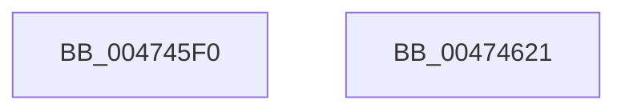

# PsAssignThreadId

- RVA: `0x004745F0`–`0x00474622` (길이 `50` bytes)
- VA: `0x00000001404745F0`
- 실행 섹션: `.text`
- PDB 이름 있음: `예`; PDB Function 태그: `아니요`
- unwind 정보 RVA: `0x0005CF00`
- 디코드: `15`개 명령, `50/50` bytes 표시
- 미해석 바이트: `0` (있으면 어셈블리에 `.byte`로 보존)

> 이 문서는 커널 이미지의 기계어와 PDB 기호를 분석해 생성했습니다. 4번과 5번은 함수 원형과 자료형을 바이너리 사용 방식에서 추정한 C 해석이며 원본 소스 복구 결과는 아닙니다.

## 1. Dependencies

- 직접 호출 지점: **1**; 고유 호출 대상: **1**
- 직접 호출자로 확인된 함수: **3**
- RIP 상대 이미지 참조: **1**

### Outgoing calls
- `0x00474603` → [ExCreateHandle](../../page/A3/ExCreateHandle_function_00A304D4.md) (function, `0x00A304D4`)

### Direct callers
- [KiAllocateDpcDelegateThread](../5B/KiAllocateDpcDelegateThread_function_005B697C.md) at `0x005B69C6`
- [KiAllocateSmtIsolationThread](../5C/KiAllocateSmtIsolationThread_function_005C3F88.md) at `0x005C3FCC`
- [PspAllocateThread](../../page/9E/PspAllocateThread_function_009EF72C.md) at `0x009EFC59`

### Static image references
- `0x004745FC` → RVA `0x00FC6CA8` (`ALMOSTRO`; read)

## 2. Other-region calls and transfers

- 다른 실행 섹션으로 향하는 call: **1**
  - `0x00474603` → [ExCreateHandle](../../page/A3/ExCreateHandle_function_00A304D4.md) (`.text` → `PAGE`)
- 별도 외부 분기/꼬리 이동을 확인하지 못했습니다.

## 3. Assembly (complete function range)

```asm
004745F0  40 53                           push rbx
004745F2  48 83 EC 20                     sub rsp, 0x20
004745F6  48 8B D9                        mov rbx, rcx
004745F9  48 8B D1                        mov rdx, rcx
004745FC  48 8B 0D A5 26 B5 00            mov rcx, qword ptr [rip + 0xb526a5]
00474603  E8 CC BE 5B 00                  call 0x140a304d4
00474608  48 89 83 10 05 00 00            mov qword ptr [rbx + 0x510], rax
0047460F  48 F7 D8                        neg rax
00474612  1B C0                           sbb eax, eax
00474614  F7 D0                           not eax
00474616  25 9A 00 00 C0                  and eax, 0xc000009a
0047461B  48 83 C4 20                     add rsp, 0x20
0047461F  5B                              pop rbx
00474620  C3                              ret
00474621  CC                              int3
```

## 4. C-style interpretation (structured pseudocode)

```c
__int64 __fastcall PsAssignThreadId(__int64 a1)
{
    __int64 result;
    __int64 v_rsp;

    v_rsp = (v_rsp) - (32);
    result = ExCreateHandle(*(unsigned __int64 *)(v_rip + 11871909), a1, a3, a4);
    *(unsigned __int64 *)(a1 + 1296) = result;
    result = -(result);
    result = (unsigned int)(~(result));
    result = (unsigned int)((result) & (0xC000009AULL));
    v_rsp = (v_rsp) + (32);
    return result;
}
```

## 5. (Beta) C Style

```c
int64_t PsAssignThreadId(void *Arg1)
{
    uint8_t *arg1 = (uint8_t *)Arg1;

    int64_t result;
    int64_t local_rsp;

    local_rsp = (local_rsp) - (32);
    result = ExCreateHandle(*(uint64_t *)(v_rip + 0xB526A5), Arg1, a3, a4);
    *(uint64_t *)(arg1 + 0x510) = result;
    result = -(result);
    result = (uint32_t)(~(result));
    result = (uint32_t)((result) & (0xC000009AULL));
    local_rsp = (local_rsp) + (32);
    return result;
}
```

### 관측된 메모리 오프셋

구조체 형식이 확인되지 않은 접근은 인자 기준의 오프셋으로만 기록했습니다.

| 기준 인자 | 오프셋 표현 | 폭 (bit) | 접근 |
|---|---:|---:|---|
| `Arg1` | `+ 0x510` | `64` | `W` |

## 6. Execution-region graph

[열기: 2D/3D 그래프와 함수 탐색 컨트롤 패널](../../../control-panel.html?section=text&rva=0x004745F0&view=graph)

- 2D 그래프는 위에서 아래로 흐르고, 3D 그래프는 빈 공간을 드래그해 회전합니다. Shift+드래그는 이동, 휠은 확대·축소, 함수 노드 선택은 대상 보고서 이동입니다.

### Static fallback


