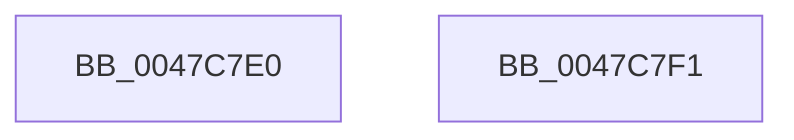

# PsGetCurrentThreadProcess

- RVA: `0x0047C7E0`–`0x0047C7F2` (길이 `18` bytes)
- VA: `0x000000014047C7E0`
- 실행 섹션: `.text`
- PDB 이름 있음: `예`; PDB Function 태그: `아니요`
- unwind 정보 RVA: `0x000DB714`
- 디코드: `4`개 명령, `18/18` bytes 표시
- 미해석 바이트: `0` (있으면 어셈블리에 `.byte`로 보존)

> 이 문서는 커널 이미지의 기계어와 PDB 기호를 분석해 생성했습니다. 4번과 5번은 함수 원형과 자료형을 바이너리 사용 방식에서 추정한 C 해석이며 원본 소스 복구 결과는 아닙니다.

## 1. Dependencies

- 직접 호출 지점: **0**; 고유 호출 대상: **0**
- 직접 호출자로 확인된 함수: **27**
- RIP 상대 이미지 참조: **0**

### Outgoing calls
- 직접 디코드된 call 명령이 없습니다.

### Direct callers
- [NtAlertMultipleThreadByThreadId](../../page/78/NtAlertMultipleThreadByThreadId_function_00789650.md) at `0x007896B1`
- [SeAdtRegistryValueChangedAuditAlarm](../../page/79/SeAdtRegistryValueChangedAuditAlarm_function_0079DDD4.md) at `0x0079E0FD`
- [SeAuditFipsCryptoSelftests](../../page/79/SeAuditFipsCryptoSelftests_function_0079E820.md) at `0x0079E8F3`
- [SeAuditSystemTimeChange](../../page/79/SeAuditSystemTimeChange_function_0079EB8C.md) at `0x0079EBFF`
- [SeAuditTransactionStateChange](../../page/79/SeAuditTransactionStateChange_function_0079ED50.md) at `0x0079EE49`
- [SeAuditTransactionStateChange](../../page/79/SeAuditTransactionStateChange_function_0079ED50.md) at `0x0079EEFC`
- [SepAuditAssignPrimaryToken](../../page/79/SepAuditAssignPrimaryToken_function_0079F828.md) at `0x0079F890`
- [CmpDoAccessCheckOnKCB](../../page/7E/CmpDoAccessCheckOnKCB_function_007EB348.md) at `0x007EB41D`
- [CmpReportAuditVirtualizationEvent](../../page/7E/CmpReportAuditVirtualizationEvent_function_007ED758.md) at `0x007ED916`
- [CmQueryKey](../../page/85/CmQueryKey_function_00858240.md) at `0x008585F3`
- [SepAdtCloseObjectAuditAlarm](../../page/86/SepAdtCloseObjectAuditAlarm_function_0086B4E8.md) at `0x0086B598`
- [SepAdtPrivilegeObjectAuditAlarm](../../page/86/SepAdtPrivilegeObjectAuditAlarm_function_0086E3F0.md) at `0x0086E555`
- [CmpCheckOpenAccessOnKeyBody](../../page/87/CmpCheckOpenAccessOnKeyBody_function_00870000.md) at `0x00870770`
- [SepAdtPrivilegedServiceAuditAlarm](../../page/87/SepAdtPrivilegedServiceAuditAlarm_function_008714F0.md) at `0x00871626`
- [sub_008B4FCE](../../page/8B/Unknown_function_008B4FCE.md) at `0x008B4FCE`
- [SepAdtTokenRightAdjusted](../../page/90/SepAdtTokenRightAdjusted_function_0090445C.md) at `0x009045B1`
- [SepAdtSecurityDescriptorChangedAuditAlarm](../../page/91/SepAdtSecurityDescriptorChangedAuditAlarm_function_0091E3E8.md) at `0x0091E444`
- [SepAdtDeleteObjectAuditAlarm](../../page/91/SepAdtDeleteObjectAuditAlarm_function_0091E824.md) at `0x0091E8B3`
- [SepAdtDeleteObjectAuditAlarm](../../page/91/SepAdtDeleteObjectAuditAlarm_function_0091E824.md) at `0x0091E9CB`
- [SeOperationAuditAlarm](../../page/91/SeOperationAuditAlarm_function_0091EA78.md) at `0x0091EB04`
- [SepAdtOpenObjectAuditAlarm](../../page/91/SepAdtOpenObjectAuditAlarm_function_0091F23C.md) at `0x0091F37E`
- [CmpCheckKeySecurityDescriptorAccess](../../page/94/CmpCheckKeySecurityDescriptorAccess_function_0094715C.md) at `0x009471DB`
- [CmpCheckExeOwnerForPca](../../page/9A/CmpCheckExeOwnerForPca_function_009A343C.md) at `0x009A3462`
- [PspSchedulerSharedDataRegionSlotAllocate](../../page/A2/PspSchedulerSharedDataRegionSlotAllocate_function_00A268C8.md) at `0x00A26919`
- [CmpPublishEventForPcaResolver](../../page/A6/CmpPublishEventForPcaResolver_function_00A66AC0.md) at `0x00A66B32`
- [PopDiagTracePowerSettingRegistration](../../page/AA/PopDiagTracePowerSettingRegistration_function_00AA2968.md) at `0x00AA2999`
- [PopDiagTracePolicyInitiatePowerActionApiCall](../../page/AC/PopDiagTracePolicyInitiatePowerActionApiCall_function_00AC139C.md) at `0x00AC13BF`
- [sub_00B16F66](../../page/B1/Unknown_function_00B16F66.md) at `0x00B17110`
- [sub_00B16F66](../../page/B1/Unknown_function_00B16F66.md) at `0x00B171F6`
- [sub_00B21E9E](../../page/B2/Unknown_function_00B21E9E.md) at `0x00B21E9E`

### Static image references
- 디코드된 RIP-relative 메모리 참조가 없습니다.

## 2. Other-region calls and transfers

- 다른 실행 섹션으로 향하는 call: **0**
- 별도 외부 분기/꼬리 이동을 확인하지 못했습니다.

## 3. Assembly (complete function range)

```asm
0047C7E0  65 48 8B 04 25 88 01 00 00      mov rax, qword ptr gs:[0x188]
0047C7E9  48 8B 80 20 02 00 00            mov rax, qword ptr [rax + 0x220]
0047C7F0  C3                              ret
0047C7F1  CC                              int3
```

## 4. C-style interpretation (structured pseudocode)

```c
__int64 __fastcall PsGetCurrentThreadProcess(void)
{
    return *(unsigned __int64 *)(*(unsigned __int64 *)(gs_base + (0 + 392)) + 544);
}
```

## 5. (Beta) C Style

```c
void PsGetCurrentThreadProcess(void)
{
    return *(uint64_t *)(*(uint64_t *)(gs_base + (0 + 0x188)) + 0x220);
}
```

## 6. Execution-region graph

[열기: 2D/3D 그래프와 함수 탐색 컨트롤 패널](../../../control-panel.html?section=text&rva=0x0047C7E0&view=graph)

- 2D 그래프는 위에서 아래로 흐르고, 3D 그래프는 빈 공간을 드래그해 회전합니다. Shift+드래그는 이동, 휠은 확대·축소, 함수 노드 선택은 대상 보고서 이동입니다.

### Static fallback


