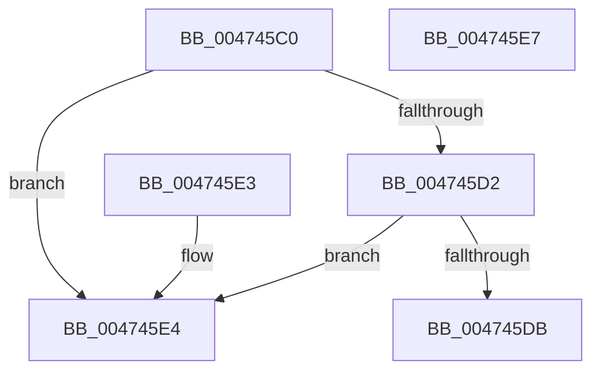

# PsGetCurrentThreadTeb

- RVA: `0x004745C0`–`0x004745E8` (길이 `40` bytes)
- VA: `0x00000001404745C0`
- 실행 섹션: `.text`
- PDB 이름 있음: `예`; PDB Function 태그: `아니요`
- unwind 정보 RVA: `0x000DB714`
- 디코드: `11`개 명령, `40/40` bytes 표시
- 미해석 바이트: `0` (있으면 어셈블리에 `.byte`로 보존)

> 이 문서는 커널 이미지의 기계어와 PDB 기호를 분석해 생성했습니다. 4번과 5번은 함수 원형과 자료형을 바이너리 사용 방식에서 추정한 C 해석이며 원본 소스 복구 결과는 아닙니다.

## 1. Dependencies

- 직접 호출 지점: **0**; 고유 호출 대상: **0**
- 직접 호출자로 확인된 함수: **2**
- RIP 상대 이미지 참조: **0**

### Outgoing calls
- 직접 디코드된 call 명령이 없습니다.

### Direct callers
- [EtwTraceThread](../../page/90/EtwTraceThread_function_00905700.md) at `0x009059B7`
- [EtwpPsProvTraceThread](../../page/9F/EtwpPsProvTraceThread_function_009FFE5C.md) at `0x009FFEBB`

### Static image references
- 디코드된 RIP-relative 메모리 참조가 없습니다.

## 2. Other-region calls and transfers

- 다른 실행 섹션으로 향하는 call: **0**
- 별도 외부 분기/꼬리 이동을 확인하지 못했습니다.

## 3. Assembly (complete function range)

```asm
004745C0  65 48 8B 0C 25 88 01 00 00      mov rcx, qword ptr gs:[0x188]
004745C9  F7 41 74 00 04 00 00            test dword ptr [rcx + 0x74], 0x400
004745D0  75 12                           jne 0x1404745e4
004745D2  80 B9 4A 02 00 00 01            cmp byte ptr [rcx + 0x24a], 1
004745D9  74 09                           je 0x1404745e4
004745DB  48 8B 81 F0 00 00 00            mov rax, qword ptr [rcx + 0xf0]
004745E2  C3                              ret
004745E3  CC                              int3
004745E4  33 C0                           xor eax, eax
004745E6  C3                              ret
004745E7  CC                              int3
```

## 4. C-style interpretation (structured pseudocode)

```c
__int64 __fastcall PsGetCurrentThreadTeb(void)
{
    __int64 result;

    if (((*(unsigned int *)(*(unsigned __int64 *)(gs_base + (0 + 392)) + 116)) & (0x400ULL)) != 0) goto loc_004745E4;
    if ((*(unsigned __int8 *)(*(unsigned __int64 *)(gs_base + (0 + 392)) + 586)) == 1) goto loc_004745E4;
    return *(unsigned __int64 *)(*(unsigned __int64 *)(gs_base + (0 + 392)) + 240);
loc_004745E4:
    result = 0;
    return result;
}
```

## 5. (Beta) C Style

```c
void PsGetCurrentThreadTeb(void)
{
    int64_t result;

    if (((*(uint32_t *)(*(uint64_t *)(gs_base + (0 + 0x188)) + 0x74)) & (0x400ULL)) != 0) goto loc_004745E4;
    if ((*(uint8_t *)(*(uint64_t *)(gs_base + (0 + 0x188)) + 0x24A)) == 1) goto loc_004745E4;
    return *(uint64_t *)(*(uint64_t *)(gs_base + (0 + 0x188)) + 0xF0);
loc_004745E4:
    result = 0;
    return result;
}
```

## 6. Execution-region graph

[열기: 2D/3D 그래프와 함수 탐색 컨트롤 패널](../../../control-panel.html?section=text&rva=0x004745C0&view=graph)

- 2D 그래프는 위에서 아래로 흐르고, 3D 그래프는 빈 공간을 드래그해 회전합니다. Shift+드래그는 이동, 휠은 확대·축소, 함수 노드 선택은 대상 보고서 이동입니다.

### Static fallback


