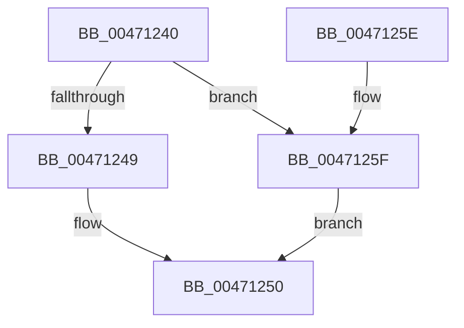

# PsGetSiloContext

- RVA: `0x00471240`–`0x00471268` (길이 `40` bytes)
- VA: `0x0000000140471240`
- 실행 섹션: `.text`
- PDB 이름 있음: `예`; PDB Function 태그: `아니요`
- unwind 정보 RVA: `0x0006EDE0`
- 디코드: `11`개 명령, `40/40` bytes 표시
- 미해석 바이트: `0` (있으면 어셈블리에 `.byte`로 보존)

> 이 문서는 커널 이미지의 기계어와 PDB 기호를 분석해 생성했습니다. 4번과 5번은 함수 원형과 자료형을 바이너리 사용 방식에서 추정한 C 해석이며 원본 소스 복구 결과는 아닙니다.

## 1. Dependencies

- 직접 호출 지점: **1**; 고유 호출 대상: **1**
- 직접 호출자로 확인된 함수: **0**
- RIP 상대 이미지 참조: **1**

### Outgoing calls
- `0x00471254` → [PspStorageGetObject](../../page/9F/PspStorageGetObject_function_009FC6F4.md) (function, `0x009FC6F4`)

### Direct callers
- 이 함수 시작 RVA로 연결되는 직접 call은 확인되지 않았습니다. 간접 호출은 완전히 역산할 수 없습니다.

### Static image references
- `0x0047125F` → RVA `0x00FCFE30` (`CACHEALI`; read)

## 2. Other-region calls and transfers

- 다른 실행 섹션으로 향하는 call: **1**
  - `0x00471254` → [PspStorageGetObject](../../page/9F/PspStorageGetObject_function_009FC6F4.md) (`.text` → `PAGE`)
- 별도 외부 분기/꼬리 이동을 확인하지 못했습니다.

## 3. Assembly (complete function range)

```asm
00471240  48 83 EC 28                     sub rsp, 0x28
00471244  48 85 C9                        test rcx, rcx
00471247  74 16                           je 0x14047125f
00471249  48 8B 89 00 06 00 00            mov rcx, qword ptr [rcx + 0x600]
00471250  49 83 20 00                     and qword ptr [r8], 0
00471254  E8 9B B4 58 00                  call 0x1409fc6f4
00471259  48 83 C4 28                     add rsp, 0x28
0047125D  C3                              ret
0047125E  CC                              int3
0047125F  48 8B 0D CA EB B5 00            mov rcx, qword ptr [rip + 0xb5ebca]
00471266  EB E8                           jmp 0x140471250
```

## 4. C-style interpretation (structured pseudocode)

```c
__int64 __fastcall PsGetSiloContext(__int64 a1, __int64 a2, __int64 a3)
{
    __int64 result;
    __int64 v_rsp;

    v_rsp = (v_rsp) - (40);
    if (a1 == 0) goto loc_0047125F;
loc_00471250:
    result = PspStorageGetObject(*(unsigned __int64 *)(a1 + 1536), a2, a3, a4);
    v_rsp = (v_rsp) + (40);
    return result;
loc_0047125F:
    goto loc_00471250;
}
```

## 5. (Beta) C Style

```c
int64_t PsGetSiloContext(int64_t Arg1, int64_t Arg2, void *Arg3)
{
    uint8_t *arg3 = (uint8_t *)Arg3;

    int64_t result;
    int64_t local_rsp;

    local_rsp = (local_rsp) - (40);
    if (Arg1 == 0) goto loc_0047125F;
loc_00471250:
    result = PspStorageGetObject(*(uint64_t *)(Arg1 + 0x600), Arg2, Arg3, a4);
    local_rsp = (local_rsp) + (40);
    return result;
loc_0047125F:
    goto loc_00471250;
}
```

### 관측된 메모리 오프셋

구조체 형식이 확인되지 않은 접근은 인자 기준의 오프셋으로만 기록했습니다.

| 기준 인자 | 오프셋 표현 | 폭 (bit) | 접근 |
|---|---:|---:|---|
| `Arg3` | `+ 0x0` | `64` | `R/W` |

## 6. Execution-region graph

[열기: 2D/3D 그래프와 함수 탐색 컨트롤 패널](../../../control-panel.html?section=text&rva=0x00471240&view=graph)

- 2D 그래프는 위에서 아래로 흐르고, 3D 그래프는 빈 공간을 드래그해 회전합니다. Shift+드래그는 이동, 휠은 확대·축소, 함수 노드 선택은 대상 보고서 이동입니다.

### Static fallback


