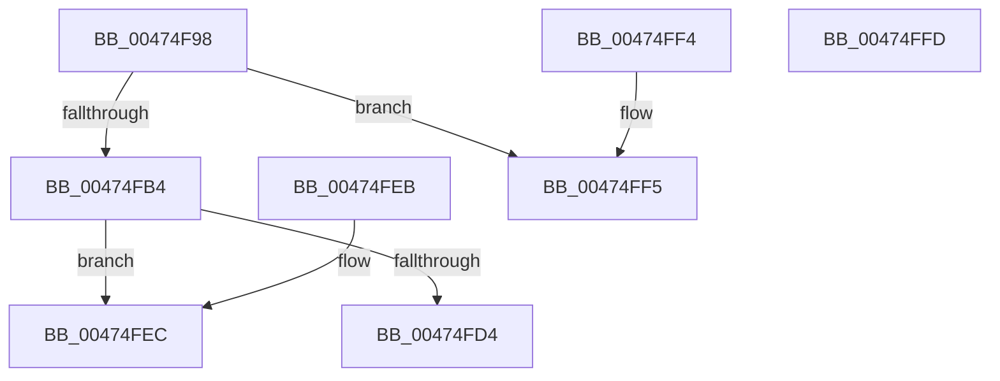

# PsSessionGetWin32Callouts

- RVA: `0x00474F98`–`0x00474FFE` (길이 `102` bytes)
- VA: `0x0000000140474F98`
- 실행 섹션: `.text`
- PDB 이름 있음: `예`; PDB Function 태그: `아니요`
- unwind 정보 RVA: `0x000DB714`
- 디코드: `22`개 명령, `102/102` bytes 표시
- 미해석 바이트: `0` (있으면 어셈블리에 `.byte`로 보존)

> 이 문서는 커널 이미지의 기계어와 PDB 기호를 분석해 생성했습니다. 4번과 5번은 함수 원형과 자료형을 바이너리 사용 방식에서 추정한 C 해석이며 원본 소스 복구 결과는 아닙니다.

## 1. Dependencies

- 직접 호출 지점: **0**; 고유 호출 대상: **0**
- 직접 호출자로 확인된 함수: **12**
- RIP 상대 이미지 참조: **2**

### Outgoing calls
- 직접 디코드된 call 명령이 없습니다.

### Direct callers
- [KeUserModeCallback](../../page/8E/KeUserModeCallback_function_008E8A00.md) at `0x008E8D31`
- [PfpQueryGpuUtilization](../../page/90/PfpQueryGpuUtilization_function_00903974.md) at `0x00903A2A`
- [PspExitLastThread](../../page/90/PspExitLastThread_function_00904184.md) at `0x00904387`
- [ExpWin32CloseProcedure](../../page/90/ExpWin32CloseProcedure_function_00904FA0.md) at `0x00905040`
- [ExpWin32OkayToCloseProcedure](../../page/90/ExpWin32OkayToCloseProcedure_function_009050A0.md) at `0x00905161`
- [ExpWin32DeleteProcedure](../../page/90/ExpWin32DeleteProcedure_function_009051E0.md) at `0x00905270`
- [ExpWin32OpenProcedure](../../page/90/ExpWin32OpenProcedure_function_009052D0.md) at `0x00905385`
- [ExpWin32ParseProcedure](../../page/90/ExpWin32ParseProcedure_function_00905400.md) at `0x00905487`
- [PspExitThread](../../page/90/PspExitThread_function_00905F60.md) at `0x0090623E`
- [sub_009133FC](../../page/91/Unknown_function_009133FC.md) at `0x00913406`
- [PsConvertToGuiThread](../../page/A2/PsConvertToGuiThread_function_00A2F8B0.md) at `0x00A2FA82`
- [PsConvertToGuiThread](../../page/A2/PsConvertToGuiThread_function_00A2F8B0.md) at `0x00A2FAD8`
- [PsApplyDeepFreezeOptimizations](../../page/AA/PsApplyDeepFreezeOptimizations_function_00AA9EDC.md) at `0x00AA9F45`

### Static image references
- `0x00474FD8` → RVA `0x00F05F10` (`.data`; read)
- `0x00474FDF` → RVA `0x00F05F08` (`.data`; read)

## 2. Other-region calls and transfers

- 다른 실행 섹션으로 향하는 call: **0**
- 별도 외부 분기/꼬리 이동을 확인하지 못했습니다.

## 3. Assembly (complete function range)

```asm
00474F98  65 48 8B 04 25 88 01 00 00      mov rax, qword ptr gs:[0x188]
00474FA1  48 8B 88 B8 00 00 00            mov rcx, qword ptr [rax + 0xb8]
00474FA8  F7 81 F4 01 00 00 00 00 01 00   test dword ptr [rcx + 0x1f4], 0x10000
00474FB2  74 41                           je 0x140474ff5
00474FB4  65 48 8B 04 25 88 01 00 00      mov rax, qword ptr gs:[0x188]
00474FBD  48 8B 88 B8 00 00 00            mov rcx, qword ptr [rax + 0xb8]
00474FC4  48 8B 81 E8 02 00 00            mov rax, qword ptr [rcx + 0x2e8]
00474FCB  48 8B 50 78                     mov rdx, qword ptr [rax + 0x78]
00474FCF  48 85 D2                        test rdx, rdx
00474FD2  74 18                           je 0x140474fec
00474FD4  48 83 FA 01                     cmp rdx, 1
00474FD8  48 8D 0D 31 0F A9 00            lea rcx, [rip + 0xa90f31]
00474FDF  48 8D 05 22 0F A9 00            lea rax, [rip + 0xa90f22]
00474FE6  48 0F 44 C1                     cmove rax, rcx
00474FEA  C3                              ret
00474FEB  CC                              int3
00474FEC  48 8D 05 1D 0F A9 00            lea rax, [rip + 0xa90f1d]
00474FF3  C3                              ret
00474FF4  CC                              int3
00474FF5  48 8D 05 0C 0F A9 00            lea rax, [rip + 0xa90f0c]
00474FFC  C3                              ret
00474FFD  CC                              int3
```

## 4. C-style interpretation (structured pseudocode)

```c
__int64 __fastcall PsSessionGetWin32Callouts(void)
{
    __int64 result;

    if (((*(unsigned int *)(*(unsigned __int64 *)(*(unsigned __int64 *)(gs_base + (0 + 392)) + 184) + 500)) & (0x10000ULL)) == 0) goto loc_00474FF5;
    if (*(unsigned __int64 *)(*(unsigned __int64 *)(*(unsigned __int64 *)(*(unsigned __int64 *)(gs_base + (0 + 392)) + 184) + 744) + 120) == 0) goto loc_00474FEC;
    result = v_rip + 11079458;
    if ((*(unsigned __int64 *)(*(unsigned __int64 *)(*(unsigned __int64 *)(*(unsigned __int64 *)(gs_base + (0 + 392)) + 184) + 744) + 120)) == 1) { result = v_rip + 11079473; }
    return result;
loc_00474FEC:
    return v_rip + 11079453;
loc_00474FF5:
    return v_rip + 11079436;
}
```

## 5. (Beta) C Style

```c
void PsSessionGetWin32Callouts(void)
{
    int64_t result;

    if (((*(uint32_t *)(*(uint64_t *)(*(uint64_t *)(gs_base + (0 + 0x188)) + 0xB8) + 0x1F4)) & (0x10000ULL)) == 0) goto loc_00474FF5;
    if (*(uint64_t *)(*(uint64_t *)(*(uint64_t *)(*(uint64_t *)(gs_base + (0 + 0x188)) + 0xB8) + 0x2E8) + 0x78) == 0) goto loc_00474FEC;
    result = v_rip + 11079458;
    if ((*(uint64_t *)(*(uint64_t *)(*(uint64_t *)(*(uint64_t *)(gs_base + (0 + 0x188)) + 0xB8) + 0x2E8) + 0x78)) == 1) { result = v_rip + 11079473; }
    return result;
loc_00474FEC:
    return v_rip + 11079453;
loc_00474FF5:
    return v_rip + 11079436;
}
```

## 6. Execution-region graph

[열기: 2D/3D 그래프와 함수 탐색 컨트롤 패널](../../../control-panel.html?section=text&rva=0x00474F98&view=graph)

- 2D 그래프는 위에서 아래로 흐르고, 3D 그래프는 빈 공간을 드래그해 회전합니다. Shift+드래그는 이동, 휠은 확대·축소, 함수 노드 선택은 대상 보고서 이동입니다.

### Static fallback


