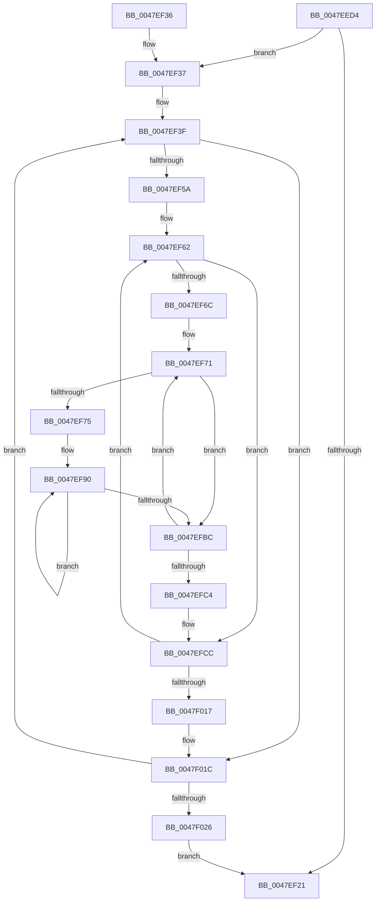

# RaspAntiAlias

- RVA: `0x0047EED4`–`0x0047F02B` (길이 `343` bytes)
- VA: `0x000000014047EED4`
- 실행 섹션: `.text`
- PDB 이름 있음: `예`; PDB Function 태그: `아니요`
- unwind 정보 RVA: `0x000AE07C`
- 디코드: `106`개 명령, `343/343` bytes 표시
- 미해석 바이트: `0` (있으면 어셈블리에 `.byte`로 보존)

> 이 문서는 커널 이미지의 기계어와 PDB 기호를 분석해 생성했습니다. 4번과 5번은 함수 원형과 자료형을 바이너리 사용 방식에서 추정한 C 해석이며 원본 소스 복구 결과는 아닙니다.

## 1. Dependencies

- 직접 호출 지점: **2**; 고유 호출 대상: **2**
- 직접 호출자로 확인된 함수: **1**
- RIP 상대 이미지 참조: **0**

### Outgoing calls
- `0x0047EF18` → [BgpGxFillRectangle](BgpGxFillRectangle_function_0047F808.md) (function, `0x0047F808`)
- `0x0047EFE0` → [BgpGxBlendColor](BgpGxBlendColor_function_0047F034.md) (function, `0x0047F034`)

### Direct callers
- [BgpRasPrintGlyph](BgpRasPrintGlyph_function_0047F3B4.md) at `0x0047F720`

### Static image references
- 디코드된 RIP-relative 메모리 참조가 없습니다.

## 2. Other-region calls and transfers

- 다른 실행 섹션으로 향하는 call: **0**
- 별도 외부 분기/꼬리 이동을 확인하지 못했습니다.

## 3. Assembly (complete function range)

```asm
0047EED4  48 89 5C 24 18                  mov qword ptr [rsp + 0x18], rbx
0047EED9  48 89 54 24 10                  mov qword ptr [rsp + 0x10], rdx
0047EEDE  55                              push rbp
0047EEDF  56                              push rsi
0047EEE0  57                              push rdi
0047EEE1  41 54                           push r12
0047EEE3  41 55                           push r13
0047EEE5  41 56                           push r14
0047EEE7  41 57                           push r15
0047EEE9  48 83 EC 20                     sub rsp, 0x20
0047EEED  48 8B 41 18                     mov rax, qword ptr [rcx + 0x18]
0047EEF1  48 8B F2                        mov rsi, rdx
0047EEF4  48 8B 94 24 80 00 00 00         mov rdx, qword ptr [rsp + 0x80]
0047EEFC  45 8B E0                        mov r12d, r8d
0047EEFF  4C 8B F9                        mov r15, rcx
0047EF02  41 8B E8                        mov ebp, r8d
0047EF05  48 8B CE                        mov rcx, rsi
0047EF08  48 89 44 24 60                  mov qword ptr [rsp + 0x60], rax
0047EF0D  41 8B D9                        mov ebx, r9d
0047EF10  45 0F AF E1                     imul r12d, r9d
0047EF14  8B 12                           mov edx, dword ptr [rdx]
0047EF16  33 FF                           xor edi, edi
0047EF18  E8 EB 08 00 00                  call 0x14047f808
0047EF1D  39 3E                           cmp dword ptr [rsi], edi
0047EF1F  77 16                           ja 0x14047ef37
0047EF21  48 8B 5C 24 70                  mov rbx, qword ptr [rsp + 0x70]
0047EF26  48 83 C4 20                     add rsp, 0x20
0047EF2A  41 5F                           pop r15
0047EF2C  41 5E                           pop r14
0047EF2E  41 5D                           pop r13
0047EF30  41 5C                           pop r12
0047EF32  5F                              pop rdi
0047EF33  5E                              pop rsi
0047EF34  5D                              pop rbp
0047EF35  C3                              ret
0047EF36  CC                              int3
0047EF37  41 8B 47 04                     mov eax, dword ptr [r15 + 4]
0047EF3B  33 D2                           xor edx, edx
0047EF3D  F7 F3                           div ebx
0047EF3F  44 8B F7                        mov r14d, edi
0047EF42  45 33 ED                        xor r13d, r13d
0047EF45  44 0F AF 76 04                  imul r14d, dword ptr [rsi + 4]
0047EF4A  41 C1 E6 02                     shl r14d, 2
0047EF4E  4C 03 76 18                     add r14, qword ptr [rsi + 0x18]
0047EF52  85 C0                           test eax, eax
0047EF54  0F 84 C2 00 00 00               je 0x14047f01c
0047EF5A  48 8B B4 24 80 00 00 00         mov rsi, qword ptr [rsp + 0x80]
0047EF62  45 33 D2                        xor r10d, r10d
0047EF65  45 33 C9                        xor r9d, r9d
0047EF68  85 DB                           test ebx, ebx
0047EF6A  74 60                           je 0x14047efcc
0047EF6C  48 8B 74 24 60                  mov rsi, qword ptr [rsp + 0x60]
0047EF71  85 ED                           test ebp, ebp
0047EF73  74 47                           je 0x14047efbc
0047EF75  44 8B C7                        mov r8d, edi
0047EF78  41 8B C5                        mov eax, r13d
0047EF7B  44 0F AF C3                     imul r8d, ebx
0047EF7F  4C 8B DD                        mov r11, rbp
0047EF82  0F AF C5                        imul eax, ebp
0047EF85  45 03 C1                        add r8d, r9d
0047EF88  45 0F AF 47 04                  imul r8d, dword ptr [r15 + 4]
0047EF8D  44 03 C0                        add r8d, eax
0047EF90  41 8B C0                        mov eax, r8d
0047EF93  BA 80 00 00 00                  mov edx, 0x80
0047EF98  48 C1 E8 03                     shr rax, 3
0047EF9C  41 0F B6 C8                     movzx ecx, r8b
0047EFA0  83 E1 07                        and ecx, 7
0047EFA3  D3 FA                           sar edx, cl
0047EFA5  84 14 30                        test byte ptr [rax + rsi], dl
0047EFA8  41 8D 42 01                     lea eax, [r10 + 1]
0047EFAC  41 0F 44 C2                     cmove eax, r10d
0047EFB0  41 FF C0                        inc r8d
0047EFB3  44 8B D0                        mov r10d, eax
0047EFB6  49 83 EB 01                     sub r11, 1
0047EFBA  75 D4                           jne 0x14047ef90
0047EFBC  41 FF C1                        inc r9d
0047EFBF  44 3B CB                        cmp r9d, ebx
0047EFC2  72 AD                           jb 0x14047ef71
0047EFC4  48 8B B4 24 80 00 00 00         mov rsi, qword ptr [rsp + 0x80]
0047EFCC  8B 0E                           mov ecx, dword ptr [rsi]
0047EFCE  33 D2                           xor edx, edx
0047EFD0  41 69 C2 FF 00 00 00            imul eax, r10d, 0xff
0047EFD7  41 F7 F4                        div r12d
0047EFDA  8B 56 04                        mov edx, dword ptr [rsi + 4]
0047EFDD  44 8B C0                        mov r8d, eax
0047EFE0  E8 4F 00 00 00                  call 0x14047f034
0047EFE5  8B C8                           mov ecx, eax
0047EFE7  41 88 06                        mov byte ptr [r14], al
0047EFEA  C1 E9 10                        shr ecx, 0x10
0047EFED  33 D2                           xor edx, edx
0047EFEF  41 88 4E 02                     mov byte ptr [r14 + 2], cl
0047EFF3  41 FF C5                        inc r13d
0047EFF6  8B C8                           mov ecx, eax
0047EFF8  41 C6 46 03 FF                  mov byte ptr [r14 + 3], 0xff
0047EFFD  C1 E9 08                        shr ecx, 8
0047F000  41 88 4E 01                     mov byte ptr [r14 + 1], cl
0047F004  49 83 C6 04                     add r14, 4
0047F008  41 8B 47 04                     mov eax, dword ptr [r15 + 4]
0047F00C  F7 F3                           div ebx
0047F00E  44 3B E8                        cmp r13d, eax
0047F011  0F 82 4B FF FF FF               jb 0x14047ef62
0047F017  48 8B 74 24 68                  mov rsi, qword ptr [rsp + 0x68]
0047F01C  FF C7                           inc edi
0047F01E  3B 3E                           cmp edi, dword ptr [rsi]
0047F020  0F 82 19 FF FF FF               jb 0x14047ef3f
0047F026  E9 F6 FE FF FF                  jmp 0x14047ef21
```

## 4. C-style interpretation (structured pseudocode)

```c
__int64 __fastcall RaspAntiAlias(__int64 a1, __int64 a2, int a3, int a4, __int64 a5)
{
    __int64 result;
    __int64 v_r10;
    __int64 v_r11;
    __int64 v_r12;
    __int64 v_r13;
    __int64 v_r14;
    __int64 v_rdi;
    __int64 v_rsp;
    unsigned __int64 v_stack_p10;
    unsigned __int64 v_stack_p18;
    unsigned __int64 v_stack_p60;
    unsigned __int64 v_stack_p68;
    unsigned __int64 v_stack_p8;

    v_stack_p18 = v_rbx;
    v_stack_p10 = a2;
    v_rsp = (v_rsp) - (32);
    v_stack_p8 = *(unsigned __int64 *)(a1 + 24);
    v_r12 = (unsigned int)(((unsigned int)(a3)) * (a4));
    v_rdi = 0;
    result = BgpGxFillRectangle(a2, (unsigned int)(*(unsigned int *)(a5)), a3, a4);
    if ((*(unsigned int *)(a2)) > 0) goto loc_0047EF37;
loc_0047EF21:
    v_rsp = (v_rsp) + (32);
    return result;
loc_0047EF37:
    a2 = 0;
loc_0047EF3F:
    v_r13 = 0;
    v_r14 = (unsigned int)((0) * (*(unsigned int *)(a2 + 4)));
    v_r14 = (unsigned int)((v_r14) << (2));
    v_r14 = (v_r14) + (*(unsigned __int64 *)(a2 + 24));
    if ((unsigned int)((unsigned int)(*(unsigned int *)(a1 + 4))) == 0) goto loc_0047F01C;
loc_0047EF62:
    v_r10 = 0;
    a4 = 0;
    if ((unsigned int)(v_stack_p18) == 0) goto loc_0047EFCC;
loc_0047EF71:
    if ((unsigned int)((unsigned int)(a3)) == 0) goto loc_0047EFBC;
    a3 = (unsigned int)((0) * ((unsigned int)(v_stack_p18)));
    result = (unsigned int)((0) * ((unsigned int)((unsigned int)(a3))));
    a3 = (unsigned int)((a3) + (0));
    a3 = (unsigned int)((a3) * (*(unsigned int *)(a1 + 4)));
    a3 = (unsigned int)((a3) + ((unsigned int)(result)));
loc_0047EF90:
    result = ((unsigned int)(a3)) >> (3);
    a1 = (unsigned int)(((unsigned __int8)(a3)) & (7));
    a2 = (unsigned int)((128) >> ((unsigned __int8)(a1)));
    result = v_r10 + 1;
    if (((*(unsigned __int8 *)(result + v_stack_p60 * 1)) & ((unsigned __int8)(a2))) == 0) { result = 0; }
    a3 = (unsigned int)((a3) + 1);
    v_r11 = ((unsigned int)(a3)) - (1);
    if (condition_is_not_equal) goto loc_0047EF90;
loc_0047EFBC:
    a4 = (unsigned int)((a4) + 1);
    if (a4 < ((unsigned int)(v_stack_p18))) goto loc_0047EF71;
loc_0047EFCC:
    a2 = 0;
    result = (unsigned int)((result) * ((unsigned int)((unsigned int)((unsigned int)(result)))));
    result = BgpGxBlendColor((unsigned int)(*(unsigned int *)(a5)), (unsigned int)(*(unsigned int *)(a5 + 4)), (unsigned int)((unsigned int)(result)), a4);
    *(unsigned __int8 *)(v_r14) = (unsigned __int8)(result);
    a1 = (unsigned int)(((unsigned int)((unsigned int)(result))) >> (16));
    a2 = 0;
    *(unsigned __int8 *)(v_r14 + 2) = (unsigned __int8)(a1);
    v_r13 = (unsigned int)((v_r13) + 1);
    *(unsigned __int8 *)(v_r14 + 3) = 255;
    a1 = (unsigned int)(((unsigned int)((unsigned int)(result))) >> (8));
    *(unsigned __int8 *)(v_r14 + 1) = (unsigned __int8)(a1);
    v_r14 = (v_r14) + (4);
    if (((unsigned int)(v_r13)) < ((unsigned int)((unsigned int)(*(unsigned int *)(a1 + 4))))) goto loc_0047EF62;
loc_0047F01C:
    v_rdi = (unsigned int)((v_rdi) + 1);
    if (((unsigned int)(v_rdi)) < (*(unsigned int *)(v_stack_p68))) goto loc_0047EF3F;
    goto loc_0047EF21;
}
```

## 5. (Beta) C Style

```c
int64_t RaspAntiAlias(void *Arg1, void *Arg2, int32_t Arg3, int32_t Arg4, void *Arg5)
{
    uint8_t *arg1 = (uint8_t *)Arg1;
    uint8_t *arg2 = (uint8_t *)Arg2;
    uint8_t *arg5 = (uint8_t *)Arg5;

    int64_t result;
    int64_t local_r10;
    int64_t local_r11;
    int64_t local_r12;
    int64_t local_r13;
    int64_t local_r14;
    int64_t local_rdi;
    int64_t local_rsp;
    uint64_t v_stack_p10;
    uint64_t v_stack_p18;
    uint64_t v_stack_p60;
    uint64_t v_stack_p68;
    uint64_t v_stack_p8;

    v_stack_p18 = local_rbx;
    v_stack_p10 = Arg2;
    local_rsp = (local_rsp) - (32);
    v_stack_p8 = *(uint64_t *)(arg1 + 0x18);
    local_r12 = (uint32_t)(((uint32_t)(Arg3)) * (Arg4));
    local_rdi = 0;
    result = BgpGxFillRectangle(Arg2, (uint32_t)(*(uint32_t *)(arg5)), Arg3, Arg4);
    if ((*(uint32_t *)(arg2)) > 0) goto loc_0047EF37;
loc_0047EF21:
    local_rsp = (local_rsp) + (32);
    return result;
loc_0047EF37:
    Arg2 = 0;
loc_0047EF3F:
    local_r13 = 0;
    local_r14 = (uint32_t)((0) * (*(uint32_t *)(arg2 + 0x4)));
    local_r14 = (uint32_t)((local_r14) << (2));
    local_r14 = (local_r14) + (*(uint64_t *)(arg2 + 0x18));
    if ((uint32_t)((uint32_t)(*(uint32_t *)(arg1 + 0x4))) == 0) goto loc_0047F01C;
loc_0047EF62:
    local_r10 = 0;
    Arg4 = 0;
    if ((uint32_t)(v_stack_p18) == 0) goto loc_0047EFCC;
loc_0047EF71:
    if ((uint32_t)((uint32_t)(Arg3)) == 0) goto loc_0047EFBC;
    Arg3 = (uint32_t)((0) * ((uint32_t)(v_stack_p18)));
    result = (uint32_t)((0) * ((uint32_t)((uint32_t)(Arg3))));
    Arg3 = (uint32_t)((Arg3) + (0));
    Arg3 = (uint32_t)((Arg3) * (*(uint32_t *)(arg1 + 0x4)));
    Arg3 = (uint32_t)((Arg3) + ((uint32_t)(result)));
loc_0047EF90:
    result = ((uint32_t)(Arg3)) >> (3);
    Arg1 = (uint32_t)(((uint8_t)(Arg3)) & (7));
    Arg2 = (uint32_t)((128) >> ((uint8_t)(Arg1)));
    result = local_r10 + 1;
    if (((*(uint8_t *)(result + v_stack_p60 * 1)) & ((uint8_t)(Arg2))) == 0) { result = 0; }
    Arg3 = (uint32_t)((Arg3) + 1);
    local_r11 = ((uint32_t)(Arg3)) - (1);
    if (condition_is_not_equal) goto loc_0047EF90;
loc_0047EFBC:
    Arg4 = (uint32_t)((Arg4) + 1);
    if (Arg4 < ((uint32_t)(v_stack_p18))) goto loc_0047EF71;
loc_0047EFCC:
    Arg2 = 0;
    result = (uint32_t)((result) * ((uint32_t)((uint32_t)((uint32_t)(result)))));
    result = BgpGxBlendColor((uint32_t)(*(uint32_t *)(arg5)), (uint32_t)(*(uint32_t *)(arg5 + 0x4)), (uint32_t)((uint32_t)(result)), Arg4);
    *(uint8_t *)(local_r14) = (uint8_t)(result);
    Arg1 = (uint32_t)(((uint32_t)((uint32_t)(result))) >> (16));
    Arg2 = 0;
    *(uint8_t *)(local_r14 + 0x2) = (uint8_t)(Arg1);
    local_r13 = (uint32_t)((local_r13) + 1);
    *(uint8_t *)(local_r14 + 0x3) = 255;
    Arg1 = (uint32_t)(((uint32_t)((uint32_t)(result))) >> (8));
    *(uint8_t *)(local_r14 + 0x1) = (uint8_t)(Arg1);
    local_r14 = (local_r14) + (4);
    if (((uint32_t)(local_r13)) < ((uint32_t)((uint32_t)(*(uint32_t *)(arg1 + 0x4))))) goto loc_0047EF62;
loc_0047F01C:
    local_rdi = (uint32_t)((local_rdi) + 1);
    if (((uint32_t)(local_rdi)) < (*(uint32_t *)(v_stack_p68))) goto loc_0047EF3F;
    goto loc_0047EF21;
}
```

### 관측된 메모리 오프셋

구조체 형식이 확인되지 않은 접근은 인자 기준의 오프셋으로만 기록했습니다.

| 기준 인자 | 오프셋 표현 | 폭 (bit) | 접근 |
|---|---:|---:|---|
| `Arg1` | `+ 0x4` | `32` | `R` |
| `Arg1` | `+ 0x18` | `64` | `R` |
| `Arg2` | `+ 0x0` | `32` | `R` |
| `Arg5` | `+ 0x0` | `32` | `R` |
| `Arg5` | `+ 0x4` | `32` | `R` |

## 6. Execution-region graph

[열기: 2D/3D 그래프와 함수 탐색 컨트롤 패널](../../../control-panel.html?section=text&rva=0x0047EED4&view=graph)

- 2D 그래프는 위에서 아래로 흐르고, 3D 그래프는 빈 공간을 드래그해 회전합니다. Shift+드래그는 이동, 휠은 확대·축소, 함수 노드 선택은 대상 보고서 이동입니다.

### Static fallback


