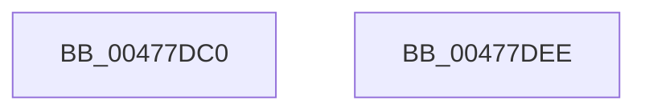

# RtlClearAllBitsEx

- RVA: `0x00477DC0`–`0x00477DEF` (길이 `47` bytes)
- VA: `0x0000000140477DC0`
- 실행 섹션: `.text`
- PDB 이름 있음: `예`; PDB Function 태그: `아니요`
- unwind 정보 RVA: `0x0005C788`
- 디코드: `14`개 명령, `47/47` bytes 표시
- 미해석 바이트: `0` (있으면 어셈블리에 `.byte`로 보존)

> 이 문서는 커널 이미지의 기계어와 PDB 기호를 분석해 생성했습니다. 4번과 5번은 함수 원형과 자료형을 바이너리 사용 방식에서 추정한 C 해석이며 원본 소스 복구 결과는 아닙니다.

## 1. Dependencies

- 직접 호출 지점: **1**; 고유 호출 대상: **1**
- 직접 호출자로 확인된 함수: **3**
- RIP 상대 이미지 참조: **0**

### Outgoing calls
- `0x00477DE4` → [memset](../6C/memset_function_006C6C40.md) (function, `0x006C6C40`)

### Direct callers
- [MiIdentifyPatchImageDataPages](../../page/80/MiIdentifyPatchImageDataPages_function_00803EBC.md) at `0x00803F81`
- [MiUpdateCfgSystemWideBitmapWorker](../../page/8C/MiUpdateCfgSystemWideBitmapWorker_function_008CE650.md) at `0x008CE7E4`
- [MiCopyToCfgBitMap](../../page/8D/MiCopyToCfgBitMap_function_008D1140.md) at `0x008D1362`

### Static image references
- 디코드된 RIP-relative 메모리 참조가 없습니다.

## 2. Other-region calls and transfers

- 다른 실행 섹션으로 향하는 call: **0**
- 별도 외부 분기/꼬리 이동을 확인하지 못했습니다.

## 3. Assembly (complete function range)

```asm
00477DC0  48 83 EC 28                     sub rsp, 0x28
00477DC4  48 8B 01                        mov rax, qword ptr [rcx]
00477DC7  41 B8 00 00 00 00               mov r8d, 0
00477DCD  48 8B 49 08                     mov rcx, qword ptr [rcx + 8]
00477DD1  A8 1F                           test al, 0x1f
00477DD3  41 0F 95 C0                     setne r8b
00477DD7  48 C1 E8 05                     shr rax, 5
00477DDB  4C 03 C0                        add r8, rax
00477DDE  33 D2                           xor edx, edx
00477DE0  49 C1 E0 02                     shl r8, 2
00477DE4  E8 57 EE 24 00                  call 0x1406c6c40
00477DE9  48 83 C4 28                     add rsp, 0x28
00477DED  C3                              ret
00477DEE  CC                              int3
```

## 4. C-style interpretation (structured pseudocode)

```c
__int64 __fastcall RtlClearAllBitsEx(__int64 a1, int a2)
{
    __int64 result;
    __int64 v_rsp;

    v_rsp = (v_rsp) - (40);
    a3 = ((((unsigned __int8)(*(unsigned __int64 *)(a1))) & (31)) != 0) ? 1 : 0;
    result = (*(unsigned __int64 *)(a1)) >> (5);
    a3 = (a3) + (result);
    a2 = 0;
    a3 = (a3) << (2);
    result = memset(*(unsigned __int64 *)(a1 + 8), a2, a3, a4);
    v_rsp = (v_rsp) + (40);
    return result;
}
```

## 5. (Beta) C Style

```c
int64_t RtlClearAllBitsEx(void *Arg1, int32_t Arg2)
{
    uint8_t *arg1 = (uint8_t *)Arg1;

    int64_t result;
    int64_t local_rsp;

    local_rsp = (local_rsp) - (40);
    a3 = ((((uint8_t)(*(uint64_t *)(arg1))) & (31)) != 0) ? 1 : 0;
    result = (*(uint64_t *)(arg1)) >> (5);
    a3 = (a3) + (result);
    Arg2 = 0;
    a3 = (a3) << (2);
    result = memset(*(uint64_t *)(arg1 + 0x8), Arg2, a3, a4);
    local_rsp = (local_rsp) + (40);
    return result;
}
```

### 관측된 메모리 오프셋

구조체 형식이 확인되지 않은 접근은 인자 기준의 오프셋으로만 기록했습니다.

| 기준 인자 | 오프셋 표현 | 폭 (bit) | 접근 |
|---|---:|---:|---|
| `Arg1` | `+ 0x0` | `64` | `R` |
| `Arg1` | `+ 0x8` | `64` | `R` |

## 6. Execution-region graph

[열기: 2D/3D 그래프와 함수 탐색 컨트롤 패널](../../../control-panel.html?section=text&rva=0x00477DC0&view=graph)

- 2D 그래프는 위에서 아래로 흐르고, 3D 그래프는 빈 공간을 드래그해 회전합니다. Shift+드래그는 이동, 휠은 확대·축소, 함수 노드 선택은 대상 보고서 이동입니다.

### Static fallback


