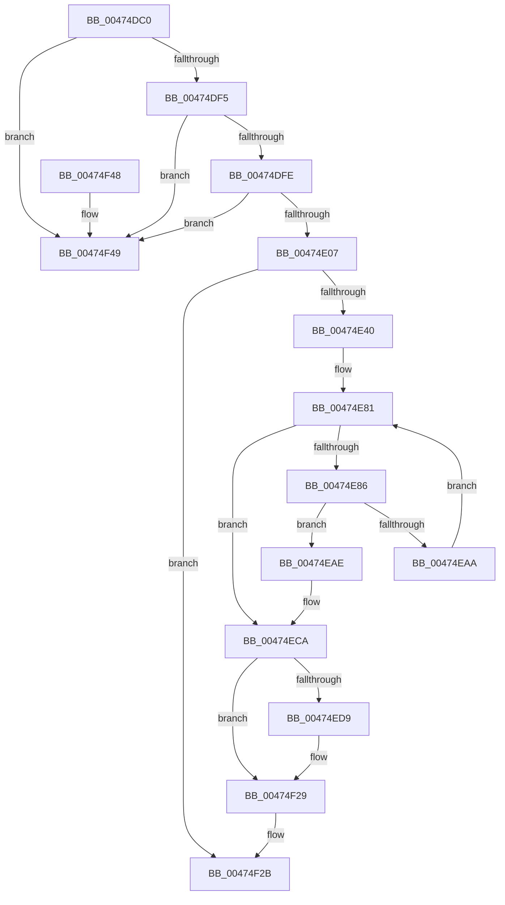

# RtlDeriveCapabilitySidsFromName

- RVA: `0x00474DC0`–`0x00474F50` (길이 `400` bytes)
- VA: `0x0000000140474DC0`
- 실행 섹션: `.text`
- PDB 이름 있음: `예`; PDB Function 태그: `아니요`
- unwind 정보 RVA: `0x000ACA84`
- 디코드: `103`개 명령, `400/400` bytes 표시
- 미해석 바이트: `0` (있으면 어셈블리에 `.byte`로 보존)

> 이 문서는 커널 이미지의 기계어와 PDB 기호를 분석해 생성했습니다. 4번과 5번은 함수 원형과 자료형을 바이너리 사용 방식에서 추정한 C 해석이며 원본 소스 복구 결과는 아닙니다.

## 1. Dependencies

- 직접 호출 지점: **9**; 고유 호출 대상: **7**
- 직접 호출자로 확인된 함수: **6**
- RIP 상대 이미지 참조: **5**

### Outgoing calls
- `0x00474E33` → [RtlUpcaseUnicodeString](../../page/96/RtlUpcaseUnicodeString_function_00960780.md) (function, `0x00960780`)
- `0x00474E4F` → [SymCryptSha256](../51/SymCryptSha256_function_0051CA8C.md) (function, `0x0051CA8C`)
- `0x00474E61` → [RtlInitializeSid](../../page/9E/RtlInitializeSid_function_009EB720.md) (function, `0x009EB720`)
- `0x00474EA1` → [RtlEqualUnicodeString](../../page/93/RtlEqualUnicodeString_function_00932A20.md) (function, `0x00932A20`)
- `0x00474EBB` → [RtlInitializeSid](../../page/9E/RtlInitializeSid_function_009EB720.md) (function, `0x009EB720`)
- `0x00474ECF` → [RtlFreeAnsiString](../../page/9C/RtlFreeAnsiString_function_009C0800.md) (function, `0x009C0800`)
- `0x00474EE6` → [RtlInitializeSid](../../page/9E/RtlInitializeSid_function_009EB720.md) (function, `0x009EB720`)
- `0x00474EFF` → [RtlPrefixUnicodeString](../../page/8F/RtlPrefixUnicodeString_function_008F4F70.md) (function, `0x008F4F70`)
- `0x00474F33` → [_security_check_cookie](../6A/_security_check_cookie_function_006AC640.md) (function, `0x006AC640`)

### Direct callers
- [DbgkpCreateNotificationEvent](../../page/71/DbgkpCreateNotificationEvent_function_00710480.md) at `0x007104F7`
- [CmpHiveRootSecurityDescriptor](../../page/7E/CmpHiveRootSecurityDescriptor_function_007ED104.md) at `0x007ED2F2`
- [PopCreateNotificationName](../../page/91/PopCreateNotificationName_function_009121E8.md) at `0x009122C4`
- [PiUEventInitClientRegistrationContext](../../page/91/PiUEventInitClientRegistrationContext_function_00916A54.md) at `0x00916B3E`
- [RtlCapabilityCheck](../../page/A2/RtlCapabilityCheck_function_00A20340.md) at `0x00A203F9`
- [SepVariableInitialization](../../init/C4/SepVariableInitialization_function_00C483A4.md) at `0x00C4989F`
- [SepVariableInitialization](../../init/C4/SepVariableInitialization_function_00C483A4.md) at `0x00C498C0`
- [SepVariableInitialization](../../init/C4/SepVariableInitialization_function_00C483A4.md) at `0x00C498DF`
- [SepVariableInitialization](../../init/C4/SepVariableInitialization_function_00C483A4.md) at `0x00C498FE`
- [SepVariableInitialization](../../init/C4/SepVariableInitialization_function_00C483A4.md) at `0x00C49920`
- [SepVariableInitialization](../../init/C4/SepVariableInitialization_function_00C483A4.md) at `0x00C49942`
- [SepVariableInitialization](../../init/C4/SepVariableInitialization_function_00C483A4.md) at `0x00C49964`
- [SepVariableInitialization](../../init/C4/SepVariableInitialization_function_00C483A4.md) at `0x00C49986`
- [SepVariableInitialization](../../init/C4/SepVariableInitialization_function_00C483A4.md) at `0x00C499A8`
- [SepVariableInitialization](../../init/C4/SepVariableInitialization_function_00C483A4.md) at `0x00C499CA`
- [SepVariableInitialization](../../init/C4/SepVariableInitialization_function_00C483A4.md) at `0x00C499EC`
- [SepVariableInitialization](../../init/C4/SepVariableInitialization_function_00C483A4.md) at `0x00C49A0E`
- [SepVariableInitialization](../../init/C4/SepVariableInitialization_function_00C483A4.md) at `0x00C49A30`
- [SepVariableInitialization](../../init/C4/SepVariableInitialization_function_00C483A4.md) at `0x00C49A52`
- [SepVariableInitialization](../../init/C4/SepVariableInitialization_function_00C483A4.md) at `0x00C49A74`
- [SepVariableInitialization](../../init/C4/SepVariableInitialization_function_00C483A4.md) at `0x00C49A96`
- [SepVariableInitialization](../../init/C4/SepVariableInitialization_function_00C483A4.md) at `0x00C49AB8`
- [SepVariableInitialization](../../init/C4/SepVariableInitialization_function_00C483A4.md) at `0x00C49ADA`
- [SepVariableInitialization](../../init/C4/SepVariableInitialization_function_00C483A4.md) at `0x00C49AFC`
- [SepVariableInitialization](../../init/C4/SepVariableInitialization_function_00C483A4.md) at `0x00C49B1E`
- [SepVariableInitialization](../../init/C4/SepVariableInitialization_function_00C483A4.md) at `0x00C49B3D`
- [SepVariableInitialization](../../init/C4/SepVariableInitialization_function_00C483A4.md) at `0x00C49B5C`
- [SepVariableInitialization](../../init/C4/SepVariableInitialization_function_00C483A4.md) at `0x00C49C5D`
- [SepVariableInitialization](../../init/C4/SepVariableInitialization_function_00C483A4.md) at `0x00C49C7C`
- [SepVariableInitialization](../../init/C4/SepVariableInitialization_function_00C483A4.md) at `0x00C49C9B`
- [SepVariableInitialization](../../init/C4/SepVariableInitialization_function_00C483A4.md) at `0x00C49CBA`

### Static image references
- `0x00474DCC` → RVA `0x00E0A740` (`.data`; read)
- `0x00474E57` → RVA `0x0001A1DC` (`.rdata`; read)
- `0x00474E86` → RVA `0x00B50950` (`RtlpLegacyApplicationCapabilityNames`; read)
- `0x00474EB1` → RVA `0x0001A798` (`.rdata`; read)
- `0x00474EF8` → RVA `0x00002F48` (`.rdata`; read)

## 2. Other-region calls and transfers

- 다른 실행 섹션으로 향하는 call: **7**
  - `0x00474E33` → [RtlUpcaseUnicodeString](../../page/96/RtlUpcaseUnicodeString_function_00960780.md) (`.text` → `PAGE`)
  - `0x00474E61` → [RtlInitializeSid](../../page/9E/RtlInitializeSid_function_009EB720.md) (`.text` → `PAGE`)
  - `0x00474EA1` → [RtlEqualUnicodeString](../../page/93/RtlEqualUnicodeString_function_00932A20.md) (`.text` → `PAGE`)
  - `0x00474EBB` → [RtlInitializeSid](../../page/9E/RtlInitializeSid_function_009EB720.md) (`.text` → `PAGE`)
  - `0x00474ECF` → [RtlFreeAnsiString](../../page/9C/RtlFreeAnsiString_function_009C0800.md) (`.text` → `PAGE`)
  - `0x00474EE6` → [RtlInitializeSid](../../page/9E/RtlInitializeSid_function_009EB720.md) (`.text` → `PAGE`)
  - `0x00474EFF` → [RtlPrefixUnicodeString](../../page/8F/RtlPrefixUnicodeString_function_008F4F70.md) (`.text` → `PAGE`)
- 별도 외부 분기/꼬리 이동을 확인하지 못했습니다.

## 3. Assembly (complete function range)

```asm
00474DC0  48 89 5C 24 20                  mov qword ptr [rsp + 0x20], rbx
00474DC5  55                              push rbp
00474DC6  56                              push rsi
00474DC7  57                              push rdi
00474DC8  48 83 EC 60                     sub rsp, 0x60
00474DCC  48 8B 05 6D 59 99 00            mov rax, qword ptr [rip + 0x99596d]
00474DD3  48 33 C4                        xor rax, rsp
00474DD6  48 89 44 24 50                  mov qword ptr [rsp + 0x50], rax
00474DDB  0F 57 C0                        xorps xmm0, xmm0
00474DDE  49 8B D8                        mov rbx, r8
00474DE1  48 8B FA                        mov rdi, rdx
00474DE4  48 8B E9                        mov rbp, rcx
00474DE7  0F 11 44 24 20                  movups xmmword ptr [rsp + 0x20], xmm0
00474DEC  48 85 C9                        test rcx, rcx
00474DEF  0F 84 54 01 00 00               je 0x140474f49
00474DF5  48 85 D2                        test rdx, rdx
00474DF8  0F 84 4B 01 00 00               je 0x140474f49
00474DFE  48 85 DB                        test rbx, rbx
00474E01  0F 84 42 01 00 00               je 0x140474f49
00474E07  41 0F 11 00                     movups xmmword ptr [r8], xmm0
00474E0B  33 C0                           xor eax, eax
00474E0D  41 0F 11 40 10                  movups xmmword ptr [r8 + 0x10], xmm0
00474E12  41 0F 11 40 20                  movups xmmword ptr [r8 + 0x20], xmm0
00474E17  41 B0 01                        mov r8b, 1
00474E1A  0F 57 C9                        xorps xmm1, xmm1
00474E1D  0F 11 0A                        movups xmmword ptr [rdx], xmm1
00474E20  0F 11 4A 10                     movups xmmword ptr [rdx + 0x10], xmm1
00474E24  48 89 42 20                     mov qword ptr [rdx + 0x20], rax
00474E28  89 42 28                        mov dword ptr [rdx + 0x28], eax
00474E2B  48 8B D1                        mov rdx, rcx
00474E2E  48 8D 4C 24 20                  lea rcx, [rsp + 0x20]
00474E33  E8 48 B9 4E 00                  call 0x140960780
00474E38  85 C0                           test eax, eax
00474E3A  0F 88 EB 00 00 00               js 0x140474f2b
00474E40  0F B7 54 24 20                  movzx edx, word ptr [rsp + 0x20]
00474E45  4C 8D 44 24 30                  lea r8, [rsp + 0x30]
00474E4A  48 8B 4C 24 28                  mov rcx, qword ptr [rsp + 0x28]
00474E4F  E8 38 7C 0A 00                  call 0x14051ca8c
00474E54  41 B0 09                        mov r8b, 9
00474E57  48 8D 15 7E 53 BA FF            lea rdx, [rip - 0x45ac82]
00474E5E  48 8B CF                        mov rcx, rdi
00474E61  E8 BA 68 57 00                  call 0x1409eb720
00474E66  0F 10 44 24 30                  movups xmm0, xmmword ptr [rsp + 0x30]
00474E6B  C7 47 08 20 00 00 00            mov dword ptr [rdi + 8], 0x20
00474E72  0F 10 4C 24 40                  movups xmm1, xmmword ptr [rsp + 0x40]
00474E77  0F 11 47 0C                     movups xmmword ptr [rdi + 0xc], xmm0
00474E7B  0F 11 4F 1C                     movups xmmword ptr [rdi + 0x1c], xmm1
00474E7F  33 FF                           xor edi, edi
00474E81  83 FF 0C                        cmp edi, 0xc
00474E84  73 44                           jae 0x140474eca
00474E86  48 8D 05 C3 BA 6D 00            lea rax, [rip + 0x6dbac3]
00474E8D  8B D7                           mov edx, edi
00474E8F  48 C1 E2 04                     shl rdx, 4
00474E93  48 8D 4C 24 20                  lea rcx, [rsp + 0x20]
00474E98  48 03 D0                        add rdx, rax
00474E9B  8D 77 01                        lea esi, [rdi + 1]
00474E9E  45 33 C0                        xor r8d, r8d
00474EA1  E8 7A DB 4B 00                  call 0x140932a20
00474EA6  84 C0                           test al, al
00474EA8  75 04                           jne 0x140474eae
00474EAA  8B FE                           mov edi, esi
00474EAC  EB D3                           jmp 0x140474e81
00474EAE  41 B0 02                        mov r8b, 2
00474EB1  48 8D 15 E0 58 BA FF            lea rdx, [rip - 0x45a720]
00474EB8  48 8B CB                        mov rcx, rbx
00474EBB  E8 60 68 57 00                  call 0x1409eb720
00474EC0  C7 43 08 03 00 00 00            mov dword ptr [rbx + 8], 3
00474EC7  89 73 0C                        mov dword ptr [rbx + 0xc], esi
00474ECA  48 8D 4C 24 20                  lea rcx, [rsp + 0x20]
00474ECF  E8 2C B9 54 00                  call 0x1409c0800
00474ED4  83 FF 0C                        cmp edi, 0xc
00474ED7  75 50                           jne 0x140474f29
00474ED9  41 B0 0A                        mov r8b, 0xa
00474EDC  48 8D 15 B5 58 BA FF            lea rdx, [rip - 0x45a74b]
00474EE3  48 8B CB                        mov rcx, rbx
00474EE6  E8 35 68 57 00                  call 0x1409eb720
00474EEB  41 B0 01                        mov r8b, 1
00474EEE  C7 43 08 03 00 00 00            mov dword ptr [rbx + 8], 3
00474EF5  48 8B D5                        mov rdx, rbp
00474EF8  48 8D 0D 49 E0 B8 FF            lea rcx, [rip - 0x471fb7]
00474EFF  E8 6C 00 48 00                  call 0x1408f4f70
00474F04  F6 D8                           neg al
00474F06  1B C9                           sbb ecx, ecx
00474F08  81 E1 00 FC 00 00               and ecx, 0xfc00
00474F0E  81 C1 00 04 00 00               add ecx, 0x400
00474F14  89 4B 0C                        mov dword ptr [rbx + 0xc], ecx
00474F17  0F 10 44 24 30                  movups xmm0, xmmword ptr [rsp + 0x30]
00474F1C  0F 10 4C 24 40                  movups xmm1, xmmword ptr [rsp + 0x40]
00474F21  0F 11 43 10                     movups xmmword ptr [rbx + 0x10], xmm0
00474F25  0F 11 4B 20                     movups xmmword ptr [rbx + 0x20], xmm1
00474F29  33 C0                           xor eax, eax
00474F2B  48 8B 4C 24 50                  mov rcx, qword ptr [rsp + 0x50]
00474F30  48 33 CC                        xor rcx, rsp
00474F33  E8 08 77 23 00                  call 0x1406ac640
00474F38  48 8B 9C 24 98 00 00 00         mov rbx, qword ptr [rsp + 0x98]
00474F40  48 83 C4 60                     add rsp, 0x60
00474F44  5F                              pop rdi
00474F45  5E                              pop rsi
00474F46  5D                              pop rbp
00474F47  C3                              ret
00474F48  CC                              int3
00474F49  B9 05 00 00 00                  mov ecx, 5
00474F4E  CD 29                           int 0x29
```

## 4. C-style interpretation (structured pseudocode)

```c
__int64 __fastcall RtlDeriveCapabilitySidsFromName(__int64 a1, __int64 a2, __int64 a3)
{
    __int64 result;
    __int64 v_rdi;
    __int64 v_rsp;
    unsigned __int64 v_stack_m28;
    unsigned __int64 v_stack_m38;
    unsigned __int64 v_stack_m48;
    unsigned __int64 v_stack_m50;
    unsigned __int64 v_stack_m58;
    unsigned __int64 v_stack_p20;

    v_stack_p20 = v_rbx;
    v_rsp = (v_rsp) - (96);
    result = (*(unsigned __int64 *)(v_rip + 10049901)) ^ (v_rsp);
    v_stack_m28 = result;
    v_stack_m58 = v_xmm0;
    if (a1 == 0) goto loc_00474F49;
    if (a2 == 0) goto loc_00474F49;
    if (a3 == 0) goto loc_00474F49;
    *(unsigned __int64 *)(a3) = v_xmm0;
    result = 0;
    *(unsigned __int64 *)(a3 + 16) = v_xmm0;
    *(unsigned __int64 *)(a3 + 32) = v_xmm0;
    *(unsigned __int64 *)(a2) = v_xmm1;
    *(unsigned __int64 *)(a2 + 16) = v_xmm1;
    *(unsigned __int64 *)(a2 + 32) = 0;
    *(unsigned int *)(a2 + 40) = 0;
    result = RtlUpcaseUnicodeString(v_stack_m58, a1, 1, a4);
    if (sign_flag) goto loc_00474F2B;
    result = SymCryptSha256(v_stack_m50, v_stack_m58, v_stack_m48, a4);
    result = RtlInitializeSid(a2, v_rip - 4566146, 9, a4);
    *(unsigned int *)(a2 + 8) = 32;
    *(unsigned __int64 *)(a2 + 12) = v_xmm0;
    *(unsigned __int64 *)(a2 + 28) = v_xmm1;
    v_rdi = 0;
loc_00474E81:
    if (0 >= 12) goto loc_00474ECA;
    a2 = (0) << (4);
    a2 = (a2) + (v_rip + 7191235);
    a3 = 0;
    result = RtlEqualUnicodeString(v_stack_m58, a2, a3, a4);
    if ((unsigned __int8)(result) != 0) goto loc_00474EAE;
    goto loc_00474E81;
loc_00474EAE:
    result = RtlInitializeSid(0, v_rip - 4564768, 2, a4);
    *(unsigned int *)(a3 + 8) = 3;
    *(unsigned int *)(a3 + 12) = (unsigned int)(v_rdi + 1);
loc_00474ECA:
    result = RtlFreeAnsiString(v_stack_m58, v_rip - 4564768, 2, a4);
    if (((unsigned int)((unsigned int)((unsigned int)(v_rdi + 1)))) == 12) {
        a3 = 10;
        a2 = v_rip - 4564811;
        a1 = a3;
        result = RtlInitializeSid(a1, a2, a3, a4);
        a3 = 1;
        *(unsigned int *)(a3 + 8) = 3;
        a2 = a1;
        a1 = v_rip - 4661175;
        result = RtlPrefixUnicodeString(a1, a2, a3, a4);
        result = (unsigned __int8)(-(result));
        a1 = (unsigned int)((a1) & (0xFC00ULL));
        a1 = (unsigned int)((a1) + (0x400ULL));
        *(unsigned int *)(a3 + 12) = (unsigned int)(a1);
        *(unsigned __int64 *)(a3 + 16) = v_xmm0;
        *(unsigned __int64 *)(a3 + 32) = v_xmm1;
    }
    result = 0;
loc_00474F2B:
    a1 = (v_stack_m28) ^ (v_rsp);
    result = _security_check_cookie(a1, a2, a3, a4);
    v_rsp = (v_rsp) + (96);
    return result;
loc_00474F49:
    return result;
}
```

## 5. (Beta) C Style

```c
int64_t RtlDeriveCapabilitySidsFromName(int64_t Arg1, void *Arg2, void *Arg3)
{
    uint8_t *arg2 = (uint8_t *)Arg2;
    uint8_t *arg3 = (uint8_t *)Arg3;

    int64_t result;
    int64_t local_rdi;
    int64_t local_rsp;
    uint64_t v_stack_m28;
    uint64_t v_stack_m38;
    uint64_t v_stack_m48;
    uint64_t v_stack_m50;
    uint64_t v_stack_m58;
    uint64_t v_stack_p20;

    v_stack_p20 = local_rbx;
    local_rsp = (local_rsp) - (96);
    result = (*(uint64_t *)(v_rip + 0x99596D)) ^ (local_rsp);
    v_stack_m28 = result;
    v_stack_m58 = v_xmm0;
    if (Arg1 == 0) goto loc_00474F49;
    if (Arg2 == NULL) goto loc_00474F49;
    if (Arg3 == NULL) goto loc_00474F49;
    *(uint64_t *)(arg3) = v_xmm0;
    result = 0;
    *(uint64_t *)(arg3 + 0x10) = v_xmm0;
    *(uint64_t *)(arg3 + 0x20) = v_xmm0;
    *(uint64_t *)(arg2) = v_xmm1;
    *(uint64_t *)(arg2 + 0x10) = v_xmm1;
    *(uint64_t *)(arg2 + 0x20) = 0;
    *(uint32_t *)(arg2 + 0x28) = 0;
    result = RtlUpcaseUnicodeString(v_stack_m58, Arg1, 1, a4);
    if (sign_flag) goto loc_00474F2B;
    result = SymCryptSha256(v_stack_m50, v_stack_m58, v_stack_m48, a4);
    result = RtlInitializeSid(Arg2, v_rip - 4566146, 9, a4);
    *(uint32_t *)(arg2 + 0x8) = 32;
    *(uint64_t *)(arg2 + 0xC) = v_xmm0;
    *(uint64_t *)(arg2 + 0x1C) = v_xmm1;
    local_rdi = 0;
loc_00474E81:
    if (0 >= 12) goto loc_00474ECA;
    Arg2 = (0) << (4);
    Arg2 = (Arg2) + (v_rip + 7191235);
    Arg3 = 0;
    result = RtlEqualUnicodeString(v_stack_m58, Arg2, Arg3, a4);
    if ((uint8_t)(result) != 0) goto loc_00474EAE;
    goto loc_00474E81;
loc_00474EAE:
    result = RtlInitializeSid(0, v_rip - 4564768, 2, a4);
    *(uint32_t *)(arg3 + 0x8) = 3;
    *(uint32_t *)(arg3 + 0xC) = (uint32_t)(local_rdi + 1);
loc_00474ECA:
    result = RtlFreeAnsiString(v_stack_m58, v_rip - 4564768, 2, a4);
    if (((uint32_t)((uint32_t)((uint32_t)(local_rdi + 1)))) == 12) {
        Arg3 = 10;
        Arg2 = v_rip - 4564811;
        Arg1 = Arg3;
        result = RtlInitializeSid(Arg1, Arg2, Arg3, a4);
        Arg3 = 1;
        *(uint32_t *)(arg3 + 0x8) = 3;
        Arg2 = Arg1;
        Arg1 = v_rip - 4661175;
        result = RtlPrefixUnicodeString(Arg1, Arg2, Arg3, a4);
        result = (uint8_t)(-(result));
        Arg1 = (uint32_t)((Arg1) & (0xFC00ULL));
        Arg1 = (uint32_t)((Arg1) + (0x400ULL));
        *(uint32_t *)(arg3 + 0xC) = (uint32_t)(Arg1);
        *(uint64_t *)(arg3 + 0x10) = v_xmm0;
        *(uint64_t *)(arg3 + 0x20) = v_xmm1;
    }
    result = 0;
loc_00474F2B:
    Arg1 = (v_stack_m28) ^ (local_rsp);
    result = _security_check_cookie(Arg1, Arg2, Arg3, a4);
    local_rsp = (local_rsp) + (96);
    return result;
loc_00474F49:
    return result;
}
```

### 관측된 메모리 오프셋

구조체 형식이 확인되지 않은 접근은 인자 기준의 오프셋으로만 기록했습니다.

| 기준 인자 | 오프셋 표현 | 폭 (bit) | 접근 |
|---|---:|---:|---|
| `Arg2` | `+ 0x8` | `32` | `W` |
| `Arg2` | `+ 0xC` | `128` | `R` |
| `Arg2` | `+ 0x1C` | `128` | `R` |
| `Arg3` | `+ 0x0` | `128` | `R` |
| `Arg3` | `+ 0x10` | `128` | `R` |
| `Arg3` | `+ 0x20` | `128` | `R` |

## 6. Execution-region graph

[열기: 2D/3D 그래프와 함수 탐색 컨트롤 패널](../../../control-panel.html?section=text&rva=0x00474DC0&view=graph)

- 2D 그래프는 위에서 아래로 흐르고, 3D 그래프는 빈 공간을 드래그해 회전합니다. Shift+드래그는 이동, 휠은 확대·축소, 함수 노드 선택은 대상 보고서 이동입니다.

### Static fallback


