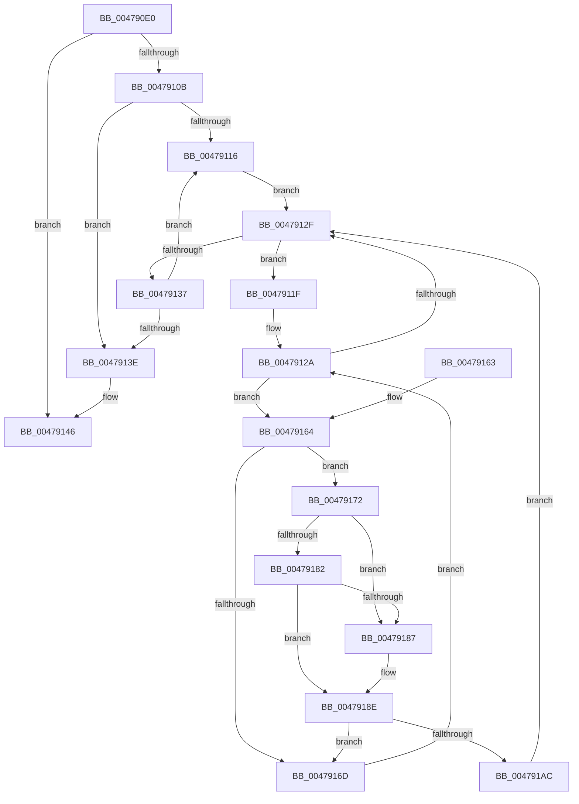

# RtlDestroyLowBoxAtoms

- RVA: `0x004790E0`–`0x004791AE` (길이 `206` bytes)
- VA: `0x00000001404790E0`
- 실행 섹션: `.text`
- PDB 이름 있음: `예`; PDB Function 태그: `아니요`
- unwind 정보 RVA: `0x000ACED4`
- 디코드: `69`개 명령, `206/206` bytes 표시
- 미해석 바이트: `0` (있으면 어셈블리에 `.byte`로 보존)

> 이 문서는 커널 이미지의 기계어와 PDB 기호를 분석해 생성했습니다. 4번과 5번은 함수 원형과 자료형을 바이너리 사용 방식에서 추정한 C 해석이며 원본 소스 복구 결과는 아닙니다.

## 1. Dependencies

- 직접 호출 지점: **4**; 고유 호출 대상: **4**
- 직접 호출자로 확인된 함수: **1**
- RIP 상대 이미지 참조: **0**

### Outgoing calls
- `0x00479102` → [RtlpLockAtomTable](../../page/9C/RtlpLockAtomTable_function_009C4A10.md) (function, `0x009C4A10`)
- `0x00479141` → [RtlpUnlockAtomTable](../../page/9C/RtlpUnlockAtomTable_function_009C4A8C.md) (function, `0x009C4A8C`)
- `0x00479195` → [RtlpFreeAtom](../../page/8B/RtlpFreeAtom_function_008BD87C.md) (function, `0x008BD87C`)
- `0x004791A3` → [RtlpDereferenceAtom](RtlpDereferenceAtom_function_004791B4.md) (function, `0x004791B4`)

### Direct callers
- [ExRemoveLowBoxAtomReferences](ExRemoveLowBoxAtomReferences_function_004790C8.md) at `0x004790CC`

### Static image references
- 디코드된 RIP-relative 메모리 참조가 없습니다.

## 2. Other-region calls and transfers

- 다른 실행 섹션으로 향하는 call: **3**
  - `0x00479102` → [RtlpLockAtomTable](../../page/9C/RtlpLockAtomTable_function_009C4A10.md) (`.text` → `PAGE`)
  - `0x00479141` → [RtlpUnlockAtomTable](../../page/9C/RtlpUnlockAtomTable_function_009C4A8C.md) (`.text` → `PAGE`)
  - `0x00479195` → [RtlpFreeAtom](../../page/8B/RtlpFreeAtom_function_008BD87C.md) (`.text` → `PAGE`)
- 별도 외부 분기/꼬리 이동을 확인하지 못했습니다.

## 3. Assembly (complete function range)

```asm
004790E0  48 89 5C 24 08                  mov qword ptr [rsp + 8], rbx
004790E5  48 89 6C 24 10                  mov qword ptr [rsp + 0x10], rbp
004790EA  48 89 74 24 18                  mov qword ptr [rsp + 0x18], rsi
004790EF  57                              push rdi
004790F0  41 54                           push r12
004790F2  41 55                           push r13
004790F4  41 56                           push r14
004790F6  41 57                           push r15
004790F8  48 83 EC 20                     sub rsp, 0x20
004790FC  44 8B EA                        mov r13d, edx
004790FF  48 8B D9                        mov rbx, rcx
00479102  E8 09 B9 54 00                  call 0x1409c4a10
00479107  84 C0                           test al, al
00479109  74 3B                           je 0x140479146
0047910B  33 ED                           xor ebp, ebp
0047910D  4C 8D 73 20                     lea r14, [rbx + 0x20]
00479111  39 6B 1C                        cmp dword ptr [rbx + 0x1c], ebp
00479114  76 28                           jbe 0x14047913e
00479116  49 8B 3E                        mov rdi, qword ptr [r14]
00479119  4D 8D 76 08                     lea r14, [r14 + 8]
0047911D  EB 10                           jmp 0x14047912f
0047911F  48 8B 3F                        mov rdi, qword ptr [rdi]
00479122  4D 8D 67 10                     lea r12, [r15 + 0x10]
00479126  49 8B 34 24                     mov rsi, qword ptr [r12]
0047912A  49 3B F4                        cmp rsi, r12
0047912D  75 35                           jne 0x140479164
0047912F  4C 8B FF                        mov r15, rdi
00479132  48 85 FF                        test rdi, rdi
00479135  75 E8                           jne 0x14047911f
00479137  FF C5                           inc ebp
00479139  3B 6B 1C                        cmp ebp, dword ptr [rbx + 0x1c]
0047913C  72 D8                           jb 0x140479116
0047913E  48 8B CB                        mov rcx, rbx
00479141  E8 46 B9 54 00                  call 0x1409c4a8c
00479146  48 8B 5C 24 50                  mov rbx, qword ptr [rsp + 0x50]
0047914B  48 8B 6C 24 58                  mov rbp, qword ptr [rsp + 0x58]
00479150  48 8B 74 24 60                  mov rsi, qword ptr [rsp + 0x60]
00479155  48 83 C4 20                     add rsp, 0x20
00479159  41 5F                           pop r15
0047915B  41 5E                           pop r14
0047915D  41 5D                           pop r13
0047915F  41 5C                           pop r12
00479161  5F                              pop rdi
00479162  C3                              ret
00479163  CC                              int3
00479164  48 8B CE                        mov rcx, rsi
00479167  44 39 6E 10                     cmp dword ptr [rsi + 0x10], r13d
0047916B  74 05                           je 0x140479172
0047916D  48 8B 36                        mov rsi, qword ptr [rsi]
00479170  EB B8                           jmp 0x14047912a
00479172  48 8B 11                        mov rdx, qword ptr [rcx]
00479175  48 8B 46 08                     mov rax, qword ptr [rsi + 8]
00479179  48 8B F0                        mov rsi, rax
0047917C  48 39 4A 08                     cmp qword ptr [rdx + 8], rcx
00479180  75 05                           jne 0x140479187
00479182  48 39 08                        cmp qword ptr [rax], rcx
00479185  74 07                           je 0x14047918e
00479187  B9 03 00 00 00                  mov ecx, 3
0047918C  CD 29                           int 0x29
0047918E  48 89 10                        mov qword ptr [rax], rdx
00479191  48 89 42 08                     mov qword ptr [rdx + 8], rax
00479195  E8 E2 46 44 00                  call 0x1408bd87c
0047919A  4C 8B C3                        mov r8, rbx
0047919D  49 8B D4                        mov rdx, r12
004791A0  49 8B CF                        mov rcx, r15
004791A3  E8 0C 00 00 00                  call 0x1404791b4
004791A8  84 C0                           test al, al
004791AA  74 C1                           je 0x14047916d
004791AC  EB 81                           jmp 0x14047912f
```

## 4. C-style interpretation (structured pseudocode)

```c
__int64 __fastcall RtlDestroyLowBoxAtoms(__int64 a1, int a2)
{
    __int64 result;
    __int64 v_rbp;
    __int64 v_rsp;
    unsigned __int64 v_stack_p10;
    unsigned __int64 v_stack_p18;
    unsigned __int64 v_stack_p8;

    v_stack_p8 = v_rbx;
    v_stack_p10 = v_rbp;
    v_stack_p18 = v_rsi;
    v_rsp = (v_rsp) - (32);
    result = RtlpLockAtomTable(a1, a2, a3, a4);
    if ((unsigned __int8)(result) == 0) goto loc_00479146;
    v_rbp = 0;
    if ((*(unsigned int *)(a1 + 28)) <= 0) goto loc_0047913E;
loc_00479116:
    goto loc_0047912F;
loc_0047911F:
loc_0047912A:
    if ((*(unsigned __int64 *)(v_r15 + 16)) != (v_r15 + 16)) goto loc_00479164;
loc_0047912F:
    if (*(unsigned __int64 *)(*(unsigned __int64 *)(a1 + 32)) != 0) goto loc_0047911F;
    v_rbp = (unsigned int)((v_rbp) + 1);
    if (((unsigned int)(v_rbp)) < (*(unsigned int *)(a1 + 28))) goto loc_00479116;
loc_0047913E:
    result = RtlpUnlockAtomTable(a1, a2, a3, a4);
loc_00479146:
    v_rsp = (v_rsp) + (32);
    return result;
loc_00479164:
    if ((*(unsigned int *)(v_stack_p18 + 16)) == ((unsigned int)((unsigned int)(a2)))) goto loc_00479172;
loc_0047916D:
    goto loc_0047912A;
loc_00479172:
    if ((*(unsigned __int64 *)(*(unsigned __int64 *)(v_stack_p18) + 8)) != v_stack_p18) goto loc_00479187;
    if ((*(unsigned __int64 *)(*(unsigned __int64 *)(*(unsigned __int64 *)(v_stack_p18) + 8))) != v_stack_p18) {
        a1 = 3;
    }
    *(unsigned __int64 *)(*(unsigned __int64 *)(*(unsigned __int64 *)(v_stack_p18) + 8)) = *(unsigned __int64 *)(v_stack_p18);
    *(unsigned __int64 *)(*(unsigned __int64 *)(v_stack_p18) + 8) = *(unsigned __int64 *)(*(unsigned __int64 *)(v_stack_p18) + 8);
    result = RtlpFreeAtom(a1, *(unsigned __int64 *)(v_stack_p18), a3, a4);
    result = RtlpDereferenceAtom(*(unsigned __int64 *)(*(unsigned __int64 *)(a1 + 32)), v_r15 + 16, v_stack_p8, a4);
    if ((unsigned __int8)(result) == 0) goto loc_0047916D;
    goto loc_0047912F;
}
```

## 5. (Beta) C Style

```c
int64_t RtlDestroyLowBoxAtoms(void *Arg1, int32_t Arg2)
{
    uint8_t *arg1 = (uint8_t *)Arg1;

    int64_t result;
    int64_t local_rbp;
    int64_t local_rsp;
    uint64_t v_stack_p10;
    uint64_t v_stack_p18;
    uint64_t v_stack_p8;

    v_stack_p8 = local_rbx;
    v_stack_p10 = local_rbp;
    v_stack_p18 = local_rsi;
    local_rsp = (local_rsp) - (32);
    result = RtlpLockAtomTable(Arg1, Arg2, a3, a4);
    if ((uint8_t)(result) == 0) goto loc_00479146;
    local_rbp = 0;
    if ((*(uint32_t *)(arg1 + 0x1C)) <= 0) goto loc_0047913E;
loc_00479116:
    goto loc_0047912F;
loc_0047911F:
loc_0047912A:
    if ((*(uint64_t *)(local_r15 + 0x10)) != (local_r15 + 16)) goto loc_00479164;
loc_0047912F:
    if (*(uint64_t *)(*(uint64_t *)(arg1 + 0x20)) != 0) goto loc_0047911F;
    local_rbp = (uint32_t)((local_rbp) + 1);
    if (((uint32_t)(local_rbp)) < (*(uint32_t *)(arg1 + 0x1C))) goto loc_00479116;
loc_0047913E:
    result = RtlpUnlockAtomTable(Arg1, Arg2, a3, a4);
loc_00479146:
    local_rsp = (local_rsp) + (32);
    return result;
loc_00479164:
    if ((*(uint32_t *)(v_stack_p18 + 0x10)) == ((uint32_t)((uint32_t)(Arg2)))) goto loc_00479172;
loc_0047916D:
    goto loc_0047912A;
loc_00479172:
    if ((*(uint64_t *)(*(uint64_t *)(v_stack_p18) + 0x8)) != v_stack_p18) goto loc_00479187;
    if ((*(uint64_t *)(*(uint64_t *)(*(uint64_t *)(v_stack_p18) + 0x8))) != v_stack_p18) {
        Arg1 = 3;
    }
    *(uint64_t *)(*(uint64_t *)(*(uint64_t *)(v_stack_p18) + 0x8)) = *(uint64_t *)(v_stack_p18);
    *(uint64_t *)(*(uint64_t *)(v_stack_p18) + 0x8) = *(uint64_t *)(*(uint64_t *)(v_stack_p18) + 0x8);
    result = RtlpFreeAtom(Arg1, *(uint64_t *)(v_stack_p18), a3, a4);
    result = RtlpDereferenceAtom(*(uint64_t *)(*(uint64_t *)(arg1 + 0x20)), local_r15 + 16, v_stack_p8, a4);
    if ((uint8_t)(result) == 0) goto loc_0047916D;
    goto loc_0047912F;
}
```

### 관측된 메모리 오프셋

구조체 형식이 확인되지 않은 접근은 인자 기준의 오프셋으로만 기록했습니다.

| 기준 인자 | 오프셋 표현 | 폭 (bit) | 접근 |
|---|---:|---:|---|
| `Arg1` | `+ 0x0` | `64` | `R` |
| `Arg1` | `+ 0x8` | `64` | `R` |
| `Arg1` | `+ 0x1C` | `32` | `R` |
| `Arg1` | `+ 0x20` | `64` | `R` |

## 6. Execution-region graph

[열기: 2D/3D 그래프와 함수 탐색 컨트롤 패널](../../../control-panel.html?section=text&rva=0x004790E0&view=graph)

- 2D 그래프는 위에서 아래로 흐르고, 3D 그래프는 빈 공간을 드래그해 회전합니다. Shift+드래그는 이동, 휠은 확대·축소, 함수 노드 선택은 대상 보고서 이동입니다.

### Static fallback


