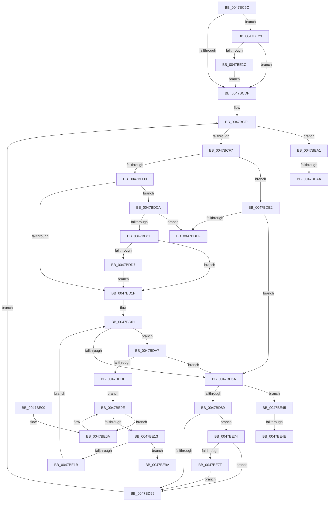

# RtlFindLongestRunClearCapped

- RVA: `0x0047BC5C`–`0x0047BECE` (길이 `626` bytes)
- VA: `0x000000014047BC5C`
- 실행 섹션: `.text`
- PDB 이름 있음: `예`; PDB Function 태그: `예`
- unwind 정보 RVA: `0x000AD750`
- 디코드: `174`개 명령, `626/626` bytes 표시
- 미해석 바이트: `0` (있으면 어셈블리에 `.byte`로 보존)

> 이 문서는 커널 이미지의 기계어와 PDB 기호를 분석해 생성했습니다. 4번과 5번은 함수 원형과 자료형을 바이너리 사용 방식에서 추정한 C 해석이며 원본 소스 복구 결과는 아닙니다.

## 1. Dependencies

- 직접 호출 지점: **0**; 고유 호출 대상: **0**
- 직접 호출자로 확인된 함수: **2**
- RIP 상대 이미지 참조: **2**

### Outgoing calls
- 직접 디코드된 call 명령이 없습니다.

### Direct callers
- [MiGatherPagefilePages](../37/MiGatherPagefilePages_function_00372B08.md) at `0x0037349E`
- [MiFindPageFileWriteCluster](../3E/MiFindPageFileWriteCluster_function_003E2B00.md) at `0x003E2C03`

### Static image references
- `0x0047BD04` → RVA `0x00000000` (`image boundary/outside`; read)
- `0x0047BD3B` → RVA `0x00012D28` (`.rdata`; read)

## 2. Other-region calls and transfers

- 다른 실행 섹션으로 향하는 call: **0**
- call이 아닌 외부 분기/꼬리 이동: **5**
  - `0x0047BE48` → [sub_006F49A2](../6F/Unknown_function_006F49A2.md) (`tail-transfer`)
  - `0x0047BE6F` → [sub_006F49A2](../6F/Unknown_function_006F49A2.md) (`tail-transfer`)
  - `0x0047BE9C` → [sub_006F49A2 + 0x29](../6F/Unknown_function_006F49A2.md) (`tail-transfer`)
  - `0x0047BEA4` → [sub_006F49A2 + 0x10](../6F/Unknown_function_006F49A2.md) (`tail-transfer`)
  - `0x0047BEC9` → [sub_006F49A2 + 0x1F](../6F/Unknown_function_006F49A2.md) (`tail-transfer`)

## 3. Assembly (complete function range)

```asm
0047BC5C  48 89 5C 24 10                  mov qword ptr [rsp + 0x10], rbx
0047BC61  48 89 4C 24 08                  mov qword ptr [rsp + 8], rcx
0047BC66  55                              push rbp
0047BC67  56                              push rsi
0047BC68  57                              push rdi
0047BC69  41 54                           push r12
0047BC6B  41 55                           push r13
0047BC6D  41 56                           push r14
0047BC6F  41 57                           push r15
0047BC71  48 83 EC 10                     sub rsp, 0x10
0047BC75  49 8B F0                        mov rsi, r8
0047BC78  8B DA                           mov ebx, edx
0047BC7A  8B 11                           mov edx, dword ptr [rcx]
0047BC7C  4C 8B C1                        mov r8, rcx
0047BC7F  B9 00 00 00 00                  mov ecx, 0
0047BC84  89 54 24 0C                     mov dword ptr [rsp + 0xc], edx
0047BC88  44 8B E2                        mov r12d, edx
0047BC8B  8B C2                           mov eax, edx
0047BC8D  41 83 E4 07                     and r12d, 7
0047BC91  44 89 64 24 60                  mov dword ptr [rsp + 0x60], r12d
0047BC96  0F 95 C1                        setne cl
0047BC99  C1 E8 03                        shr eax, 3
0047BC9C  03 C8                           add ecx, eax
0047BC9E  8B 06                           mov eax, dword ptr [rsi]
0047BCA0  3B C2                           cmp eax, edx
0047BCA2  89 0C 24                        mov dword ptr [rsp], ecx
0047BCA5  45 1B ED                        sbb r13d, r13d
0047BCA8  45 33 DB                        xor r11d, r11d
0047BCAB  44 23 E8                        and r13d, eax
0047BCAE  33 FF                           xor edi, edi
0047BCB0  41 83 E5 F8                     and r13d, 0xfffffff8
0047BCB4  8D 41 FF                        lea eax, [rcx - 1]
0047BCB7  41 8B ED                        mov ebp, r13d
0047BCBA  89 44 24 08                     mov dword ptr [rsp + 8], eax
0047BCBE  C1 ED 03                        shr ebp, 3
0047BCC1  45 33 D2                        xor r10d, r10d
0047BCC4  44 8B FD                        mov r15d, ebp
0047BCC7  45 8B F5                        mov r14d, r13d
0047BCCA  4D 03 78 08                     add r15, qword ptr [r8 + 8]
0047BCCE  45 33 C0                        xor r8d, r8d
0047BCD1  45 8A 0F                        mov r9b, byte ptr [r15]
0047BCD4  49 FF C7                        inc r15
0047BCD7  3B E8                           cmp ebp, eax
0047BCD9  0F 84 44 01 00 00               je 0x14047be23
0047BCDF  33 C0                           xor eax, eax
0047BCE1  89 44 24 68                     mov dword ptr [rsp + 0x68], eax
0047BCE5  45 8B E3                        mov r12d, r11d
0047BCE8  89 7C 24 04                     mov dword ptr [rsp + 4], edi
0047BCEC  41 8B D0                        mov edx, r8d
0047BCEF  3B C1                           cmp eax, ecx
0047BCF1  0F 83 AA 01 00 00               jae 0x14047bea1
0047BCF7  45 84 C9                        test r9b, r9b
0047BCFA  0F 84 E2 00 00 00               je 0x14047bde2
0047BD00  41 0F B6 C1                     movzx eax, r9b
0047BD04  48 8D 15 F5 42 B8 FF            lea rdx, [rip - 0x47bd0b]
0047BD0B  0F B6 8C 10 90 C7 02 00         movzx ecx, byte ptr [rax + rdx + 0x2c790]
0047BD13  42 8D 3C 11                     lea edi, [rcx + r10]
0047BD17  85 FF                           test edi, edi
0047BD19  0F 85 AB 00 00 00               jne 0x14047bdca
0047BD1F  44 0F B6 94 10 A0 C8 02 00      movzx r10d, byte ptr [rax + rdx + 0x2c8a0]
0047BD28  45 3B F5                        cmp r14d, r13d
0047BD2B  48 8B D1                        mov rdx, rcx
0047BD2E  44 8D 34 ED 00 00 00 00         lea r14d, [rbp*8]
0047BD36  0F 45 7C 24 04                  cmovne edi, dword ptr [rsp + 4]
0047BD3B  48 8D 0D E6 6F B9 FF            lea rcx, [rip - 0x46901a]
0047BD42  49 2B CA                        sub rcx, r10
0047BD45  45 8B E6                        mov r12d, r14d
0047BD48  45 2B F2                        sub r14d, r10d
0047BD4B  41 83 C6 08                     add r14d, 8
0047BD4F  8A 01                           mov al, byte ptr [rcx]
0047BD51  48 8D 0D A8 42 B8 FF            lea rcx, [rip - 0x47bd58]
0047BD58  8A 8C 0A 90 C8 02 00            mov cl, byte ptr [rdx + rcx + 0x2c890]
0047BD5F  0A C8                           or cl, al
0047BD61  44 0A C9                        or r9b, cl
0047BD64  41 80 F9 FF                     cmp r9b, 0xff
0047BD68  75 3D                           jne 0x14047bda7
0047BD6A  FF C5                           inc ebp
0047BD6C  44 89 5C 24 04                  mov dword ptr [rsp + 4], r11d
0047BD71  45 8B C8                        mov r9d, r8d
0047BD74  41 8B C2                        mov eax, r10d
0047BD77  41 8B D0                        mov edx, r8d
0047BD7A  41 8B CA                        mov ecx, r10d
0047BD7D  44 8B E7                        mov r12d, edi
0047BD80  3B 2C 24                        cmp ebp, dword ptr [rsp]
0047BD83  0F 83 BC 00 00 00               jae 0x14047be45
0047BD89  45 8A 0F                        mov r9b, byte ptr [r15]
0047BD8C  49 FF C7                        inc r15
0047BD8F  3B 6C 24 08                     cmp ebp, dword ptr [rsp + 8]
0047BD93  0F 84 DB 00 00 00               je 0x14047be74
0047BD99  8B 44 24 68                     mov eax, dword ptr [rsp + 0x68]
0047BD9D  8B 0C 24                        mov ecx, dword ptr [rsp]
0047BDA0  FF C0                           inc eax
0047BDA2  E9 3A FF FF FF                  jmp 0x14047bce1
0047BDA7  41 0F B6 C1                     movzx eax, r9b
0047BDAB  48 8D 0D 4E 42 B8 FF            lea rcx, [rip - 0x47bdb2]
0047BDB2  0F B6 94 08 30 2D 01 00         movzx edx, byte ptr [rax + rcx + 0x12d30]
0047BDBA  44 3B C2                        cmp r8d, edx
0047BDBD  73 AB                           jae 0x14047bd6a
0047BDBF  8A 8C 0A 90 C8 02 00            mov cl, byte ptr [rdx + rcx + 0x2c890]
0047BDC6  33 C0                           xor eax, eax
0047BDC8  EB 44                           jmp 0x14047be0e
0047BDCA  3B FB                           cmp edi, ebx
0047BDCC  73 21                           jae 0x14047bdef
0047BDCE  41 3B F8                        cmp edi, r8d
0047BDD1  0F 86 48 FF FF FF               jbe 0x14047bd1f
0047BDD7  44 8B C7                        mov r8d, edi
0047BDDA  45 8B DE                        mov r11d, r14d
0047BDDD  E9 3D FF FF FF                  jmp 0x14047bd1f
0047BDE2  41 83 C2 08                     add r10d, 8
0047BDE6  44 3B D3                        cmp r10d, ebx
0047BDE9  0F 82 7B FF FF FF               jb 0x14047bd6a
0047BDEF  44 89 36                        mov dword ptr [rsi], r14d
0047BDF2  8B C3                           mov eax, ebx
0047BDF4  48 8B 5C 24 58                  mov rbx, qword ptr [rsp + 0x58]
0047BDF9  48 83 C4 10                     add rsp, 0x10
0047BDFD  41 5F                           pop r15
0047BDFF  41 5E                           pop r14
0047BE01  41 5D                           pop r13
0047BE03  41 5C                           pop r12
0047BE05  5F                              pop rdi
0047BE06  5E                              pop rsi
0047BE07  5D                              pop rbp
0047BE08  C3                              ret
0047BE09  CC                              int3
0047BE0A  02 C9                           add cl, cl
0047BE0C  FF C0                           inc eax
0047BE0E  41 84 C9                        test r9b, cl
0047BE11  75 F7                           jne 0x14047be0a
0047BE13  45 8D 1C 04                     lea r11d, [r12 + rax]
0047BE17  3B D3                           cmp edx, ebx
0047BE19  73 7F                           jae 0x14047be9a
0047BE1B  44 8B C2                        mov r8d, edx
0047BE1E  E9 3E FF FF FF                  jmp 0x14047bd61
0047BE23  45 85 E4                        test r12d, r12d
0047BE26  0F 84 B3 FE FF FF               je 0x14047bcdf
0047BE2C  8B C2                           mov eax, edx
0047BE2E  48 8D 15 CB 41 B8 FF            lea rdx, [rip - 0x47be35]
0047BE35  83 E0 07                        and eax, 7
0047BE38  44 0A 8C 10 20 2D 01 00         or r9b, byte ptr [rax + rdx + 0x12d20]
0047BE40  E9 9A FE FF FF                  jmp 0x14047bcdf
0047BE45  45 85 D2                        test r10d, r10d
0047BE48  0F 84 54 8B 27 00               je 0x1406f49a2
0047BE4E  45 33 D2                        xor r10d, r10d
0047BE51  8B F9                           mov edi, ecx
0047BE53  45 3B F5                        cmp r14d, r13d
0047BE56  44 8B C0                        mov r8d, eax
0047BE59  45 8B DE                        mov r11d, r14d
0047BE5C  41 0F 45 FC                     cmovne edi, r12d
0047BE60  3B CA                           cmp ecx, edx
0047BE62  44 0F 46 C2                     cmovbe r8d, edx
0047BE66  41 3B C1                        cmp eax, r9d
0047BE69  44 0F 46 5C 24 04               cmovbe r11d, dword ptr [rsp + 4]
0047BE6F  E9 2E 8B 27 00                  jmp 0x1406f49a2
0047BE74  83 7C 24 60 00                  cmp dword ptr [rsp + 0x60], 0
0047BE79  0F 84 1A FF FF FF               je 0x14047bd99
0047BE7F  8B 44 24 0C                     mov eax, dword ptr [rsp + 0xc]
0047BE83  48 8D 0D 76 41 B8 FF            lea rcx, [rip - 0x47be8a]
0047BE8A  83 E0 07                        and eax, 7
0047BE8D  44 0A 8C 08 20 2D 01 00         or r9b, byte ptr [rax + rcx + 0x12d20]
0047BE95  E9 FF FE FF FF                  jmp 0x14047bd99
0047BE9A  8B C3                           mov eax, ebx
0047BE9C  E9 2A 8B 27 00                  jmp 0x1406f49cb
0047BEA1  45 85 D2                        test r10d, r10d
0047BEA4  0F 84 08 8B 27 00               je 0x1406f49b2
0047BEAA  43 8D 04 16                     lea eax, [r14 + r10]
0047BEAE  45 8B DE                        mov r11d, r14d
0047BEB1  41 3B C5                        cmp eax, r13d
0047BEB4  42 8D 0C 17                     lea ecx, [rdi + r10]
0047BEB8  41 0F 45 CA                     cmovne ecx, r10d
0047BEBC  41 3B C8                        cmp ecx, r8d
0047BEBF  44 0F 47 C1                     cmova r8d, ecx
0047BEC3  3B CA                           cmp ecx, edx
0047BEC5  45 0F 46 DC                     cmovbe r11d, r12d
0047BEC9  E9 F3 8A 27 00                  jmp 0x1406f49c1
```

## 4. C-style interpretation (structured pseudocode)

```c
__int64 __fastcall RtlFindLongestRunClearCapped(__int64 a1, int a2, __int64 a3)
{
    __int64 result;
    __int64 v_r10;
    __int64 v_r11;
    __int64 v_r12;
    __int64 v_r13;
    __int64 v_r14;
    __int64 v_r15;
    __int64 v_rbp;
    __int64 v_rdi;
    __int64 v_rsp;
    unsigned int v_stack_m3C;
    unsigned int v_stack_m40;
    unsigned int v_stack_m44;
    unsigned int v_stack_m48;
    unsigned __int64 v_stack_p10;
    unsigned int v_stack_p18;
    unsigned int v_stack_p20;
    unsigned int v_stack_p4;
    unsigned int v_stack_p60;
    unsigned __int64 v_stack_p8;
    unsigned int v_stack_pC;

    v_stack_p10 = v_rbx;
    v_stack_p8 = a1;
    v_rsp = (v_rsp) - (16);
    v_stack_m3C = (unsigned int)((unsigned int)(*(unsigned int *)(a1)));
    v_r12 = (unsigned int)(((unsigned int)((unsigned int)((unsigned int)(*(unsigned int *)(a1))))) & (7));
    v_stack_p18 = (unsigned int)(v_r12);
    a1 = (condition_is_not_equal) ? 1 : 0;
    result = (unsigned int)(((unsigned int)((unsigned int)((unsigned int)(*(unsigned int *)(a1))))) >> (3));
    a1 = (unsigned int)((a1) + ((unsigned int)(result)));
    v_stack_m48 = (unsigned int)(a1);
    v_r11 = 0;
    v_r13 = (unsigned int)((v_r13) & ((unsigned int)((unsigned int)(*(unsigned int *)(a3)))));
    v_rdi = 0;
    v_r13 = (unsigned int)((v_r13) & (0xFFFFFFF8ULL));
    v_stack_m40 = (unsigned int)(a1 - 1);
    v_rbp = (unsigned int)(((unsigned int)((unsigned int)(v_r13))) >> (3));
    v_r10 = 0;
    v_r15 = ((unsigned int)((unsigned int)(v_rbp))) + (*(unsigned __int64 *)(a1 + 8));
    a3 = 0;
    v_r15 = (v_r15) + 1;
    if (((unsigned int)(v_rbp)) == ((unsigned int)(a1 - 1))) goto loc_0047BE23;
loc_0047BCDF:
    result = 0;
loc_0047BCE1:
    v_stack_p20 = 0;
    v_stack_m44 = 0;
    if (0 >= ((unsigned int)(a1))) goto loc_0047BEA1;
    if ((unsigned __int8)(*(unsigned __int8 *)(v_r15)) == 0) goto loc_0047BDE2;
    if ((unsigned int)(*(unsigned __int8 *)((unsigned __int8)(*(unsigned __int8 *)(v_r15)) + v_rip - 4701451 * 1 + 182160) + v_r10 * 1) != 0) goto loc_0047BDCA;
loc_0047BD1F:
    v_rdi = *(unsigned __int8 *)((unsigned __int8)(*(unsigned __int8 *)(v_r15)) + v_rip - 4701451 * 1 + 182160) + v_r10 * 1;
    if (((unsigned int)((unsigned int)((unsigned int)(v_r13)))) != ((unsigned int)(v_r13))) { v_rdi = v_stack_m44; }
    a1 = (v_rip - 4624410) - (*(unsigned __int8 *)((unsigned __int8)(*(unsigned __int8 *)(v_r15)) + v_rip - 4701451 * 1 + 182432));
    v_r14 = (unsigned int)((v_rbp * 8) - ((unsigned int)(*(unsigned __int8 *)((unsigned __int8)(*(unsigned __int8 *)(v_r15)) + v_rip - 4701451 * 1 + 182432))));
    v_r14 = (unsigned int)((v_r14) + (8));
    a1 = (unsigned __int8)((*(unsigned __int8 *)(*(unsigned __int8 *)((unsigned __int8)(*(unsigned __int8 *)(v_r15)) + v_rip - 4701451 * 1 + 182160) + v_rip - 4701528 * 1 + 182416)) | ((unsigned __int8)(*(unsigned __int8 *)(a1))));
loc_0047BD61:
    a4 = (unsigned __int8)((*(unsigned __int8 *)(v_r15)) | ((unsigned __int8)(a1)));
    if (((unsigned __int8)(a4)) != 255) goto loc_0047BDA7;
loc_0047BD6A:
    v_rbp = (unsigned int)((v_rbp) + 1);
    v_stack_m44 = 0;
    if (((unsigned int)(v_rbp)) >= v_stack_m48) goto loc_0047BE45;
    v_r15 = (v_r15) + 1;
    if (((unsigned int)(v_rbp)) == v_stack_m40) goto loc_0047BE74;
loc_0047BD99:
    result = (unsigned int)(((unsigned int)(v_stack_p20)) + 1);
    goto loc_0047BCE1;
loc_0047BDA7:
    if (0 >= ((unsigned int)(*(unsigned __int8 *)((unsigned __int8)(*(unsigned __int8 *)(v_r15)) + v_rip - 4701618 * 1 + 77104)))) goto loc_0047BD6A;
    result = 0;
    goto loc_0047BE0E;
loc_0047BDCA:
    if (((unsigned int)(v_rdi)) >= ((unsigned int)((unsigned int)(a2)))) goto loc_0047BDEF;
    if (((unsigned int)(v_rdi)) <= 0) goto loc_0047BD1F;
    goto loc_0047BD1F;
loc_0047BDE2:
    v_r10 = (unsigned int)((*(unsigned __int8 *)((unsigned __int8)(*(unsigned __int8 *)(v_r15)) + v_rip - 4701451 * 1 + 182432)) + (8));
    if (((unsigned int)(v_r10)) < ((unsigned int)((unsigned int)(a2)))) goto loc_0047BD6A;
loc_0047BDEF:
    *(unsigned int *)(a3) = (unsigned int)(v_r14);
    v_rsp = (v_rsp) + (16);
    return (unsigned int)((unsigned int)((unsigned int)(a2)));
loc_0047BE0A:
    a1 = (unsigned __int8)((*(unsigned __int8 *)(*(unsigned __int8 *)((unsigned __int8)(*(unsigned __int8 *)(v_r15)) + v_rip - 4701618 * 1 + 77104) + v_rip - 4701618 * 1 + 182416)) + ((unsigned __int8)(*(unsigned __int8 *)(*(unsigned __int8 *)((unsigned __int8)(*(unsigned __int8 *)(v_r15)) + v_rip - 4701618 * 1 + 77104) + v_rip - 4701618 * 1 + 182416))));
    result = (unsigned int)(((unsigned int)((unsigned int)((unsigned int)(a2)))) + 1);
loc_0047BE0E:
    if ((((unsigned __int8)(*(unsigned __int8 *)(v_r15))) & ((unsigned __int8)(a1))) != 0) goto loc_0047BE0A;
    if (((unsigned int)(*(unsigned __int8 *)((unsigned __int8)(*(unsigned __int8 *)(v_r15)) + v_rip - 4701618 * 1 + 77104))) >= ((unsigned int)(v_stack_p10))) goto loc_0047BE9A;
    goto loc_0047BD61;
loc_0047BE23:
    if ((unsigned int)((unsigned int)((unsigned int)(v_rdi))) == 0) goto loc_0047BCDF;
    result = (unsigned int)(((unsigned int)((unsigned int)(*(unsigned __int8 *)((unsigned __int8)(*(unsigned __int8 *)(v_r15)) + v_rip - 4701618 * 1 + 77104)))) & (7));
    a4 = (unsigned __int8)((*(unsigned __int8 *)(v_r15)) | (*(unsigned __int8 *)(result + v_rip - 4701749 * 1 + 77088)));
    goto loc_0047BCDF;
loc_0047BE45:
    v_r10 = 0;
    v_rdi = (unsigned int)((unsigned int)(a1));
    if (((unsigned int)(v_r14)) != ((unsigned int)(v_r13))) { v_rdi = (unsigned int)((unsigned int)((unsigned int)(v_rdi))); }
    a3 = (unsigned int)((unsigned int)(result));
    if (((unsigned int)(a1)) <= ((unsigned int)(v_rip - 4701749))) { a3 = (unsigned int)(v_rip - 4701749); }
    v_r11 = (unsigned int)((unsigned int)(v_r14));
    if (((unsigned int)(result)) <= ((unsigned int)(a4))) { v_r11 = v_stack_p4; }
loc_0047BE74:
    if (v_stack_p60 == 0) goto loc_0047BD99;
    result = (unsigned int)(((unsigned int)(v_stack_pC)) & (7));
    a4 = (unsigned __int8)((a4) | (*(unsigned __int8 *)(result + v_rip - 4701834 * 1 + 77088)));
    goto loc_0047BD99;
loc_0047BE9A:
loc_0047BEA1:
    a1 = v_rdi + v_r10 * 1;
    if (((unsigned int)(v_r14 + v_r10 * 1)) != ((unsigned int)(v_r13))) { a1 = 0; }
    if (((unsigned int)(a1)) > ((unsigned int)(a3))) { a3 = (unsigned int)(a1); }
    v_r11 = (unsigned int)((unsigned int)(v_r14));
    if (((unsigned int)(a1)) <= ((unsigned int)(v_rip - 4701749))) { v_r11 = (unsigned int)((unsigned int)((unsigned int)(v_rdi))); }
}
```

## 5. (Beta) C Style

```c
int64_t RtlFindLongestRunClearCapped(void *Arg1, int32_t Arg2, void *Arg3)
{
    uint8_t *arg1 = (uint8_t *)Arg1;
    uint8_t *arg3 = (uint8_t *)Arg3;

    int64_t result;
    int64_t local_r10;
    int64_t local_r11;
    int64_t local_r12;
    int64_t local_r13;
    int64_t local_r14;
    int64_t local_r15;
    int64_t local_rbp;
    int64_t local_rdi;
    int64_t local_rsp;
    uint32_t v_stack_m3C;
    uint32_t v_stack_m40;
    uint32_t v_stack_m44;
    uint32_t v_stack_m48;
    uint64_t v_stack_p10;
    uint32_t v_stack_p18;
    uint32_t v_stack_p20;
    uint32_t v_stack_p4;
    uint32_t v_stack_p60;
    uint64_t v_stack_p8;
    uint32_t v_stack_pC;

    v_stack_p10 = local_rbx;
    v_stack_p8 = Arg1;
    local_rsp = (local_rsp) - (16);
    v_stack_m3C = (uint32_t)((uint32_t)(*(uint32_t *)(arg1)));
    local_r12 = (uint32_t)(((uint32_t)((uint32_t)((uint32_t)(*(uint32_t *)(arg1))))) & (7));
    v_stack_p18 = (uint32_t)(local_r12);
    Arg1 = (condition_is_not_equal) ? 1 : 0;
    result = (uint32_t)(((uint32_t)((uint32_t)((uint32_t)(*(uint32_t *)(arg1))))) >> (3));
    Arg1 = (uint32_t)((Arg1) + ((uint32_t)(result)));
    v_stack_m48 = (uint32_t)(Arg1);
    local_r11 = 0;
    local_r13 = (uint32_t)((local_r13) & ((uint32_t)((uint32_t)(*(uint32_t *)(arg3)))));
    local_rdi = 0;
    local_r13 = (uint32_t)((local_r13) & (0xFFFFFFF8ULL));
    v_stack_m40 = (uint32_t)(Arg1 - 1);
    local_rbp = (uint32_t)(((uint32_t)((uint32_t)(local_r13))) >> (3));
    local_r10 = 0;
    local_r15 = ((uint32_t)((uint32_t)(local_rbp))) + (*(uint64_t *)(arg1 + 0x8));
    Arg3 = 0;
    local_r15 = (local_r15) + 1;
    if (((uint32_t)(local_rbp)) == ((uint32_t)(Arg1 - 1))) goto loc_0047BE23;
loc_0047BCDF:
    result = 0;
loc_0047BCE1:
    v_stack_p20 = 0;
    v_stack_m44 = 0;
    if (0 >= ((uint32_t)(Arg1))) goto loc_0047BEA1;
    if ((uint8_t)(*(uint8_t *)(local_r15)) == 0) goto loc_0047BDE2;
    if ((uint32_t)(*(uint8_t *)((uint8_t)(*(uint8_t *)(local_r15)) + v_rip - 0x47BD0B * 1 + 0x2C790) + local_r10 * 1) != 0) goto loc_0047BDCA;
loc_0047BD1F:
    local_rdi = *(uint8_t *)((uint8_t)(*(uint8_t *)(local_r15)) + v_rip - 0x47BD0B * 1 + 0x2C790) + local_r10 * 1;
    if (((uint32_t)((uint32_t)((uint32_t)(local_r13)))) != ((uint32_t)(local_r13))) { local_rdi = v_stack_m44; }
    Arg1 = (v_rip - 4624410) - (*(uint8_t *)((uint8_t)(*(uint8_t *)(local_r15)) + v_rip - 0x47BD0B * 1 + 0x2C8A0));
    local_r14 = (uint32_t)((local_rbp * 8) - ((uint32_t)(*(uint8_t *)((uint8_t)(*(uint8_t *)(local_r15)) + v_rip - 0x47BD0B * 1 + 0x2C8A0))));
    local_r14 = (uint32_t)((local_r14) + (8));
    Arg1 = (uint8_t)((*(uint8_t *)(*(uint8_t *)((uint8_t)(*(uint8_t *)(local_r15)) + v_rip - 0x47BD0B * 1 + 0x2C790) + v_rip - 0x47BD58 * 1 + 0x2C890)) | ((uint8_t)(*(uint8_t *)(arg1))));
loc_0047BD61:
    a4 = (uint8_t)((*(uint8_t *)(local_r15)) | ((uint8_t)(Arg1)));
    if (((uint8_t)(a4)) != 255) goto loc_0047BDA7;
loc_0047BD6A:
    local_rbp = (uint32_t)((local_rbp) + 1);
    v_stack_m44 = 0;
    if (((uint32_t)(local_rbp)) >= v_stack_m48) goto loc_0047BE45;
    local_r15 = (local_r15) + 1;
    if (((uint32_t)(local_rbp)) == v_stack_m40) goto loc_0047BE74;
loc_0047BD99:
    result = (uint32_t)(((uint32_t)(v_stack_p20)) + 1);
    goto loc_0047BCE1;
loc_0047BDA7:
    if (0 >= ((uint32_t)(*(uint8_t *)((uint8_t)(*(uint8_t *)(local_r15)) + v_rip - 0x47BDB2 * 1 + 0x12D30)))) goto loc_0047BD6A;
    result = 0;
    goto loc_0047BE0E;
loc_0047BDCA:
    if (((uint32_t)(local_rdi)) >= ((uint32_t)((uint32_t)(Arg2)))) goto loc_0047BDEF;
    if (((uint32_t)(local_rdi)) <= 0) goto loc_0047BD1F;
    goto loc_0047BD1F;
loc_0047BDE2:
    local_r10 = (uint32_t)((*(uint8_t *)((uint8_t)(*(uint8_t *)(local_r15)) + v_rip - 0x47BD0B * 1 + 0x2C8A0)) + (8));
    if (((uint32_t)(local_r10)) < ((uint32_t)((uint32_t)(Arg2)))) goto loc_0047BD6A;
loc_0047BDEF:
    *(uint32_t *)(arg3) = (uint32_t)(local_r14);
    local_rsp = (local_rsp) + (16);
    return (uint32_t)((uint32_t)((uint32_t)(Arg2)));
loc_0047BE0A:
    Arg1 = (uint8_t)((*(uint8_t *)(*(uint8_t *)((uint8_t)(*(uint8_t *)(local_r15)) + v_rip - 0x47BDB2 * 1 + 0x12D30) + v_rip - 0x47BDB2 * 1 + 0x2C890)) + ((uint8_t)(*(uint8_t *)(*(uint8_t *)((uint8_t)(*(uint8_t *)(local_r15)) + v_rip - 0x47BDB2 * 1 + 0x12D30) + v_rip - 0x47BDB2 * 1 + 0x2C890))));
    result = (uint32_t)(((uint32_t)((uint32_t)((uint32_t)(Arg2)))) + 1);
loc_0047BE0E:
    if ((((uint8_t)(*(uint8_t *)(local_r15))) & ((uint8_t)(Arg1))) != 0) goto loc_0047BE0A;
    if (((uint32_t)(*(uint8_t *)((uint8_t)(*(uint8_t *)(local_r15)) + v_rip - 0x47BDB2 * 1 + 0x12D30))) >= ((uint32_t)(v_stack_p10))) goto loc_0047BE9A;
    goto loc_0047BD61;
loc_0047BE23:
    if ((uint32_t)((uint32_t)((uint32_t)(local_rdi))) == 0) goto loc_0047BCDF;
    result = (uint32_t)(((uint32_t)((uint32_t)(*(uint8_t *)((uint8_t)(*(uint8_t *)(local_r15)) + v_rip - 0x47BDB2 * 1 + 0x12D30)))) & (7));
    a4 = (uint8_t)((*(uint8_t *)(local_r15)) | (*(uint8_t *)(result + v_rip - 0x47BE35 * 1 + 0x12D20)));
    goto loc_0047BCDF;
loc_0047BE45:
    local_r10 = 0;
    local_rdi = (uint32_t)((uint32_t)(Arg1));
    if (((uint32_t)(local_r14)) != ((uint32_t)(local_r13))) { local_rdi = (uint32_t)((uint32_t)((uint32_t)(local_rdi))); }
    Arg3 = (uint32_t)((uint32_t)(result));
    if (((uint32_t)(Arg1)) <= ((uint32_t)(v_rip - 4701749))) { Arg3 = (uint32_t)(v_rip - 4701749); }
    local_r11 = (uint32_t)((uint32_t)(local_r14));
    if (((uint32_t)(result)) <= ((uint32_t)(a4))) { local_r11 = v_stack_p4; }
loc_0047BE74:
    if (v_stack_p60 == 0) goto loc_0047BD99;
    result = (uint32_t)(((uint32_t)(v_stack_pC)) & (7));
    a4 = (uint8_t)((a4) | (*(uint8_t *)(result + v_rip - 0x47BE8A * 1 + 0x12D20)));
    goto loc_0047BD99;
loc_0047BE9A:
loc_0047BEA1:
    Arg1 = local_rdi + local_r10 * 1;
    if (((uint32_t)(local_r14 + local_r10 * 1)) != ((uint32_t)(local_r13))) { Arg1 = 0; }
    if (((uint32_t)(Arg1)) > ((uint32_t)(Arg3))) { Arg3 = (uint32_t)(Arg1); }
    local_r11 = (uint32_t)((uint32_t)(local_r14));
    if (((uint32_t)(Arg1)) <= ((uint32_t)(v_rip - 4701749))) { local_r11 = (uint32_t)((uint32_t)((uint32_t)(local_rdi))); }
}
```

### 관측된 메모리 오프셋

구조체 형식이 확인되지 않은 접근은 인자 기준의 오프셋으로만 기록했습니다.

| 기준 인자 | 오프셋 표현 | 폭 (bit) | 접근 |
|---|---:|---:|---|
| `Arg1` | `+ 0x0` | `32` | `R` |
| `Arg1` | `+ 0x8` | `64` | `R` |
| `Arg3` | `+ 0x0` | `32` | `R` |
| `Arg3` | `+ 0x0` | `32` | `W` |

## 6. Execution-region graph

[열기: 2D/3D 그래프와 함수 탐색 컨트롤 패널](../../../control-panel.html?section=text&rva=0x0047BC5C&view=graph)

- 2D 그래프는 위에서 아래로 흐르고, 3D 그래프는 빈 공간을 드래그해 회전합니다. Shift+드래그는 이동, 휠은 확대·축소, 함수 노드 선택은 대상 보고서 이동입니다.

### Static fallback


