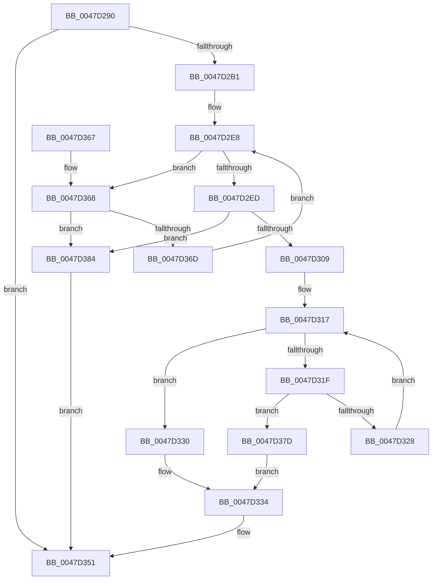

# RtlFindNextForwardRunSetEx

- RVA: `0x0047D290`–`0x0047D389` (길이 `249` bytes)
- VA: `0x000000014047D290`
- 실행 섹션: `.text`
- PDB 이름 있음: `예`; PDB Function 태그: `아니요`
- unwind 정보 RVA: `0x000A47D4`
- 디코드: `75`개 명령, `249/249` bytes 표시
- 미해석 바이트: `0` (있으면 어셈블리에 `.byte`로 보존)

> 이 문서는 커널 이미지의 기계어와 PDB 기호를 분석해 생성했습니다. 4번과 5번은 함수 원형과 자료형을 바이너리 사용 방식에서 추정한 C 해석이며 원본 소스 복구 결과는 아닙니다.

## 1. Dependencies

- 직접 호출 지점: **0**; 고유 호출 대상: **0**
- 직접 호출자로 확인된 함수: **1**
- RIP 상대 이미지 참조: **0**

### Outgoing calls
- 직접 디코드된 call 명령이 없습니다.

### Direct callers
- [MiApplyHotPatchToDriverDataPages](../../page/80/MiApplyHotPatchToDriverDataPages_function_00801F18.md) at `0x00802043`

### Static image references
- 디코드된 RIP-relative 메모리 참조가 없습니다.

## 2. Other-region calls and transfers

- 다른 실행 섹션으로 향하는 call: **0**
- 별도 외부 분기/꼬리 이동을 확인하지 못했습니다.

## 3. Assembly (complete function range)

```asm
0047D290  48 89 5C 24 10                  mov qword ptr [rsp + 0x10], rbx
0047D295  48 89 74 24 18                  mov qword ptr [rsp + 0x18], rsi
0047D29A  48 89 7C 24 20                  mov qword ptr [rsp + 0x20], rdi
0047D29F  4C 8B 19                        mov r11, qword ptr [rcx]
0047D2A2  45 33 C9                        xor r9d, r9d
0047D2A5  49 8B F8                        mov rdi, r8
0047D2A8  4C 3B DA                        cmp r11, rdx
0047D2AB  0F 86 A0 00 00 00               jbe 0x14047d351
0047D2B1  48 8B 71 08                     mov rsi, qword ptr [rcx + 8]
0047D2B5  49 8D 43 FF                     lea rax, [r11 - 1]
0047D2B9  48 C1 E8 06                     shr rax, 6
0047D2BD  8A CA                           mov cl, dl
0047D2BF  80 E1 3F                        and cl, 0x3f
0047D2C2  48 8D 1C C6                     lea rbx, [rsi + rax*8]
0047D2C6  48 8B C2                        mov rax, rdx
0047D2C9  48 C1 E8 06                     shr rax, 6
0047D2CD  4C 8D 04 C6                     lea r8, [rsi + rax*8]
0047D2D1  4D 8B 10                        mov r10, qword ptr [r8]
0047D2D4  41 8D 41 01                     lea eax, [r9 + 1]
0047D2D8  48 D3 E0                        shl rax, cl
0047D2DB  48 FF C8                        dec rax
0047D2DE  48 F7 D0                        not rax
0047D2E1  4C 23 D0                        and r10, rax
0047D2E4  49 8D 40 08                     lea rax, [r8 + 8]
0047D2E8  4D 85 D2                        test r10, r10
0047D2EB  74 7B                           je 0x14047d368
0047D2ED  49 0F BC CA                     bsf rcx, r10
0047D2F1  49 8B D0                        mov rdx, r8
0047D2F4  48 2B D6                        sub rdx, rsi
0047D2F7  8B C1                           mov eax, ecx
0047D2F9  48 C1 FA 03                     sar rdx, 3
0047D2FD  48 C1 E2 06                     shl rdx, 6
0047D301  48 03 D0                        add rdx, rax
0047D304  49 3B D3                        cmp rdx, r11
0047D307  77 7B                           ja 0x14047d384
0047D309  B8 01 00 00 00                  mov eax, 1
0047D30E  48 D3 E0                        shl rax, cl
0047D311  48 FF C8                        dec rax
0047D314  4C 0B D0                        or r10, rax
0047D317  49 F7 D2                        not r10
0047D31A  4D 85 D2                        test r10, r10
0047D31D  75 11                           jne 0x14047d330
0047D31F  49 8D 40 08                     lea rax, [r8 + 8]
0047D323  48 3B C3                        cmp rax, rbx
0047D326  77 55                           ja 0x14047d37d
0047D328  4C 8B 10                        mov r10, qword ptr [rax]
0047D32B  4C 8B C0                        mov r8, rax
0047D32E  EB E7                           jmp 0x14047d317
0047D330  49 0F BC C2                     bsf rax, r10
0047D334  4C 2B C6                        sub r8, rsi
0047D337  8B C8                           mov ecx, eax
0047D339  49 C1 F8 03                     sar r8, 3
0047D33D  4D 8B CB                        mov r9, r11
0047D340  49 C1 E0 06                     shl r8, 6
0047D344  49 03 C8                        add rcx, r8
0047D347  49 3B CB                        cmp rcx, r11
0047D34A  4C 0F 46 C9                     cmovbe r9, rcx
0047D34E  4C 2B CA                        sub r9, rdx
0047D351  48 89 17                        mov qword ptr [rdi], rdx
0047D354  49 8B C1                        mov rax, r9
0047D357  48 8B 5C 24 10                  mov rbx, qword ptr [rsp + 0x10]
0047D35C  48 8B 74 24 18                  mov rsi, qword ptr [rsp + 0x18]
0047D361  48 8B 7C 24 20                  mov rdi, qword ptr [rsp + 0x20]
0047D366  C3                              ret
0047D367  CC                              int3
0047D368  48 3B C3                        cmp rax, rbx
0047D36B  77 17                           ja 0x14047d384
0047D36D  49 83 C0 08                     add r8, 8
0047D371  48 83 C0 08                     add rax, 8
0047D375  4D 8B 10                        mov r10, qword ptr [r8]
0047D378  E9 6B FF FF FF                  jmp 0x14047d2e8
0047D37D  B8 40 00 00 00                  mov eax, 0x40
0047D382  EB B0                           jmp 0x14047d334
0047D384  49 8B D3                        mov rdx, r11
0047D387  EB C8                           jmp 0x14047d351
```

## 4. C-style interpretation (structured pseudocode)

```c
__int64 __fastcall RtlFindNextForwardRunSetEx(__int64 a1, __int64 a2, __int64 a3, int a4)
{
    __int64 result;
    __int64 v_r10;
    unsigned __int64 v_stack_p10;
    unsigned __int64 v_stack_p18;
    unsigned __int64 v_stack_p20;

    v_stack_p10 = v_rbx;
    v_stack_p18 = v_rsi;
    v_stack_p20 = v_rdi;
    a4 = 0;
    if ((*(unsigned __int64 *)(a1)) <= a2) goto loc_0047D351;
    result = (*(unsigned __int64 *)(a1) - 1) >> (6);
    a1 = (unsigned __int8)(((unsigned __int8)(a2)) & (63));
    result = (a2) >> (6);
    result = (a4 + 1) << ((unsigned __int8)(a1));
    result = (result) - 1;
    result = ~(result);
    v_r10 = (*(unsigned __int64 *)(*(unsigned __int64 *)(a1 + 8) + result * 8)) & (result);
loc_0047D2E8:
    if (v_r10 == 0) goto loc_0047D368;
    a2 = (*(unsigned __int64 *)(a1 + 8) + result * 8) - (*(unsigned __int64 *)(a1 + 8));
    a2 = (a2) >> (3);
    a2 = (a2) << (6);
    a2 = (a2) + ((unsigned int)((unsigned int)(a1)));
    if (a2 > (*(unsigned __int64 *)(a1))) goto loc_0047D384;
    result = (1) << ((unsigned __int8)(a1));
    result = (result) - 1;
    v_r10 = (v_r10) | (result);
loc_0047D317:
    v_r10 = ~(v_r10);
    if (v_r10 != 0) goto loc_0047D330;
    if ((*(unsigned __int64 *)(a1 + 8) + result * 8 + 8) > (*(unsigned __int64 *)(a1 + 8) + result * 8)) goto loc_0047D37D;
    goto loc_0047D317;
loc_0047D330:
loc_0047D334:
    a3 = (*(unsigned __int64 *)(a1 + 8) + result * 8 + 8) - (*(unsigned __int64 *)(a1 + 8));
    a3 = (a3) >> (3);
    a3 = (a3) << (6);
    a1 = ((unsigned int)((unsigned int)(*(unsigned __int64 *)(a1 + 8) + result * 8 + 8))) + (a3);
    a4 = *(unsigned __int64 *)(a1);
    if (a1 <= (*(unsigned __int64 *)(a1))) { a4 = a1; }
    a4 = (a4) - (a2);
loc_0047D351:
    *(unsigned __int64 *)(a3) = a2;
    return a4;
loc_0047D368:
    if (a4 > v_stack_p10) goto loc_0047D384;
    a3 = (a3) + (8);
    result = (a4) + (8);
    goto loc_0047D2E8;
loc_0047D37D:
    goto loc_0047D334;
loc_0047D384:
    goto loc_0047D351;
}
```

## 5. (Beta) C Style

```c
int64_t RtlFindNextForwardRunSetEx(void *Arg1, int64_t Arg2, void *Arg3, int32_t Arg4)
{
    uint8_t *arg1 = (uint8_t *)Arg1;
    uint8_t *arg3 = (uint8_t *)Arg3;

    int64_t result;
    int64_t local_r10;
    uint64_t v_stack_p10;
    uint64_t v_stack_p18;
    uint64_t v_stack_p20;

    v_stack_p10 = local_rbx;
    v_stack_p18 = local_rsi;
    v_stack_p20 = local_rdi;
    Arg4 = 0;
    if ((*(uint64_t *)(arg1)) <= Arg2) goto loc_0047D351;
    result = (*(uint64_t *)(arg1) - 1) >> (6);
    Arg1 = (uint8_t)(((uint8_t)(Arg2)) & (63));
    result = (Arg2) >> (6);
    result = (Arg4 + 1) << ((uint8_t)(Arg1));
    result = (result) - 1;
    result = ~(result);
    local_r10 = (*(uint64_t *)(*(uint64_t *)(arg1 + 0x8) + result * 8)) & (result);
loc_0047D2E8:
    if (local_r10 == 0) goto loc_0047D368;
    Arg2 = (*(uint64_t *)(arg1 + 0x8) + result * 8) - (*(uint64_t *)(arg1 + 0x8));
    Arg2 = (Arg2) >> (3);
    Arg2 = (Arg2) << (6);
    Arg2 = (Arg2) + ((uint32_t)((uint32_t)(Arg1)));
    if (Arg2 > (*(uint64_t *)(arg1))) goto loc_0047D384;
    result = (1) << ((uint8_t)(Arg1));
    result = (result) - 1;
    local_r10 = (local_r10) | (result);
loc_0047D317:
    local_r10 = ~(local_r10);
    if (local_r10 != 0) goto loc_0047D330;
    if ((*(uint64_t *)(arg1 + 0x8) + result * 8 + 8) > (*(uint64_t *)(arg1 + 0x8) + result * 8)) goto loc_0047D37D;
    goto loc_0047D317;
loc_0047D330:
loc_0047D334:
    Arg3 = (*(uint64_t *)(arg1 + 0x8) + result * 8 + 8) - (*(uint64_t *)(arg1 + 0x8));
    Arg3 = (Arg3) >> (3);
    Arg3 = (Arg3) << (6);
    Arg1 = ((uint32_t)((uint32_t)(*(uint64_t *)(arg1 + 0x8) + result * 8 + 8))) + (Arg3);
    Arg4 = *(uint64_t *)(arg1);
    if (Arg1 <= (*(uint64_t *)(arg1))) { Arg4 = Arg1; }
    Arg4 = (Arg4) - (Arg2);
loc_0047D351:
    *(uint64_t *)(arg3) = Arg2;
    return Arg4;
loc_0047D368:
    if (Arg4 > v_stack_p10) goto loc_0047D384;
    Arg3 = (Arg3) + (8);
    result = (Arg4) + (8);
    goto loc_0047D2E8;
loc_0047D37D:
    goto loc_0047D334;
loc_0047D384:
    goto loc_0047D351;
}
```

### 관측된 메모리 오프셋

구조체 형식이 확인되지 않은 접근은 인자 기준의 오프셋으로만 기록했습니다.

| 기준 인자 | 오프셋 표현 | 폭 (bit) | 접근 |
|---|---:|---:|---|
| `Arg1` | `+ 0x0` | `64` | `R` |
| `Arg1` | `+ 0x8` | `64` | `R` |
| `Arg3` | `+ 0x0` | `64` | `W` |

## 6. Execution-region graph

[열기: 2D/3D 그래프와 함수 탐색 컨트롤 패널](../../../control-panel.html?section=text&rva=0x0047D290&view=graph)

- 2D 그래프는 위에서 아래로 흐르고, 3D 그래프는 빈 공간을 드래그해 회전합니다. Shift+드래그는 이동, 휠은 확대·축소, 함수 노드 선택은 대상 보고서 이동입니다.

### Static fallback


