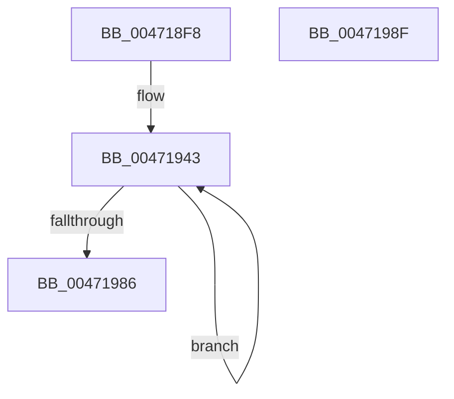

# RtlFnToFxFrame

- RVA: `0x004718F8`–`0x00471990` (길이 `152` bytes)
- VA: `0x00000001404718F8`
- 실행 섹션: `.text`
- PDB 이름 있음: `예`; PDB Function 태그: `아니요`
- unwind 정보 RVA: `0x00071750`
- 디코드: `42`개 명령, `152/152` bytes 표시
- 미해석 바이트: `0` (있으면 어셈블리에 `.byte`로 보존)

> 이 문서는 커널 이미지의 기계어와 PDB 기호를 분석해 생성했습니다. 4번과 5번은 함수 원형과 자료형을 바이너리 사용 방식에서 추정한 C 해석이며 원본 소스 복구 결과는 아닙니다.

## 1. Dependencies

- 직접 호출 지점: **0**; 고유 호출 대상: **0**
- 직접 호출자로 확인된 함수: **1**
- RIP 상대 이미지 참조: **0**

### Outgoing calls
- 직접 디코드된 call 명령이 없습니다.

### Direct callers
- [RtlpWow64CtxToAmd64](../../page/A6/RtlpWow64CtxToAmd64_function_00A67188.md) at `0x00A672D9`

### Static image references
- 디코드된 RIP-relative 메모리 참조가 없습니다.

## 2. Other-region calls and transfers

- 다른 실행 섹션으로 향하는 call: **0**
- 별도 외부 분기/꼬리 이동을 확인하지 못했습니다.

## 3. Assembly (complete function range)

```asm
004718F8  48 89 5C 24 08                  mov qword ptr [rsp + 8], rbx
004718FD  0F B7 02                        movzx eax, word ptr [rdx]
00471900  4C 8D 51 20                     lea r10, [rcx + 0x20]
00471904  66 89 01                        mov word ptr [rcx], ax
00471907  45 33 C0                        xor r8d, r8d
0047190A  0F B7 42 04                     movzx eax, word ptr [rdx + 4]
0047190E  45 8B C8                        mov r9d, r8d
00471911  66 89 41 02                     mov word ptr [rcx + 2], ax
00471915  BB 00 C0 00 00                  mov ebx, 0xc000
0047191A  8B 42 0C                        mov eax, dword ptr [rdx + 0xc]
0047191D  89 41 08                        mov dword ptr [rcx + 8], eax
00471920  0F B7 42 10                     movzx eax, word ptr [rdx + 0x10]
00471924  66 89 41 0C                     mov word ptr [rcx + 0xc], ax
00471928  0F B7 42 12                     movzx eax, word ptr [rdx + 0x12]
0047192C  66 89 41 06                     mov word ptr [rcx + 6], ax
00471930  8B 42 14                        mov eax, dword ptr [rdx + 0x14]
00471933  89 41 10                        mov dword ptr [rcx + 0x10], eax
00471936  0F B7 42 18                     movzx eax, word ptr [rdx + 0x18]
0047193A  66 89 41 14                     mov word ptr [rcx + 0x14], ax
0047193E  44 0F B7 5A 08                  movzx r11d, word ptr [rdx + 8]
00471943  43 8D 04 89                     lea eax, [r9 + r9*4]
00471947  03 C0                           add eax, eax
00471949  F2 0F 10 44 10 1C               movsd xmm0, qword ptr [rax + rdx + 0x1c]
0047194F  F2 41 0F 11 02                  movsd qword ptr [r10], xmm0
00471954  4D 8D 52 10                     lea r10, [r10 + 0x10]
00471958  0F B7 44 10 24                  movzx eax, word ptr [rax + rdx + 0x24]
0047195D  66 41 89 42 F8                  mov word ptr [r10 - 8], ax
00471962  41 0F B7 C3                     movzx eax, r11w
00471966  66 23 C3                        and ax, bx
00471969  66 3B C3                        cmp ax, bx
0047196C  0F 95 C0                        setne al
0047196F  45 02 C0                        add r8b, r8b
00471972  41 02 C0                        add al, r8b
00471975  66 41 C1 E3 02                  shl r11w, 2
0047197A  41 FF C1                        inc r9d
0047197D  44 8A C0                        mov r8b, al
00471980  41 83 F9 08                     cmp r9d, 8
00471984  72 BD                           jb 0x140471943
00471986  48 8B 5C 24 08                  mov rbx, qword ptr [rsp + 8]
0047198B  88 41 04                        mov byte ptr [rcx + 4], al
0047198E  C3                              ret
0047198F  CC                              int3
```

## 4. C-style interpretation (structured pseudocode)

```c
__int64 __fastcall RtlFnToFxFrame(__int64 a1, __int64 a2, int a3)
{
    __int64 result;
    __int64 v_r11;
    unsigned __int64 v_stack_p8;

    v_stack_p8 = v_rbx;
    *(unsigned __int16 *)(a1) = (unsigned __int16)(*(unsigned __int16 *)(a2));
    a3 = 0;
    *(unsigned __int16 *)(a1 + 2) = (unsigned __int16)(*(unsigned __int16 *)(a2 + 4));
    *(unsigned int *)(a1 + 8) = (unsigned int)((unsigned int)(*(unsigned int *)(a2 + 12)));
    *(unsigned __int16 *)(a1 + 12) = (unsigned __int16)(*(unsigned __int16 *)(a2 + 16));
    *(unsigned __int16 *)(a1 + 6) = (unsigned __int16)(*(unsigned __int16 *)(a2 + 18));
    *(unsigned int *)(a1 + 16) = (unsigned int)((unsigned int)(*(unsigned int *)(a2 + 20)));
    *(unsigned __int16 *)(a1 + 20) = (unsigned __int16)(*(unsigned __int16 *)(a2 + 24));
loc_00471943:
    result = (unsigned int)((0 + 0 * 4) + ((unsigned int)(0 + 0 * 4)));
    *(unsigned __int64 *)(a1 + 32) = v_xmm0;
    *(unsigned __int16 *)(a1 + 32 + 16 - 8) = (unsigned __int16)(*(unsigned __int16 *)(result + a2 * 1 + 36));
    result = (unsigned __int16)(((unsigned __int16)(*(unsigned __int16 *)(a2 + 8))) & ((unsigned __int16)((unsigned int)(0xC000ULL))));
    result = (((unsigned __int16)(result)) != ((unsigned __int16)((unsigned int)(0xC000ULL)))) ? 1 : 0;
    a3 = (unsigned __int8)((a3) + (0));
    result = (unsigned __int8)((result) + ((unsigned __int8)(a3)));
    v_r11 = (unsigned __int16)((*(unsigned __int16 *)(a2 + 8)) << (2));
    a4 = (unsigned int)((0) + 1);
    if (((unsigned int)(a4)) < 8) goto loc_00471943;
    *(unsigned __int8 *)(a1 + 4) = (unsigned __int8)(result);
    return result;
}
```

## 5. (Beta) C Style

```c
int64_t RtlFnToFxFrame(void *Arg1, void *Arg2, int32_t Arg3)
{
    uint8_t *arg1 = (uint8_t *)Arg1;
    uint8_t *arg2 = (uint8_t *)Arg2;

    int64_t result;
    int64_t local_r11;
    uint64_t v_stack_p8;

    v_stack_p8 = local_rbx;
    *(uint16_t *)(arg1) = (uint16_t)(*(uint16_t *)(arg2));
    Arg3 = 0;
    *(uint16_t *)(arg1 + 0x2) = (uint16_t)(*(uint16_t *)(arg2 + 0x4));
    *(uint32_t *)(arg1 + 0x8) = (uint32_t)((uint32_t)(*(uint32_t *)(arg2 + 0xC)));
    *(uint16_t *)(arg1 + 0xC) = (uint16_t)(*(uint16_t *)(arg2 + 0x10));
    *(uint16_t *)(arg1 + 0x6) = (uint16_t)(*(uint16_t *)(arg2 + 0x12));
    *(uint32_t *)(arg1 + 0x10) = (uint32_t)((uint32_t)(*(uint32_t *)(arg2 + 0x14)));
    *(uint16_t *)(arg1 + 0x14) = (uint16_t)(*(uint16_t *)(arg2 + 0x18));
loc_00471943:
    result = (uint32_t)((0 + 0 * 4) + ((uint32_t)(0 + 0 * 4)));
    *(uint64_t *)(arg1 + 0x20) = v_xmm0;
    *(uint16_t *)(arg1 + 0x20 + 0x10 - 0x8) = (uint16_t)(*(uint16_t *)(result + arg2 * 1 + 0x24));
    result = (uint16_t)(((uint16_t)(*(uint16_t *)(arg2 + 0x8))) & ((uint16_t)((uint32_t)(0xC000ULL))));
    result = (((uint16_t)(result)) != ((uint16_t)((uint32_t)(0xC000ULL)))) ? 1 : 0;
    Arg3 = (uint8_t)((Arg3) + (0));
    result = (uint8_t)((result) + ((uint8_t)(Arg3)));
    local_r11 = (uint16_t)((*(uint16_t *)(arg2 + 0x8)) << (2));
    a4 = (uint32_t)((0) + 1);
    if (((uint32_t)(a4)) < 8) goto loc_00471943;
    *(uint8_t *)(arg1 + 0x4) = (uint8_t)(result);
    return result;
}
```

### 관측된 메모리 오프셋

구조체 형식이 확인되지 않은 접근은 인자 기준의 오프셋으로만 기록했습니다.

| 기준 인자 | 오프셋 표현 | 폭 (bit) | 접근 |
|---|---:|---:|---|
| `Arg1` | `- 0x8` | `16` | `W` |
| `Arg1` | `+ 0x0` | `16` | `W` |
| `Arg1` | `+ 0x0` | `64` | `W` |
| `Arg1` | `+ 0x2` | `16` | `W` |
| `Arg1` | `+ 0x4` | `8` | `W` |
| `Arg1` | `+ 0x6` | `16` | `W` |
| `Arg1` | `+ 0x8` | `32` | `W` |
| `Arg1` | `+ 0xC` | `16` | `W` |
| `Arg1` | `+ 0x10` | `32` | `W` |
| `Arg1` | `+ 0x10` | `64` | `R` |
| `Arg1` | `+ 0x14` | `16` | `W` |
| `Arg1` | `+ 0x20` | `64` | `R` |
| `Arg2` | `+ 0x0` | `16` | `R` |
| `Arg2` | `+ 0x4` | `16` | `R` |
| `Arg2` | `+ 0x8` | `16` | `R` |
| `Arg2` | `+ 0xC` | `32` | `R` |
| `Arg2` | `+ 0x10` | `16` | `R` |
| `Arg2` | `+ 0x12` | `16` | `R` |
| `Arg2` | `+ 0x14` | `32` | `R` |
| `Arg2` | `+ 0x18` | `16` | `R` |

## 6. Execution-region graph

[열기: 2D/3D 그래프와 함수 탐색 컨트롤 패널](../../../control-panel.html?section=text&rva=0x004718F8&view=graph)

- 2D 그래프는 위에서 아래로 흐르고, 3D 그래프는 빈 공간을 드래그해 회전합니다. Shift+드래그는 이동, 휠은 확대·축소, 함수 노드 선택은 대상 보고서 이동입니다.

### Static fallback


