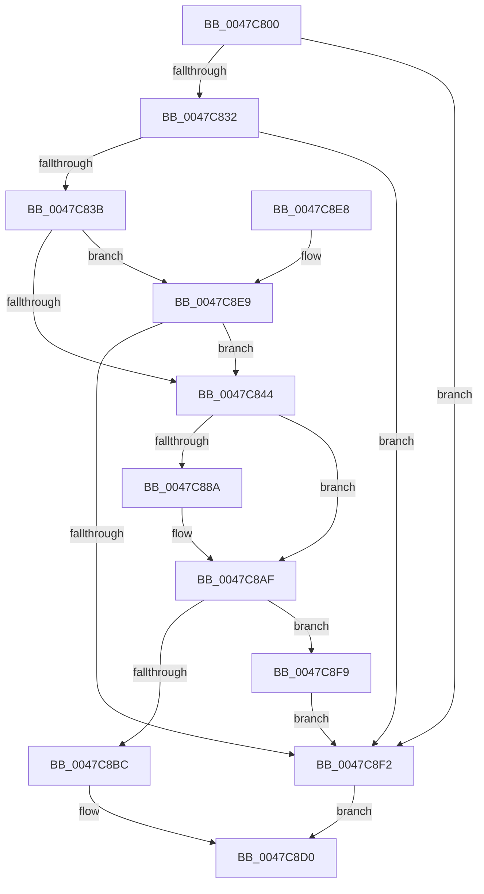

# RtlIpv4AddressToStringExA

- RVA: `0x0047C800`–`0x0047C8FD` (길이 `253` bytes)
- VA: `0x000000014047C800`
- 실행 섹션: `.text`
- PDB 이름 있음: `예`; PDB Function 태그: `아니요`
- unwind 정보 RVA: `0x000AD820`
- 디코드: `74`개 명령, `253/253` bytes 표시
- 미해석 바이트: `0` (있으면 어셈블리에 `.byte`로 보존)

> 이 문서는 커널 이미지의 기계어와 PDB 기호를 분석해 생성했습니다. 4번과 5번은 함수 원형과 자료형을 바이너리 사용 방식에서 추정한 C 해석이며 원본 소스 복구 결과는 아닙니다.

## 1. Dependencies

- 직접 호출 지점: **4**; 고유 호출 대상: **3**
- 직접 호출자로 확인된 함수: **0**
- RIP 상대 이미지 참조: **3**

### Outgoing calls
- `0x0047C875` → [sprintf_s](../50/sprintf_s_function_00505E40.md) (function, `0x00505E40`)
- `0x0047C8A4` → [sprintf_s](../50/sprintf_s_function_00505E40.md) (function, `0x00505E40`)
- `0x0047C8C7` → [memcpy](../6C/memcpy_function_006C6840.md) (function, `0x006C6840`)
- `0x0047C8D8` → [_security_check_cookie](../6A/_security_check_cookie_function_006AC640.md) (function, `0x006AC640`)

### Direct callers
- 이 함수 시작 RVA로 연결되는 직접 call은 확인되지 않았습니다. 간접 호출은 완전히 역산할 수 없습니다.

### Static image references
- `0x0047C80B` → RVA `0x00E0A740` (`.data`; read)
- `0x0047C86A` → RVA `0x006CCBF0` (` ?? ::FNODOBFM::`string'`; read)
- `0x0047C897` → RVA `0x006CCBE0` (` ?? ::FNODOBFM::`string'`; read)

## 2. Other-region calls and transfers

- 다른 실행 섹션으로 향하는 call: **0**
- 별도 외부 분기/꼬리 이동을 확인하지 못했습니다.

## 3. Assembly (complete function range)

```asm
0047C800  40 53                           push rbx
0047C802  55                              push rbp
0047C803  56                              push rsi
0047C804  57                              push rdi
0047C805  41 56                           push r14
0047C807  48 83 EC 60                     sub rsp, 0x60
0047C80B  48 8B 05 2E DF 98 00            mov rax, qword ptr [rip + 0x98df2e]
0047C812  48 33 C4                        xor rax, rsp
0047C815  48 89 44 24 58                  mov qword ptr [rsp + 0x58], rax
0047C81A  45 33 F6                        xor r14d, r14d
0047C81D  49 8B F9                        mov rdi, r9
0047C820  49 8B E8                        mov rbp, r8
0047C823  0F B7 F2                        movzx esi, dx
0047C826  48 8B C1                        mov rax, rcx
0047C829  48 85 C9                        test rcx, rcx
0047C82C  0F 84 C0 00 00 00               je 0x14047c8f2
0047C832  4D 85 C9                        test r9, r9
0047C835  0F 84 B7 00 00 00               je 0x14047c8f2
0047C83B  4D 85 C0                        test r8, r8
0047C83E  0F 84 A5 00 00 00               je 0x14047c8e9
0047C844  0F B6 50 02                     movzx edx, byte ptr [rax + 2]
0047C848  44 0F B6 40 01                  movzx r8d, byte ptr [rax + 1]
0047C84D  0F B6 49 03                     movzx ecx, byte ptr [rcx + 3]
0047C851  8B 00                           mov eax, dword ptr [rax]
0047C853  89 4C 24 30                     mov dword ptr [rsp + 0x30], ecx
0047C857  48 8D 4C 24 40                  lea rcx, [rsp + 0x40]
0047C85C  89 54 24 28                     mov dword ptr [rsp + 0x28], edx
0047C860  BA 10 00 00 00                  mov edx, 0x10
0047C865  44 89 44 24 20                  mov dword ptr [rsp + 0x20], r8d
0047C86A  4C 8D 05 7F 03 25 00            lea r8, [rip + 0x25037f]
0047C871  44 0F B6 C8                     movzx r9d, al
0047C875  E8 C6 95 08 00                  call 0x140505e40
0047C87A  48 63 C8                        movsxd rcx, eax
0047C87D  48 8D 5C 24 40                  lea rbx, [rsp + 0x40]
0047C882  48 03 D9                        add rbx, rcx
0047C885  66 85 F6                        test si, si
0047C888  74 25                           je 0x14047c8af
0047C88A  66 C1 CE 08                     ror si, 8
0047C88E  48 8D 54 24 56                  lea rdx, [rsp + 0x56]
0047C893  44 0F B7 CE                     movzx r9d, si
0047C897  4C 8D 05 42 03 25 00            lea r8, [rip + 0x250342]
0047C89E  48 2B D3                        sub rdx, rbx
0047C8A1  48 8B CB                        mov rcx, rbx
0047C8A4  E8 97 95 08 00                  call 0x140505e40
0047C8A9  48 63 C8                        movsxd rcx, eax
0047C8AC  48 03 D9                        add rbx, rcx
0047C8AF  48 8D 44 24 40                  lea rax, [rsp + 0x40]
0047C8B4  2B D8                           sub ebx, eax
0047C8B6  FF C3                           inc ebx
0047C8B8  39 1F                           cmp dword ptr [rdi], ebx
0047C8BA  72 3D                           jb 0x14047c8f9
0047C8BC  44 8B C3                        mov r8d, ebx
0047C8BF  48 8D 54 24 40                  lea rdx, [rsp + 0x40]
0047C8C4  48 8B CD                        mov rcx, rbp
0047C8C7  E8 74 9F 24 00                  call 0x1406c6840
0047C8CC  33 C0                           xor eax, eax
0047C8CE  89 1F                           mov dword ptr [rdi], ebx
0047C8D0  48 8B 4C 24 58                  mov rcx, qword ptr [rsp + 0x58]
0047C8D5  48 33 CC                        xor rcx, rsp
0047C8D8  E8 63 FD 22 00                  call 0x1406ac640
0047C8DD  48 83 C4 60                     add rsp, 0x60
0047C8E1  41 5E                           pop r14
0047C8E3  5F                              pop rdi
0047C8E4  5E                              pop rsi
0047C8E5  5D                              pop rbp
0047C8E6  5B                              pop rbx
0047C8E7  C3                              ret
0047C8E8  CC                              int3
0047C8E9  45 39 31                        cmp dword ptr [r9], r14d
0047C8EC  0F 84 52 FF FF FF               je 0x14047c844
0047C8F2  B8 0D 00 00 C0                  mov eax, 0xc000000d
0047C8F7  EB D7                           jmp 0x14047c8d0
0047C8F9  89 1F                           mov dword ptr [rdi], ebx
0047C8FB  EB F5                           jmp 0x14047c8f2
```

## 4. C-style interpretation (structured pseudocode)

```c
__int64 __fastcall RtlIpv4AddressToStringExA(__int64 a1, unsigned __int16 a2, __int64 a3, __int64 a4)
{
    __int64 result;
    __int64 v_r14;
    __int64 v_rbx;
    __int64 v_rsp;
    unsigned __int64 v_stack_m30;
    unsigned __int64 v_stack_m32;
    unsigned __int64 v_stack_m48;
    unsigned int v_stack_m58;
    unsigned int v_stack_m60;
    unsigned int v_stack_m68;

    v_rsp = (v_rsp) - (96);
    result = (*(unsigned __int64 *)(v_rip + 10018606)) ^ (v_rsp);
    v_stack_m30 = result;
    v_r14 = 0;
    if (a1 == 0) goto loc_0047C8F2;
    if (a4 == 0) goto loc_0047C8F2;
    if (a3 == 0) goto loc_0047C8E9;
loc_0047C844:
    v_stack_m58 = (unsigned int)(*(unsigned __int8 *)(a1 + 3));
    v_stack_m60 = (unsigned int)(*(unsigned __int8 *)(a1 + 2));
    v_stack_m68 = (unsigned int)(*(unsigned __int8 *)(a1 + 1));
    result = sprintf_s(v_stack_m48, 16, v_rip + 2425727, (unsigned __int8)((unsigned int)(*(unsigned int *)(a1))));
    v_rbx = (v_stack_m48) + ((int)((unsigned int)(result)));
    if (a2 != 0) {
        a2 = v_stack_m32;
        a4 = a2;
        a3 = v_rip + 2425666;
        a2 = (a2) - (v_rbx);
        a1 = v_rbx;
        result = sprintf_s(a1, a2, a3, a4);
        a1 = (int)((unsigned int)(result));
        v_rbx = (v_rbx) + (a1);
    }
    v_rbx = (unsigned int)((v_rbx) - ((unsigned int)(v_stack_m48)));
    v_rbx = (unsigned int)((v_rbx) + 1);
    if ((*(unsigned int *)(a4)) < ((unsigned int)(v_rbx))) goto loc_0047C8F9;
    result = memcpy(a3, v_stack_m48, (unsigned int)((unsigned int)(v_rbx)), a4);
    result = 0;
    *(unsigned int *)(a4) = (unsigned int)(v_rbx);
loc_0047C8D0:
    a1 = (v_stack_m30) ^ (v_rsp);
    result = _security_check_cookie(a1, v_stack_m48, (unsigned int)((unsigned int)(v_rbx)), a4);
    v_rsp = (v_rsp) + (96);
    return result;
loc_0047C8E9:
    if ((*(unsigned int *)(a4)) == 0) goto loc_0047C844;
loc_0047C8F2:
    goto loc_0047C8D0;
loc_0047C8F9:
    *(unsigned int *)(a4) = (unsigned int)(v_rbx);
    goto loc_0047C8F2;
}
```

## 5. (Beta) C Style

```c
int64_t RtlIpv4AddressToStringExA(void *Arg1, uint16_t Arg2, int64_t Arg3, void *Arg4)
{
    uint8_t *arg1 = (uint8_t *)Arg1;
    uint8_t *arg4 = (uint8_t *)Arg4;

    int64_t result;
    int64_t local_r14;
    int64_t local_rbx;
    int64_t local_rsp;
    uint64_t v_stack_m30;
    uint64_t v_stack_m32;
    uint64_t v_stack_m48;
    uint32_t v_stack_m58;
    uint32_t v_stack_m60;
    uint32_t v_stack_m68;

    local_rsp = (local_rsp) - (96);
    result = (*(uint64_t *)(v_rip + 0x98DF2E)) ^ (local_rsp);
    v_stack_m30 = result;
    local_r14 = 0;
    if (Arg1 == NULL) goto loc_0047C8F2;
    if (Arg4 == NULL) goto loc_0047C8F2;
    if (Arg3 == 0) goto loc_0047C8E9;
loc_0047C844:
    v_stack_m58 = (uint32_t)(*(uint8_t *)(arg1 + 0x3));
    v_stack_m60 = (uint32_t)(*(uint8_t *)(arg1 + 0x2));
    v_stack_m68 = (uint32_t)(*(uint8_t *)(arg1 + 0x1));
    result = sprintf_s(v_stack_m48, 16, v_rip + 2425727, (uint8_t)((uint32_t)(*(uint32_t *)(arg1))));
    local_rbx = (v_stack_m48) + ((int32_t)((uint32_t)(result)));
    if (Arg2 != 0) {
        Arg2 = v_stack_m32;
        Arg4 = Arg2;
        Arg3 = v_rip + 2425666;
        Arg2 = (Arg2) - (local_rbx);
        Arg1 = local_rbx;
        result = sprintf_s(Arg1, Arg2, Arg3, Arg4);
        Arg1 = (int32_t)((uint32_t)(result));
        local_rbx = (local_rbx) + (Arg1);
    }
    local_rbx = (uint32_t)((local_rbx) - ((uint32_t)(v_stack_m48)));
    local_rbx = (uint32_t)((local_rbx) + 1);
    if ((*(uint32_t *)(arg4)) < ((uint32_t)(local_rbx))) goto loc_0047C8F9;
    result = memcpy(Arg3, v_stack_m48, (uint32_t)((uint32_t)(local_rbx)), Arg4);
    result = 0;
    *(uint32_t *)(arg4) = (uint32_t)(local_rbx);
loc_0047C8D0:
    Arg1 = (v_stack_m30) ^ (local_rsp);
    result = _security_check_cookie(Arg1, v_stack_m48, (uint32_t)((uint32_t)(local_rbx)), Arg4);
    local_rsp = (local_rsp) + (96);
    return result;
loc_0047C8E9:
    if ((*(uint32_t *)(arg4)) == 0) goto loc_0047C844;
loc_0047C8F2:
    goto loc_0047C8D0;
loc_0047C8F9:
    *(uint32_t *)(arg4) = (uint32_t)(local_rbx);
    goto loc_0047C8F2;
}
```

### 관측된 메모리 오프셋

구조체 형식이 확인되지 않은 접근은 인자 기준의 오프셋으로만 기록했습니다.

| 기준 인자 | 오프셋 표현 | 폭 (bit) | 접근 |
|---|---:|---:|---|
| `Arg1` | `+ 0x0` | `32` | `R` |
| `Arg1` | `+ 0x1` | `8` | `R` |
| `Arg1` | `+ 0x2` | `8` | `R` |
| `Arg4` | `+ 0x0` | `32` | `R` |
| `Arg4` | `+ 0x0` | `32` | `W` |

## 6. Execution-region graph

[열기: 2D/3D 그래프와 함수 탐색 컨트롤 패널](../../../control-panel.html?section=text&rva=0x0047C800&view=graph)

- 2D 그래프는 위에서 아래로 흐르고, 3D 그래프는 빈 공간을 드래그해 회전합니다. Shift+드래그는 이동, 휠은 확대·축소, 함수 노드 선택은 대상 보고서 이동입니다.

### Static fallback


