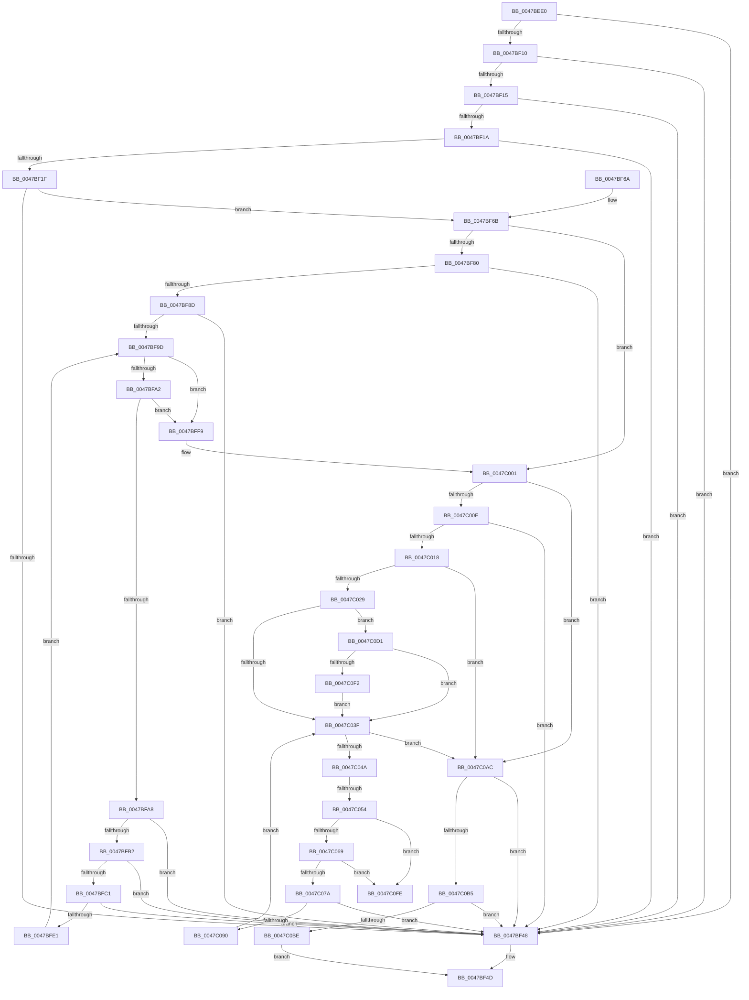

# RtlIpv6StringToAddressExW

- RVA: `0x0047BEE0`–`0x0047C109` (길이 `553` bytes)
- VA: `0x000000014047BEE0`
- 실행 섹션: `.text`
- PDB 이름 있음: `예`; PDB Function 태그: `예`
- unwind 정보 RVA: `0x000AD77C`
- 디코드: `155`개 명령, `553/553` bytes 표시
- 미해석 바이트: `0` (있으면 어셈블리에 `.byte`로 보존)

> 이 문서는 커널 이미지의 기계어와 PDB 기호를 분석해 생성했습니다. 4번과 5번은 함수 원형과 자료형을 바이너리 사용 방식에서 추정한 C 해석이며 원본 소스 복구 결과는 아닙니다.

## 1. Dependencies

- 직접 호출 지점: **4**; 고유 호출 대상: **2**
- 직접 호출자로 확인된 함수: **0**
- RIP 상대 이미지 참조: **0**

### Outgoing calls
- `0x0047BF3F` → [RtlIpv6StringToAddressW](RtlIpv6StringToAddressW_function_0047C110.md) (function, `0x0047C110`)
- `0x0047BF94` → [iswctype](../50/iswctype_function_00502900.md) (function, `0x00502900`)
- `0x0047BFB8` → [iswctype](../50/iswctype_function_00502900.md) (function, `0x00502900`)
- `0x0047C05C` → [iswctype](../50/iswctype_function_00502900.md) (function, `0x00502900`)

### Direct callers
- 이 함수 시작 RVA로 연결되는 직접 call은 확인되지 않았습니다. 간접 호출은 완전히 역산할 수 없습니다.

### Static image references
- 디코드된 RIP-relative 메모리 참조가 없습니다.

## 2. Other-region calls and transfers

- 다른 실행 섹션으로 향하는 call: **0**
- call이 아닌 외부 분기/꼬리 이동: **2**
  - `0x0047C04E` → [sub_006F49D4](../6F/Unknown_function_006F49D4.md) (`tail-transfer`)
  - `0x0047C104` → [sub_006F49D4](../6F/Unknown_function_006F49D4.md) (`tail-transfer`)

## 3. Assembly (complete function range)

```asm
0047BEE0  4C 8B DC                        mov r11, rsp
0047BEE3  49 89 5B 10                     mov qword ptr [r11 + 0x10], rbx
0047BEE7  49 89 6B 18                     mov qword ptr [r11 + 0x18], rbp
0047BEEB  49 89 73 20                     mov qword ptr [r11 + 0x20], rsi
0047BEEF  57                              push rdi
0047BEF0  41 54                           push r12
0047BEF2  41 55                           push r13
0047BEF4  41 56                           push r14
0047BEF6  41 57                           push r15
0047BEF8  48 83 EC 20                     sub rsp, 0x20
0047BEFC  33 FF                           xor edi, edi
0047BEFE  4D 8B F9                        mov r15, r9
0047BF01  49 89 7B 08                     mov qword ptr [r11 + 8], rdi
0047BF05  4D 8B E0                        mov r12, r8
0047BF08  48 8B C1                        mov rax, rcx
0047BF0B  48 85 C9                        test rcx, rcx
0047BF0E  74 38                           je 0x14047bf48
0047BF10  48 85 D2                        test rdx, rdx
0047BF13  74 33                           je 0x14047bf48
0047BF15  4D 85 C0                        test r8, r8
0047BF18  74 2E                           je 0x14047bf48
0047BF1A  4D 85 C9                        test r9, r9
0047BF1D  74 29                           je 0x14047bf48
0047BF1F  0F B7 29                        movzx ebp, word ptr [rcx]
0047BF22  4C 8B C2                        mov r8, rdx
0047BF25  66 83 FD 5B                     cmp bp, 0x5b
0047BF29  48 8D 49 02                     lea rcx, [rcx + 2]
0047BF2D  49 8D 53 08                     lea rdx, [r11 + 8]
0047BF31  0F B7 F7                        movzx esi, di
0047BF34  48 0F 45 C8                     cmovne rcx, rax
0047BF38  44 8B F7                        mov r14d, edi
0047BF3B  41 0F 94 C5                     sete r13b
0047BF3F  E8 CC 01 00 00                  call 0x14047c110
0047BF44  85 C0                           test eax, eax
0047BF46  79 23                           jns 0x14047bf6b
0047BF48  B8 0D 00 00 C0                  mov eax, 0xc000000d
0047BF4D  48 8B 5C 24 58                  mov rbx, qword ptr [rsp + 0x58]
0047BF52  48 8B 6C 24 60                  mov rbp, qword ptr [rsp + 0x60]
0047BF57  48 8B 74 24 68                  mov rsi, qword ptr [rsp + 0x68]
0047BF5C  48 83 C4 20                     add rsp, 0x20
0047BF60  41 5F                           pop r15
0047BF62  41 5E                           pop r14
0047BF64  41 5D                           pop r13
0047BF66  41 5C                           pop r12
0047BF68  5F                              pop rdi
0047BF69  C3                              ret
0047BF6A  CC                              int3
0047BF6B  48 8B 5C 24 50                  mov rbx, qword ptr [rsp + 0x50]
0047BF70  41 B8 80 00 00 00               mov r8d, 0x80
0047BF76  66 83 3B 25                     cmp word ptr [rbx], 0x25
0047BF7A  0F 85 81 00 00 00               jne 0x14047c001
0047BF80  48 83 C3 02                     add rbx, 2
0047BF84  0F B7 3B                        movzx edi, word ptr [rbx]
0047BF87  66 41 3B F8                     cmp di, r8w
0047BF8B  73 BB                           jae 0x14047bf48
0047BF8D  41 8D 50 84                     lea edx, [r8 - 0x7c]
0047BF91  0F B7 CF                        movzx ecx, di
0047BF94  E8 67 69 08 00                  call 0x140502900
0047BF99  85 C0                           test eax, eax
0047BF9B  74 AB                           je 0x14047bf48
0047BF9D  66 85 FF                        test di, di
0047BFA0  74 57                           je 0x14047bff9
0047BFA2  66 83 FF 5D                     cmp di, 0x5d
0047BFA6  74 51                           je 0x14047bff9
0047BFA8  B8 80 00 00 00                  mov eax, 0x80
0047BFAD  66 3B F8                        cmp di, ax
0047BFB0  73 96                           jae 0x14047bf48
0047BFB2  8D 50 84                        lea edx, [rax - 0x7c]
0047BFB5  0F B7 CF                        movzx ecx, di
0047BFB8  E8 43 69 08 00                  call 0x140502900
0047BFBD  85 C0                           test eax, eax
0047BFBF  74 87                           je 0x14047bf48
0047BFC1  41 8B C6                        mov eax, r14d
0047BFC4  48 8D 14 80                     lea rdx, [rax + rax*4]
0047BFC8  0F B7 C7                        movzx eax, di
0047BFCB  48 8D 52 E8                     lea rdx, [rdx - 0x18]
0047BFCF  48 8D 14 50                     lea rdx, [rax + rdx*2]
0047BFD3  B8 FF FF FF FF                  mov eax, 0xffffffff
0047BFD8  48 3B D0                        cmp rdx, rax
0047BFDB  0F 87 67 FF FF FF               ja 0x14047bf48
0047BFE1  0F B7 C7                        movzx eax, di
0047BFE4  41 8D 4E FA                     lea ecx, [r14 - 6]
0047BFE8  48 83 C3 02                     add rbx, 2
0047BFEC  41 8D 0C 8E                     lea ecx, [r14 + rcx*4]
0047BFF0  44 8D 34 48                     lea r14d, [rax + rcx*2]
0047BFF4  0F B7 3B                        movzx edi, word ptr [rbx]
0047BFF7  EB A4                           jmp 0x14047bf9d
0047BFF9  41 B8 80 00 00 00               mov r8d, 0x80
0047BFFF  33 FF                           xor edi, edi
0047C001  0F B7 03                        movzx eax, word ptr [rbx]
0047C004  66 83 F8 5D                     cmp ax, 0x5d
0047C008  0F 85 9E 00 00 00               jne 0x14047c0ac
0047C00E  66 83 FD 5B                     cmp bp, 0x5b
0047C012  0F 85 30 FF FF FF               jne 0x14047bf48
0047C018  0F B7 43 02                     movzx eax, word ptr [rbx + 2]
0047C01C  44 8A EF                        mov r13b, dil
0047C01F  66 83 F8 3A                     cmp ax, 0x3a
0047C023  0F 85 83 00 00 00               jne 0x14047c0ac
0047C029  48 8D 7B 04                     lea rdi, [rbx + 4]
0047C02D  BD 0A 00 00 00                  mov ebp, 0xa
0047C032  66 83 3F 30                     cmp word ptr [rdi], 0x30
0047C036  8D 5D 06                        lea ebx, [rbp + 6]
0047C039  0F 84 92 00 00 00               je 0x14047c0d1
0047C03F  0F B7 07                        movzx eax, word ptr [rdi]
0047C042  0F B7 D8                        movzx ebx, ax
0047C045  66 85 C0                        test ax, ax
0047C048  74 62                           je 0x14047c0ac
0047C04A  66 41 3B C0                     cmp ax, r8w
0047C04E  0F 83 80 89 27 00               jae 0x1406f49d4
0047C054  BA 04 00 00 00                  mov edx, 4
0047C059  0F B7 C8                        movzx ecx, ax
0047C05C  E8 9F 68 08 00                  call 0x140502900
0047C061  85 C0                           test eax, eax
0047C063  0F 84 95 00 00 00               je 0x14047c0fe
0047C069  0F B7 CB                        movzx ecx, bx
0047C06C  0F B7 D5                        movzx edx, bp
0047C06F  8D 41 D0                        lea eax, [rcx - 0x30]
0047C072  3B C2                           cmp eax, edx
0047C074  0F 8D 84 00 00 00               jge 0x14047c0fe
0047C07A  0F B7 C6                        movzx eax, si
0047C07D  0F AF C2                        imul eax, edx
0047C080  83 C0 D0                        add eax, -0x30
0047C083  03 C1                           add eax, ecx
0047C085  3D FF FF 00 00                  cmp eax, 0xffff
0047C08A  0F 87 B8 FE FF FF               ja 0x14047bf48
0047C090  0F B7 C6                        movzx eax, si
0047C093  0F B7 F5                        movzx esi, bp
0047C096  0F AF F0                        imul esi, eax
0047C099  66 83 EE 30                     sub si, 0x30
0047C09D  66 03 F3                        add si, bx
0047C0A0  41 B8 80 00 00 00               mov r8d, 0x80
0047C0A6  48 83 C7 02                     add rdi, 2
0047C0AA  EB 93                           jmp 0x14047c03f
0047C0AC  66 85 C0                        test ax, ax
0047C0AF  0F 85 93 FE FF FF               jne 0x14047bf48
0047C0B5  45 84 ED                        test r13b, r13b
0047C0B8  0F 85 8A FE FF FF               jne 0x14047bf48
0047C0BE  66 C1 CE 08                     ror si, 8
0047C0C2  66 41 89 37                     mov word ptr [r15], si
0047C0C6  33 C0                           xor eax, eax
0047C0C8  45 89 34 24                     mov dword ptr [r12], r14d
0047C0CC  E9 7C FE FF FF                  jmp 0x14047bf4d
0047C0D1  48 8D 4F 02                     lea rcx, [rdi + 2]
0047C0D5  BA DF FF 00 00                  mov edx, 0xffdf
0047C0DA  0F B7 01                        movzx eax, word ptr [rcx]
0047C0DD  BD 08 00 00 00                  mov ebp, 8
0047C0E2  66 83 E8 58                     sub ax, 0x58
0047C0E6  48 8B F9                        mov rdi, rcx
0047C0E9  66 85 C2                        test dx, ax
0047C0EC  0F 85 4D FF FF FF               jne 0x14047c03f
0047C0F2  0F B7 EB                        movzx ebp, bx
0047C0F5  48 8D 79 02                     lea rdi, [rcx + 2]
0047C0F9  E9 41 FF FF FF                  jmp 0x14047c03f
0047C0FE  41 B8 80 00 00 00               mov r8d, 0x80
0047C104  E9 CB 88 27 00                  jmp 0x1406f49d4
```

## 4. C-style interpretation (structured pseudocode)

```c
__int64 __fastcall RtlIpv6StringToAddressExW(__int64 a1, __int64 a2, __int64 a3, __int64 a4)
{
    __int64 result;
    __int64 v_r13;
    __int64 v_rbx;
    __int64 v_rdi;
    __int64 v_rsi;
    __int64 v_rsp;
    unsigned __int64 v_stack_p10;
    unsigned __int64 v_stack_p18;
    unsigned __int64 v_stack_p20;
    unsigned __int64 v_stack_p50;

    *(unsigned __int64 *)(v_rsp + 16) = v_rbx;
    *(unsigned __int64 *)(v_rsp + 24) = v_rbp;
    *(unsigned __int64 *)(v_rsp + 32) = v_rsi;
    v_rsp = (v_rsp) - (32);
    v_rdi = 0;
    *(unsigned __int64 *)(v_rsp + 8) = 0;
    if (a1 == 0) goto loc_0047BF48;
    if (a2 == 0) goto loc_0047BF48;
    if (a3 == 0) goto loc_0047BF48;
    if (a4 == 0) goto loc_0047BF48;
    a1 = a1 + 2;
    if (((unsigned __int16)(*(unsigned __int16 *)(a1))) != 91) { a1 = a1; }
    v_r13 = (((unsigned __int16)(*(unsigned __int16 *)(a1))) == 91) ? 1 : 0;
    result = RtlIpv6StringToAddressW(a1, v_rsp + 8, a2, a4);
    if (!sign_flag) goto loc_0047BF6B;
loc_0047BF48:
loc_0047BF4D:
    v_rsp = (v_rsp) + (32);
    return (unsigned int)(0xC000000DULL);
loc_0047BF6B:
    if ((*(unsigned __int16 *)(v_stack_p50)) != 37) goto loc_0047C001;
    v_rbx = (v_stack_p50) + (2);
    if (((unsigned __int16)(*(unsigned __int16 *)(v_rbx))) >= 128) goto loc_0047BF48;
    result = iswctype((unsigned __int16)(*(unsigned __int16 *)(v_rbx)), 128 - 124, 128, a4);
    if ((unsigned int)(result) == 0) goto loc_0047BF48;
loc_0047BF9D:
    if ((unsigned __int16)(*(unsigned __int16 *)(v_rbx)) == 0) goto loc_0047BFF9;
    if (((unsigned __int16)(*(unsigned __int16 *)(v_rbx))) == 93) goto loc_0047BFF9;
    if (((unsigned __int16)(*(unsigned __int16 *)(v_rbx))) >= 128) goto loc_0047BF48;
    result = iswctype((unsigned __int16)(*(unsigned __int16 *)(v_rbx)), 128 - 124, 128, a4);
    if ((unsigned int)(result) == 0) goto loc_0047BF48;
    if (((unsigned __int16)(*(unsigned __int16 *)(v_rbx)) + 0 + 0 * 4 - 24 * 2) > ((unsigned int)(0xFFFFFFFFULL))) goto loc_0047BF48;
    v_rbx = (v_rbx) + (2);
    goto loc_0047BF9D;
loc_0047BFF9:
    v_rdi = 0;
loc_0047C001:
    if (((unsigned __int16)(*(unsigned __int16 *)(v_rbx))) != 93) goto loc_0047C0AC;
    if (((unsigned __int16)(v_stack_p18)) != 91) goto loc_0047BF48;
    if (((unsigned __int16)(*(unsigned __int16 *)(v_rbx + 2))) != 58) goto loc_0047C0AC;
    if ((*(unsigned __int16 *)(v_rbx + 4)) == 48) goto loc_0047C0D1;
loc_0047C03F:
    if ((unsigned __int16)(*(unsigned __int16 *)(v_rbx + 4)) == 0) goto loc_0047C0AC;
    result = iswctype((unsigned __int16)(*(unsigned __int16 *)(v_rbx + 4)), 4, 128, a4);
    if ((unsigned int)(result) == 0) goto loc_0047C0FE;
    if (((unsigned int)((unsigned __int16)((unsigned __int16)(*(unsigned __int16 *)(v_rbx + 4))) - 48)) >= 10) goto loc_0047C0FE;
    result = (unsigned int)(((unsigned __int16)(v_stack_p20)) * (10));
    result = (unsigned int)((result) + (-48));
    result = (unsigned int)((result) + ((unsigned int)((unsigned __int16)((unsigned __int16)(*(unsigned __int16 *)(v_rbx + 4))))));
    if (((unsigned int)(result)) > 0xFFFFULL) goto loc_0047BF48;
    v_rsi = (unsigned int)((10) * ((unsigned int)((unsigned __int16)(v_stack_p20))));
    v_rsi = (unsigned __int16)((v_rsi) - (48));
    v_rsi = (unsigned __int16)((v_rsi) + ((unsigned __int16)((unsigned __int16)(*(unsigned __int16 *)(v_rbx + 4)))));
    v_rdi = (v_rbx + 4) + (2);
    goto loc_0047C03F;
loc_0047C0AC:
    if ((unsigned __int16)((unsigned __int16)(v_stack_p20)) != 0) goto loc_0047BF48;
    if (0 != 0) goto loc_0047BF48;
    *(unsigned __int16 *)(a4) = (unsigned __int16)(v_rsi);
    result = 0;
    *(unsigned int *)(a3) = (unsigned int)((unsigned __int16)(*(unsigned __int16 *)(v_rbx)) + 0 + 0 - 6 * 4 * 2);
    goto loc_0047BF4D;
loc_0047C0D1:
    result = (unsigned __int16)((*(unsigned __int16 *)(v_rdi + 2)) - (88));
    if ((((unsigned __int16)((unsigned int)(0xFFDFULL))) & ((unsigned __int16)(result))) != 0) goto loc_0047C03F;
    goto loc_0047C03F;
loc_0047C0FE:
}
```

## 5. (Beta) C Style

```c
int64_t RtlIpv6StringToAddressExW(int64_t Arg1, int64_t Arg2, void *Arg3, void *Arg4)
{
    uint8_t *arg3 = (uint8_t *)Arg3;
    uint8_t *arg4 = (uint8_t *)Arg4;

    int64_t result;
    int64_t local_r13;
    int64_t local_rbx;
    int64_t local_rdi;
    int64_t local_rsi;
    int64_t local_rsp;
    uint64_t v_stack_p10;
    uint64_t v_stack_p18;
    uint64_t v_stack_p20;
    uint64_t v_stack_p50;

    *(uint64_t *)(local_rsp + 0x10) = local_rbx;
    *(uint64_t *)(local_rsp + 0x18) = local_rbp;
    *(uint64_t *)(local_rsp + 0x20) = local_rsi;
    local_rsp = (local_rsp) - (32);
    local_rdi = 0;
    *(uint64_t *)(local_rsp + 0x8) = 0;
    if (Arg1 == 0) goto loc_0047BF48;
    if (Arg2 == 0) goto loc_0047BF48;
    if (Arg3 == NULL) goto loc_0047BF48;
    if (Arg4 == NULL) goto loc_0047BF48;
    Arg1 = Arg1 + 2;
    if (((uint16_t)(*(uint16_t *)(Arg1))) != 91) { Arg1 = Arg1; }
    local_r13 = (((uint16_t)(*(uint16_t *)(Arg1))) == 91) ? 1 : 0;
    result = RtlIpv6StringToAddressW(Arg1, local_rsp + 8, Arg2, Arg4);
    if (!sign_flag) goto loc_0047BF6B;
loc_0047BF48:
loc_0047BF4D:
    local_rsp = (local_rsp) + (32);
    return (uint32_t)(0xC000000DULL);
loc_0047BF6B:
    if ((*(uint16_t *)(v_stack_p50)) != 37) goto loc_0047C001;
    local_rbx = (v_stack_p50) + (2);
    if (((uint16_t)(*(uint16_t *)(local_rbx))) >= 128) goto loc_0047BF48;
    result = iswctype((uint16_t)(*(uint16_t *)(local_rbx)), 128 - 124, 128, Arg4);
    if ((uint32_t)(result) == 0) goto loc_0047BF48;
loc_0047BF9D:
    if ((uint16_t)(*(uint16_t *)(local_rbx)) == 0) goto loc_0047BFF9;
    if (((uint16_t)(*(uint16_t *)(local_rbx))) == 93) goto loc_0047BFF9;
    if (((uint16_t)(*(uint16_t *)(local_rbx))) >= 128) goto loc_0047BF48;
    result = iswctype((uint16_t)(*(uint16_t *)(local_rbx)), 128 - 124, 128, Arg4);
    if ((uint32_t)(result) == 0) goto loc_0047BF48;
    if (((uint16_t)(*(uint16_t *)(local_rbx)) + 0 + 0 * 4 - 24 * 2) > ((uint32_t)(0xFFFFFFFFULL))) goto loc_0047BF48;
    local_rbx = (local_rbx) + (2);
    goto loc_0047BF9D;
loc_0047BFF9:
    local_rdi = 0;
loc_0047C001:
    if (((uint16_t)(*(uint16_t *)(local_rbx))) != 93) goto loc_0047C0AC;
    if (((uint16_t)(v_stack_p18)) != 91) goto loc_0047BF48;
    if (((uint16_t)(*(uint16_t *)(local_rbx + 0x2))) != 58) goto loc_0047C0AC;
    if ((*(uint16_t *)(local_rbx + 0x4)) == 48) goto loc_0047C0D1;
loc_0047C03F:
    if ((uint16_t)(*(uint16_t *)(local_rbx + 0x4)) == 0) goto loc_0047C0AC;
    result = iswctype((uint16_t)(*(uint16_t *)(local_rbx + 0x4)), 4, 128, Arg4);
    if ((uint32_t)(result) == 0) goto loc_0047C0FE;
    if (((uint32_t)((uint16_t)((uint16_t)(*(uint16_t *)(local_rbx + 0x4))) - 48)) >= 10) goto loc_0047C0FE;
    result = (uint32_t)(((uint16_t)(v_stack_p20)) * (10));
    result = (uint32_t)((result) + (-48));
    result = (uint32_t)((result) + ((uint32_t)((uint16_t)((uint16_t)(*(uint16_t *)(local_rbx + 0x4))))));
    if (((uint32_t)(result)) > 0xFFFFULL) goto loc_0047BF48;
    local_rsi = (uint32_t)((10) * ((uint32_t)((uint16_t)(v_stack_p20))));
    local_rsi = (uint16_t)((local_rsi) - (48));
    local_rsi = (uint16_t)((local_rsi) + ((uint16_t)((uint16_t)(*(uint16_t *)(local_rbx + 0x4)))));
    local_rdi = (local_rbx + 4) + (2);
    goto loc_0047C03F;
loc_0047C0AC:
    if ((uint16_t)((uint16_t)(v_stack_p20)) != 0) goto loc_0047BF48;
    if (0 != 0) goto loc_0047BF48;
    *(uint16_t *)(arg4) = (uint16_t)(local_rsi);
    result = 0;
    *(uint32_t *)(arg3) = (uint32_t)((uint16_t)(*(uint16_t *)(local_rbx)) + 0 + 0 - 6 * 4 * 2);
    goto loc_0047BF4D;
loc_0047C0D1:
    result = (uint16_t)((*(uint16_t *)(local_rdi + 0x2)) - (88));
    if ((((uint16_t)((uint32_t)(0xFFDFULL))) & ((uint16_t)(result))) != 0) goto loc_0047C03F;
    goto loc_0047C03F;
loc_0047C0FE:
}
```

### 관측된 메모리 오프셋

구조체 형식이 확인되지 않은 접근은 인자 기준의 오프셋으로만 기록했습니다.

| 기준 인자 | 오프셋 표현 | 폭 (bit) | 접근 |
|---|---:|---:|---|
| `Arg3` | `+ 0x0` | `32` | `W` |
| `Arg4` | `+ 0x0` | `16` | `W` |

## 6. Execution-region graph

[열기: 2D/3D 그래프와 함수 탐색 컨트롤 패널](../../../control-panel.html?section=text&rva=0x0047BEE0&view=graph)

- 2D 그래프는 위에서 아래로 흐르고, 3D 그래프는 빈 공간을 드래그해 회전합니다. Shift+드래그는 이동, 휠은 확대·축소, 함수 노드 선택은 대상 보고서 이동입니다.

### Static fallback


