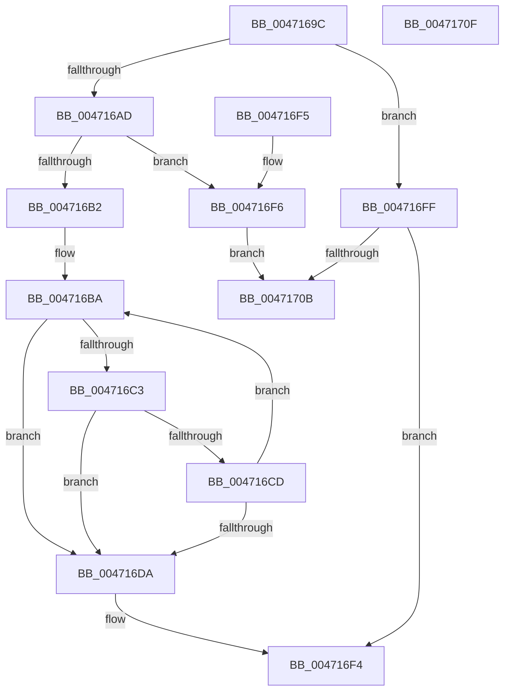

# RtlStringCchCopyNW

- RVA: `0x0047169C`–`0x00471710` (길이 `116` bytes)
- VA: `0x000000014047169C`
- 실행 섹션: `.text`
- PDB 이름 있음: `예`; PDB Function 태그: `아니요`
- unwind 정보 RVA: `0x000DB714`
- 디코드: `40`개 명령, `116/116` bytes 표시
- 미해석 바이트: `0` (있으면 어셈블리에 `.byte`로 보존)

> 이 문서는 커널 이미지의 기계어와 PDB 기호를 분석해 생성했습니다. 4번과 5번은 함수 원형과 자료형을 바이너리 사용 방식에서 추정한 C 해석이며 원본 소스 복구 결과는 아닙니다.

## 1. Dependencies

- 직접 호출 지점: **0**; 고유 호출 대상: **0**
- 직접 호출자로 확인된 함수: **11**
- RIP 상대 이미지 참조: **0**

### Outgoing calls
- 직접 디코드된 call 명령이 없습니다.

### Direct callers
- [PiDevCfgParsePropertyKeyName](../5A/PiDevCfgParsePropertyKeyName_function_005A7E70.md) at `0x005A7F32`
- [IopLogBlockedDriverEvent](../../page/71/IopLogBlockedDriverEvent_function_0071BBFC.md) at `0x0071BC44`
- [SdbpSafeAllocAndConcatW](../../page/81/SdbpSafeAllocAndConcatW_function_00813198.md) at `0x008132B2`
- [SdbQueryDataExTagID](../../page/81/SdbQueryDataExTagID_function_008136E0.md) at `0x008137ED`
- [PiUEventNotifyUserMode](../../page/95/PiUEventNotifyUserMode_function_00954CB4.md) at `0x00954F54`
- [EtwpCoverageSamplerQuery](../../page/95/EtwpCoverageSamplerQuery_function_0095C4A0.md) at `0x0095CDE6`
- [WmipBuildInstanceSet](../../page/9D/WmipBuildInstanceSet_function_009DDFC4.md) at `0x009DE0CD`
- [WmipBuildInstanceSet](../../page/9D/WmipBuildInstanceSet_function_009DDFC4.md) at `0x009DE1CA`
- [IopErrorLogThread](../../page/A5/IopErrorLogThread_function_00A5DC80.md) at `0x00A5DFB3`
- [IopErrorLogThread](../../page/A5/IopErrorLogThread_function_00A5DC80.md) at `0x00A5DFD2`
- [PoQueryProcessEnergyTrackingState](../../page/AA/PoQueryProcessEnergyTrackingState_function_00AAC8D0.md) at `0x00AAC95E`
- [AslPathSplit](../../page/AB/AslPathSplit_function_00ABE87C.md) at `0x00ABE922`
- [AslPathSplit](../../page/AB/AslPathSplit_function_00ABE87C.md) at `0x00ABE98B`
- [sub_00B2EDF4](../../page/B2/Unknown_function_00B2EDF4.md) at `0x00B2EEF5`

### Static image references
- 디코드된 RIP-relative 메모리 참조가 없습니다.

## 2. Other-region calls and transfers

- 다른 실행 섹션으로 향하는 call: **0**
- 별도 외부 분기/꼬리 이동을 확인하지 못했습니다.

## 3. Assembly (complete function range)

```asm
0047169C  48 8D 42 FF                     lea rax, [rdx - 1]
004716A0  4C 8B D2                        mov r10, rdx
004716A3  BA FE FF FF 7F                  mov edx, 0x7ffffffe
004716A8  48 3B C2                        cmp rax, rdx
004716AB  77 52                           ja 0x1404716ff
004716AD  4C 3B CA                        cmp r9, rdx
004716B0  77 44                           ja 0x1404716f6
004716B2  4D 2B CA                        sub r9, r10
004716B5  4C 2B C1                        sub r8, rcx
004716B8  33 D2                           xor edx, edx
004716BA  4B 8D 04 11                     lea rax, [r9 + r10]
004716BE  48 85 C0                        test rax, rax
004716C1  74 17                           je 0x1404716da
004716C3  41 0F B7 04 08                  movzx eax, word ptr [r8 + rcx]
004716C8  66 85 C0                        test ax, ax
004716CB  74 0D                           je 0x1404716da
004716CD  66 89 01                        mov word ptr [rcx], ax
004716D0  48 83 C1 02                     add rcx, 2
004716D4  49 83 EA 01                     sub r10, 1
004716D8  75 E0                           jne 0x1404716ba
004716DA  4D 85 D2                        test r10, r10
004716DD  48 8D 41 FE                     lea rax, [rcx - 2]
004716E1  48 0F 45 C1                     cmovne rax, rcx
004716E5  49 F7 DA                        neg r10
004716E8  66 89 10                        mov word ptr [rax], dx
004716EB  1B C0                           sbb eax, eax
004716ED  F7 D0                           not eax
004716EF  25 05 00 00 80                  and eax, 0x80000005
004716F4  C3                              ret
004716F5  CC                              int3
004716F6  B8 0D 00 00 C0                  mov eax, 0xc000000d
004716FB  33 D2                           xor edx, edx
004716FD  EB 0C                           jmp 0x14047170b
004716FF  33 D2                           xor edx, edx
00471701  B8 0D 00 00 C0                  mov eax, 0xc000000d
00471706  4D 85 D2                        test r10, r10
00471709  74 E9                           je 0x1404716f4
0047170B  66 89 11                        mov word ptr [rcx], dx
0047170E  C3                              ret
0047170F  CC                              int3
```

## 4. C-style interpretation (structured pseudocode)

```c
__int64 __fastcall RtlStringCchCopyNW(__int64 a1, __int64 a2, __int64 a3, __int64 a4)
{
    __int64 result;
    __int64 v_r10;

    if ((a2 - 1) > ((unsigned int)(0x7FFFFFFEULL))) goto loc_004716FF;
    if (a4 > ((unsigned int)(0x7FFFFFFEULL))) goto loc_004716F6;
    a4 = (a4) - (a2);
    a3 = (a3) - (a1);
    a2 = 0;
loc_004716BA:
    if (a4 + a2 * 1 == 0) goto loc_004716DA;
    if ((unsigned __int16)(*(unsigned __int16 *)(a3 + a1 * 1)) == 0) goto loc_004716DA;
    *(unsigned __int16 *)(a1) = (unsigned __int16)(*(unsigned __int16 *)(a3 + a1 * 1));
    a1 = (a1) + (2);
    v_r10 = (a2) - (1);
    if (condition_is_not_equal) goto loc_004716BA;
loc_004716DA:
    result = a1 - 2;
    if (v_r10 != 0) { result = a1; }
    v_r10 = -(v_r10);
    *(unsigned __int16 *)(result) = 0;
    result = (unsigned int)(~(result));
    result = (unsigned int)((result) & (0x80000005ULL));
loc_004716F4:
    return result;
loc_004716F6:
    a2 = 0;
    goto loc_0047170B;
loc_004716FF:
    a2 = 0;
    if (v_r10 == 0) goto loc_004716F4;
loc_0047170B:
    *(unsigned __int16 *)(a1) = 0;
    return (unsigned int)(0xC000000DULL);
}
```

## 5. (Beta) C Style

```c
int64_t RtlStringCchCopyNW(void *Arg1, void *Arg2, void *Arg3, int64_t Arg4)
{
    uint8_t *arg1 = (uint8_t *)Arg1;
    uint8_t *arg2 = (uint8_t *)Arg2;
    uint8_t *arg3 = (uint8_t *)Arg3;

    int64_t result;
    int64_t local_r10;

    if ((Arg2 - 1) > ((uint32_t)(0x7FFFFFFEULL))) goto loc_004716FF;
    if (Arg4 > ((uint32_t)(0x7FFFFFFEULL))) goto loc_004716F6;
    Arg4 = (Arg4) - (Arg2);
    Arg3 = (Arg3) - (Arg1);
    Arg2 = 0;
loc_004716BA:
    if (Arg4 + Arg2 * 1 == 0) goto loc_004716DA;
    if ((uint16_t)(*(uint16_t *)(arg3 + arg1 * 1)) == 0) goto loc_004716DA;
    *(uint16_t *)(arg1) = (uint16_t)(*(uint16_t *)(arg3 + arg1 * 1));
    Arg1 = (Arg1) + (2);
    local_r10 = (Arg2) - (1);
    if (condition_is_not_equal) goto loc_004716BA;
loc_004716DA:
    result = Arg1 - 2;
    if (local_r10 != 0) { result = Arg1; }
    local_r10 = -(local_r10);
    *(uint16_t *)(result) = 0;
    result = (uint32_t)(~(result));
    result = (uint32_t)((result) & (0x80000005ULL));
loc_004716F4:
    return result;
loc_004716F6:
    Arg2 = 0;
    goto loc_0047170B;
loc_004716FF:
    Arg2 = 0;
    if (local_r10 == 0) goto loc_004716F4;
loc_0047170B:
    *(uint16_t *)(arg1) = 0;
    return (uint32_t)(0xC000000DULL);
}
```

### 관측된 메모리 오프셋

구조체 형식이 확인되지 않은 접근은 인자 기준의 오프셋으로만 기록했습니다.

| 기준 인자 | 오프셋 표현 | 폭 (bit) | 접근 |
|---|---:|---:|---|
| `Arg1` | `- 0x2` | `64` | `R` |
| `Arg1` | `+ 0x0` | `16` | `W` |
| `Arg2` | `- 0x1` | `64` | `R` |
| `Arg3` | `+ 0x0 + rcx*1` | `16` | `R` |

## 6. Execution-region graph

[열기: 2D/3D 그래프와 함수 탐색 컨트롤 패널](../../../control-panel.html?section=text&rva=0x0047169C&view=graph)

- 2D 그래프는 위에서 아래로 흐르고, 3D 그래프는 빈 공간을 드래그해 회전합니다. Shift+드래그는 이동, 휠은 확대·축소, 함수 노드 선택은 대상 보고서 이동입니다.

### Static fallback


