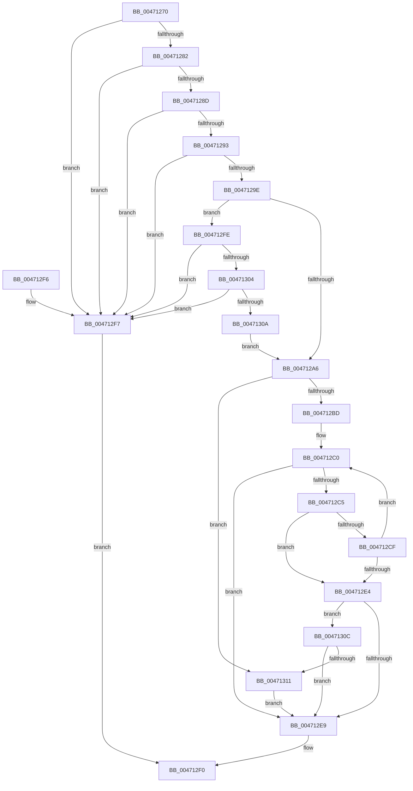

# RtlUnicodeStringCopyString

- RVA: `0x00471270`–`0x00471320` (길이 `176` bytes)
- VA: `0x0000000140471270`
- 실행 섹션: `.text`
- PDB 이름 있음: `예`; PDB Function 태그: `아니요`
- unwind 정보 RVA: `0x000AA074`
- 디코드: `54`개 명령, `176/176` bytes 표시
- 미해석 바이트: `0` (있으면 어셈블리에 `.byte`로 보존)

> 이 문서는 커널 이미지의 기계어와 PDB 기호를 분석해 생성했습니다. 4번과 5번은 함수 원형과 자료형을 바이너리 사용 방식에서 추정한 C 해석이며 원본 소스 복구 결과는 아닙니다.

## 1. Dependencies

- 직접 호출 지점: **0**; 고유 호출 대상: **0**
- 직접 호출자로 확인된 함수: **3**
- RIP 상대 이미지 참조: **0**

### Outgoing calls
- 직접 디코드된 call 명령이 없습니다.

### Direct callers
- [CmpFinishSystemHivesLoad](../../page/7D/CmpFinishSystemHivesLoad_function_007DA210.md) at `0x007DA2D6`
- [PnpAllocateAndEnableEventWatchdog](../../page/8F/PnpAllocateAndEnableEventWatchdog_function_008FB3F8.md) at `0x008FB50F`
- [PopIdleWakeGenerateInterruptDescriptionString](../../page/A9/PopIdleWakeGenerateInterruptDescriptionString_function_00A98748.md) at `0x00A988FC`

### Static image references
- 디코드된 RIP-relative 메모리 참조가 없습니다.

## 2. Other-region calls and transfers

- 다른 실행 섹션으로 향하는 call: **0**
- 별도 외부 분기/꼬리 이동을 확인하지 못했습니다.

## 3. Assembly (complete function range)

```asm
00471270  48 89 5C 24 08                  mov qword ptr [rsp + 8], rbx
00471275  44 0F B7 09                     movzx r9d, word ptr [rcx]
00471279  4C 8B D1                        mov r10, rcx
0047127C  41 F6 C1 01                     test r9b, 1
00471280  75 75                           jne 0x1404712f7
00471282  44 0F B7 41 02                  movzx r8d, word ptr [rcx + 2]
00471287  41 F6 C0 01                     test r8b, 1
0047128B  75 6A                           jne 0x1404712f7
0047128D  66 45 3B C8                     cmp r9w, r8w
00471291  77 64                           ja 0x1404712f7
00471293  B8 FE FF 00 00                  mov eax, 0xfffe
00471298  66 44 3B C0                     cmp r8w, ax
0047129C  77 59                           ja 0x1404712f7
0047129E  33 C0                           xor eax, eax
004712A0  48 39 41 08                     cmp qword ptr [rcx + 8], rax
004712A4  74 58                           je 0x1404712fe
004712A6  44 0F B7 41 02                  movzx r8d, word ptr [rcx + 2]
004712AB  41 B9 FF 7F 00 00               mov r9d, 0x7fff
004712B1  49 D1 E8                        shr r8, 1
004712B4  48 8B 59 08                     mov rbx, qword ptr [rcx + 8]
004712B8  48 8B C8                        mov rcx, rax
004712BB  74 54                           je 0x140471311
004712BD  48 2B DA                        sub rbx, rdx
004712C0  4D 85 C9                        test r9, r9
004712C3  74 24                           je 0x1404712e9
004712C5  44 0F B7 1A                     movzx r11d, word ptr [rdx]
004712C9  66 45 85 DB                     test r11w, r11w
004712CD  74 15                           je 0x1404712e4
004712CF  66 44 89 1C 13                  mov word ptr [rbx + rdx], r11w
004712D4  49 FF C9                        dec r9
004712D7  48 83 C2 02                     add rdx, 2
004712DB  48 FF C1                        inc rcx
004712DE  49 83 E8 01                     sub r8, 1
004712E2  75 DC                           jne 0x1404712c0
004712E4  4D 85 C0                        test r8, r8
004712E7  74 23                           je 0x14047130c
004712E9  66 03 C9                        add cx, cx
004712EC  66 41 89 0A                     mov word ptr [r10], cx
004712F0  48 8B 5C 24 08                  mov rbx, qword ptr [rsp + 8]
004712F5  C3                              ret
004712F6  CC                              int3
004712F7  B8 0D 00 00 C0                  mov eax, 0xc000000d
004712FC  EB F2                           jmp 0x1404712f0
004712FE  66 45 85 C9                     test r9w, r9w
00471302  75 F3                           jne 0x1404712f7
00471304  66 45 85 C0                     test r8w, r8w
00471308  75 ED                           jne 0x1404712f7
0047130A  EB 9A                           jmp 0x1404712a6
0047130C  4D 85 C9                        test r9, r9
0047130F  74 D8                           je 0x1404712e9
00471311  66 39 02                        cmp word ptr [rdx], ax
00471314  41 B8 05 00 00 80               mov r8d, 0x80000005
0047131A  41 0F 45 C0                     cmovne eax, r8d
0047131E  EB C9                           jmp 0x1404712e9
```

## 4. C-style interpretation (structured pseudocode)

```c
__int64 __fastcall RtlUnicodeStringCopyString(__int64 a1, __int64 a2)
{
    __int64 result;
    __int64 v_rbx;
    unsigned __int64 v_stack_p8;

    v_stack_p8 = v_rbx;
    if ((((unsigned __int8)(*(unsigned __int16 *)(a1))) & (1)) != 0) goto loc_004712F7;
    if ((((unsigned __int8)(*(unsigned __int16 *)(a1 + 2))) & (1)) != 0) goto loc_004712F7;
    if (((unsigned __int16)(*(unsigned __int16 *)(a1))) > ((unsigned __int16)(*(unsigned __int16 *)(a1 + 2)))) goto loc_004712F7;
    if (((unsigned __int16)(*(unsigned __int16 *)(a1 + 2))) > ((unsigned __int16)((unsigned int)(0xFFFEULL)))) goto loc_004712F7;
    result = 0;
    if ((*(unsigned __int64 *)(a1 + 8)) == 0) goto loc_004712FE;
loc_004712A6:
    a3 = (*(unsigned __int16 *)(a1 + 2)) >> (1);
    if (condition_is_equal) goto loc_00471311;
    v_rbx = (*(unsigned __int64 *)(a1 + 8)) - (a2);
loc_004712C0:
    if ((unsigned int)(0x7FFFULL) == 0) goto loc_004712E9;
    if ((unsigned __int16)(*(unsigned __int16 *)(a2)) == 0) goto loc_004712E4;
    *(unsigned __int16 *)(v_rbx + a2 * 1) = (unsigned __int16)(*(unsigned __int16 *)(a2));
    a4 = ((unsigned int)(0x7FFFULL)) - 1;
    a2 = (a2) + (2);
    a1 = (0) + 1;
    a3 = (a3) - (1);
    if (condition_is_not_equal) goto loc_004712C0;
loc_004712E4:
    if (a3 == 0) goto loc_0047130C;
loc_004712E9:
    a1 = (unsigned __int16)((a1) + ((unsigned __int16)(a1)));
    *(unsigned __int16 *)(a1) = (unsigned __int16)(a1);
loc_004712F0:
    return result;
loc_004712F7:
    goto loc_004712F0;
loc_004712FE:
    if ((unsigned __int16)(a4) != 0) goto loc_004712F7;
    if ((unsigned __int16)(a3) != 0) goto loc_004712F7;
    goto loc_004712A6;
loc_0047130C:
    if (a4 == 0) goto loc_004712E9;
loc_00471311:
    result = (unsigned int)(0xC000000DULL);
    if ((*(unsigned __int16 *)(a2)) != ((unsigned __int16)((unsigned int)(0xC000000DULL)))) { result = (unsigned int)((unsigned int)(0x80000005ULL)); }
    goto loc_004712E9;
}
```

## 5. (Beta) C Style

```c
int64_t RtlUnicodeStringCopyString(void *Arg1, void *Arg2)
{
    uint8_t *arg1 = (uint8_t *)Arg1;
    uint8_t *arg2 = (uint8_t *)Arg2;

    int64_t result;
    int64_t local_rbx;
    uint64_t v_stack_p8;

    v_stack_p8 = local_rbx;
    if ((((uint8_t)(*(uint16_t *)(arg1))) & (1)) != 0) goto loc_004712F7;
    if ((((uint8_t)(*(uint16_t *)(arg1 + 0x2))) & (1)) != 0) goto loc_004712F7;
    if (((uint16_t)(*(uint16_t *)(arg1))) > ((uint16_t)(*(uint16_t *)(arg1 + 0x2)))) goto loc_004712F7;
    if (((uint16_t)(*(uint16_t *)(arg1 + 0x2))) > ((uint16_t)((uint32_t)(0xFFFEULL)))) goto loc_004712F7;
    result = 0;
    if ((*(uint64_t *)(arg1 + 0x8)) == 0) goto loc_004712FE;
loc_004712A6:
    a3 = (*(uint16_t *)(arg1 + 0x2)) >> (1);
    if (condition_is_equal) goto loc_00471311;
    local_rbx = (*(uint64_t *)(arg1 + 0x8)) - (Arg2);
loc_004712C0:
    if ((uint32_t)(0x7FFFULL) == 0) goto loc_004712E9;
    if ((uint16_t)(*(uint16_t *)(arg2)) == 0) goto loc_004712E4;
    *(uint16_t *)(local_rbx + arg2 * 1) = (uint16_t)(*(uint16_t *)(arg2));
    a4 = ((uint32_t)(0x7FFFULL)) - 1;
    Arg2 = (Arg2) + (2);
    Arg1 = (0) + 1;
    a3 = (a3) - (1);
    if (condition_is_not_equal) goto loc_004712C0;
loc_004712E4:
    if (a3 == 0) goto loc_0047130C;
loc_004712E9:
    Arg1 = (uint16_t)((Arg1) + ((uint16_t)(Arg1)));
    *(uint16_t *)(arg1) = (uint16_t)(Arg1);
loc_004712F0:
    return result;
loc_004712F7:
    goto loc_004712F0;
loc_004712FE:
    if ((uint16_t)(a4) != 0) goto loc_004712F7;
    if ((uint16_t)(a3) != 0) goto loc_004712F7;
    goto loc_004712A6;
loc_0047130C:
    if (a4 == 0) goto loc_004712E9;
loc_00471311:
    result = (uint32_t)(0xC000000DULL);
    if ((*(uint16_t *)(arg2)) != ((uint16_t)((uint32_t)(0xC000000DULL)))) { result = (uint32_t)((uint32_t)(0x80000005ULL)); }
    goto loc_004712E9;
}
```

### 관측된 메모리 오프셋

구조체 형식이 확인되지 않은 접근은 인자 기준의 오프셋으로만 기록했습니다.

| 기준 인자 | 오프셋 표현 | 폭 (bit) | 접근 |
|---|---:|---:|---|
| `Arg1` | `+ 0x0` | `16` | `R` |
| `Arg1` | `+ 0x0` | `16` | `W` |
| `Arg1` | `+ 0x2` | `16` | `R` |
| `Arg1` | `+ 0x8` | `64` | `R` |
| `Arg2` | `+ 0x0` | `16` | `R` |

## 6. Execution-region graph

[열기: 2D/3D 그래프와 함수 탐색 컨트롤 패널](../../../control-panel.html?section=text&rva=0x00471270&view=graph)

- 2D 그래프는 위에서 아래로 흐르고, 3D 그래프는 빈 공간을 드래그해 회전합니다. Shift+드래그는 이동, 휠은 확대·축소, 함수 노드 선택은 대상 보고서 이동입니다.

### Static fallback


