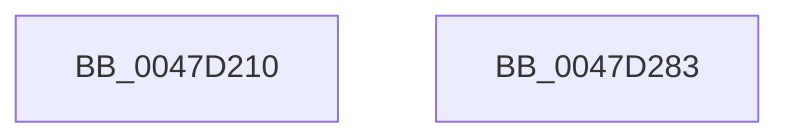

# RtlVirtualUnwind

- RVA: `0x0047D210`–`0x0047D284` (길이 `116` bytes)
- VA: `0x000000014047D210`
- 실행 섹션: `.text`
- PDB 이름 있음: `예`; PDB Function 태그: `아니요`
- unwind 정보 RVA: `0x0007F678`
- 디코드: `25`개 명령, `116/116` bytes 표시
- 미해석 바이트: `0` (있으면 어셈블리에 `.byte`로 보존)

> 이 문서는 커널 이미지의 기계어와 PDB 기호를 분석해 생성했습니다. 4번과 5번은 함수 원형과 자료형을 바이너리 사용 방식에서 추정한 C 해석이며 원본 소스 복구 결과는 아닙니다.

## 1. Dependencies

- 직접 호출 지점: **1**; 고유 호출 대상: **1**
- 직접 호출자로 확인된 함수: **3**
- RIP 상대 이미지 참조: **0**

### Outgoing calls
- `0x0047D271` → [RtlpxVirtualUnwind](../2F/RtlpxVirtualUnwind_function_002F5110.md) (function, `0x002F5110`)

### Direct callers
- [RtlUnwindEx](../2F/RtlUnwindEx_function_002F2830.md) at `0x002F2C65`
- [RtlRaiseException](../5E/RtlRaiseException_function_005E6B00.md) at `0x005E6BF2`
- [sub_006DF0C8](../6D/Unknown_function_006DF0C8.md) at `0x006DF127`

### Static image references
- 디코드된 RIP-relative 메모리 참조가 없습니다.

## 2. Other-region calls and transfers

- 다른 실행 섹션으로 향하는 call: **0**
- 별도 외부 분기/꼬리 이동을 확인하지 못했습니다.

## 3. Assembly (complete function range)

```asm
0047D210  4C 8B DC                        mov r11, rsp
0047D213  48 81 EC 88 00 00 00            sub rsp, 0x88
0047D21A  48 8B 84 24 C8 00 00 00         mov rax, qword ptr [rsp + 0xc8]
0047D222  45 33 D2                        xor r10d, r10d
0047D225  45 89 53 C8                     mov dword ptr [r11 - 0x38], r10d
0047D229  49 89 43 F0                     mov qword ptr [r11 - 0x10], rax
0047D22D  49 8D 43 E0                     lea rax, [r11 - 0x20]
0047D231  49 89 43 C0                     mov qword ptr [r11 - 0x40], rax
0047D235  49 8D 43 D8                     lea rax, [r11 - 0x28]
0047D239  49 89 43 B8                     mov qword ptr [r11 - 0x48], rax
0047D23D  48 8B 84 24 C0 00 00 00         mov rax, qword ptr [rsp + 0xc0]
0047D245  49 89 43 B0                     mov qword ptr [r11 - 0x50], rax
0047D249  48 8B 84 24 B8 00 00 00         mov rax, qword ptr [rsp + 0xb8]
0047D251  49 89 43 A8                     mov qword ptr [r11 - 0x58], rax
0047D255  48 8B 84 24 B0 00 00 00         mov rax, qword ptr [rsp + 0xb0]
0047D25D  4D 89 53 A0                     mov qword ptr [r11 - 0x60], r10
0047D261  49 89 43 98                     mov qword ptr [r11 - 0x68], rax
0047D265  4D 89 53 D8                     mov qword ptr [r11 - 0x28], r10
0047D269  4D 89 53 E0                     mov qword ptr [r11 - 0x20], r10
0047D26D  4D 89 53 E8                     mov qword ptr [r11 - 0x18], r10
0047D271  E8 9A 7E E7 FF                  call 0x1402f5110
0047D276  48 8B 44 24 60                  mov rax, qword ptr [rsp + 0x60]
0047D27B  48 81 C4 88 00 00 00            add rsp, 0x88
0047D282  C3                              ret
0047D283  CC                              int3
```

## 4. C-style interpretation (structured pseudocode)

```c
__int64 __fastcall RtlVirtualUnwind(__int64 a1, __int64 a2, __int64 a3, __int64 a4, __int64 a5, __int64 a6, __int64 a7, __int64 a8)
{
    __int64 result;
    __int64 v_r10;
    __int64 v_rsp;
    unsigned __int64 v_stack_m28;

    v_rsp = (v_rsp) - (136);
    v_r10 = 0;
    *(unsigned int *)(v_rsp - 56) = 0;
    *(unsigned __int64 *)(v_rsp - 16) = a8;
    *(unsigned __int64 *)(v_rsp - 64) = v_rsp - 32;
    *(unsigned __int64 *)(v_rsp - 72) = v_rsp - 40;
    *(unsigned __int64 *)(v_rsp - 80) = a7;
    *(unsigned __int64 *)(v_rsp - 88) = a6;
    *(unsigned __int64 *)(v_rsp - 96) = 0;
    *(unsigned __int64 *)(v_rsp - 104) = a5;
    *(unsigned __int64 *)(v_rsp - 40) = 0;
    *(unsigned __int64 *)(v_rsp - 32) = 0;
    *(unsigned __int64 *)(v_rsp - 24) = 0;
    result = RtlpxVirtualUnwind(a1, a2, a3, a4);
    v_rsp = (v_rsp) + (136);
    return v_stack_m28;
}
```

## 5. (Beta) C Style

```c
int64_t RtlVirtualUnwind(int64_t Arg1, int64_t Arg2, int64_t Arg3, int64_t Arg4, int64_t Arg5, int64_t Arg6, int64_t Arg7, int64_t Arg8)
{
    int64_t result;
    int64_t local_r10;
    int64_t local_rsp;
    uint64_t v_stack_m28;

    local_rsp = (local_rsp) - (136);
    local_r10 = 0;
    *(uint32_t *)(local_rsp - 0x38) = 0;
    *(uint64_t *)(local_rsp - 0x10) = Arg8;
    *(uint64_t *)(local_rsp - 0x40) = local_rsp - 32;
    *(uint64_t *)(local_rsp - 0x48) = local_rsp - 40;
    *(uint64_t *)(local_rsp - 0x50) = Arg7;
    *(uint64_t *)(local_rsp - 0x58) = Arg6;
    *(uint64_t *)(local_rsp - 0x60) = 0;
    *(uint64_t *)(local_rsp - 0x68) = Arg5;
    *(uint64_t *)(local_rsp - 0x28) = 0;
    *(uint64_t *)(local_rsp - 0x20) = 0;
    *(uint64_t *)(local_rsp - 0x18) = 0;
    result = RtlpxVirtualUnwind(Arg1, Arg2, Arg3, Arg4);
    local_rsp = (local_rsp) + (136);
    return v_stack_m28;
}
```

## 6. Execution-region graph

[열기: 2D/3D 그래프와 함수 탐색 컨트롤 패널](../../../control-panel.html?section=text&rva=0x0047D210&view=graph)

- 2D 그래프는 위에서 아래로 흐르고, 3D 그래프는 빈 공간을 드래그해 회전합니다. Shift+드래그는 이동, 휠은 확대·축소, 함수 노드 선택은 대상 보고서 이동입니다.

### Static fallback


