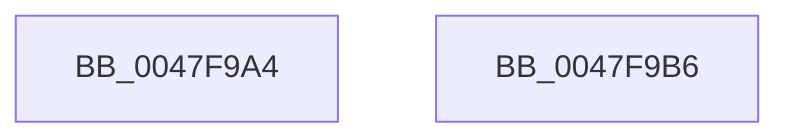

# RtlWow64GetEquivalentMachineCHPE

- RVA: `0x0047F9A4`–`0x0047F9B7` (길이 `19` bytes)
- VA: `0x000000014047F9A4`
- 실행 섹션: `.text`
- PDB 이름 있음: `예`; PDB Function 태그: `아니요`
- unwind 정보 RVA: `0x000DB714`
- 디코드: `6`개 명령, `19/19` bytes 표시
- 미해석 바이트: `0` (있으면 어셈블리에 `.byte`로 보존)

> 이 문서는 커널 이미지의 기계어와 PDB 기호를 분석해 생성했습니다. 4번과 5번은 함수 원형과 자료형을 바이너리 사용 방식에서 추정한 C 해석이며 원본 소스 복구 결과는 아닙니다.

## 1. Dependencies

- 직접 호출 지점: **0**; 고유 호출 대상: **0**
- 직접 호출자로 확인된 함수: **1**
- RIP 상대 이미지 참조: **0**

### Outgoing calls
- 직접 디코드된 call 명령이 없습니다.

### Direct callers
- [PsWow64IsMachineSupported](../../page/8D/PsWow64IsMachineSupported_function_008D20A0.md) at `0x008D20B0`

### Static image references
- 디코드된 RIP-relative 메모리 참조가 없습니다.

## 2. Other-region calls and transfers

- 다른 실행 섹션으로 향하는 call: **0**
- 별도 외부 분기/꼬리 이동을 확인하지 못했습니다.

## 3. Assembly (complete function range)

```asm
0047F9A4  BA 64 3A 00 00                  mov edx, 0x3a64
0047F9A9  B8 4C 01 00 00                  mov eax, 0x14c
0047F9AE  66 3B CA                        cmp cx, dx
0047F9B1  66 0F 45 C1                     cmovne ax, cx
0047F9B5  C3                              ret
0047F9B6  CC                              int3
```

## 4. C-style interpretation (structured pseudocode)

```c
__int64 __fastcall RtlWow64GetEquivalentMachineCHPE(unsigned __int16 a1)
{
    __int64 result;

    result = 332;
    if (a1 != ((unsigned __int16)((unsigned int)(0x3A64ULL)))) { result = a1; }
    return result;
}
```

## 5. (Beta) C Style

```c
int64_t RtlWow64GetEquivalentMachineCHPE(uint16_t Arg1)
{
    int64_t result;

    result = 332;
    if (Arg1 != ((uint16_t)((uint32_t)(0x3A64ULL)))) { result = Arg1; }
    return result;
}
```

## 6. Execution-region graph

[열기: 2D/3D 그래프와 함수 탐색 컨트롤 패널](../../../control-panel.html?section=text&rva=0x0047F9A4&view=graph)

- 2D 그래프는 위에서 아래로 흐르고, 3D 그래프는 빈 공간을 드래그해 회전합니다. Shift+드래그는 이동, 휠은 확대·축소, 함수 노드 선택은 대상 보고서 이동입니다.

### Static fallback


