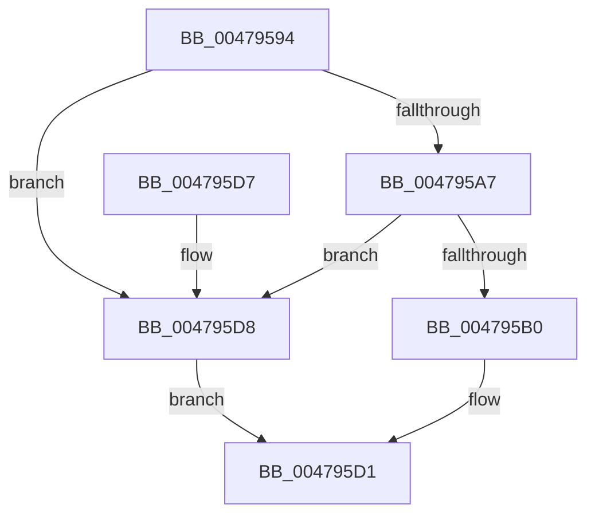

# RtlpCallInterceptRoutine

- RVA: `0x00479594`–`0x004795DF` (길이 `75` bytes)
- VA: `0x0000000140479594`
- 실행 섹션: `.text`
- PDB 이름 있음: `예`; PDB Function 태그: `아니요`
- unwind 정보 RVA: `0x0005DAC8`
- 디코드: `25`개 명령, `75/75` bytes 표시
- 미해석 바이트: `0` (있으면 어셈블리에 `.byte`로 보존)

> 이 문서는 커널 이미지의 기계어와 PDB 기호를 분석해 생성했습니다. 4번과 5번은 함수 원형과 자료형을 바이너리 사용 방식에서 추정한 C 해석이며 원본 소스 복구 결과는 아닙니다.

## 1. Dependencies

- 직접 호출 지점: **1**; 고유 호출 대상: **1**
- 직접 호출자로 확인된 함수: **4**
- RIP 상대 이미지 참조: **1**

### Outgoing calls
- `0x004795CC` → `indirect target` (indirect, 간접 대상)

### Direct callers
- [RtlpHpAllocateHeapSlow](../2E/RtlpHpAllocateHeapSlow_function_002E9DEC.md) at `0x002E9E48`
- [RtlpHpAllocateHeapSlow](../2E/RtlpHpAllocateHeapSlow_function_002E9DEC.md) at `0x002EA4C7`
- [RtlpHpAllocateHeapSlow](../2E/RtlpHpAllocateHeapSlow_function_002E9DEC.md) at `0x002EA4E6`
- [sub_006DE680](../6D/Unknown_function_006DE680.md) at `0x006DE728`
- [sub_006DE680](../6D/Unknown_function_006DE680.md) at `0x006DE7DD`
- [sub_006F57DA](../6F/Unknown_function_006F57DA.md) at `0x006F58ED`
- [RtlDestroyHeap](../../page/AA/RtlDestroyHeap_function_00AA8790.md) at `0x00AA8809`

### Static image references
- `0x004795BE` → RVA `0x00010880` (`.rdata`; read)

## 2. Other-region calls and transfers

- 다른 실행 섹션으로 향하는 call: **0**
- 별도 외부 분기/꼬리 이동을 확인하지 못했습니다.

## 3. Assembly (complete function range)

```asm
00479594  40 53                           push rbx
00479596  48 83 EC 20                     sub rsp, 0x20
0047959A  45 8B D1                        mov r10d, r9d
0047959D  4D 8B D8                        mov r11, r8
004795A0  48 8B DA                        mov rbx, rdx
004795A3  85 C9                           test ecx, ecx
004795A5  74 31                           je 0x1404795d8
004795A7  66 FF C9                        dec cx
004795AA  66 83 F9 01                     cmp cx, 1
004795AE  73 28                           jae 0x1404795d8
004795B0  4C 8B 4C 24 50                  mov r9, qword ptr [rsp + 0x50]
004795B5  45 8B C2                        mov r8d, r10d
004795B8  0F B7 C1                        movzx eax, cx
004795BB  49 8B D3                        mov rdx, r11
004795BE  48 8D 0D BB 72 B9 FF            lea rcx, [rip - 0x468d45]
004795C5  48 8B 04 C1                     mov rax, qword ptr [rcx + rax*8]
004795C9  48 8B CB                        mov rcx, rbx
004795CC  FF D0                           call rax
004795CE  0F 1F 00                        nop dword ptr [rax]
004795D1  48 83 C4 20                     add rsp, 0x20
004795D5  5B                              pop rbx
004795D6  C3                              ret
004795D7  CC                              int3
004795D8  B8 01 00 00 C0                  mov eax, 0xc0000001
004795DD  EB F2                           jmp 0x1404795d1
```

## 4. C-style interpretation (structured pseudocode)

```c
__int64 __fastcall RtlpCallInterceptRoutine(int a1, __int64 a2, __int64 a3, int a4, __int64 a5)
{
    __int64 result;
    __int64 v_rsp;

    v_rsp = (v_rsp) - (32);
    if (a1 == 0) goto loc_004795D8;
    a1 = (unsigned __int16)((a1) - 1);
    if (((unsigned __int16)(a1)) >= 1) goto loc_004795D8;
    result = kernel_indirect_call(a2, a3, (unsigned int)((unsigned int)((unsigned int)(a4))), a5);
loc_004795D1:
    v_rsp = (v_rsp) + (32);
    return result;
loc_004795D8:
    goto loc_004795D1;
}
```

## 5. (Beta) C Style

```c
int64_t RtlpCallInterceptRoutine(int32_t Arg1, int64_t Arg2, int64_t Arg3, int32_t Arg4, int64_t Arg5)
{
    int64_t result;
    int64_t local_rsp;

    local_rsp = (local_rsp) - (32);
    if (Arg1 == 0) goto loc_004795D8;
    Arg1 = (uint16_t)((Arg1) - 1);
    if (((uint16_t)(Arg1)) >= 1) goto loc_004795D8;
    result = kernel_indirect_call(Arg2, Arg3, (uint32_t)((uint32_t)((uint32_t)(Arg4))), Arg5);
loc_004795D1:
    local_rsp = (local_rsp) + (32);
    return result;
loc_004795D8:
    goto loc_004795D1;
}
```

## 6. Execution-region graph

[열기: 2D/3D 그래프와 함수 탐색 컨트롤 패널](../../../control-panel.html?section=text&rva=0x00479594&view=graph)

- 2D 그래프는 위에서 아래로 흐르고, 3D 그래프는 빈 공간을 드래그해 회전합니다. Shift+드래그는 이동, 휠은 확대·축소, 함수 노드 선택은 대상 보고서 이동입니다.

### Static fallback


