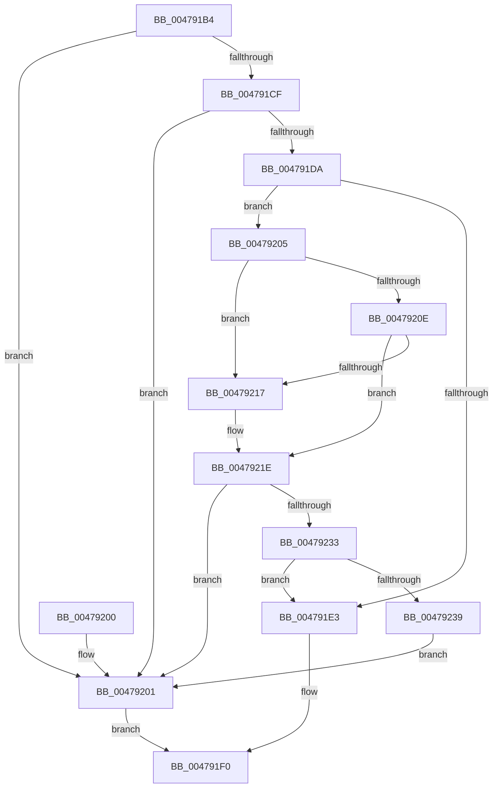

# RtlpDereferenceAtom

- RVA: `0x004791B4`–`0x0047923B` (길이 `135` bytes)
- VA: `0x00000001404791B4`
- 실행 섹션: `.text`
- PDB 이름 있음: `예`; PDB Function 태그: `아니요`
- unwind 정보 RVA: `0x000ACEF4`
- 디코드: `43`개 명령, `135/135` bytes 표시
- 미해석 바이트: `0` (있으면 어셈블리에 `.byte`로 보존)

> 이 문서는 커널 이미지의 기계어와 PDB 기호를 분석해 생성했습니다. 4번과 5번은 함수 원형과 자료형을 바이너리 사용 방식에서 추정한 C 해석이며 원본 소스 복구 결과는 아닙니다.

## 1. Dependencies

- 직접 호출 지점: **2**; 고유 호출 대상: **2**
- 직접 호출자로 확인된 함수: **2**
- RIP 상대 이미지 참조: **0**

### Outgoing calls
- `0x004791E9` → [RtlpFreeAllAtom](RtlpFreeAllAtom_function_00479244.md) (function, `0x00479244`)
- `0x00479228` → [RtlpFreeAtom](../../page/8B/RtlpFreeAtom_function_008BD87C.md) (function, `0x008BD87C`)

### Direct callers
- [RtlDestroyLowBoxAtoms](RtlDestroyLowBoxAtoms_function_004790E0.md) at `0x004791A3`
- [RtlDeleteAtomFromAtomTable](../../page/9C/RtlDeleteAtomFromAtomTable_function_009C45C0.md) at `0x009C4641`

### Static image references
- 디코드된 RIP-relative 메모리 참조가 없습니다.

## 2. Other-region calls and transfers

- 다른 실행 섹션으로 향하는 call: **1**
  - `0x00479228` → [RtlpFreeAtom](../../page/8B/RtlpFreeAtom_function_008BD87C.md) (`.text` → `PAGE`)
- 별도 외부 분기/꼬리 이동을 확인하지 못했습니다.

## 3. Assembly (complete function range)

```asm
004791B4  48 89 5C 24 08                  mov qword ptr [rsp + 8], rbx
004791B9  48 89 74 24 10                  mov qword ptr [rsp + 0x10], rsi
004791BE  57                              push rdi
004791BF  48 83 EC 20                     sub rsp, 0x20
004791C3  F6 42 16 01                     test byte ptr [rdx + 0x16], 1
004791C7  49 8B F8                        mov rdi, r8
004791CA  48 8B D9                        mov rbx, rcx
004791CD  75 32                           jne 0x140479201
004791CF  BE FF FF 00 00                  mov esi, 0xffff
004791D4  66 01 72 14                     add word ptr [rdx + 0x14], si
004791D8  75 27                           jne 0x140479201
004791DA  48 8D 41 10                     lea rax, [rcx + 0x10]
004791DE  48 3B D0                        cmp rdx, rax
004791E1  75 22                           jne 0x140479205
004791E3  48 8B D7                        mov rdx, rdi
004791E6  48 8B CB                        mov rcx, rbx
004791E9  E8 56 00 00 00                  call 0x140479244
004791EE  B0 01                           mov al, 1
004791F0  48 8B 5C 24 30                  mov rbx, qword ptr [rsp + 0x30]
004791F5  48 8B 74 24 38                  mov rsi, qword ptr [rsp + 0x38]
004791FA  48 83 C4 20                     add rsp, 0x20
004791FE  5F                              pop rdi
004791FF  C3                              ret
00479200  CC                              int3
00479201  32 C0                           xor al, al
00479203  EB EB                           jmp 0x1404791f0
00479205  48 8B 0A                        mov rcx, qword ptr [rdx]
00479208  48 39 51 08                     cmp qword ptr [rcx + 8], rdx
0047920C  75 09                           jne 0x140479217
0047920E  48 8B 42 08                     mov rax, qword ptr [rdx + 8]
00479212  48 39 10                        cmp qword ptr [rax], rdx
00479215  74 07                           je 0x14047921e
00479217  B9 03 00 00 00                  mov ecx, 3
0047921C  CD 29                           int 0x29
0047921E  48 89 08                        mov qword ptr [rax], rcx
00479221  48 89 41 08                     mov qword ptr [rcx + 8], rax
00479225  48 8B CA                        mov rcx, rdx
00479228  E8 4F 46 44 00                  call 0x1408bd87c
0047922D  F6 43 26 01                     test byte ptr [rbx + 0x26], 1
00479231  75 CE                           jne 0x140479201
00479233  66 01 73 24                     add word ptr [rbx + 0x24], si
00479237  74 AA                           je 0x1404791e3
00479239  EB C6                           jmp 0x140479201
```

## 4. C-style interpretation (structured pseudocode)

```c
__int64 __fastcall RtlpDereferenceAtom(__int64 a1, __int64 a2, __int64 a3)
{
    __int64 result;
    __int64 v_rsp;
    unsigned __int64 v_stack_p10;
    unsigned __int64 v_stack_p8;

    v_stack_p8 = v_rbx;
    v_stack_p10 = v_rsi;
    v_rsp = (v_rsp) - (32);
    if (((*(unsigned __int8 *)(a2 + 22)) & (1)) != 0) goto loc_00479201;
    if (((*(unsigned __int8 *)(a2 + 22)) & (1)) != 0) goto loc_00479201;
    if (a2 != (a1 + 16)) goto loc_00479205;
loc_004791E3:
    result = RtlpFreeAllAtom(a1, a3, a3, a4);
loc_004791F0:
    v_rsp = (v_rsp) + (32);
    return 1;
loc_00479201:
    result = 0;
    goto loc_004791F0;
loc_00479205:
    if ((*(unsigned __int64 *)(*(unsigned __int64 *)(a3) + 8)) != a3) goto loc_00479217;
    if ((*(unsigned __int64 *)(*(unsigned __int64 *)(a3 + 8))) != a3) {
        a1 = 3;
    }
    *(unsigned __int64 *)(*(unsigned __int64 *)(a3 + 8)) = a1;
    *(unsigned __int64 *)(a1 + 8) = *(unsigned __int64 *)(a3 + 8);
    result = RtlpFreeAtom(a3, a3, a3, a4);
    if (((*(unsigned __int8 *)(v_stack_p8 + 38)) & (1)) != 0) goto loc_00479201;
    if (((*(unsigned __int8 *)(v_stack_p8 + 38)) & (1)) == 0) goto loc_004791E3;
    goto loc_00479201;
}
```

## 5. (Beta) C Style

```c
int64_t RtlpDereferenceAtom(void *Arg1, void *Arg2, int64_t Arg3)
{
    uint8_t *arg1 = (uint8_t *)Arg1;
    uint8_t *arg2 = (uint8_t *)Arg2;

    int64_t result;
    int64_t local_rsp;
    uint64_t v_stack_p10;
    uint64_t v_stack_p8;

    v_stack_p8 = local_rbx;
    v_stack_p10 = local_rsi;
    local_rsp = (local_rsp) - (32);
    if (((*(uint8_t *)(arg2 + 0x16)) & (1)) != 0) goto loc_00479201;
    if (((*(uint8_t *)(arg2 + 0x16)) & (1)) != 0) goto loc_00479201;
    if (Arg2 != (Arg1 + 16)) goto loc_00479205;
loc_004791E3:
    result = RtlpFreeAllAtom(Arg1, Arg3, Arg3, a4);
loc_004791F0:
    local_rsp = (local_rsp) + (32);
    return 1;
loc_00479201:
    result = 0;
    goto loc_004791F0;
loc_00479205:
    if ((*(uint64_t *)(*(uint64_t *)(Arg3) + 0x8)) != Arg3) goto loc_00479217;
    if ((*(uint64_t *)(*(uint64_t *)(Arg3 + 0x8))) != Arg3) {
        Arg1 = 3;
    }
    *(void **)(*(uint64_t *)(Arg3 + 0x8)) = Arg1;
    *(uint64_t *)(arg1 + 0x8) = *(uint64_t *)(Arg3 + 0x8);
    result = RtlpFreeAtom(Arg3, Arg3, Arg3, a4);
    if (((*(uint8_t *)(v_stack_p8 + 0x26)) & (1)) != 0) goto loc_00479201;
    if (((*(uint8_t *)(v_stack_p8 + 0x26)) & (1)) == 0) goto loc_004791E3;
    goto loc_00479201;
}
```

### 관측된 메모리 오프셋

구조체 형식이 확인되지 않은 접근은 인자 기준의 오프셋으로만 기록했습니다.

| 기준 인자 | 오프셋 표현 | 폭 (bit) | 접근 |
|---|---:|---:|---|
| `Arg1` | `+ 0x10` | `64` | `R` |
| `Arg1` | `+ 0x24` | `16` | `R/W` |
| `Arg1` | `+ 0x26` | `8` | `R` |
| `Arg2` | `+ 0x14` | `16` | `R/W` |
| `Arg2` | `+ 0x16` | `8` | `R` |

## 6. Execution-region graph

[열기: 2D/3D 그래프와 함수 탐색 컨트롤 패널](../../../control-panel.html?section=text&rva=0x004791B4&view=graph)

- 2D 그래프는 위에서 아래로 흐르고, 3D 그래프는 빈 공간을 드래그해 회전합니다. Shift+드래그는 이동, 휠은 확대·축소, 함수 노드 선택은 대상 보고서 이동입니다.

### Static fallback


