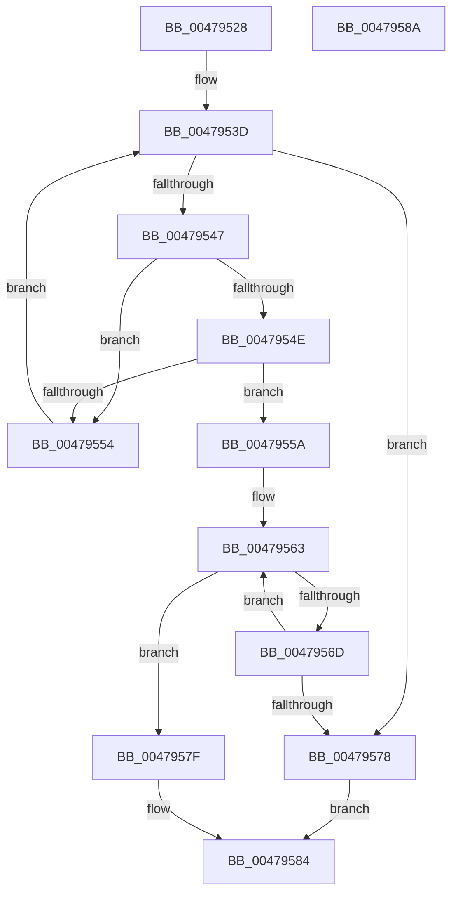

# RtlpFindMessageInTable

- RVA: `0x00479528`–`0x0047958B` (길이 `99` bytes)
- VA: `0x0000000140479528`
- 실행 섹션: `.text`
- PDB 이름 있음: `예`; PDB Function 태그: `아니요`
- unwind 정보 RVA: `0x00071750`
- 디코드: `35`개 명령, `99/99` bytes 표시
- 미해석 바이트: `0` (있으면 어셈블리에 `.byte`로 보존)

> 이 문서는 커널 이미지의 기계어와 PDB 기호를 분석해 생성했습니다. 4번과 5번은 함수 원형과 자료형을 바이너리 사용 방식에서 추정한 C 해석이며 원본 소스 복구 결과는 아닙니다.

## 1. Dependencies

- 직접 호출 지점: **0**; 고유 호출 대상: **0**
- 직접 호출자로 확인된 함수: **1**
- RIP 상대 이미지 참조: **0**

### Outgoing calls
- 직접 디코드된 call 명령이 없습니다.

### Direct callers
- [RtlFindMessage](../../page/99/RtlFindMessage_function_0099B220.md) at `0x0099B2B3`

### Static image references
- 디코드된 RIP-relative 메모리 참조가 없습니다.

## 2. Other-region calls and transfers

- 다른 실행 섹션으로 향하는 call: **0**
- 별도 외부 분기/꼬리 이동을 확인하지 못했습니다.

## 3. Assembly (complete function range)

```asm
00479528  48 89 5C 24 08                  mov qword ptr [rsp + 8], rbx
0047952D  44 8B 11                        mov r10d, dword ptr [rcx]
00479530  8D 5A FF                        lea ebx, [rdx - 1]
00479533  48 03 D9                        add rbx, rcx
00479536  48 8D 51 04                     lea rdx, [rcx + 4]
0047953A  4C 8B D9                        mov r11, rcx
0047953D  41 8B C2                        mov eax, r10d
00479540  41 FF CA                        dec r10d
00479543  85 C0                           test eax, eax
00479545  74 31                           je 0x140479578
00479547  8B 02                           mov eax, dword ptr [rdx]
00479549  44 3B C0                        cmp r8d, eax
0047954C  72 06                           jb 0x140479554
0047954E  44 3B 42 04                     cmp r8d, dword ptr [rdx + 4]
00479552  76 06                           jbe 0x14047955a
00479554  48 83 C2 0C                     add rdx, 0xc
00479558  EB E3                           jmp 0x14047953d
0047955A  8B 4A 08                        mov ecx, dword ptr [rdx + 8]
0047955D  49 03 CB                        add rcx, r11
00479560  44 2B C0                        sub r8d, eax
00479563  41 8B C0                        mov eax, r8d
00479566  41 FF C8                        dec r8d
00479569  85 C0                           test eax, eax
0047956B  74 12                           je 0x14047957f
0047956D  0F B7 01                        movzx eax, word ptr [rcx]
00479570  48 03 C8                        add rcx, rax
00479573  48 3B CB                        cmp rcx, rbx
00479576  76 EB                           jbe 0x140479563
00479578  B8 09 01 00 C0                  mov eax, 0xc0000109
0047957D  EB 05                           jmp 0x140479584
0047957F  49 89 09                        mov qword ptr [r9], rcx
00479582  33 C0                           xor eax, eax
00479584  48 8B 5C 24 08                  mov rbx, qword ptr [rsp + 8]
00479589  C3                              ret
0047958A  CC                              int3
```

## 4. C-style interpretation (structured pseudocode)

```c
__int64 __fastcall RtlpFindMessageInTable(__int64 a1, __int64 a2, int a3, __int64 a4)
{
    __int64 result;
    __int64 v_r10;
    __int64 v_rbx;
    unsigned __int64 v_stack_p8;

    v_stack_p8 = v_rbx;
    v_rbx = (a2 - 1) + (a1);
loc_0047953D:
    v_r10 = (unsigned int)(((unsigned int)(*(unsigned int *)(a1))) - 1);
    if ((unsigned int)((unsigned int)((unsigned int)((unsigned int)(*(unsigned int *)(a1))))) == 0) goto loc_00479578;
    if (a3 < ((unsigned int)((unsigned int)(*(unsigned int *)(a1 + 4))))) goto loc_00479554;
    if (a3 <= (*(unsigned int *)(a1 + 4 + 4))) goto loc_0047955A;
loc_00479554:
    a2 = (a1 + 4) + (12);
    goto loc_0047953D;
loc_0047955A:
    a1 = ((unsigned int)(*(unsigned int *)(a2 + 8))) + (a1);
    a3 = (unsigned int)((a3) - ((unsigned int)((unsigned int)(*(unsigned int *)(a1 + 4)))));
loc_00479563:
    a3 = (unsigned int)((a3) - 1);
    if ((unsigned int)((unsigned int)(a3)) == 0) goto loc_0047957F;
    a1 = (a1) + (*(unsigned __int16 *)(a1));
    if (a1 <= v_rbx) goto loc_00479563;
loc_00479578:
    goto loc_00479584;
loc_0047957F:
    *(unsigned __int64 *)(a4) = a1;
    result = 0;
loc_00479584:
    return result;
}
```

## 5. (Beta) C Style

```c
int64_t RtlpFindMessageInTable(void *Arg1, void *Arg2, int32_t Arg3, void *Arg4)
{
    uint8_t *arg1 = (uint8_t *)Arg1;
    uint8_t *arg2 = (uint8_t *)Arg2;
    uint8_t *arg4 = (uint8_t *)Arg4;

    int64_t result;
    int64_t local_r10;
    int64_t local_rbx;
    uint64_t v_stack_p8;

    v_stack_p8 = local_rbx;
    local_rbx = (Arg2 - 1) + (Arg1);
loc_0047953D:
    local_r10 = (uint32_t)(((uint32_t)(*(uint32_t *)(arg1))) - 1);
    if ((uint32_t)((uint32_t)((uint32_t)((uint32_t)(*(uint32_t *)(arg1))))) == 0) goto loc_00479578;
    if (Arg3 < ((uint32_t)((uint32_t)(*(uint32_t *)(arg1 + 0x4))))) goto loc_00479554;
    if (Arg3 <= (*(uint32_t *)(arg1 + 0x4 + 0x4))) goto loc_0047955A;
loc_00479554:
    Arg2 = (Arg1 + 4) + (12);
    goto loc_0047953D;
loc_0047955A:
    Arg1 = ((uint32_t)(*(uint32_t *)(arg2 + 0x8))) + (Arg1);
    Arg3 = (uint32_t)((Arg3) - ((uint32_t)((uint32_t)(*(uint32_t *)(arg1 + 0x4)))));
loc_00479563:
    Arg3 = (uint32_t)((Arg3) - 1);
    if ((uint32_t)((uint32_t)(Arg3)) == 0) goto loc_0047957F;
    Arg1 = (Arg1) + (*(uint16_t *)(arg1));
    if (Arg1 <= local_rbx) goto loc_00479563;
loc_00479578:
    goto loc_00479584;
loc_0047957F:
    *(void **)(arg4) = Arg1;
    result = 0;
loc_00479584:
    return result;
}
```

### 관측된 메모리 오프셋

구조체 형식이 확인되지 않은 접근은 인자 기준의 오프셋으로만 기록했습니다.

| 기준 인자 | 오프셋 표현 | 폭 (bit) | 접근 |
|---|---:|---:|---|
| `Arg1` | `+ 0x0` | `32` | `R` |
| `Arg1` | `+ 0x4` | `32` | `R` |
| `Arg1` | `+ 0x4` | `64` | `R` |
| `Arg1` | `+ 0x8` | `32` | `R` |
| `Arg2` | `- 0x1` | `32` | `R` |
| `Arg4` | `+ 0x0` | `64` | `W` |

## 6. Execution-region graph

[열기: 2D/3D 그래프와 함수 탐색 컨트롤 패널](../../../control-panel.html?section=text&rva=0x00479528&view=graph)

- 2D 그래프는 위에서 아래로 흐르고, 3D 그래프는 빈 공간을 드래그해 회전합니다. Shift+드래그는 이동, 휠은 확대·축소, 함수 노드 선택은 대상 보고서 이동입니다.

### Static fallback


