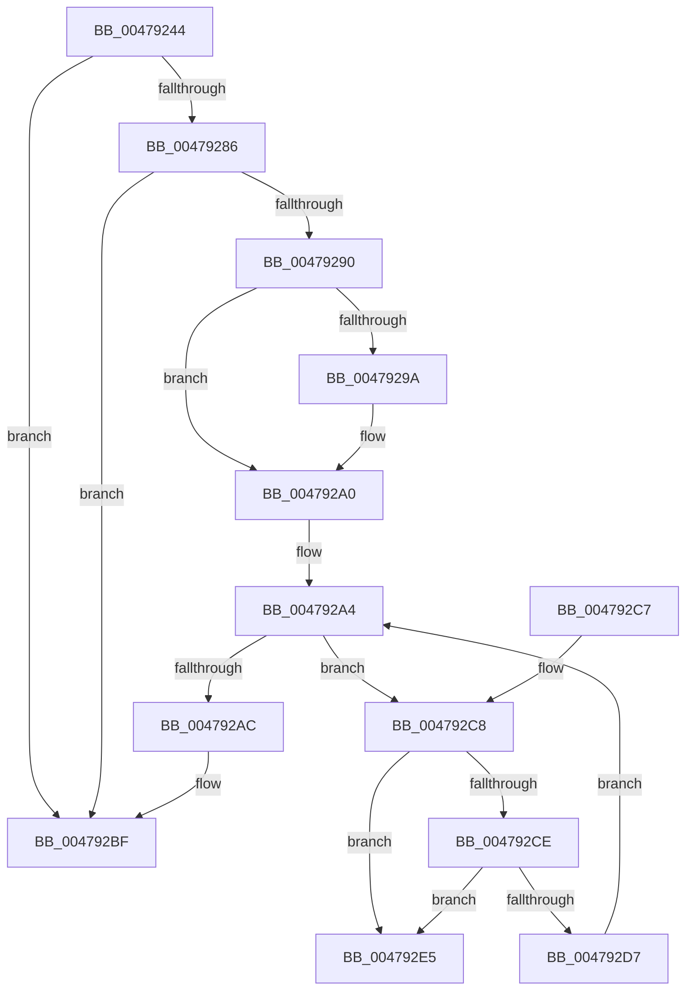

# RtlpFreeAllAtom

- RVA: `0x00479244`–`0x004792EC` (길이 `168` bytes)
- VA: `0x0000000140479244`
- 실행 섹션: `.text`
- PDB 이름 있음: `예`; PDB Function 태그: `아니요`
- unwind 정보 RVA: `0x000ACF08`
- 디코드: `54`개 명령, `168/168` bytes 표시
- 미해석 바이트: `0` (있으면 어셈블리에 `.byte`로 보존)

> 이 문서는 커널 이미지의 기계어와 PDB 기호를 분석해 생성했습니다. 4번과 5번은 함수 원형과 자료형을 바이너리 사용 방식에서 추정한 C 해석이며 원본 소스 복구 결과는 아닙니다.

## 1. Dependencies

- 직접 호출 지점: **4**; 고유 호출 대상: **3**
- 직접 호출자로 확인된 함수: **1**
- RIP 상대 이미지 참조: **0**

### Outgoing calls
- `0x0047927D` → [RtlpHashStringToAtom](../../page/99/RtlpHashStringToAtom_function_0099E760.md) (function, `0x0099E760`)
- `0x004792B2` → [RtlpFreeHandleForAtom](../../page/88/RtlpFreeHandleForAtom_function_00887F08.md) (function, `0x00887F08`)
- `0x004792BA` → [RtlpFreeAtom](../../page/8B/RtlpFreeAtom_function_008BD87C.md) (function, `0x008BD87C`)
- `0x004792DE` → [RtlpFreeAtom](../../page/8B/RtlpFreeAtom_function_008BD87C.md) (function, `0x008BD87C`)

### Direct callers
- [RtlpDereferenceAtom](RtlpDereferenceAtom_function_004791B4.md) at `0x004791E9`

### Static image references
- 디코드된 RIP-relative 메모리 참조가 없습니다.

## 2. Other-region calls and transfers

- 다른 실행 섹션으로 향하는 call: **4**
  - `0x0047927D` → [RtlpHashStringToAtom](../../page/99/RtlpHashStringToAtom_function_0099E760.md) (`.text` → `PAGE`)
  - `0x004792B2` → [RtlpFreeHandleForAtom](../../page/88/RtlpFreeHandleForAtom_function_00887F08.md) (`.text` → `PAGE`)
  - `0x004792BA` → [RtlpFreeAtom](../../page/8B/RtlpFreeAtom_function_008BD87C.md) (`.text` → `PAGE`)
  - `0x004792DE` → [RtlpFreeAtom](../../page/8B/RtlpFreeAtom_function_008BD87C.md) (`.text` → `PAGE`)
- 별도 외부 분기/꼬리 이동을 확인하지 못했습니다.

## 3. Assembly (complete function range)

```asm
00479244  4C 8B DC                        mov r11, rsp
00479247  49 89 4B 08                     mov qword ptr [r11 + 8], rcx
0047924B  53                              push rbx
0047924C  56                              push rsi
0047924D  57                              push rdi
0047924E  48 83 EC 40                     sub rsp, 0x40
00479252  49 83 63 18 00                  and qword ptr [r11 + 0x18], 0
00479257  49 8D 43 08                     lea rax, [r11 + 8]
0047925B  49 89 43 D8                     mov qword ptr [r11 - 0x28], rax
0047925F  4D 8D 4B 18                     lea r9, [r11 + 0x18]
00479263  48 8B F2                        mov rsi, rdx
00479266  49 8D 43 20                     lea rax, [r11 + 0x20]
0047926A  48 8D 51 2A                     lea rdx, [rcx + 0x2a]
0047926E  49 89 43 D0                     mov qword ptr [r11 - 0x30], rax
00479272  49 83 63 C8 00                  and qword ptr [r11 - 0x38], 0
00479277  45 33 C0                        xor r8d, r8d
0047927A  48 8B CE                        mov rcx, rsi
0047927D  E8 DE 54 52 00                  call 0x14099e760
00479282  85 C0                           test eax, eax
00479284  78 39                           js 0x1404792bf
00479286  48 8B 5C 24 60                  mov rbx, qword ptr [rsp + 0x60]
0047928B  48 85 DB                        test rbx, rbx
0047928E  74 2F                           je 0x1404792bf
00479290  48 8B 4C 24 70                  mov rcx, qword ptr [rsp + 0x70]
00479295  48 85 C9                        test rcx, rcx
00479298  74 06                           je 0x1404792a0
0047929A  48 8B 03                        mov rax, qword ptr [rbx]
0047929D  48 89 01                        mov qword ptr [rcx], rax
004792A0  48 8D 7B 10                     lea rdi, [rbx + 0x10]
004792A4  48 8B 0F                        mov rcx, qword ptr [rdi]
004792A7  48 3B CF                        cmp rcx, rdi
004792AA  75 1C                           jne 0x1404792c8
004792AC  48 8B D3                        mov rdx, rbx
004792AF  48 8B CE                        mov rcx, rsi
004792B2  E8 51 EC 40 00                  call 0x140887f08
004792B7  48 8B CB                        mov rcx, rbx
004792BA  E8 BD 45 44 00                  call 0x1408bd87c
004792BF  48 83 C4 40                     add rsp, 0x40
004792C3  5F                              pop rdi
004792C4  5E                              pop rsi
004792C5  5B                              pop rbx
004792C6  C3                              ret
004792C7  CC                              int3
004792C8  48 39 79 08                     cmp qword ptr [rcx + 8], rdi
004792CC  75 17                           jne 0x1404792e5
004792CE  48 8B 01                        mov rax, qword ptr [rcx]
004792D1  48 39 48 08                     cmp qword ptr [rax + 8], rcx
004792D5  75 0E                           jne 0x1404792e5
004792D7  48 89 07                        mov qword ptr [rdi], rax
004792DA  48 89 78 08                     mov qword ptr [rax + 8], rdi
004792DE  E8 99 45 44 00                  call 0x1408bd87c
004792E3  EB BF                           jmp 0x1404792a4
004792E5  B9 03 00 00 00                  mov ecx, 3
004792EA  CD 29                           int 0x29
```

## 4. C-style interpretation (structured pseudocode)

```c
__int64 __fastcall RtlpFreeAllAtom(__int64 a1, __int64 a2, int a3)
{
    __int64 result;
    __int64 v_rsp;
    unsigned __int64 v_stack_p18;
    unsigned __int64 v_stack_p8;

    *(unsigned __int64 *)(v_rsp + 8) = a1;
    v_rsp = (v_rsp) - (64);
    *(unsigned __int64 *)(v_rsp - 40) = v_rsp + 8;
    *(unsigned __int64 *)(v_rsp - 48) = v_rsp + 32;
    a3 = 0;
    result = RtlpHashStringToAtom(a2, a1 + 42, a3, v_rsp + 24);
    if (sign_flag) goto loc_004792BF;
    if (v_stack_p8 == 0) goto loc_004792BF;
    if (v_stack_p18 != 0) {
        result = *(unsigned __int64 *)(v_stack_p8);
        *(unsigned __int64 *)(v_stack_p18) = result;
    }
loc_004792A4:
    if ((*(unsigned __int64 *)(v_stack_p8 + 16)) != (v_stack_p8 + 16)) goto loc_004792C8;
    result = RtlpFreeHandleForAtom(a2, v_stack_p8, a3, v_rsp + 24);
    result = RtlpFreeAtom(v_stack_p8, v_stack_p8, a3, v_rsp + 24);
loc_004792BF:
    v_rsp = (v_rsp) + (64);
    return result;
loc_004792C8:
    if ((*(unsigned __int64 *)(v_stack_p8 + 8)) != (v_stack_p8 + 16)) goto loc_004792E5;
    if ((*(unsigned __int64 *)(*(unsigned __int64 *)(v_stack_p8) + 8)) != v_stack_p8) goto loc_004792E5;
    *(unsigned __int64 *)(v_stack_p8 + 16) = *(unsigned __int64 *)(v_stack_p8);
    *(unsigned __int64 *)(*(unsigned __int64 *)(v_stack_p8) + 8) = v_stack_p8 + 16;
    result = RtlpFreeAtom(v_stack_p8, v_stack_p8, a3, v_rsp + 24);
    goto loc_004792A4;
loc_004792E5:
    return result;
}
```

## 5. (Beta) C Style

```c
int64_t RtlpFreeAllAtom(void *Arg1, int64_t Arg2, int32_t Arg3)
{
    uint8_t *arg1 = (uint8_t *)Arg1;

    int64_t result;
    int64_t local_rsp;
    uint64_t v_stack_p18;
    uint64_t v_stack_p8;

    *(void **)(local_rsp + 0x8) = Arg1;
    local_rsp = (local_rsp) - (64);
    *(uint64_t *)(local_rsp - 0x28) = local_rsp + 8;
    *(uint64_t *)(local_rsp - 0x30) = local_rsp + 32;
    Arg3 = 0;
    result = RtlpHashStringToAtom(Arg2, Arg1 + 42, Arg3, local_rsp + 24);
    if (sign_flag) goto loc_004792BF;
    if (v_stack_p8 == 0) goto loc_004792BF;
    if (v_stack_p18 != 0) {
        result = *(uint64_t *)(v_stack_p8);
        *(uint64_t *)(v_stack_p18) = result;
    }
loc_004792A4:
    if ((*(uint64_t *)(v_stack_p8 + 0x10)) != (v_stack_p8 + 16)) goto loc_004792C8;
    result = RtlpFreeHandleForAtom(Arg2, v_stack_p8, Arg3, local_rsp + 24);
    result = RtlpFreeAtom(v_stack_p8, v_stack_p8, Arg3, local_rsp + 24);
loc_004792BF:
    local_rsp = (local_rsp) + (64);
    return result;
loc_004792C8:
    if ((*(uint64_t *)(v_stack_p8 + 0x8)) != (v_stack_p8 + 16)) goto loc_004792E5;
    if ((*(uint64_t *)(*(uint64_t *)(v_stack_p8) + 0x8)) != v_stack_p8) goto loc_004792E5;
    *(uint64_t *)(v_stack_p8 + 0x10) = *(uint64_t *)(v_stack_p8);
    *(uint64_t *)(*(uint64_t *)(v_stack_p8) + 0x8) = v_stack_p8 + 16;
    result = RtlpFreeAtom(v_stack_p8, v_stack_p8, Arg3, local_rsp + 24);
    goto loc_004792A4;
loc_004792E5:
    return result;
}
```

### 관측된 메모리 오프셋

구조체 형식이 확인되지 않은 접근은 인자 기준의 오프셋으로만 기록했습니다.

| 기준 인자 | 오프셋 표현 | 폭 (bit) | 접근 |
|---|---:|---:|---|
| `Arg1` | `+ 0x2A` | `64` | `R` |

## 6. Execution-region graph

[열기: 2D/3D 그래프와 함수 탐색 컨트롤 패널](../../../control-panel.html?section=text&rva=0x00479244&view=graph)

- 2D 그래프는 위에서 아래로 흐르고, 3D 그래프는 빈 공간을 드래그해 회전합니다. Shift+드래그는 이동, 휠은 확대·축소, 함수 노드 선택은 대상 보고서 이동입니다.

### Static fallback


