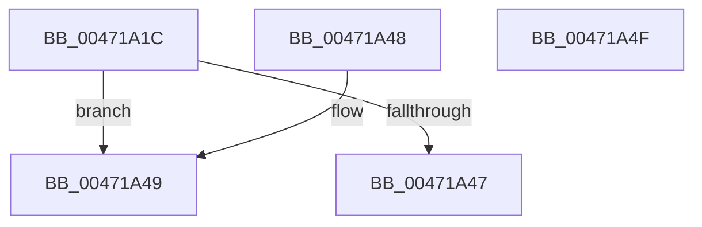

# RtlpHpLfhSlotActiveSubsegmentReset

- RVA: `0x00471A1C`–`0x00471A50` (길이 `52` bytes)
- VA: `0x0000000140471A1C`
- 실행 섹션: `.text`
- PDB 이름 있음: `예`; PDB Function 태그: `아니요`
- unwind 정보 RVA: `0x000DB714`
- 디코드: `18`개 명령, `52/52` bytes 표시
- 미해석 바이트: `0` (있으면 어셈블리에 `.byte`로 보존)

> 이 문서는 커널 이미지의 기계어와 PDB 기호를 분석해 생성했습니다. 4번과 5번은 함수 원형과 자료형을 바이너리 사용 방식에서 추정한 C 해석이며 원본 소스 복구 결과는 아닙니다.

## 1. Dependencies

- 직접 호출 지점: **0**; 고유 호출 대상: **0**
- 직접 호출자로 확인된 함수: **2**
- RIP 상대 이미지 참조: **0**

### Outgoing calls
- 직접 디코드된 call 명령이 없습니다.

### Direct callers
- [RtlpHpLfhOwnerCompact](../2E/RtlpHpLfhOwnerCompact_function_002E785C.md) at `0x002E7903`
- [RtlpHpLfhPrivateSlotShutdown](../60/RtlpHpLfhPrivateSlotShutdown_function_0060502C.md) at `0x00605075`

### Static image references
- 디코드된 RIP-relative 메모리 참조가 없습니다.

## 2. Other-region calls and transfers

- 다른 실행 섹션으로 향하는 call: **0**
- 별도 외부 분기/꼬리 이동을 확인하지 못했습니다.

## 3. Assembly (complete function range)

```asm
00471A1C  33 C0                           xor eax, eax
00471A1E  BA FF 0F 00 00                  mov edx, 0xfff
00471A23  48 87 41 38                     xchg qword ptr [rcx + 0x38], rax
00471A27  44 8B C0                        mov r8d, eax
00471A2A  48 8B C8                        mov rcx, rax
00471A2D  44 23 C2                        and r8d, edx
00471A30  48 23 CA                        and rcx, rdx
00471A33  48 25 00 F0 FF FF               and rax, 0xfffffffffffff000
00471A39  48 F7 D9                        neg rcx
00471A3C  48 1B D2                        sbb rdx, rdx
00471A3F  48 23 D0                        and rdx, rax
00471A42  45 85 C0                        test r8d, r8d
00471A45  75 02                           jne 0x140471a49
00471A47  C3                              ret
00471A48  CC                              int3
00471A49  66 44 01 42 20                  add word ptr [rdx + 0x20], r8w
00471A4E  C3                              ret
00471A4F  CC                              int3
```

## 4. C-style interpretation (structured pseudocode)

```c
__int64 __fastcall RtlpHpLfhSlotActiveSubsegmentReset(__int64 a1)
{
    __int64 result;

    result = 0;
    a3 = (unsigned int)((0) & ((unsigned int)((unsigned int)(0xFFFULL))));
    a1 = (0) & ((unsigned int)(0xFFFULL));
    result = (result) & (0xFFFFFFFFFFFFF000ULL);
    a1 = -(a1);
    a2 = ((unsigned int)(0xFFFULL)) & (result);
    if ((unsigned int)(a3) != 0) goto loc_00471A49;
    return result;
loc_00471A49:
    return result;
}
```

## 5. (Beta) C Style

```c
int64_t RtlpHpLfhSlotActiveSubsegmentReset(void *Arg1)
{
    uint8_t *arg1 = (uint8_t *)Arg1;

    int64_t result;

    result = 0;
    a3 = (uint32_t)((0) & ((uint32_t)((uint32_t)(0xFFFULL))));
    Arg1 = (0) & ((uint32_t)(0xFFFULL));
    result = (result) & (0xFFFFFFFFFFFFF000ULL);
    Arg1 = -(Arg1);
    a2 = ((uint32_t)(0xFFFULL)) & (result);
    if ((uint32_t)(a3) != 0) goto loc_00471A49;
    return result;
loc_00471A49:
    return result;
}
```

### 관측된 메모리 오프셋

구조체 형식이 확인되지 않은 접근은 인자 기준의 오프셋으로만 기록했습니다.

| 기준 인자 | 오프셋 표현 | 폭 (bit) | 접근 |
|---|---:|---:|---|
| `Arg1` | `+ 0x38` | `64` | `R/W` |

## 6. Execution-region graph

[열기: 2D/3D 그래프와 함수 탐색 컨트롤 패널](../../../control-panel.html?section=text&rva=0x00471A1C&view=graph)

- 2D 그래프는 위에서 아래로 흐르고, 3D 그래프는 빈 공간을 드래그해 회전합니다. Shift+드래그는 이동, 휠은 확대·축소, 함수 노드 선택은 대상 보고서 이동입니다.

### Static fallback


