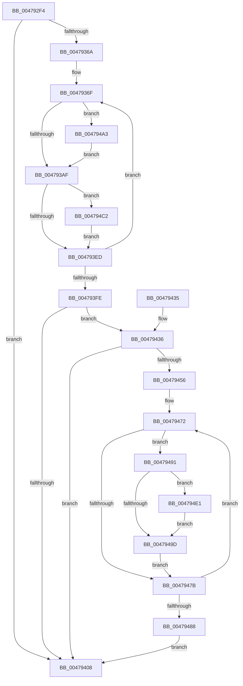

# RtlpHpLfhSubsegmentDelayFreeListBatch

- RVA: `0x004792F4`–`0x00479522` (길이 `558` bytes)
- VA: `0x00000001404792F4`
- 실행 섹션: `.text`
- PDB 이름 있음: `예`; PDB Function 태그: `아니요`
- unwind 정보 RVA: `0x000ACF18`
- 디코드: `149`개 명령, `558/558` bytes 표시
- 미해석 바이트: `0` (있으면 어셈블리에 `.byte`로 보존)

> 이 문서는 커널 이미지의 기계어와 PDB 기호를 분석해 생성했습니다. 4번과 5번은 함수 원형과 자료형을 바이너리 사용 방식에서 추정한 C 해석이며 원본 소스 복구 결과는 아닙니다.

## 1. Dependencies

- 직접 호출 지점: **5**; 고유 호출 대상: **3**
- 직접 호출자로 확인된 함수: **1**
- RIP 상대 이미지 참조: **1**

### Outgoing calls
- `0x00479352` → [memset](../6C/memset_function_006C6C40.md) (function, `0x006C6C40`)
- `0x00479415` → [_security_check_cookie](../6A/_security_check_cookie_function_006AC640.md) (function, `0x006AC640`)
- `0x004794B6` → [RtlpHpLfhReportError](../4A/RtlpHpLfhReportError_function_004A5CE4.md) (function, `0x004A5CE4`)
- `0x004794D5` → [RtlpHpLfhReportError](../4A/RtlpHpLfhReportError_function_004A5CE4.md) (function, `0x004A5CE4`)
- `0x00479516` → [RtlpHpLfhReportError](../4A/RtlpHpLfhReportError_function_004A5CE4.md) (function, `0x004A5CE4`)

### Direct callers
- [RtlpHpLfhSubsegmentDelayFreeListProcess](../32/RtlpHpLfhSubsegmentDelayFreeListProcess_function_00323CE0.md) at `0x0032411D`

### Static image references
- `0x0047930B` → RVA `0x00E0A740` (`.data`; read)

## 2. Other-region calls and transfers

- 다른 실행 섹션으로 향하는 call: **0**
- 별도 외부 분기/꼬리 이동을 확인하지 못했습니다.

## 3. Assembly (complete function range)

```asm
004792F4  48 89 5C 24 20                  mov qword ptr [rsp + 0x20], rbx
004792F9  55                              push rbp
004792FA  56                              push rsi
004792FB  57                              push rdi
004792FC  41 54                           push r12
004792FE  41 55                           push r13
00479300  41 56                           push r14
00479302  41 57                           push r15
00479304  48 81 EC 60 01 00 00            sub rsp, 0x160
0047930B  48 8B 05 2E 14 99 00            mov rax, qword ptr [rip + 0x99142e]
00479312  48 33 C4                        xor rax, rsp
00479315  48 89 84 24 50 01 00 00         mov qword ptr [rsp + 0x150], rax
0047931D  0F B6 42 18                     movzx eax, byte ptr [rdx + 0x18]
00479321  4C 8B F2                        mov r14, rdx
00479324  48 89 4C 24 38                  mov qword ptr [rsp + 0x38], rcx
00479329  BA FF 00 00 00                  mov edx, 0xff
0047932E  4C 89 44 24 30                  mov qword ptr [rsp + 0x30], r8
00479333  48 8D 4C 24 50                  lea rcx, [rsp + 0x50]
00479338  49 8B F1                        mov rsi, r9
0047933B  4C 89 4C 24 40                  mov qword ptr [rsp + 0x40], r9
00479340  8D 04 C5 C0 FF FF FF            lea eax, [rax*8 - 0x40]
00479347  44 8B F8                        mov r15d, eax
0047934A  44 8B C0                        mov r8d, eax
0047934D  4C 89 7C 24 48                  mov qword ptr [rsp + 0x48], r15
00479352  E8 E9 D8 24 00                  call 0x1406c6c40
00479357  44 0F B7 6C 24 30               movzx r13d, word ptr [rsp + 0x30]
0047935D  83 CB FF                        or ebx, 0xffffffff
00479360  66 45 85 ED                     test r13w, r13w
00479364  0F 84 9E 00 00 00               je 0x140479408
0047936A  4C 8B 7C 24 38                  mov r15, qword ptr [rsp + 0x38]
0047936F  49 8B 47 50                     mov rax, qword ptr [r15 + 0x50]
00479373  41 0F B7 ED                     movzx ebp, r13w
00479377  8B D0                           mov edx, eax
00479379  FF CD                           dec ebp
0047937B  48 C1 E8 20                     shr rax, 0x20
0047937F  44 8B E5                        mov r12d, ebp
00479382  44 0F AF A4 24 C0 01 00 00      imul r12d, dword ptr [rsp + 0x1c0]
0047938B  4C 03 E6                        add r12, rsi
0047938E  8B F5                           mov esi, ebp
00479390  41 33 14 24                     xor edx, dword ptr [r12]
00479394  45 0F B7 2C 24                  movzx r13d, word ptr [r12]
00479399  41 0F B6 CD                     movzx ecx, r13b
0047939D  D3 C2                           rol edx, cl
0047939F  33 D0                           xor edx, eax
004793A1  41 33 D4                        xor edx, r12d
004793A4  41 39 54 24 08                  cmp dword ptr [r12 + 8], edx
004793A9  0F 85 F4 00 00 00               jne 0x1404794a3
004793AF  3B DD                           cmp ebx, ebp
004793B1  8B FD                           mov edi, ebp
004793B3  49 C7 C1 FE FF FF FF            mov r9, 0xfffffffffffffffe
004793BA  0F 42 FB                        cmovb edi, ebx
004793BD  83 E5 3F                        and ebp, 0x3f
004793C0  40 8A CD                        mov cl, bpl
004793C3  89 7C 24 30                     mov dword ptr [rsp + 0x30], edi
004793C7  49 D3 C1                        rol r9, cl
004793CA  48 8B CE                        mov rcx, rsi
004793CD  48 C1 E9 06                     shr rcx, 6
004793D1  48 8B 54 CC 50                  mov rdx, qword ptr [rsp + rcx*8 + 0x50]
004793D6  48 8B C2                        mov rax, rdx
004793D9  49 23 C1                        and rax, r9
004793DC  49 F7 D1                        not r9
004793DF  48 89 44 CC 50                  mov qword ptr [rsp + rcx*8 + 0x50], rax
004793E4  4C 85 CA                        test rdx, r9
004793E7  0F 84 D5 00 00 00               je 0x1404794c2
004793ED  48 8B 74 24 40                  mov rsi, qword ptr [rsp + 0x40]
004793F2  8B DF                           mov ebx, edi
004793F4  66 45 85 ED                     test r13w, r13w
004793F8  0F 85 71 FF FF FF               jne 0x14047936f
004793FE  4C 8B 7C 24 48                  mov r15, qword ptr [rsp + 0x48]
00479403  83 FF FF                        cmp edi, -1
00479406  75 2E                           jne 0x140479436
00479408  8B C3                           mov eax, ebx
0047940A  48 8B 8C 24 50 01 00 00         mov rcx, qword ptr [rsp + 0x150]
00479412  48 33 CC                        xor rcx, rsp
00479415  E8 26 32 23 00                  call 0x1406ac640
0047941A  48 8B 9C 24 B8 01 00 00         mov rbx, qword ptr [rsp + 0x1b8]
00479422  48 81 C4 60 01 00 00            add rsp, 0x160
00479429  41 5F                           pop r15
0047942B  41 5E                           pop r14
0047942D  41 5D                           pop r13
0047942F  41 5C                           pop r12
00479431  5F                              pop rdi
00479432  5E                              pop rsi
00479433  5D                              pop rbp
00479434  C3                              ret
00479435  CC                              int3
00479436  8B C7                           mov eax, edi
00479438  49 C1 EF 03                     shr r15, 3
0047943C  C1 E8 06                        shr eax, 6
0047943F  4C 8D 64 24 50                  lea r12, [rsp + 0x50]
00479444  48 8D 74 24 50                  lea rsi, [rsp + 0x50]
00479449  4F 8D 24 FC                     lea r12, [r12 + r15*8]
0047944D  48 8D 34 C6                     lea rsi, [rsi + rax*8]
00479451  49 3B F4                        cmp rsi, r12
00479454  73 B2                           jae 0x140479408
00479456  4C 8B 6C 24 38                  mov r13, qword ptr [rsp + 0x38]
0047945B  49 8D 5E 40                     lea rbx, [r14 + 0x40]
0047945F  48 8B 7C 24 40                  mov rdi, qword ptr [rsp + 0x40]
00479464  48 8D 1C C3                     lea rbx, [rbx + rax*8]
00479468  49 C7 C7 C0 FF FF FF            mov r15, 0xffffffffffffffc0
0047946F  4D 2B FE                        sub r15, r14
00479472  48 8B 2E                        mov rbp, qword ptr [rsi]
00479475  48 83 FD FF                     cmp rbp, -1
00479479  75 16                           jne 0x140479491
0047947B  48 83 C6 08                     add rsi, 8
0047947F  48 83 C3 08                     add rbx, 8
00479483  49 3B F4                        cmp rsi, r12
00479486  72 EA                           jb 0x140479472
00479488  8B 5C 24 30                     mov ebx, dword ptr [rsp + 0x30]
0047948C  E9 77 FF FF FF                  jmp 0x140479408
00479491  48 8B C5                        mov rax, rbp
00479494  48 0B 03                        or rax, qword ptr [rbx]
00479497  48 83 F8 FF                     cmp rax, -1
0047949B  75 44                           jne 0x1404794e1
0047949D  F0 48 21 2B                     lock and qword ptr [rbx], rbp
004794A1  EB D8                           jmp 0x14047947b
004794A3  4D 8B CE                        mov r9, r14
004794A6  48 89 74 24 20                  mov qword ptr [rsp + 0x20], rsi
004794AB  4D 8B C4                        mov r8, r12
004794AE  49 8B D7                        mov rdx, r15
004794B1  B9 17 00 00 00                  mov ecx, 0x17
004794B6  E8 29 C8 02 00                  call 0x1404a5ce4
004794BB  CD 2C                           int 0x2c
004794BD  E9 ED FE FF FF                  jmp 0x1404793af
004794C2  4D 8B CE                        mov r9, r14
004794C5  48 89 74 24 20                  mov qword ptr [rsp + 0x20], rsi
004794CA  4D 8B C4                        mov r8, r12
004794CD  49 8B D7                        mov rdx, r15
004794D0  B9 11 00 00 00                  mov ecx, 0x11
004794D5  E8 0A C8 02 00                  call 0x1404a5ce4
004794DA  CD 2C                           int 0x2c
004794DC  E9 0C FF FF FF                  jmp 0x1404793ed
004794E1  48 F7 D0                        not rax
004794E4  4D 8B CE                        mov r9, r14
004794E7  F3 48 0F BC C8                  tzcnt rcx, rax
004794EC  49 8D 04 1F                     lea rax, [r15 + rbx]
004794F0  49 8B D5                        mov rdx, r13
004794F3  48 C1 F8 03                     sar rax, 3
004794F7  C1 E0 06                        shl eax, 6
004794FA  03 C8                           add ecx, eax
004794FC  8B C1                           mov eax, ecx
004794FE  0F AF 8C 24 C0 01 00 00         imul ecx, dword ptr [rsp + 0x1c0]
00479506  48 89 44 24 20                  mov qword ptr [rsp + 0x20], rax
0047950B  44 8B C1                        mov r8d, ecx
0047950E  B9 11 00 00 00                  mov ecx, 0x11
00479513  4C 03 C7                        add r8, rdi
00479516  E8 C9 C7 02 00                  call 0x1404a5ce4
0047951B  CD 2C                           int 0x2c
0047951D  E9 7B FF FF FF                  jmp 0x14047949d
```

## 4. C-style interpretation (structured pseudocode)

```c
__int64 __fastcall RtlpHpLfhSubsegmentDelayFreeListBatch(__int64 a1, __int64 a2, __int64 a3, __int64 a4, unsigned int a5)
{
    __int64 result;
    __int64 v_r12;
    __int64 v_r15;
    __int64 v_rbp;
    __int64 v_rbx;
    __int64 v_rdi;
    __int64 v_rsi;
    __int64 v_rsp;
    unsigned __int64 v_stack_m148;
    unsigned __int64 v_stack_m150;
    unsigned __int64 v_stack_m158;
    unsigned __int64 v_stack_m160;
    unsigned __int64 v_stack_m168;
    unsigned __int64 v_stack_m48;
    unsigned __int64 v_stack_p20;
    unsigned int v_stack_p30;
    unsigned __int64 v_stack_p38;
    unsigned __int64 v_stack_p40;
    unsigned __int64 v_stack_p50;

    v_stack_p20 = v_rbx;
    v_rsp = (v_rsp) - (352);
    result = (*(unsigned __int64 *)(v_rip + 10032174)) ^ (v_rsp);
    v_stack_m48 = result;
    v_stack_m160 = a1;
    v_stack_m168 = a3;
    v_stack_m158 = a4;
    v_stack_m150 = (unsigned int)((unsigned int)(*(unsigned __int8 *)(a2 + 24) * 8 - 64));
    result = memset(v_stack_m148, 255, (unsigned int)((unsigned int)(*(unsigned __int8 *)(a2 + 24) * 8 - 64)), a4);
    v_rbx = (unsigned int)((v_rbx) | (0xFFFFFFFFULL));
    if ((unsigned __int16)(v_stack_m168) == 0) goto loc_00479408;
loc_0047936F:
    v_rbp = (unsigned int)(((unsigned __int16)(v_stack_m168)) - 1);
    result = (*(unsigned __int64 *)(v_stack_m160 + 80)) >> (32);
    v_r12 = (unsigned int)(((unsigned int)((unsigned int)(v_rbp))) * (a5));
    v_r12 = (v_r12) + (a4);
    a2 = (unsigned int)(((unsigned int)((unsigned int)(*(unsigned __int64 *)(v_stack_m160 + 80)))) ^ (*(unsigned int *)(v_r12)));
    a2 = (unsigned int)((a2) ^ ((unsigned int)(result)));
    a2 = (unsigned int)((a2) ^ ((unsigned int)(v_r12)));
    if ((*(unsigned int *)(v_r12 + 8)) != ((unsigned int)(a2))) goto loc_004794A3;
loc_004793AF:
    v_rdi = (unsigned int)((unsigned int)(v_rbp));
    if (((unsigned int)(v_rbx)) < ((unsigned int)(v_rbp))) { v_rdi = (unsigned int)(v_rbx); }
    v_rbp = (unsigned int)((v_rbp) & (63));
    v_stack_m168 = (unsigned int)(v_rdi);
    a1 = ((unsigned int)((unsigned int)(v_rbp))) >> (6);
    result = (*(unsigned __int64 *)(v_rsp + a1 * 8 + 80)) & (-2);
    a4 = ~(-2);
    *(unsigned __int64 *)(v_rsp + a1 * 8 + 80) = result;
    if (((*(unsigned __int64 *)(v_rsp + a1 * 8 + 80)) & (a4)) == 0) goto loc_004794C2;
loc_004793ED:
    if ((unsigned __int16)(*(unsigned __int16 *)(v_r12)) != 0) goto loc_0047936F;
    if (((unsigned int)(v_rdi)) != -1) goto loc_00479436;
loc_00479408:
    a1 = (v_stack_m48) ^ (v_rsp);
    result = _security_check_cookie(a1, *(unsigned __int64 *)(v_rsp + a1 * 8 + 80), (unsigned int)((unsigned int)(*(unsigned __int8 *)(a2 + 24) * 8 - 64)), a4);
    v_rsp = (v_rsp) + (352);
    return result;
loc_00479436:
    v_r15 = (v_stack_m150) >> (3);
    result = (unsigned int)(((unsigned int)((unsigned int)(v_rdi))) >> (6));
    if ((v_stack_p50 + result * 8) >= (v_stack_p50 + v_r15 * 8)) goto loc_00479408;
    v_r15 = (-64) - (a2);
loc_00479472:
    if ((*(unsigned __int64 *)(v_stack_p50 + result * 8)) != -1) goto loc_00479491;
loc_0047947B:
    v_rsi = (v_stack_p50 + result * 8) + (8);
    v_rbx = (a2 + 64 + result * 8) + (8);
    if (v_rsi < (v_stack_p50 + v_r15 * 8)) goto loc_00479472;
    goto loc_00479408;
loc_00479491:
    result = (*(unsigned __int64 *)(v_stack_p50 + result * 8)) | (*(unsigned __int64 *)((unsigned int)(v_stack_p30)));
    if (result != -1) goto loc_004794E1;
loc_0047949D:
    goto loc_0047947B;
loc_004794A3:
    v_stack_p20 = v_rsi;
    result = RtlpHpLfhReportError(23, v_r15, v_stack_p50 + v_r15 * 8, a2);
    goto loc_004793AF;
loc_004794C2:
    v_stack_p20 = v_rsi;
    result = RtlpHpLfhReportError(17, v_r15, v_stack_p50 + v_r15 * 8, a2);
    goto loc_004793ED;
loc_004794E1:
    result = ~(result);
    result = (v_r15 + (unsigned int)(v_stack_p30) * 1) >> (3);
    result = (unsigned int)((result) << (6));
    a1 = (unsigned int)((17) + ((unsigned int)(result)));
    a1 = (unsigned int)((a1) * (a5));
    v_stack_p20 = (unsigned int)((unsigned int)(a1));
    a3 = ((unsigned int)((unsigned int)(a1))) + (v_stack_p40);
    result = RtlpHpLfhReportError(17, v_stack_p38, a3, a2);
    goto loc_0047949D;
}
```

## 5. (Beta) C Style

```c
int64_t RtlpHpLfhSubsegmentDelayFreeListBatch(int64_t Arg1, void *Arg2, int64_t Arg3, int64_t Arg4, uint32_t Arg5)
{
    uint8_t *arg2 = (uint8_t *)Arg2;

    int64_t result;
    int64_t local_r12;
    int64_t local_r15;
    int64_t local_rbp;
    int64_t local_rbx;
    int64_t local_rdi;
    int64_t local_rsi;
    int64_t local_rsp;
    uint64_t v_stack_m148;
    uint64_t v_stack_m150;
    uint64_t v_stack_m158;
    uint64_t v_stack_m160;
    uint64_t v_stack_m168;
    uint64_t v_stack_m48;
    uint64_t v_stack_p20;
    uint32_t v_stack_p30;
    uint64_t v_stack_p38;
    uint64_t v_stack_p40;
    uint64_t v_stack_p50;

    v_stack_p20 = local_rbx;
    local_rsp = (local_rsp) - (352);
    result = (*(uint64_t *)(v_rip + 0x99142E)) ^ (local_rsp);
    v_stack_m48 = result;
    v_stack_m160 = Arg1;
    v_stack_m168 = Arg3;
    v_stack_m158 = Arg4;
    v_stack_m150 = (uint32_t)((uint32_t)(*(uint8_t *)(arg2 + 0x18) * 8 - 64));
    result = memset(v_stack_m148, 255, (uint32_t)((uint32_t)(*(uint8_t *)(arg2 + 0x18) * 8 - 64)), Arg4);
    local_rbx = (uint32_t)((local_rbx) | (0xFFFFFFFFULL));
    if ((uint16_t)(v_stack_m168) == 0) goto loc_00479408;
loc_0047936F:
    local_rbp = (uint32_t)(((uint16_t)(v_stack_m168)) - 1);
    result = (*(uint64_t *)(v_stack_m160 + 0x50)) >> (32);
    local_r12 = (uint32_t)(((uint32_t)((uint32_t)(local_rbp))) * (Arg5));
    local_r12 = (local_r12) + (Arg4);
    Arg2 = (uint32_t)(((uint32_t)((uint32_t)(*(uint64_t *)(v_stack_m160 + 0x50)))) ^ (*(uint32_t *)(local_r12)));
    Arg2 = (uint32_t)((Arg2) ^ ((uint32_t)(result)));
    Arg2 = (uint32_t)((Arg2) ^ ((uint32_t)(local_r12)));
    if ((*(uint32_t *)(local_r12 + 0x8)) != ((uint32_t)(Arg2))) goto loc_004794A3;
loc_004793AF:
    local_rdi = (uint32_t)((uint32_t)(local_rbp));
    if (((uint32_t)(local_rbx)) < ((uint32_t)(local_rbp))) { local_rdi = (uint32_t)(local_rbx); }
    local_rbp = (uint32_t)((local_rbp) & (63));
    v_stack_m168 = (uint32_t)(local_rdi);
    Arg1 = ((uint32_t)((uint32_t)(local_rbp))) >> (6);
    result = (*(uint64_t *)(local_rsp + Arg1 * 8 + 0x50)) & (-2);
    Arg4 = ~(-2);
    *(uint64_t *)(local_rsp + Arg1 * 8 + 0x50) = result;
    if (((*(uint64_t *)(local_rsp + Arg1 * 8 + 0x50)) & (Arg4)) == 0) goto loc_004794C2;
loc_004793ED:
    if ((uint16_t)(*(uint16_t *)(local_r12)) != 0) goto loc_0047936F;
    if (((uint32_t)(local_rdi)) != -1) goto loc_00479436;
loc_00479408:
    Arg1 = (v_stack_m48) ^ (local_rsp);
    result = _security_check_cookie(Arg1, *(uint64_t *)(local_rsp + Arg1 * 8 + 0x50), (uint32_t)((uint32_t)(*(uint8_t *)(arg2 + 0x18) * 8 - 64)), Arg4);
    local_rsp = (local_rsp) + (352);
    return result;
loc_00479436:
    local_r15 = (v_stack_m150) >> (3);
    result = (uint32_t)(((uint32_t)((uint32_t)(local_rdi))) >> (6));
    if ((v_stack_p50 + result * 8) >= (v_stack_p50 + local_r15 * 8)) goto loc_00479408;
    local_r15 = (-64) - (Arg2);
loc_00479472:
    if ((*(uint64_t *)(v_stack_p50 + result * 8)) != -1) goto loc_00479491;
loc_0047947B:
    local_rsi = (v_stack_p50 + result * 8) + (8);
    local_rbx = (Arg2 + 64 + result * 8) + (8);
    if (local_rsi < (v_stack_p50 + local_r15 * 8)) goto loc_00479472;
    goto loc_00479408;
loc_00479491:
    result = (*(uint64_t *)(v_stack_p50 + result * 8)) | (*(uint64_t *)((uint32_t)(v_stack_p30)));
    if (result != -1) goto loc_004794E1;
loc_0047949D:
    goto loc_0047947B;
loc_004794A3:
    v_stack_p20 = local_rsi;
    result = RtlpHpLfhReportError(23, local_r15, v_stack_p50 + local_r15 * 8, Arg2);
    goto loc_004793AF;
loc_004794C2:
    v_stack_p20 = local_rsi;
    result = RtlpHpLfhReportError(17, local_r15, v_stack_p50 + local_r15 * 8, Arg2);
    goto loc_004793ED;
loc_004794E1:
    result = ~(result);
    result = (local_r15 + (uint32_t)(v_stack_p30) * 1) >> (3);
    result = (uint32_t)((result) << (6));
    Arg1 = (uint32_t)((17) + ((uint32_t)(result)));
    Arg1 = (uint32_t)((Arg1) * (Arg5));
    v_stack_p20 = (uint32_t)((uint32_t)(Arg1));
    Arg3 = ((uint32_t)((uint32_t)(Arg1))) + (v_stack_p40);
    result = RtlpHpLfhReportError(17, v_stack_p38, Arg3, Arg2);
    goto loc_0047949D;
}
```

### 관측된 메모리 오프셋

구조체 형식이 확인되지 않은 접근은 인자 기준의 오프셋으로만 기록했습니다.

| 기준 인자 | 오프셋 표현 | 폭 (bit) | 접근 |
|---|---:|---:|---|
| `Arg2` | `+ 0x0` | `64` | `R` |
| `Arg2` | `+ 0x0` | `64` | `R/W` |
| `Arg2` | `+ 0x0 + rax*8` | `64` | `R` |
| `Arg2` | `+ 0x18` | `8` | `R` |
| `Arg2` | `+ 0x40` | `64` | `R` |

## 6. Execution-region graph

[열기: 2D/3D 그래프와 함수 탐색 컨트롤 패널](../../../control-panel.html?section=text&rva=0x004792F4&view=graph)

- 2D 그래프는 위에서 아래로 흐르고, 3D 그래프는 빈 공간을 드래그해 회전합니다. Shift+드래그는 이동, 휠은 확대·축소, 함수 노드 선택은 대상 보고서 이동입니다.

### Static fallback


