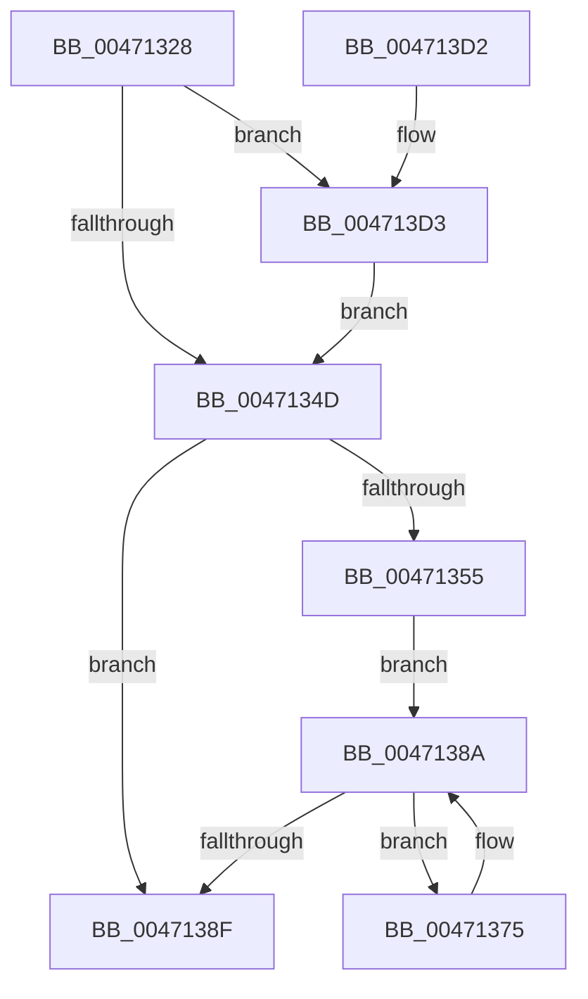

# RtlpHpSegSegmentFree

- RVA: `0x00471328`–`0x004713FC` (길이 `212` bytes)
- VA: `0x0000000140471328`
- 실행 섹션: `.text`
- PDB 이름 있음: `예`; PDB Function 태그: `아니요`
- unwind 정보 RVA: `0x000704BC`
- 디코드: `59`개 명령, `212/212` bytes 표시
- 미해석 바이트: `0` (있으면 어셈블리에 `.byte`로 보존)

> 이 문서는 커널 이미지의 기계어와 PDB 기호를 분석해 생성했습니다. 4번과 5번은 함수 원형과 자료형을 바이너리 사용 방식에서 추정한 C 해석이며 원본 소스 복구 결과는 아닙니다.

## 1. Dependencies

- 직접 호출 지점: **2**; 고유 호출 대상: **2**
- 직접 호출자로 확인된 함수: **3**
- RIP 상대 이미지 참조: **2**

### Outgoing calls
- `0x00471398` → [RtlpHpSegMgrRelease](../2E/RtlpHpSegMgrRelease_function_002E37FC.md) (function, `0x002E37FC`)
- `0x004713F2` → [RtlCSparseBitmapBitsClear](../2E/RtlCSparseBitmapBitsClear_function_002E34C4.md) (function, `0x002E34C4`)

### Direct callers
- [RtlpHpSegSegmentAllocate](../32/RtlpHpSegSegmentAllocate_function_00326A78.md) at `0x00326B59`
- [RtlpHpSegContextCompact](../32/RtlpHpSegContextCompact_function_00326F90.md) at `0x00327149`
- [RtlpHpSegContextCleanup](../60/RtlpHpSegContextCleanup_function_006041BC.md) at `0x006041FA`

### Static image references
- `0x004713D3` → RVA `0x00E68608` (`.data`; read)
- `0x004713DA` → RVA `0x00E68610` (`.data`; read)

## 2. Other-region calls and transfers

- 다른 실행 섹션으로 향하는 call: **0**
- 별도 외부 분기/꼬리 이동을 확인하지 못했습니다.

## 3. Assembly (complete function range)

```asm
00471328  48 89 5C 24 08                  mov qword ptr [rsp + 8], rbx
0047132D  48 89 74 24 10                  mov qword ptr [rsp + 0x10], rsi
00471332  57                              push rdi
00471333  48 83 EC 20                     sub rsp, 0x20
00471337  8B 01                           mov eax, dword ptr [rcx]
00471339  41 8B D8                        mov ebx, r8d
0047133C  F7 D8                           neg eax
0047133E  48 8B F2                        mov rsi, rdx
00471341  48 8B F9                        mov rdi, rcx
00471344  45 85 C9                        test r9d, r9d
00471347  0F 85 86 00 00 00               jne 0x1404713d3
0047134D  81 FB FF FF FF 7F               cmp ebx, 0x7fffffff
00471353  75 3A                           jne 0x14047138f
00471355  0F B6 47 0A                     movzx eax, byte ptr [rdi + 0xa]
00471359  BB 02 00 00 00                  mov ebx, 2
0047135E  48 C1 E0 05                     shl rax, 5
00471362  48 8D 0C 30                     lea rcx, [rax + rsi]
00471366  48 8B D1                        mov rdx, rcx
00471369  48 2B D0                        sub rdx, rax
0047136C  48 81 C2 00 20 00 00            add rdx, 0x2000
00471373  EB 15                           jmp 0x14047138a
00471375  8B 41 1C                        mov eax, dword ptr [rcx + 0x1c]
00471378  F7 D0                           not eax
0047137A  0F B7 C0                        movzx eax, ax
0047137D  03 D8                           add ebx, eax
0047137F  0F B6 41 1F                     movzx eax, byte ptr [rcx + 0x1f]
00471383  48 C1 E0 05                     shl rax, 5
00471387  48 03 C8                        add rcx, rax
0047138A  48 3B CA                        cmp rcx, rdx
0047138D  72 E6                           jb 0x140471375
0047138F  44 8B C3                        mov r8d, ebx
00471392  48 8B D6                        mov rdx, rsi
00471395  48 8B CF                        mov rcx, rdi
00471398  E8 5F 24 E7 FF                  call 0x1402e37fc
0047139D  48 0F BF 47 16                  movsx rax, word ptr [rdi + 0x16]
004713A2  8B CB                           mov ecx, ebx
004713A4  48 F7 D9                        neg rcx
004713A7  F0 48 01 4C 38 08               lock add qword ptr [rax + rdi + 8], rcx
004713AD  8B 0F                           mov ecx, dword ptr [rdi]
004713AF  48 0F BF 47 16                  movsx rax, word ptr [rdi + 0x16]
004713B4  F7 D9                           neg ecx
004713B6  48 C1 E9 0C                     shr rcx, 0xc
004713BA  48 F7 D9                        neg rcx
004713BD  F0 48 01 0C 38                  lock add qword ptr [rax + rdi], rcx
004713C2  48 8B 5C 24 30                  mov rbx, qword ptr [rsp + 0x30]
004713C7  48 8B 74 24 38                  mov rsi, qword ptr [rsp + 0x38]
004713CC  48 83 C4 20                     add rsp, 0x20
004713D0  5F                              pop rdi
004713D1  C3                              ret
004713D2  CC                              int3
004713D3  48 2B 15 2E 72 9F 00            sub rdx, qword ptr [rip + 0x9f722e]
004713DA  48 8D 0D 2F 72 9F 00            lea rcx, [rip + 0x9f722f]
004713E1  44 8B C0                        mov r8d, eax
004713E4  48 C1 EA 14                     shr rdx, 0x14
004713E8  49 C1 E8 14                     shr r8, 0x14
004713EC  48 03 D2                        add rdx, rdx
004713EF  4D 03 C0                        add r8, r8
004713F2  E8 CD 20 E7 FF                  call 0x1402e34c4
004713F7  E9 51 FF FF FF                  jmp 0x14047134d
```

## 4. C-style interpretation (structured pseudocode)

```c
__int64 __fastcall RtlpHpSegSegmentFree(__int64 a1, __int64 a2, int a3, int a4)
{
    __int64 result;
    __int64 v_rbx;
    __int64 v_rsp;
    unsigned __int64 v_stack_p10;
    unsigned __int64 v_stack_p8;

    v_stack_p8 = v_rbx;
    v_stack_p10 = v_rsi;
    v_rsp = (v_rsp) - (32);
    result = (unsigned int)(-((unsigned int)(*(unsigned int *)(a1))));
    if (a4 != 0) goto loc_004713D3;
loc_0047134D:
    if (((unsigned int)((unsigned int)(a3))) != 0x7FFFFFFFULL) goto loc_0047138F;
    result = (*(unsigned __int8 *)(a1 + 10)) << (5);
    a2 = (result + a2 * 1) - (result);
    a2 = (a2) + (0x2000ULL);
    goto loc_0047138A;
loc_00471375:
    result = (unsigned int)(~((unsigned int)(*(unsigned int *)(result + a2 * 1 + 28))));
    v_rbx = (unsigned int)((2) + ((unsigned int)((unsigned __int16)(result))));
    result = (*(unsigned __int8 *)(result + a2 * 1 + 31)) << (5);
    a1 = (result + a2 * 1) + (result);
loc_0047138A:
    if (a1 < a2) goto loc_00471375;
loc_0047138F:
    result = RtlpHpSegMgrRelease(a1, a2, (unsigned int)((unsigned int)(v_rbx)), a4);
    a1 = -((unsigned int)((unsigned int)(v_rbx)));
    a1 = (unsigned int)(-((unsigned int)(*(unsigned int *)(a1))));
    a1 = (a1) >> (12);
    a1 = -(a1);
    v_rsp = (v_rsp) + (32);
    return (__int16)(*(unsigned __int16 *)(a1 + 22));
loc_004713D3:
    a2 = (a2) - (*(unsigned __int64 *)(v_rip + 10449454));
    a2 = (a2) >> (20);
    a3 = ((unsigned int)((unsigned int)((__int16)(*(unsigned __int16 *)(a1 + 22))))) >> (20);
    a2 = (a2) + (a2);
    a3 = (a3) + (a3);
    result = RtlCSparseBitmapBitsClear(v_rip + 10449455, a2, a3, a4);
    goto loc_0047134D;
}
```

## 5. (Beta) C Style

```c
int64_t RtlpHpSegSegmentFree(void *Arg1, int64_t Arg2, int32_t Arg3, int32_t Arg4)
{
    uint8_t *arg1 = (uint8_t *)Arg1;

    int64_t result;
    int64_t local_rbx;
    int64_t local_rsp;
    uint64_t v_stack_p10;
    uint64_t v_stack_p8;

    v_stack_p8 = local_rbx;
    v_stack_p10 = local_rsi;
    local_rsp = (local_rsp) - (32);
    result = (uint32_t)(-((uint32_t)(*(uint32_t *)(arg1))));
    if (Arg4 != 0) goto loc_004713D3;
loc_0047134D:
    if (((uint32_t)((uint32_t)(Arg3))) != 0x7FFFFFFFULL) goto loc_0047138F;
    result = (*(uint8_t *)(arg1 + 0xA)) << (5);
    Arg2 = (result + Arg2 * 1) - (result);
    Arg2 = (Arg2) + (0x2000ULL);
    goto loc_0047138A;
loc_00471375:
    result = (uint32_t)(~((uint32_t)(*(uint32_t *)(result + Arg2 * 1 + 0x1C))));
    local_rbx = (uint32_t)((2) + ((uint32_t)((uint16_t)(result))));
    result = (*(uint8_t *)(result + Arg2 * 1 + 0x1F)) << (5);
    Arg1 = (result + Arg2 * 1) + (result);
loc_0047138A:
    if (Arg1 < Arg2) goto loc_00471375;
loc_0047138F:
    result = RtlpHpSegMgrRelease(Arg1, Arg2, (uint32_t)((uint32_t)(local_rbx)), Arg4);
    Arg1 = -((uint32_t)((uint32_t)(local_rbx)));
    Arg1 = (uint32_t)(-((uint32_t)(*(uint32_t *)(arg1))));
    Arg1 = (Arg1) >> (12);
    Arg1 = -(Arg1);
    local_rsp = (local_rsp) + (32);
    return (int16_t)(*(uint16_t *)(arg1 + 0x16));
loc_004713D3:
    Arg2 = (Arg2) - (*(uint64_t *)(v_rip + 0x9F722E));
    Arg2 = (Arg2) >> (20);
    Arg3 = ((uint32_t)((uint32_t)((int16_t)(*(uint16_t *)(arg1 + 0x16))))) >> (20);
    Arg2 = (Arg2) + (Arg2);
    Arg3 = (Arg3) + (Arg3);
    result = RtlCSparseBitmapBitsClear(v_rip + 10449455, Arg2, Arg3, Arg4);
    goto loc_0047134D;
}
```

### 관측된 메모리 오프셋

구조체 형식이 확인되지 않은 접근은 인자 기준의 오프셋으로만 기록했습니다.

| 기준 인자 | 오프셋 표현 | 폭 (bit) | 접근 |
|---|---:|---:|---|
| `Arg1` | `+ 0x0` | `32` | `R` |
| `Arg1` | `+ 0xA` | `8` | `R` |
| `Arg1` | `+ 0x16` | `16` | `R` |

## 6. Execution-region graph

[열기: 2D/3D 그래프와 함수 탐색 컨트롤 패널](../../../control-panel.html?section=text&rva=0x00471328&view=graph)

- 2D 그래프는 위에서 아래로 흐르고, 3D 그래프는 빈 공간을 드래그해 회전합니다. Shift+드래그는 이동, 휠은 확대·축소, 함수 노드 선택은 대상 보고서 이동입니다.

### Static fallback


