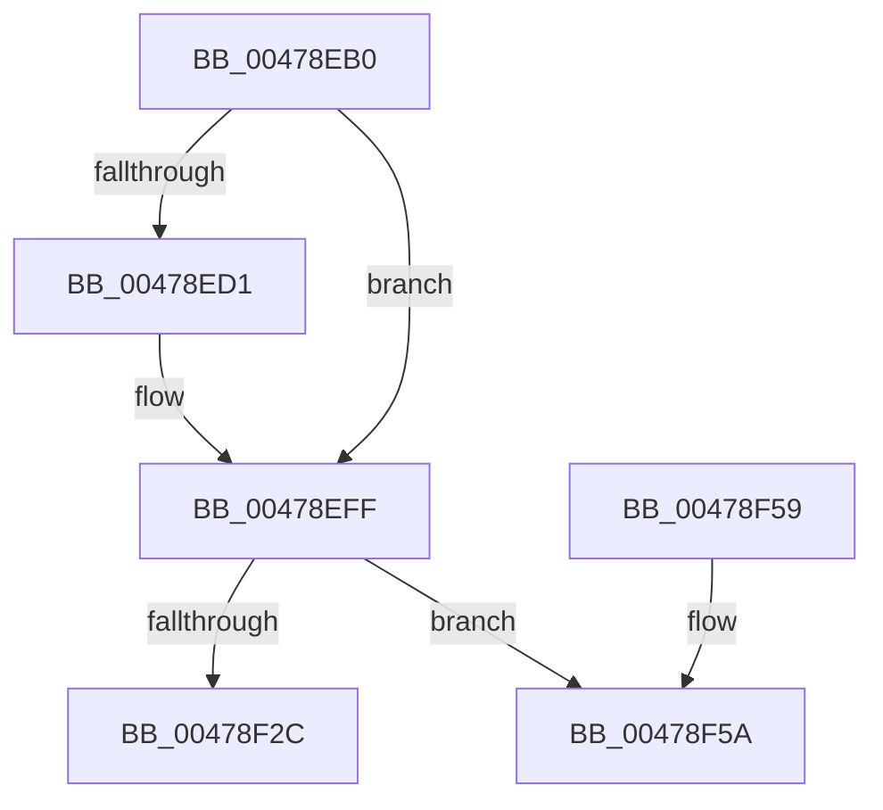

# RtlpHpSegSegmentInitialize

- RVA: `0x00478EB0`–`0x00478F63` (길이 `179` bytes)
- VA: `0x0000000140478EB0`
- 실행 섹션: `.text`
- PDB 이름 있음: `예`; PDB Function 태그: `예`
- unwind 정보 RVA: `0x000ACE9C`
- 디코드: `51`개 명령, `179/179` bytes 표시
- 미해석 바이트: `0` (있으면 어셈블리에 `.byte`로 보존)

> 이 문서는 커널 이미지의 기계어와 PDB 기호를 분석해 생성했습니다. 4번과 5번은 함수 원형과 자료형을 바이너리 사용 방식에서 추정한 C 해석이며 원본 소스 복구 결과는 아닙니다.

## 1. Dependencies

- 직접 호출 지점: **1**; 고유 호출 대상: **1**
- 직접 호출자로 확인된 함수: **2**
- RIP 상대 이미지 참조: **1**

### Outgoing calls
- `0x00478EF1` → [RtlpHpVaMgrCtxQuery](../32/RtlpHpVaMgrCtxQuery_function_003273C0.md) (function, `0x003273C0`)

### Direct callers
- [sub_003267E9](../32/Unknown_function_003267E9.md) at `0x003268D3`
- [RtlpHpSegContextReserve](../60/RtlpHpSegContextReserve_function_00604338.md) at `0x006043CD`

### Static image references
- `0x00478EE0` → RVA `0x00E68658` (`.data`; read)

## 2. Other-region calls and transfers

- 다른 실행 섹션으로 향하는 call: **0**
- call이 아닌 외부 분기/꼬리 이동: **1**
  - `0x00478F5E` → [sub_006F481E](../6F/Unknown_function_006F481E.md) (`tail-transfer`)

## 3. Assembly (complete function range)

```asm
00478EB0  48 89 5C 24 08                  mov qword ptr [rsp + 8], rbx
00478EB5  48 89 74 24 10                  mov qword ptr [rsp + 0x10], rsi
00478EBA  57                              push rdi
00478EBB  48 83 EC 40                     sub rsp, 0x40
00478EBF  8A 41 0D                        mov al, byte ptr [rcx + 0xd]
00478EC2  41 8B D8                        mov ebx, r8d
00478EC5  24 07                           and al, 7
00478EC7  48 8B FA                        mov rdi, rdx
00478ECA  48 8B F1                        mov rsi, rcx
00478ECD  3C 01                           cmp al, 1
00478ECF  72 2E                           jb 0x140478eff
00478ED1  0F 57 C0                        xorps xmm0, xmm0
00478ED4  4C 8D 44 24 20                  lea r8, [rsp + 0x20]
00478ED9  48 81 E2 00 00 E0 FF            and rdx, 0xffffffffffe00000
00478EE0  48 8D 0D 71 F7 9E 00            lea rcx, [rip + 0x9ef771]
00478EE7  0F 11 44 24 20                  movups xmmword ptr [rsp + 0x20], xmm0
00478EEC  0F 11 44 24 30                  movups xmmword ptr [rsp + 0x30], xmm0
00478EF1  E8 CA E4 EA FF                  call 0x1403273c0
00478EF6  48 8B 44 24 30                  mov rax, qword ptr [rsp + 0x30]
00478EFB  48 89 47 18                     mov qword ptr [rdi + 0x18], rax
00478EFF  0F B6 46 0A                     movzx eax, byte ptr [rsi + 0xa]
00478F03  41 B9 01 00 00 00               mov r9d, 1
00478F09  8B D0                           mov edx, eax
00478F0B  44 8B C3                        mov r8d, ebx
00478F0E  F6 D8                           neg al
00478F10  48 C1 E2 05                     shl rdx, 5
00478F14  48 03 D7                        add rdx, rdi
00478F17  88 42 1F                        mov byte ptr [rdx + 0x1f], al
00478F1A  8A 42 18                        mov al, byte ptr [rdx + 0x18]
00478F1D  0C 02                           or al, 2
00478F1F  88 42 18                        mov byte ptr [rdx + 0x18], al
00478F22  8A 4E 09                        mov cl, byte ptr [rsi + 9]
00478F25  41 D3 E1                        shl r9d, cl
00478F28  85 DB                           test ebx, ebx
00478F2A  75 2E                           jne 0x140478f5a
00478F2C  0F B6 4A 1F                     movzx ecx, byte ptr [rdx + 0x1f]
00478F30  66 F7 D3                        not bx
00478F33  48 8B 74 24 58                  mov rsi, qword ptr [rsp + 0x58]
00478F38  FF C9                           dec ecx
00478F3A  66 89 5A 1C                     mov word ptr [rdx + 0x1c], bx
00478F3E  48 8B 5C 24 50                  mov rbx, qword ptr [rsp + 0x50]
00478F43  8B C1                           mov eax, ecx
00478F45  48 C1 E0 05                     shl rax, 5
00478F49  88 4C 10 1A                     mov byte ptr [rax + rdx + 0x1a], cl
00478F4D  C7 02 DD CC DD CC               mov dword ptr [rdx], 0xccddccdd
00478F53  48 83 C4 40                     add rsp, 0x40
00478F57  5F                              pop rdi
00478F58  C3                              ret
00478F59  CC                              int3
00478F5A  48 8D 4A 19                     lea rcx, [rdx + 0x19]
00478F5E  E9 BB B8 27 00                  jmp 0x1406f481e
```

## 4. C-style interpretation (structured pseudocode)

```c
__int64 __fastcall RtlpHpSegSegmentInitialize(__int64 a1, __int64 a2, int a3)
{
    __int64 result;
    __int64 v_rbx;
    __int64 v_rsp;
    unsigned __int64 v_stack_m18;
    unsigned __int64 v_stack_m28;
    unsigned __int64 v_stack_p10;
    unsigned __int64 v_stack_p8;

    v_stack_p8 = v_rbx;
    v_stack_p10 = v_rsi;
    v_rsp = (v_rsp) - (64);
    result = (unsigned __int8)((*(unsigned __int8 *)(a1 + 13)) & (7));
    if (((unsigned __int8)(result)) >= 1) {
        a3 = v_stack_m28;
        a2 = (a2) & (0xFFFFFFFFFFE00000ULL);
        a1 = v_rip + 10418033;
        v_stack_m28 = v_xmm0;
        v_stack_m18 = v_xmm0;
        result = RtlpHpVaMgrCtxQuery(a1, a2, a3, a4);
        result = v_stack_m18;
        *(unsigned __int64 *)(a2 + 24) = result;
    }
    result = (unsigned __int8)(-(*(unsigned __int8 *)(a1 + 10)));
    a2 = ((unsigned int)((unsigned int)(*(unsigned __int8 *)(a1 + 10)))) << (5);
    a2 = (a2) + (a2);
    *(unsigned __int8 *)(a2 + 31) = (unsigned __int8)(result);
    result = (unsigned __int8)((*(unsigned __int8 *)(a2 + 24)) | (2));
    *(unsigned __int8 *)(a2 + 24) = (unsigned __int8)(result);
    a4 = (unsigned int)((1) << ((unsigned __int8)(*(unsigned __int8 *)(a1 + 9))));
    if ((unsigned int)((unsigned int)(a3)) != 0) goto loc_00478F5A;
    v_rbx = (unsigned __int16)(~((unsigned int)(a3)));
    a1 = (unsigned int)((*(unsigned __int8 *)(a2 + 31)) - 1);
    *(unsigned __int16 *)(a2 + 28) = (unsigned __int16)(v_rbx);
    result = ((unsigned int)((unsigned int)(a1))) << (5);
    *(unsigned __int8 *)(result + a2 * 1 + 26) = (unsigned __int8)(a1);
    *(unsigned int *)(a2) = 0xCCDDCCDDULL;
    v_rsp = (v_rsp) + (64);
    return result;
loc_00478F5A:
}
```

## 5. (Beta) C Style

```c
int64_t RtlpHpSegSegmentInitialize(void *Arg1, void *Arg2, int32_t Arg3)
{
    uint8_t *arg1 = (uint8_t *)Arg1;
    uint8_t *arg2 = (uint8_t *)Arg2;

    int64_t result;
    int64_t local_rbx;
    int64_t local_rsp;
    uint64_t v_stack_m18;
    uint64_t v_stack_m28;
    uint64_t v_stack_p10;
    uint64_t v_stack_p8;

    v_stack_p8 = local_rbx;
    v_stack_p10 = local_rsi;
    local_rsp = (local_rsp) - (64);
    result = (uint8_t)((*(uint8_t *)(arg1 + 0xD)) & (7));
    if (((uint8_t)(result)) >= 1) {
        Arg3 = v_stack_m28;
        Arg2 = (Arg2) & (0xFFFFFFFFFFE00000ULL);
        Arg1 = v_rip + 10418033;
        v_stack_m28 = v_xmm0;
        v_stack_m18 = v_xmm0;
        result = RtlpHpVaMgrCtxQuery(Arg1, Arg2, Arg3, a4);
        result = v_stack_m18;
        *(uint64_t *)(arg2 + 0x18) = result;
    }
    result = (uint8_t)(-(*(uint8_t *)(arg1 + 0xA)));
    Arg2 = ((uint32_t)((uint32_t)(*(uint8_t *)(arg1 + 0xA)))) << (5);
    Arg2 = (Arg2) + (Arg2);
    *(uint8_t *)(arg2 + 0x1F) = (uint8_t)(result);
    result = (uint8_t)((*(uint8_t *)(arg2 + 0x18)) | (2));
    *(uint8_t *)(arg2 + 0x18) = (uint8_t)(result);
    a4 = (uint32_t)((1) << ((uint8_t)(*(uint8_t *)(arg1 + 0x9))));
    if ((uint32_t)((uint32_t)(Arg3)) != 0) goto loc_00478F5A;
    local_rbx = (uint16_t)(~((uint32_t)(Arg3)));
    Arg1 = (uint32_t)((*(uint8_t *)(arg2 + 0x1F)) - 1);
    *(uint16_t *)(arg2 + 0x1C) = (uint16_t)(local_rbx);
    result = ((uint32_t)((uint32_t)(Arg1))) << (5);
    *(uint8_t *)(result + arg2 * 1 + 0x1A) = (uint8_t)(Arg1);
    *(uint32_t *)(arg2) = 0xCCDDCCDDULL;
    local_rsp = (local_rsp) + (64);
    return result;
loc_00478F5A:
}
```

### 관측된 메모리 오프셋

구조체 형식이 확인되지 않은 접근은 인자 기준의 오프셋으로만 기록했습니다.

| 기준 인자 | 오프셋 표현 | 폭 (bit) | 접근 |
|---|---:|---:|---|
| `Arg1` | `+ 0x9` | `8` | `R` |
| `Arg1` | `+ 0xA` | `8` | `R` |
| `Arg1` | `+ 0xD` | `8` | `R` |
| `Arg2` | `+ 0x18` | `64` | `W` |

## 6. Execution-region graph

[열기: 2D/3D 그래프와 함수 탐색 컨트롤 패널](../../../control-panel.html?section=text&rva=0x00478EB0&view=graph)

- 2D 그래프는 위에서 아래로 흐르고, 3D 그래프는 빈 공간을 드래그해 회전합니다. Shift+드래그는 이동, 휠은 확대·축소, 함수 노드 선택은 대상 보고서 이동입니다.

### Static fallback


