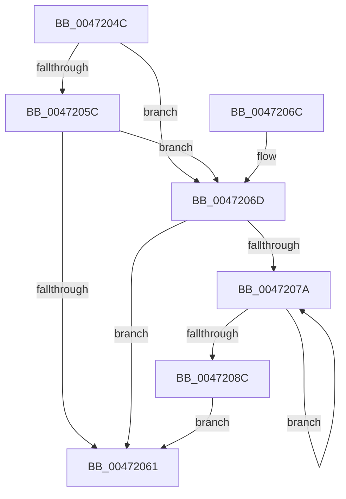

# SMKM_STORE_MGR&lt;SM_TRAITS&gt;::SmDrainSList

- RVA: `0x0047204C`–`0x0047208E` (길이 `66` bytes)
- VA: `0x000000014047204C`
- 실행 섹션: `.text`
- PDB 이름 있음: `예`; PDB Function 태그: `아니요`
- unwind 정보 RVA: `0x00088DA0`
- 디코드: `24`개 명령, `66/66` bytes 표시
- 미해석 바이트: `0` (있으면 어셈블리에 `.byte`로 보존)

> 이 문서는 커널 이미지의 기계어와 PDB 기호를 분석해 생성했습니다. 4번과 5번은 함수 원형과 자료형을 바이너리 사용 방식에서 추정한 C 해석이며 원본 소스 복구 결과는 아닙니다.

## 1. Dependencies

- 직접 호출 지점: **2**; 고유 호출 대상: **2**
- 직접 호출자로 확인된 함수: **3**
- RIP 상대 이미지 참조: **0**

### Outgoing calls
- `0x0047206D` → [ExpInterlockedFlushSList](../6B/ExpInterlockedFlushSList_function_006BA5F0.md) (function, `0x006BA5F0`)
- `0x00472082` → [ExFreePoolWithTag](../../poolcode/B8/ExFreePoolWithTag_function_00B82870.md) (function, `0x00B82870`)

### Direct callers
- [MiStoreUpdateMemoryConditions](../34/MiStoreUpdateMemoryConditions_function_0034CF3C.md) at `0x0034D0D4`
- [SMKM_STORE_MGR&lt;SM_TRAITS&gt;::SmCleanup](../60/SMKM_STORE_MGR_SM_TRAITS_SmCleanup_function_0060C214.md) at `0x0060C25A`
- [SMKM_STORE_MGR&lt;SM_TRAITS&gt;::SmCompressManagerCleanup](../60/SMKM_STORE_MGR_SM_TRAITS_SmCompressManagerCleanup_function_0060C330.md) at `0x0060C3DB`

### Static image references
- 디코드된 RIP-relative 메모리 참조가 없습니다.

## 2. Other-region calls and transfers

- 다른 실행 섹션으로 향하는 call: **1**
  - `0x00472082` → [ExFreePoolWithTag](../../poolcode/B8/ExFreePoolWithTag_function_00B82870.md) (`.text` → `POOLCODE`)
- 별도 외부 분기/꼬리 이동을 확인하지 못했습니다.

## 3. Assembly (complete function range)

```asm
0047204C  48 89 5C 24 08                  mov qword ptr [rsp + 8], rbx
00472051  57                              push rdi
00472052  48 83 EC 20                     sub rsp, 0x20
00472056  33 FF                           xor edi, edi
00472058  85 D2                           test edx, edx
0047205A  75 11                           jne 0x14047206d
0047205C  66 39 39                        cmp word ptr [rcx], di
0047205F  75 0C                           jne 0x14047206d
00472061  48 8B 5C 24 30                  mov rbx, qword ptr [rsp + 0x30]
00472066  48 83 C4 20                     add rsp, 0x20
0047206A  5F                              pop rdi
0047206B  C3                              ret
0047206C  CC                              int3
0047206D  E8 7E 85 24 00                  call 0x1406ba5f0
00472072  48 8B D8                        mov rbx, rax
00472075  48 85 C0                        test rax, rax
00472078  74 E7                           je 0x140472061
0047207A  48 8B CB                        mov rcx, rbx
0047207D  33 D2                           xor edx, edx
0047207F  48 8B 1B                        mov rbx, qword ptr [rbx]
00472082  E8 E9 07 71 00                  call 0x140b82870
00472087  48 85 DB                        test rbx, rbx
0047208A  75 EE                           jne 0x14047207a
0047208C  EB D3                           jmp 0x140472061
```

## 4. C-style interpretation (structured pseudocode)

```c
__int64 __fastcall SMKM_STORE_MGR_SM_TRAITS___SmDrainSList(__int64 a1, int a2)
{
    __int64 result;
    __int64 v_rdi;
    __int64 v_rsp;
    unsigned __int64 v_stack_p8;

    v_stack_p8 = v_rbx;
    v_rsp = (v_rsp) - (32);
    v_rdi = 0;
    if (a2 != 0) goto loc_0047206D;
    if ((*(unsigned __int16 *)(a1)) != 0) goto loc_0047206D;
loc_00472061:
    v_rsp = (v_rsp) + (32);
    return result;
loc_0047206D:
    result = ExpInterlockedFlushSList(a1, a2, a3, a4);
    if (result == 0) goto loc_00472061;
loc_0047207A:
    a2 = 0;
    result = ExFreePoolWithTag(result, a2, a3, a4);
    if (*(unsigned __int64 *)(result) != 0) goto loc_0047207A;
    goto loc_00472061;
}
```

## 5. (Beta) C Style

```c
int64_t SMKM_STORE_MGR_SM_TRAITS___SmDrainSList(void *Arg1, int32_t Arg2)
{
    uint8_t *arg1 = (uint8_t *)Arg1;

    int64_t result;
    int64_t local_rdi;
    int64_t local_rsp;
    uint64_t v_stack_p8;

    v_stack_p8 = local_rbx;
    local_rsp = (local_rsp) - (32);
    local_rdi = 0;
    if (Arg2 != 0) goto loc_0047206D;
    if ((*(uint16_t *)(arg1)) != 0) goto loc_0047206D;
loc_00472061:
    local_rsp = (local_rsp) + (32);
    return result;
loc_0047206D:
    result = ExpInterlockedFlushSList(Arg1, Arg2, a3, a4);
    if (result == 0) goto loc_00472061;
loc_0047207A:
    Arg2 = 0;
    result = ExFreePoolWithTag(result, Arg2, a3, a4);
    if (*(uint64_t *)(result) != 0) goto loc_0047207A;
    goto loc_00472061;
}
```

### 관측된 메모리 오프셋

구조체 형식이 확인되지 않은 접근은 인자 기준의 오프셋으로만 기록했습니다.

| 기준 인자 | 오프셋 표현 | 폭 (bit) | 접근 |
|---|---:|---:|---|
| `Arg1` | `+ 0x0` | `16` | `R` |

## 6. Execution-region graph

[열기: 2D/3D 그래프와 함수 탐색 컨트롤 패널](../../../control-panel.html?section=text&rva=0x0047204C&view=graph)

- 2D 그래프는 위에서 아래로 흐르고, 3D 그래프는 빈 공간을 드래그해 회전합니다. Shift+드래그는 이동, 휠은 확대·축소, 함수 노드 선택은 대상 보고서 이동입니다.

### Static fallback


