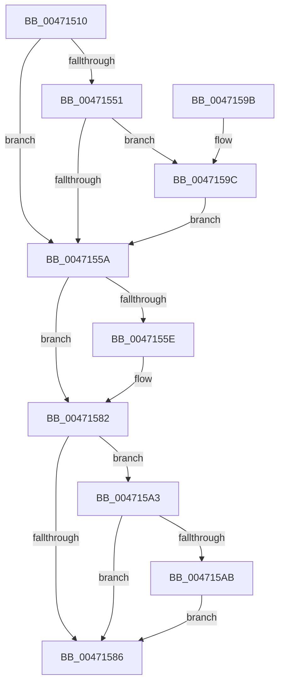

# SMKM_STORE_MGR&lt;SM_TRAITS&gt;::SmProcessAddCompletion

- RVA: `0x00471510`–`0x004715D2` (길이 `194` bytes)
- VA: `0x0000000140471510`
- 실행 섹션: `.text`
- PDB 이름 있음: `예`; PDB Function 태그: `아니요`
- unwind 정보 RVA: `0x000ABE84`
- 디코드: `53`개 명령, `194/194` bytes 표시
- 미해석 바이트: `0` (있으면 어셈블리에 `.byte`로 보존)

> 이 문서는 커널 이미지의 기계어와 PDB 기호를 분석해 생성했습니다. 4번과 5번은 함수 원형과 자료형을 바이너리 사용 방식에서 추정한 C 해석이며 원본 소스 복구 결과는 아닙니다.

## 1. Dependencies

- 직접 호출 지점: **2**; 고유 호출 대상: **1**
- 직접 호출자로 확인된 함수: **1**
- RIP 상대 이미지 참조: **0**

### Outgoing calls
- `0x00471573` → [SMKM_STORE_MGR<SM_TRAITS>::SmProcessIoCompletion](../2E/SMKM_STORE_MGR_SM_TRAITS_SmProcessIoCompletion_function_002E0380.md) (function, `0x002E0380`)
- `0x004715CB` → [SMKM_STORE_MGR<SM_TRAITS>::SmProcessIoCompletion](../2E/SMKM_STORE_MGR_SM_TRAITS_SmProcessIoCompletion_function_002E0380.md) (function, `0x002E0380`)

### Direct callers
- [SMKM_STORE_MGR&lt;SM_TRAITS&gt;::SmIoCtxWorkItemComplete](../20/SMKM_STORE_MGR_SM_TRAITS_SmIoCtxWorkItemComplete_function_00205850.md) at `0x00205914`

### Static image references
- 디코드된 RIP-relative 메모리 참조가 없습니다.

## 2. Other-region calls and transfers

- 다른 실행 섹션으로 향하는 call: **0**
- 별도 외부 분기/꼬리 이동을 확인하지 못했습니다.

## 3. Assembly (complete function range)

```asm
00471510  48 89 5C 24 08                  mov qword ptr [rsp + 8], rbx
00471515  48 89 6C 24 10                  mov qword ptr [rsp + 0x10], rbp
0047151A  48 89 74 24 20                  mov qword ptr [rsp + 0x20], rsi
0047151F  57                              push rdi
00471520  48 83 EC 30                     sub rsp, 0x30
00471524  8B 5A 08                        mov ebx, dword ptr [rdx + 8]
00471527  41 8B F8                        mov edi, r8d
0047152A  44 8B 44 24 60                  mov r8d, dword ptr [rsp + 0x60]
0047152F  48 8B F2                        mov rsi, rdx
00471532  8B 42 18                        mov eax, dword ptr [rdx + 0x18]
00471535  48 8B E9                        mov rbp, rcx
00471538  4C 8B 52 20                     mov r10, qword ptr [rdx + 0x20]
0047153C  C1 EB 03                        shr ebx, 3
0047153F  81 E3 FF FF FF 07               and ebx, 0x7ffffff
00471545  89 44 24 50                     mov dword ptr [rsp + 0x50], eax
00471549  45 89 02                        mov dword ptr [r10], r8d
0047154C  45 85 C0                        test r8d, r8d
0047154F  78 09                           js 0x14047155a
00471551  41 F7 01 00 01 00 00            test dword ptr [r9], 0x100
00471558  75 42                           jne 0x14047159c
0047155A  85 DB                           test ebx, ebx
0047155C  74 24                           je 0x140471582
0047155E  C7 44 24 28 01 00 00 00         mov dword ptr [rsp + 0x28], 1
00471566  48 8D 54 24 50                  lea rdx, [rsp + 0x50]
0047156B  44 89 44 24 20                  mov dword ptr [rsp + 0x20], r8d
00471570  44 8B C3                        mov r8d, ebx
00471573  E8 08 EE E6 FF                  call 0x1402e0380
00471578  8B 44 24 50                     mov eax, dword ptr [rsp + 0x50]
0047157C  41 B8 01 00 00 C0               mov r8d, 0xc0000001
00471582  3B DF                           cmp ebx, edi
00471584  75 1D                           jne 0x1404715a3
00471586  48 8B 5C 24 40                  mov rbx, qword ptr [rsp + 0x40]
0047158B  48 8B 6C 24 48                  mov rbp, qword ptr [rsp + 0x48]
00471590  48 8B 74 24 58                  mov rsi, qword ptr [rsp + 0x58]
00471595  48 83 C4 30                     add rsp, 0x30
00471599  5F                              pop rdi
0047159A  C3                              ret
0047159B  CC                              int3
0047159C  49 83 4A 08 01                  or qword ptr [r10 + 8], 1
004715A1  EB B7                           jmp 0x14047155a
004715A3  8B 4E 0C                        mov ecx, dword ptr [rsi + 0xc]
004715A6  F6 C1 40                        test cl, 0x40
004715A9  75 DB                           jne 0x140471586
004715AB  2B FB                           sub edi, ebx
004715AD  C7 44 24 28 01 00 00 00         mov dword ptr [rsp + 0x28], 1
004715B5  44 89 44 24 20                  mov dword ptr [rsp + 0x20], r8d
004715BA  48 8D 54 24 50                  lea rdx, [rsp + 0x50]
004715BF  03 C3                           add eax, ebx
004715C1  44 8B C7                        mov r8d, edi
004715C4  48 8B CD                        mov rcx, rbp
004715C7  89 44 24 50                     mov dword ptr [rsp + 0x50], eax
004715CB  E8 B0 ED E6 FF                  call 0x1402e0380
004715D0  EB B4                           jmp 0x140471586
```

## 4. C-style interpretation (structured pseudocode)

```c
__int64 __fastcall SMKM_STORE_MGR_SM_TRAITS___SmProcessAddCompletion(__int64 a1, __int64 a2, int a3, __int64 a4, unsigned int a5)
{
    __int64 result;
    __int64 v_rbx;
    __int64 v_rdi;
    __int64 v_rsp;
    unsigned int v_stack_m10;
    unsigned int v_stack_m18;
    unsigned __int64 v_stack_p10;
    unsigned int v_stack_p18;
    unsigned __int64 v_stack_p20;
    unsigned int v_stack_p28;
    unsigned __int64 v_stack_p50;
    unsigned __int64 v_stack_p8;

    v_stack_p8 = v_rbx;
    v_stack_p10 = v_rbp;
    v_stack_p20 = v_rsi;
    v_rsp = (v_rsp) - (48);
    v_rbx = (unsigned int)(((unsigned int)(*(unsigned int *)(a2 + 8))) >> (3));
    v_rbx = (unsigned int)((v_rbx) & (0x7FFFFFFULL));
    v_stack_p18 = (unsigned int)((unsigned int)(*(unsigned int *)(a2 + 24)));
    *(unsigned int *)(*(unsigned __int64 *)(a2 + 32)) = (unsigned int)((unsigned int)(a5));
    if (sign_flag) goto loc_0047155A;
    if (((*(unsigned int *)(a4)) & (256)) != 0) goto loc_0047159C;
loc_0047155A:
    result = (unsigned int)(*(unsigned int *)(a2 + 24));
    if ((unsigned int)(v_rbx) != 0) {
        v_stack_m10 = 1;
        a2 = v_stack_p18;
        v_stack_m18 = (unsigned int)((unsigned int)(a5));
        a3 = (unsigned int)(v_rbx);
        result = SMKM_STORE_MGR_SM_TRAITS___SmProcessIoCompletion(a1, a2, a3, a4);
        result = v_stack_p18;
        a3 = 0xC0000001ULL;
    }
    if (((unsigned int)(v_rbx)) != ((unsigned int)((unsigned int)(a3)))) goto loc_004715A3;
loc_00471586:
    v_rsp = (v_rsp) + (48);
    return result;
loc_0047159C:
    goto loc_0047155A;
loc_004715A3:
    if ((((unsigned __int8)((unsigned int)(*(unsigned int *)(v_stack_p20 + 12)))) & (64)) != 0) goto loc_00471586;
    v_rdi = (unsigned int)(((unsigned int)(a3)) - ((unsigned int)(v_stack_p8)));
    v_stack_p28 = 1;
    v_stack_p20 = a3;
    result = (unsigned int)((result) + ((unsigned int)(v_stack_p8)));
    v_stack_p50 = (unsigned int)(result);
    result = SMKM_STORE_MGR_SM_TRAITS___SmProcessIoCompletion(v_stack_p10, v_stack_p50, (unsigned int)((unsigned int)(v_rdi)), a4);
    goto loc_00471586;
}
```

## 5. (Beta) C Style

```c
int64_t SMKM_STORE_MGR_SM_TRAITS___SmProcessAddCompletion(int64_t Arg1, void *Arg2, int32_t Arg3, void *Arg4, uint32_t Arg5)
{
    uint8_t *arg2 = (uint8_t *)Arg2;
    uint8_t *arg4 = (uint8_t *)Arg4;

    int64_t result;
    int64_t local_rbx;
    int64_t local_rdi;
    int64_t local_rsp;
    uint32_t v_stack_m10;
    uint32_t v_stack_m18;
    uint64_t v_stack_p10;
    uint32_t v_stack_p18;
    uint64_t v_stack_p20;
    uint32_t v_stack_p28;
    uint64_t v_stack_p50;
    uint64_t v_stack_p8;

    v_stack_p8 = local_rbx;
    v_stack_p10 = local_rbp;
    v_stack_p20 = local_rsi;
    local_rsp = (local_rsp) - (48);
    local_rbx = (uint32_t)(((uint32_t)(*(uint32_t *)(arg2 + 0x8))) >> (3));
    local_rbx = (uint32_t)((local_rbx) & (0x7FFFFFFULL));
    v_stack_p18 = (uint32_t)((uint32_t)(*(uint32_t *)(arg2 + 0x18)));
    *(uint32_t *)(*(uint64_t *)(arg2 + 0x20)) = (uint32_t)((uint32_t)(Arg5));
    if (sign_flag) goto loc_0047155A;
    if (((*(uint32_t *)(arg4)) & (256)) != 0) goto loc_0047159C;
loc_0047155A:
    result = (uint32_t)(*(uint32_t *)(arg2 + 0x18));
    if ((uint32_t)(local_rbx) != 0) {
        v_stack_m10 = 1;
        Arg2 = v_stack_p18;
        v_stack_m18 = (uint32_t)((uint32_t)(Arg5));
        Arg3 = (uint32_t)(local_rbx);
        result = SMKM_STORE_MGR_SM_TRAITS___SmProcessIoCompletion(Arg1, Arg2, Arg3, Arg4);
        result = v_stack_p18;
        Arg3 = 0xC0000001ULL;
    }
    if (((uint32_t)(local_rbx)) != ((uint32_t)((uint32_t)(Arg3)))) goto loc_004715A3;
loc_00471586:
    local_rsp = (local_rsp) + (48);
    return result;
loc_0047159C:
    goto loc_0047155A;
loc_004715A3:
    if ((((uint8_t)((uint32_t)(*(uint32_t *)(v_stack_p20 + 0xC)))) & (64)) != 0) goto loc_00471586;
    local_rdi = (uint32_t)(((uint32_t)(Arg3)) - ((uint32_t)(v_stack_p8)));
    v_stack_p28 = 1;
    v_stack_p20 = Arg3;
    result = (uint32_t)((result) + ((uint32_t)(v_stack_p8)));
    v_stack_p50 = (uint32_t)(result);
    result = SMKM_STORE_MGR_SM_TRAITS___SmProcessIoCompletion(v_stack_p10, v_stack_p50, (uint32_t)((uint32_t)(local_rdi)), Arg4);
    goto loc_00471586;
}
```

### 관측된 메모리 오프셋

구조체 형식이 확인되지 않은 접근은 인자 기준의 오프셋으로만 기록했습니다.

| 기준 인자 | 오프셋 표현 | 폭 (bit) | 접근 |
|---|---:|---:|---|
| `Arg2` | `+ 0x8` | `32` | `R` |
| `Arg2` | `+ 0xC` | `32` | `R` |
| `Arg2` | `+ 0x18` | `32` | `R` |
| `Arg2` | `+ 0x20` | `64` | `R` |
| `Arg4` | `+ 0x0` | `32` | `R` |

## 6. Execution-region graph

[열기: 2D/3D 그래프와 함수 탐색 컨트롤 패널](../../../control-panel.html?section=text&rva=0x00471510&view=graph)

- 2D 그래프는 위에서 아래로 흐르고, 3D 그래프는 빈 공간을 드래그해 회전합니다. Shift+드래그는 이동, 휠은 확대·축소, 함수 노드 선택은 대상 보고서 이동입니다.

### Static fallback


