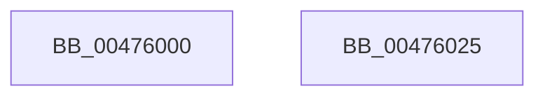

# SeAccessCheckEx

- RVA: `0x00476000`–`0x00476026` (길이 `38` bytes)
- VA: `0x0000000140476000`
- 실행 섹션: `.text`
- PDB 이름 있음: `예`; PDB Function 태그: `아니요`
- unwind 정보 RVA: `0x00063458`
- 디코드: `10`개 명령, `38/38` bytes 표시
- 미해석 바이트: `0` (있으면 어셈블리에 `.byte`로 보존)

> 이 문서는 커널 이미지의 기계어와 PDB 기호를 분석해 생성했습니다. 4번과 5번은 함수 원형과 자료형을 바이너리 사용 방식에서 추정한 C 해석이며 원본 소스 복구 결과는 아닙니다.

## 1. Dependencies

- 직접 호출 지점: **1**; 고유 호출 대상: **1**
- 직접 호출자로 확인된 함수: **0**
- RIP 상대 이미지 참조: **0**

### Outgoing calls
- `0x0047601B` → [SepCommonAccessCheckEx](SepCommonAccessCheckEx_function_0047602C.md) (function, `0x0047602C`)

### Direct callers
- 이 함수 시작 RVA로 연결되는 직접 call은 확인되지 않았습니다. 간접 호출은 완전히 역산할 수 없습니다.

### Static image references
- 디코드된 RIP-relative 메모리 참조가 없습니다.

## 2. Other-region calls and transfers

- 다른 실행 섹션으로 향하는 call: **0**
- 별도 외부 분기/꼬리 이동을 확인하지 못했습니다.

## 3. Assembly (complete function range)

```asm
00476000  48 83 EC 48                     sub rsp, 0x48
00476004  8A 44 24 78                     mov al, byte ptr [rsp + 0x78]
00476008  C6 44 24 30 00                  mov byte ptr [rsp + 0x30], 0
0047600D  88 44 24 28                     mov byte ptr [rsp + 0x28], al
00476011  48 8B 44 24 70                  mov rax, qword ptr [rsp + 0x70]
00476016  48 89 44 24 20                  mov qword ptr [rsp + 0x20], rax
0047601B  E8 0C 00 00 00                  call 0x14047602c
00476020  48 83 C4 48                     add rsp, 0x48
00476024  C3                              ret
00476025  CC                              int3
```

## 4. C-style interpretation (structured pseudocode)

```c
__int64 __fastcall SeAccessCheckEx(__int64 a1, __int64 a2, __int64 a3, __int64 a4, __int64 a5, unsigned __int8 a6)
{
    __int64 result;
    __int64 v_rsp;
    unsigned __int8 v_stack_m18;
    unsigned __int8 v_stack_m20;
    unsigned __int64 v_stack_m28;

    v_rsp = (v_rsp) - (72);
    v_stack_m18 = 0;
    v_stack_m20 = a6;
    v_stack_m28 = a5;
    result = SepCommonAccessCheckEx(a1, a2, a3, a4);
    v_rsp = (v_rsp) + (72);
    return result;
}
```

## 5. (Beta) C Style

```c
int64_t SeAccessCheckEx(int64_t Arg1, int64_t Arg2, int64_t Arg3, int64_t Arg4, int64_t Arg5, uint8_t Arg6)
{
    int64_t result;
    int64_t local_rsp;
    uint8_t v_stack_m18;
    uint8_t v_stack_m20;
    uint64_t v_stack_m28;

    local_rsp = (local_rsp) - (72);
    v_stack_m18 = 0;
    v_stack_m20 = Arg6;
    v_stack_m28 = Arg5;
    result = SepCommonAccessCheckEx(Arg1, Arg2, Arg3, Arg4);
    local_rsp = (local_rsp) + (72);
    return result;
}
```

## 6. Execution-region graph

[열기: 2D/3D 그래프와 함수 탐색 컨트롤 패널](../../../control-panel.html?section=text&rva=0x00476000&view=graph)

- 2D 그래프는 위에서 아래로 흐르고, 3D 그래프는 빈 공간을 드래그해 회전합니다. Shift+드래그는 이동, 휠은 확대·축소, 함수 노드 선택은 대상 보고서 이동입니다.

### Static fallback


