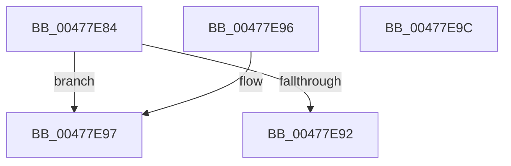

# SepAuditingForSubCategory

- RVA: `0x00477E84`–`0x00477E9D` (길이 `25` bytes)
- VA: `0x0000000140477E84`
- 실행 섹션: `.text`
- PDB 이름 있음: `예`; PDB Function 태그: `아니요`
- unwind 정보 RVA: `0x000DB714`
- 디코드: `10`개 명령, `25/25` bytes 표시
- 미해석 바이트: `0` (있으면 어셈블리에 `.byte`로 보존)

> 이 문서는 커널 이미지의 기계어와 PDB 기호를 분석해 생성했습니다. 4번과 5번은 함수 원형과 자료형을 바이너리 사용 방식에서 추정한 C 해석이며 원본 소스 복구 결과는 아닙니다.

## 1. Dependencies

- 직접 호출 지점: **0**; 고유 호출 대상: **0**
- 직접 호출자로 확인된 함수: **5**
- RIP 상대 이미지 참조: **1**

### Outgoing calls
- 직접 디코드된 call 명령이 없습니다.

### Direct callers
- [PipProcessStartPhase3](../../page/8F/PipProcessStartPhase3_function_008FBAF8.md) at `0x008FBBE8`
- [SeAuditingWithTokenForSubcategory](../../page/90/SeAuditingWithTokenForSubcategory_function_009047D0.md) at `0x009047EE`
- [PspInsertProcess](../../page/94/PspInsertProcess_function_009472CC.md) at `0x0094731F`
- [ObInitProcess](../../page/94/ObInitProcess_function_0094C62C.md) at `0x0094C68B`
- [SeAssignPrimaryToken](../../page/9F/SeAssignPrimaryToken_function_009F117C.md) at `0x009F1198`

### Static image references
- `0x00477E87` → RVA `0x00F04AE0` (`.data`; read)

## 2. Other-region calls and transfers

- 다른 실행 섹션으로 향하는 call: **0**
- 별도 외부 분기/꼬리 이동을 확인하지 못했습니다.

## 3. Assembly (complete function range)

```asm
00477E84  83 C1 9C                        add ecx, -0x64
00477E87  48 8D 05 52 CC A8 00            lea rax, [rip + 0xa8cc52]
00477E8E  84 D2                           test dl, dl
00477E90  74 05                           je 0x140477e97
00477E92  8A 04 48                        mov al, byte ptr [rax + rcx*2]
00477E95  C3                              ret
00477E96  CC                              int3
00477E97  8A 44 48 01                     mov al, byte ptr [rax + rcx*2 + 1]
00477E9B  C3                              ret
00477E9C  CC                              int3
```

## 4. C-style interpretation (structured pseudocode)

```c
__int64 __fastcall SepAuditingForSubCategory(int a1, unsigned __int8 a2)
{
    a1 = (unsigned int)((a1) + (-100));
    if (a2 == 0) goto loc_00477E97;
    return *(unsigned __int8 *)(v_rip + 11062354 + a1 * 2);
loc_00477E97:
    return *(unsigned __int8 *)(*(unsigned __int8 *)(v_rip + 11062354 + a1 * 2) + a1 * 2 + 1);
}
```

## 5. (Beta) C Style

```c
int64_t SepAuditingForSubCategory(int32_t Arg1, uint8_t Arg2)
{
    Arg1 = (uint32_t)((Arg1) + (-100));
    if (Arg2 == 0) goto loc_00477E97;
    return *(uint8_t *)(v_rip + 0xA8CC52 + Arg1 * 2);
loc_00477E97:
    return *(uint8_t *)(*(uint8_t *)(v_rip + 0xA8CC52 + Arg1 * 2) + Arg1 * 2 + 0x1);
}
```

## 6. Execution-region graph

[열기: 2D/3D 그래프와 함수 탐색 컨트롤 패널](../../../control-panel.html?section=text&rva=0x00477E84&view=graph)

- 2D 그래프는 위에서 아래로 흐르고, 3D 그래프는 빈 공간을 드래그해 회전합니다. Shift+드래그는 이동, 휠은 확대·축소, 함수 노드 선택은 대상 보고서 이동입니다.

### Static fallback


