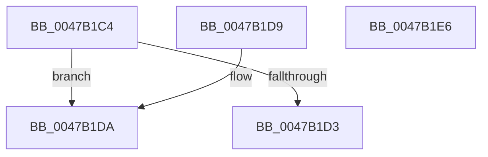

# SepGetTokenElevationType

- RVA: `0x0047B1C4`–`0x0047B1E7` (길이 `35` bytes)
- VA: `0x000000014047B1C4`
- 실행 섹션: `.text`
- PDB 이름 있음: `예`; PDB Function 태그: `아니요`
- unwind 정보 RVA: `0x000DB714`
- 디코드: `14`개 명령, `35/35` bytes 표시
- 미해석 바이트: `0` (있으면 어셈블리에 `.byte`로 보존)

> 이 문서는 커널 이미지의 기계어와 PDB 기호를 분석해 생성했습니다. 4번과 5번은 함수 원형과 자료형을 바이너리 사용 방식에서 추정한 C 해석이며 원본 소스 복구 결과는 아닙니다.

## 1. Dependencies

- 직접 호출 지점: **0**; 고유 호출 대상: **0**
- 직접 호출자로 확인된 함수: **3**
- RIP 상대 이미지 참조: **0**

### Outgoing calls
- 직접 디코드된 call 명령이 없습니다.

### Direct callers
- [SeQueryInformationToken](../../page/8B/SeQueryInformationToken_function_008B5090.md) at `0x008B58F5`
- [SepCopyTokenLoggingInformation](../../page/9A/SepCopyTokenLoggingInformation_function_009A8618.md) at `0x009A864E`
- [NtQueryInformationToken](../../page/AE/NtQueryInformationToken_function_00AECDD0.md) at `0x00AED5FB`
- [NtQueryInformationToken](../../page/AE/NtQueryInformationToken_function_00AECDD0.md) at `0x00AEDFCC`
- [NtQueryInformationToken](../../page/AE/NtQueryInformationToken_function_00AECDD0.md) at `0x00AEE5D8`

### Static image references
- 디코드된 RIP-relative 메모리 참조가 없습니다.

## 2. Other-region calls and transfers

- 다른 실행 섹션으로 향하는 call: **0**
- 별도 외부 분기/꼬리 이동을 확인하지 못했습니다.

## 3. Assembly (complete function range)

```asm
0047B1C4  48 8B 81 D8 00 00 00            mov rax, qword ptr [rcx + 0xd8]
0047B1CB  8B 48 28                        mov ecx, dword ptr [rax + 0x28]
0047B1CE  F6 C1 04                        test cl, 4
0047B1D1  74 07                           je 0x14047b1da
0047B1D3  B8 03 00 00 00                  mov eax, 3
0047B1D8  C3                              ret
0047B1D9  CC                              int3
0047B1DA  80 E1 02                        and cl, 2
0047B1DD  F6 D9                           neg cl
0047B1DF  1B C0                           sbb eax, eax
0047B1E1  F7 D8                           neg eax
0047B1E3  FF C0                           inc eax
0047B1E5  C3                              ret
0047B1E6  CC                              int3
```

## 4. C-style interpretation (structured pseudocode)

```c
__int64 __fastcall SepGetTokenElevationType(__int64 a1)
{
    __int64 result;

    if ((((unsigned __int8)((unsigned int)(*(unsigned int *)(*(unsigned __int64 *)(a1 + 216) + 40)))) & (4)) == 0) goto loc_0047B1DA;
    return 3;
loc_0047B1DA:
    a1 = (unsigned __int8)(((unsigned int)(*(unsigned int *)(*(unsigned __int64 *)(a1 + 216) + 40))) & (2));
    a1 = (unsigned __int8)(-(a1));
    result = (unsigned int)(-(3));
    result = (unsigned int)((result) + 1);
    return result;
}
```

## 5. (Beta) C Style

```c
int64_t SepGetTokenElevationType(void *Arg1)
{
    uint8_t *arg1 = (uint8_t *)Arg1;

    int64_t result;

    if ((((uint8_t)((uint32_t)(*(uint32_t *)(*(uint64_t *)(arg1 + 0xD8) + 0x28)))) & (4)) == 0) goto loc_0047B1DA;
    return 3;
loc_0047B1DA:
    Arg1 = (uint8_t)(((uint32_t)(*(uint32_t *)(*(uint64_t *)(arg1 + 0xD8) + 0x28))) & (2));
    Arg1 = (uint8_t)(-(Arg1));
    result = (uint32_t)(-(3));
    result = (uint32_t)((result) + 1);
    return result;
}
```

### 관측된 메모리 오프셋

구조체 형식이 확인되지 않은 접근은 인자 기준의 오프셋으로만 기록했습니다.

| 기준 인자 | 오프셋 표현 | 폭 (bit) | 접근 |
|---|---:|---:|---|
| `Arg1` | `+ 0xD8` | `64` | `R` |

## 6. Execution-region graph

[열기: 2D/3D 그래프와 함수 탐색 컨트롤 패널](../../../control-panel.html?section=text&rva=0x0047B1C4&view=graph)

- 2D 그래프는 위에서 아래로 흐르고, 3D 그래프는 빈 공간을 드래그해 회전합니다. Shift+드래그는 이동, 휠은 확대·축소, 함수 노드 선택은 대상 보고서 이동입니다.

### Static fallback


