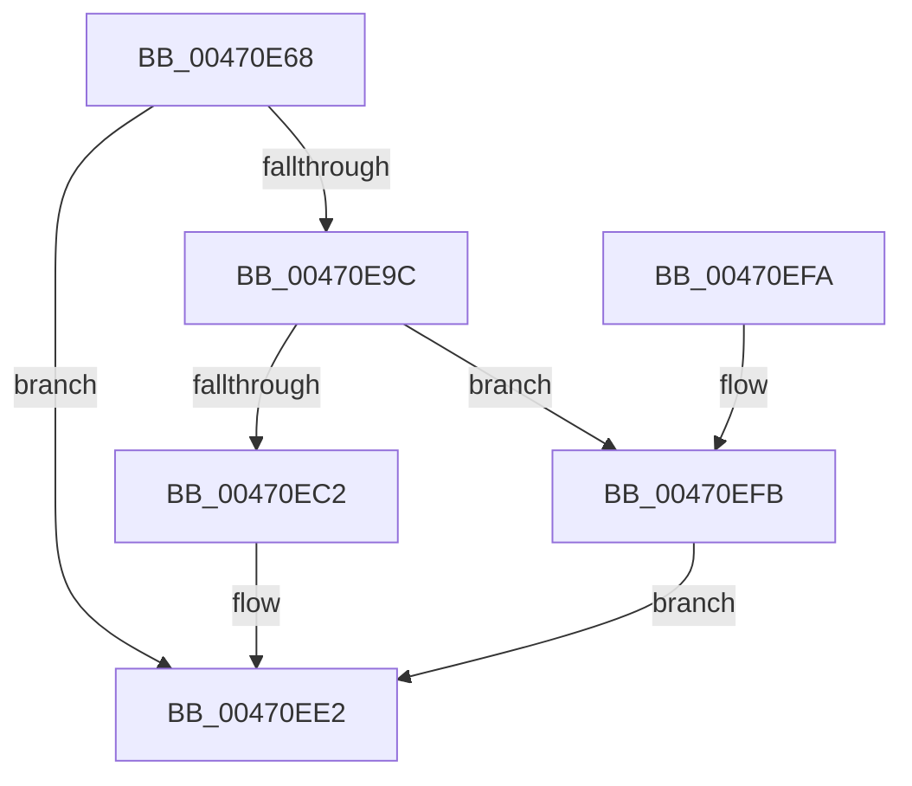

# SmKmAllocateMdlForLock

- RVA: `0x00470E68`–`0x00470F12` (길이 `170` bytes)
- VA: `0x0000000140470E68`
- 실행 섹션: `.text`
- PDB 이름 있음: `예`; PDB Function 태그: `아니요`
- unwind 정보 RVA: `0x000A6D30`
- 디코드: `45`개 명령, `170/170` bytes 표시
- 미해석 바이트: `0` (있으면 어셈블리에 `.byte`로 보존)

> 이 문서는 커널 이미지의 기계어와 PDB 기호를 분석해 생성했습니다. 4번과 5번은 함수 원형과 자료형을 바이너리 사용 방식에서 추정한 C 해석이며 원본 소스 복구 결과는 아닙니다.

## 1. Dependencies

- 직접 호출 지점: **3**; 고유 호출 대상: **3**
- 직접 호출자로 확인된 함수: **2**
- RIP 상대 이미지 참조: **0**

### Outgoing calls
- `0x00470E93` → [MmChargeResources](../28/MmChargeResources_function_002880E0.md) (function, `0x002880E0`)
- `0x00470EB8` → [ExAllocatePool2](../../poolcode/B8/ExAllocatePool2_function_00B820F0.md) (function, `0x00B820F0`)
- `0x00470F0B` → [SmAcquireReleaseCharges](../28/SmAcquireReleaseCharges_function_00285C40.md) (function, `0x00285C40`)

### Direct callers
- [SmFpAllocate](../31/SmFpAllocate_function_00317D10.md) at `0x00317DCD`
- [SmFpPreAllocate](../4C/SmFpPreAllocate_function_004CF32C.md) at `0x004CF40B`

### Static image references
- 디코드된 RIP-relative 메모리 참조가 없습니다.

## 2. Other-region calls and transfers

- 다른 실행 섹션으로 향하는 call: **1**
  - `0x00470EB8` → [ExAllocatePool2](../../poolcode/B8/ExAllocatePool2_function_00B820F0.md) (`.text` → `POOLCODE`)
- 별도 외부 분기/꼬리 이동을 확인하지 못했습니다.

## 3. Assembly (complete function range)

```asm
00470E68  48 89 5C 24 08                  mov qword ptr [rsp + 8], rbx
00470E6D  48 89 6C 24 10                  mov qword ptr [rsp + 0x10], rbp
00470E72  48 89 74 24 18                  mov qword ptr [rsp + 0x18], rsi
00470E77  57                              push rdi
00470E78  48 83 EC 30                     sub rsp, 0x30
00470E7C  33 DB                           xor ebx, ebx
00470E7E  48 8B F2                        mov rsi, rdx
00470E81  48 8B E9                        mov rbp, rcx
00470E84  48 C1 EA 0C                     shr rdx, 0xc
00470E88  48 8B 89 30 08 00 00            mov rcx, qword ptr [rcx + 0x830]
00470E8F  44 8D 43 03                     lea r8d, [rbx + 3]
00470E93  E8 48 72 E1 FF                  call 0x1402880e0
00470E98  85 C0                           test eax, eax
00470E9A  74 46                           je 0x140470ee2
00470E9C  48 8D BE FF 0F 00 00            lea rdi, [rsi + 0xfff]
00470EA3  41 B8 73 6D 50 4C               mov r8d, 0x4c506d73
00470EA9  48 C1 EF 0C                     shr rdi, 0xc
00470EAD  8D 4B 40                        lea ecx, [rbx + 0x40]
00470EB0  48 8D 14 FD 30 00 00 00         lea rdx, [rdi*8 + 0x30]
00470EB8  E8 33 12 71 00                  call 0x140b820f0
00470EBD  48 85 C0                        test rax, rax
00470EC0  74 39                           je 0x140470efb
00470EC2  66 83 C7 06                     add di, 6
00470EC6  48 89 18                        mov qword ptr [rax], rbx
00470EC9  66 C1 E7 03                     shl di, 3
00470ECD  66 89 58 0A                     mov word ptr [rax + 0xa], bx
00470ED1  48 89 58 20                     mov qword ptr [rax + 0x20], rbx
00470ED5  89 58 2C                        mov dword ptr [rax + 0x2c], ebx
00470ED8  48 8B D8                        mov rbx, rax
00470EDB  66 89 78 08                     mov word ptr [rax + 8], di
00470EDF  89 70 28                        mov dword ptr [rax + 0x28], esi
00470EE2  48 8B 6C 24 48                  mov rbp, qword ptr [rsp + 0x48]
00470EE7  48 8B C3                        mov rax, rbx
00470EEA  48 8B 5C 24 40                  mov rbx, qword ptr [rsp + 0x40]
00470EEF  48 8B 74 24 50                  mov rsi, qword ptr [rsp + 0x50]
00470EF4  48 83 C4 30                     add rsp, 0x30
00470EF8  5F                              pop rdi
00470EF9  C3                              ret
00470EFA  CC                              int3
00470EFB  41 B9 01 00 00 00               mov r9d, 1
00470F01  48 8B D6                        mov rdx, rsi
00470F04  48 8B CD                        mov rcx, rbp
00470F07  45 8D 41 02                     lea r8d, [r9 + 2]
00470F0B  E8 30 4D E1 FF                  call 0x140285c40
00470F10  EB D0                           jmp 0x140470ee2
```

## 4. C-style interpretation (structured pseudocode)

```c
__int64 __fastcall SmKmAllocateMdlForLock(__int64 a1, __int64 a2)
{
    __int64 result;
    __int64 v_rbx;
    __int64 v_rdi;
    __int64 v_rsp;
    unsigned __int64 v_stack_p10;
    unsigned __int64 v_stack_p18;
    unsigned __int64 v_stack_p8;

    v_stack_p8 = v_rbx;
    v_stack_p10 = v_rbp;
    v_stack_p18 = v_rsi;
    v_rsp = (v_rsp) - (48);
    v_rbx = 0;
    a2 = (a2) >> (12);
    result = MmChargeResources(*(unsigned __int64 *)(a1 + 2096), a2, v_rbx + 3, a4);
    if ((unsigned int)(result) == 0) goto loc_00470EE2;
    v_rdi = (a2 + 4095) >> (12);
    result = ExAllocatePool2(v_rbx + 64, v_rdi * 8 + 48, (unsigned int)(0x4C506D73ULL), a4);
    if (result == 0) goto loc_00470EFB;
    v_rdi = (unsigned __int16)((v_rdi) + (6));
    *(unsigned __int64 *)(result) = 0;
    v_rdi = (unsigned __int16)((v_rdi) << (3));
    *(unsigned __int16 *)(result + 10) = 0;
    *(unsigned __int64 *)(result + 32) = 0;
    *(unsigned int *)(result + 44) = 0;
    *(unsigned __int16 *)(result + 8) = (unsigned __int16)(v_rdi);
    *(unsigned int *)(result + 40) = (unsigned int)(a2);
loc_00470EE2:
    v_rsp = (v_rsp) + (48);
    return result;
loc_00470EFB:
    result = SmAcquireReleaseCharges(v_stack_p10, v_stack_p18, 1 + 2, 1);
    goto loc_00470EE2;
}
```

## 5. (Beta) C Style

```c
int64_t SmKmAllocateMdlForLock(void *Arg1, void *Arg2)
{
    uint8_t *arg1 = (uint8_t *)Arg1;
    uint8_t *arg2 = (uint8_t *)Arg2;

    int64_t result;
    int64_t local_rbx;
    int64_t local_rdi;
    int64_t local_rsp;
    uint64_t v_stack_p10;
    uint64_t v_stack_p18;
    uint64_t v_stack_p8;

    v_stack_p8 = local_rbx;
    v_stack_p10 = local_rbp;
    v_stack_p18 = local_rsi;
    local_rsp = (local_rsp) - (48);
    local_rbx = 0;
    Arg2 = (Arg2) >> (12);
    result = MmChargeResources(*(uint64_t *)(arg1 + 0x830), Arg2, local_rbx + 3, a4);
    if ((uint32_t)(result) == 0) goto loc_00470EE2;
    local_rdi = (Arg2 + 4095) >> (12);
    result = ExAllocatePool2(local_rbx + 64, local_rdi * 8 + 48, (uint32_t)(0x4C506D73ULL), a4);
    if (result == 0) goto loc_00470EFB;
    local_rdi = (uint16_t)((local_rdi) + (6));
    *(uint64_t *)(result) = 0;
    local_rdi = (uint16_t)((local_rdi) << (3));
    *(uint16_t *)(result + 0xA) = 0;
    *(uint64_t *)(result + 0x20) = 0;
    *(uint32_t *)(result + 0x2C) = 0;
    *(uint16_t *)(result + 0x8) = (uint16_t)(local_rdi);
    *(uint32_t *)(result + 0x28) = (uint32_t)(Arg2);
loc_00470EE2:
    local_rsp = (local_rsp) + (48);
    return result;
loc_00470EFB:
    result = SmAcquireReleaseCharges(v_stack_p10, v_stack_p18, 1 + 2, 1);
    goto loc_00470EE2;
}
```

### 관측된 메모리 오프셋

구조체 형식이 확인되지 않은 접근은 인자 기준의 오프셋으로만 기록했습니다.

| 기준 인자 | 오프셋 표현 | 폭 (bit) | 접근 |
|---|---:|---:|---|
| `Arg1` | `+ 0x830` | `64` | `R` |
| `Arg2` | `+ 0xFFF` | `64` | `R` |

## 6. Execution-region graph

[열기: 2D/3D 그래프와 함수 탐색 컨트롤 패널](../../../control-panel.html?section=text&rva=0x00470E68&view=graph)

- 2D 그래프는 위에서 아래로 흐르고, 3D 그래프는 빈 공간을 드래그해 회전합니다. Shift+드래그는 이동, 휠은 확대·축소, 함수 노드 선택은 대상 보고서 이동입니다.

### Static fallback


