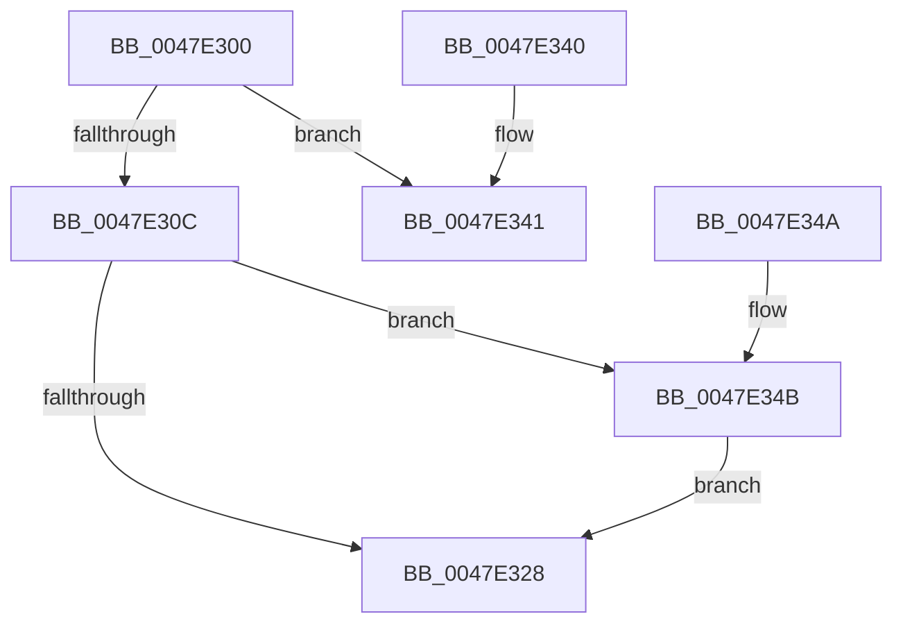

# SmUpdateReadStats

- RVA: `0x0047E300`–`0x0047E354` (길이 `84` bytes)
- VA: `0x000000014047E300`
- 실행 섹션: `.text`
- PDB 이름 있음: `예`; PDB Function 태그: `아니요`
- unwind 정보 RVA: `0x000DB714`
- 디코드: `21`개 명령, `84/84` bytes 표시
- 미해석 바이트: `0` (있으면 어셈블리에 `.byte`로 보존)

> 이 문서는 커널 이미지의 기계어와 PDB 기호를 분석해 생성했습니다. 4번과 5번은 함수 원형과 자료형을 바이너리 사용 방식에서 추정한 C 해석이며 원본 소스 복구 결과는 아닙니다.

## 1. Dependencies

- 직접 호출 지점: **0**; 고유 호출 대상: **0**
- 직접 호출자로 확인된 함수: **1**
- RIP 상대 이미지 참조: **0**

### Outgoing calls
- 직접 디코드된 call 명령이 없습니다.

### Direct callers
- [SMKM_STORE&lt;SM_TRAITS&gt;::SmStDirectReadIssue](../20/SMKM_STORE_SM_TRAITS_SmStDirectReadIssue_function_00203444.md) at `0x00203499`
- [SMKM_STORE&lt;SM_TRAITS&gt;::SmStDirectReadIssue](../20/SMKM_STORE_SM_TRAITS_SmStDirectReadIssue_function_00203444.md) at `0x0020353E`

### Static image references
- 디코드된 RIP-relative 메모리 참조가 없습니다.

## 2. Other-region calls and transfers

- 다른 실행 섹션으로 향하는 call: **0**
- 별도 외부 분기/꼬리 이동을 확인하지 못했습니다.

## 3. Assembly (complete function range)

```asm
0047E300  4C 8B 89 90 1D 00 00            mov r9, qword ptr [rcx + 0x1d90]
0047E307  45 85 C0                        test r8d, r8d
0047E30A  75 35                           jne 0x14047e341
0047E30C  41 8D 48 01                     lea ecx, [r8 + 1]
0047E310  F0 49 0F C1 89 08 0D 00 00      lock xadd qword ptr [r9 + 0xd08], rcx
0047E319  49 8B 81 10 0D 00 00            mov rax, qword ptr [r9 + 0xd10]
0047E320  48 FF C1                        inc rcx
0047E323  48 3B C1                        cmp rax, rcx
0047E326  72 23                           jb 0x14047e34b
0047E328  8D 42 FF                        lea eax, [rdx - 1]
0047E32B  B9 10 00 00 00                  mov ecx, 0x10
0047E330  83 F8 11                        cmp eax, 0x11
0047E333  0F 43 C1                        cmovae eax, ecx
0047E336  F0 49 FF 84 C1 80 0C 00 00      lock inc qword ptr [r9 + rax*8 + 0xc80]
0047E33F  C3                              ret
0047E340  CC                              int3
0047E341  F0 49 FF 89 08 0D 00 00         lock dec qword ptr [r9 + 0xd08]
0047E349  C3                              ret
0047E34A  CC                              int3
0047E34B  49 89 89 10 0D 00 00            mov qword ptr [r9 + 0xd10], rcx
0047E352  EB D4                           jmp 0x14047e328
```

## 4. C-style interpretation (structured pseudocode)

```c
__int64 __fastcall SmUpdateReadStats(__int64 a1, __int64 a2, __int64 a3)
{
    __int64 result;

    if ((unsigned int)(a3) != 0) goto loc_0047E341;
    a1 = (a3 + 1) + 1;
    if ((*(unsigned __int64 *)(*(unsigned __int64 *)(a1 + 7568) + 3344)) < a1) goto loc_0047E34B;
loc_0047E328:
    result = a2 - 1;
    if (((unsigned int)(a2 - 1)) >= 17) { result = 16; }
    return result;
loc_0047E341:
    return result;
loc_0047E34B:
    *(unsigned __int64 *)(*(unsigned __int64 *)(a1 + 7568) + 3344) = 16;
    goto loc_0047E328;
}
```

## 5. (Beta) C Style

```c
int64_t SmUpdateReadStats(void *Arg1, void *Arg2, int64_t Arg3)
{
    uint8_t *arg1 = (uint8_t *)Arg1;
    uint8_t *arg2 = (uint8_t *)Arg2;

    int64_t result;

    if ((uint32_t)(Arg3) != 0) goto loc_0047E341;
    Arg1 = (Arg3 + 1) + 1;
    if ((*(uint64_t *)(*(uint64_t *)(arg1 + 0x1D90) + 0xD10)) < Arg1) goto loc_0047E34B;
loc_0047E328:
    result = Arg2 - 1;
    if (((uint32_t)(Arg2 - 1)) >= 17) { result = 16; }
    return result;
loc_0047E341:
    return result;
loc_0047E34B:
    *(uint64_t *)(*(uint64_t *)(arg1 + 0x1D90) + 0xD10) = 16;
    goto loc_0047E328;
}
```

### 관측된 메모리 오프셋

구조체 형식이 확인되지 않은 접근은 인자 기준의 오프셋으로만 기록했습니다.

| 기준 인자 | 오프셋 표현 | 폭 (bit) | 접근 |
|---|---:|---:|---|
| `Arg1` | `+ 0x1D90` | `64` | `R` |
| `Arg2` | `- 0x1` | `32` | `R` |

## 6. Execution-region graph

[열기: 2D/3D 그래프와 함수 탐색 컨트롤 패널](../../../control-panel.html?section=text&rva=0x0047E300&view=graph)

- 2D 그래프는 위에서 아래로 흐르고, 3D 그래프는 빈 공간을 드래그해 회전합니다. Shift+드래그는 이동, 휠은 확대·축소, 함수 노드 선택은 대상 보고서 이동입니다.

### Static fallback


