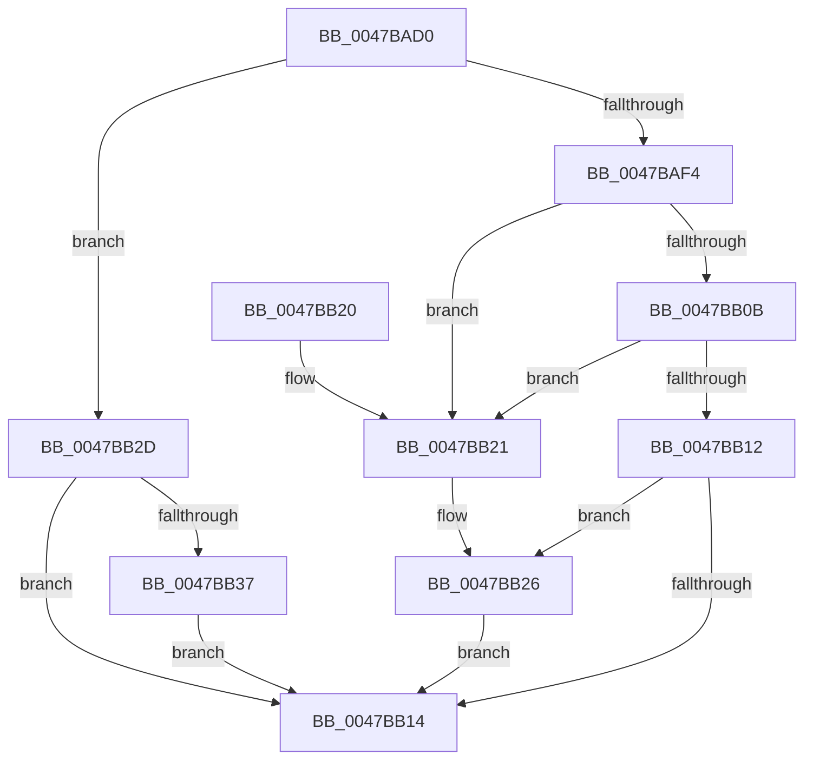

# StringCchPrintfW

- RVA: `0x0047BAD0`–`0x0047BB3C` (길이 `108` bytes)
- VA: `0x000000014047BAD0`
- 실행 섹션: `.text`
- PDB 이름 있음: `예`; PDB Function 태그: `아니요`
- unwind 정보 RVA: `0x0009BB9C`
- 디코드: `39`개 명령, `108/108` bytes 표시
- 미해석 바이트: `0` (있으면 어셈블리에 `.byte`로 보존)

> 이 문서는 커널 이미지의 기계어와 PDB 기호를 분석해 생성했습니다. 4번과 5번은 함수 원형과 자료형을 바이너리 사용 방식에서 추정한 C 해석이며 원본 소스 복구 결과는 아닙니다.

## 1. Dependencies

- 직접 호출 지점: **1**; 고유 호출 대상: **1**
- 직접 호출자로 확인된 함수: **9**
- RIP 상대 이미지 참조: **0**

### Outgoing calls
- `0x0047BB02` → [vsnwprintf](../4F/vsnwprintf_function_004FEF30.md) (function, `0x004FEF30`)

### Direct callers
- [AdtpBuildAccessReasonAuditStringInternal](../40/AdtpBuildAccessReasonAuditStringInternal_function_0040F344.md) at `0x0040F834`
- [AdtpBuildGuidString](../../page/82/AdtpBuildGuidString_function_00821EF0.md) at `0x00821FBF`
- [AdtpBuildHexInt64String](../../page/82/AdtpBuildHexInt64String_function_00822018.md) at `0x0082207A`
- [PfVerifyScenarioBuffer](../../page/8A/PfVerifyScenarioBuffer_function_008AF9A0.md) at `0x008AFF42`
- [AdtpBuildMessageString](../../page/A1/AdtpBuildMessageString_function_00A19214.md) at `0x00A19271`
- [AdtpBuildIPv4Strings](../../page/A2/AdtpBuildIPv4Strings_function_00A2B5C8.md) at `0x00A2B65E`
- [AdtpBuildIPv6Strings](../../page/A2/AdtpBuildIPv6Strings_function_00A2B720.md) at `0x00A2B7B6`
- [AdtpBuildSecurityDescriptorUnicodeString](../../page/A6/AdtpBuildSecurityDescriptorUnicodeString_function_00A663C0.md) at `0x00A665BD`
- [PopTransitionSystemPowerStateEx](../../pagelk/B7/PopTransitionSystemPowerStateEx_function_00B7E8C0.md) at `0x00B7F7DF`

### Static image references
- 디코드된 RIP-relative 메모리 참조가 없습니다.

## 2. Other-region calls and transfers

- 다른 실행 섹션으로 향하는 call: **0**
- 별도 외부 분기/꼬리 이동을 확인하지 못했습니다.

## 3. Assembly (complete function range)

```asm
0047BAD0  4C 89 44 24 18                  mov qword ptr [rsp + 0x18], r8
0047BAD5  4C 89 4C 24 20                  mov qword ptr [rsp + 0x20], r9
0047BADA  53                              push rbx
0047BADB  56                              push rsi
0047BADC  57                              push rdi
0047BADD  41 56                           push r14
0047BADF  48 83 EC 38                     sub rsp, 0x38
0047BAE3  48 8D 42 FF                     lea rax, [rdx - 1]
0047BAE7  33 DB                           xor ebx, ebx
0047BAE9  4C 8B F1                        mov r14, rcx
0047BAEC  48 3D FE FF FF 7F               cmp rax, 0x7ffffffe
0047BAF2  77 39                           ja 0x14047bb2d
0047BAF4  48 8D 72 FF                     lea rsi, [rdx - 1]
0047BAF8  8B FB                           mov edi, ebx
0047BAFA  48 8B D6                        mov rdx, rsi
0047BAFD  4C 8D 4C 24 78                  lea r9, [rsp + 0x78]
0047BB02  E8 29 34 08 00                  call 0x1404fef30
0047BB07  85 C0                           test eax, eax
0047BB09  78 16                           js 0x14047bb21
0047BB0B  48 98                           cdqe
0047BB0D  48 3B C6                        cmp rax, rsi
0047BB10  77 0F                           ja 0x14047bb21
0047BB12  74 12                           je 0x14047bb26
0047BB14  8B C7                           mov eax, edi
0047BB16  48 83 C4 38                     add rsp, 0x38
0047BB1A  41 5E                           pop r14
0047BB1C  5F                              pop rdi
0047BB1D  5E                              pop rsi
0047BB1E  5B                              pop rbx
0047BB1F  C3                              ret
0047BB20  CC                              int3
0047BB21  BF 7A 00 07 80                  mov edi, 0x8007007a
0047BB26  66 41 89 1C 76                  mov word ptr [r14 + rsi*2], bx
0047BB2B  EB E7                           jmp 0x14047bb14
0047BB2D  BF 57 00 07 80                  mov edi, 0x80070057
0047BB32  48 85 D2                        test rdx, rdx
0047BB35  74 DD                           je 0x14047bb14
0047BB37  66 89 19                        mov word ptr [rcx], bx
0047BB3A  EB D8                           jmp 0x14047bb14
```

## 4. C-style interpretation (structured pseudocode)

```c
__int64 __fastcall StringCchPrintfW(__int64 a1, __int64 a2, __int64 a3, __int64 a4)
{
    __int64 result;
    __int64 v_rbx;
    __int64 v_rsp;
    unsigned __int64 v_stack_p18;
    unsigned __int64 v_stack_p20;

    v_stack_p18 = a3;
    v_stack_p20 = a4;
    v_rsp = (v_rsp) - (56);
    v_rbx = 0;
    if ((a2 - 1) > 0x7FFFFFFEULL) goto loc_0047BB2D;
    result = vsnwprintf(a1, a2 - 1, a3, v_stack_p20);
    if (sign_flag) goto loc_0047BB21;
    if (result > (a2 - 1)) goto loc_0047BB21;
    if (result == (a2 - 1)) goto loc_0047BB26;
loc_0047BB14:
    v_rsp = (v_rsp) + (56);
    return 0;
loc_0047BB21:
loc_0047BB26:
    *(unsigned __int16 *)(a1 + a2 - 1 * 2) = 0;
    goto loc_0047BB14;
loc_0047BB2D:
    if (a2 - 1 == 0) goto loc_0047BB14;
    *(unsigned __int16 *)(a1) = 0;
    goto loc_0047BB14;
}
```

## 5. (Beta) C Style

```c
int64_t StringCchPrintfW(void *Arg1, void *Arg2, int64_t Arg3, int64_t Arg4)
{
    uint8_t *arg1 = (uint8_t *)Arg1;
    uint8_t *arg2 = (uint8_t *)Arg2;

    int64_t result;
    int64_t local_rbx;
    int64_t local_rsp;
    uint64_t v_stack_p18;
    uint64_t v_stack_p20;

    v_stack_p18 = Arg3;
    v_stack_p20 = Arg4;
    local_rsp = (local_rsp) - (56);
    local_rbx = 0;
    if ((Arg2 - 1) > 0x7FFFFFFEULL) goto loc_0047BB2D;
    result = vsnwprintf(Arg1, Arg2 - 1, Arg3, v_stack_p20);
    if (sign_flag) goto loc_0047BB21;
    if (result > (Arg2 - 1)) goto loc_0047BB21;
    if (result == (Arg2 - 1)) goto loc_0047BB26;
loc_0047BB14:
    local_rsp = (local_rsp) + (56);
    return 0;
loc_0047BB21:
loc_0047BB26:
    *(uint16_t *)(arg1 + arg2 - 0x1 * 2) = 0;
    goto loc_0047BB14;
loc_0047BB2D:
    if (Arg2 - 1 == 0) goto loc_0047BB14;
    *(uint16_t *)(arg1) = 0;
    goto loc_0047BB14;
}
```

### 관측된 메모리 오프셋

구조체 형식이 확인되지 않은 접근은 인자 기준의 오프셋으로만 기록했습니다.

| 기준 인자 | 오프셋 표현 | 폭 (bit) | 접근 |
|---|---:|---:|---|
| `Arg1` | `+ 0x0` | `16` | `W` |
| `Arg1` | `+ 0x0 + rsi*2` | `16` | `W` |
| `Arg2` | `- 0x1` | `64` | `R` |

## 6. Execution-region graph

[열기: 2D/3D 그래프와 함수 탐색 컨트롤 패널](../../../control-panel.html?section=text&rva=0x0047BAD0&view=graph)

- 2D 그래프는 위에서 아래로 흐르고, 3D 그래프는 빈 공간을 드래그해 회전합니다. Shift+드래그는 이동, 휠은 확대·축소, 함수 노드 선택은 대상 보고서 이동입니다.

### Static fallback


