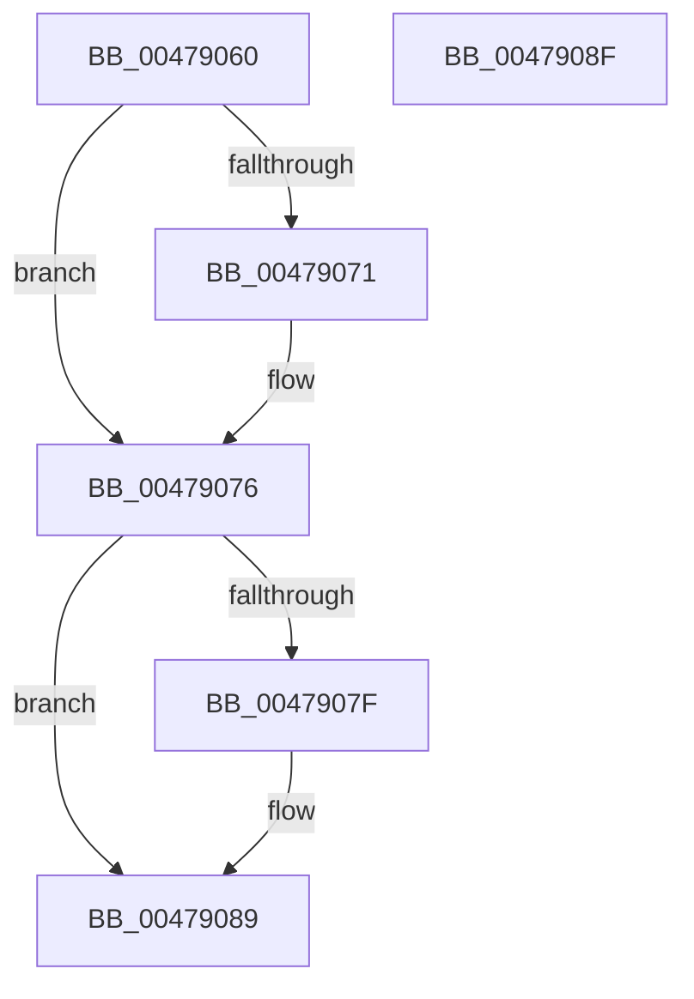

# VrpOriginalKeyNameParameterCleanup

- RVA: `0x00479060`–`0x00479090` (길이 `48` bytes)
- VA: `0x0000000140479060`
- 실행 섹션: `.text`
- PDB 이름 있음: `예`; PDB Function 태그: `아니요`
- unwind 정보 RVA: `0x0005CF00`
- 디코드: `16`개 명령, `48/48` bytes 표시
- 미해석 바이트: `0` (있으면 어셈블리에 `.byte`로 보존)

> 이 문서는 커널 이미지의 기계어와 PDB 기호를 분석해 생성했습니다. 4번과 5번은 함수 원형과 자료형을 바이너리 사용 방식에서 추정한 C 해석이며 원본 소스 복구 결과는 아닙니다.

## 1. Dependencies

- 직접 호출 지점: **2**; 고유 호출 대상: **2**
- 직접 호출자로 확인된 함수: **3**
- RIP 상대 이미지 참조: **0**

### Outgoing calls
- `0x00479071` → [VrpDereferenceJobContext](../../page/A4/VrpDereferenceJobContext_function_00A4474C.md) (function, `0x00A4474C`)
- `0x00479084` → [ExFreePoolWithTag](../../poolcode/B8/ExFreePoolWithTag_function_00B82870.md) (function, `0x00B82870`)

### Direct callers
- [CmpFreeExtraParameter](../../page/87/CmpFreeExtraParameter_function_00876894.md) at `0x008768BA`
- [sub_0087692F](../../page/87/Unknown_function_0087692F.md) at `0x00876980`
- [sub_008B4A38](../../page/8B/Unknown_function_008B4A38.md) at `0x008B4A59`

### Static image references
- 디코드된 RIP-relative 메모리 참조가 없습니다.

## 2. Other-region calls and transfers

- 다른 실행 섹션으로 향하는 call: **2**
  - `0x00479071` → [VrpDereferenceJobContext](../../page/A4/VrpDereferenceJobContext_function_00A4474C.md) (`.text` → `PAGE`)
  - `0x00479084` → [ExFreePoolWithTag](../../poolcode/B8/ExFreePoolWithTag_function_00B82870.md) (`.text` → `POOLCODE`)
- 별도 외부 분기/꼬리 이동을 확인하지 못했습니다.

## 3. Assembly (complete function range)

```asm
00479060  40 53                           push rbx
00479062  48 83 EC 20                     sub rsp, 0x20
00479066  48 8B 0A                        mov rcx, qword ptr [rdx]
00479069  48 8B DA                        mov rbx, rdx
0047906C  48 85 C9                        test rcx, rcx
0047906F  74 05                           je 0x140479076
00479071  E8 D6 B6 5C 00                  call 0x140a4474c
00479076  48 8B 4B 18                     mov rcx, qword ptr [rbx + 0x18]
0047907A  48 85 C9                        test rcx, rcx
0047907D  74 0A                           je 0x140479089
0047907F  BA 56 52 65 67                  mov edx, 0x67655256
00479084  E8 E7 97 70 00                  call 0x140b82870
00479089  48 83 C4 20                     add rsp, 0x20
0047908D  5B                              pop rbx
0047908E  C3                              ret
0047908F  CC                              int3
```

## 4. C-style interpretation (structured pseudocode)

```c
__int64 __fastcall VrpOriginalKeyNameParameterCleanup(__int64 a1, __int64 a2)
{
    __int64 result;
    __int64 v_rsp;

    v_rsp = (v_rsp) - (32);
    if (*(unsigned __int64 *)(a2) != 0) {
        result = VrpDereferenceJobContext(*(unsigned __int64 *)(a2), a2, a3, a4);
    }
    if (*(unsigned __int64 *)(a2 + 24) != 0) {
        a2 = 0x67655256ULL;
        result = ExFreePoolWithTag(*(unsigned __int64 *)(a2 + 24), a2, a3, a4);
    }
    v_rsp = (v_rsp) + (32);
    return result;
}
```

## 5. (Beta) C Style

```c
int64_t VrpOriginalKeyNameParameterCleanup(int64_t Arg1, void *Arg2)
{
    uint8_t *arg2 = (uint8_t *)Arg2;

    int64_t result;
    int64_t local_rsp;

    local_rsp = (local_rsp) - (32);
    if (*(uint64_t *)(arg2) != 0) {
        result = VrpDereferenceJobContext(*(uint64_t *)(arg2), Arg2, a3, a4);
    }
    if (*(uint64_t *)(arg2 + 0x18) != 0) {
        Arg2 = 0x67655256ULL;
        result = ExFreePoolWithTag(*(uint64_t *)(arg2 + 0x18), Arg2, a3, a4);
    }
    local_rsp = (local_rsp) + (32);
    return result;
}
```

### 관측된 메모리 오프셋

구조체 형식이 확인되지 않은 접근은 인자 기준의 오프셋으로만 기록했습니다.

| 기준 인자 | 오프셋 표현 | 폭 (bit) | 접근 |
|---|---:|---:|---|
| `Arg2` | `+ 0x0` | `64` | `R` |
| `Arg2` | `+ 0x18` | `64` | `R` |

## 6. Execution-region graph

[열기: 2D/3D 그래프와 함수 탐색 컨트롤 패널](../../../control-panel.html?section=text&rva=0x00479060&view=graph)

- 2D 그래프는 위에서 아래로 흐르고, 3D 그래프는 빈 공간을 드래그해 회전합니다. Shift+드래그는 이동, 휠은 확대·축소, 함수 노드 선택은 대상 보고서 이동입니다.

### Static fallback


