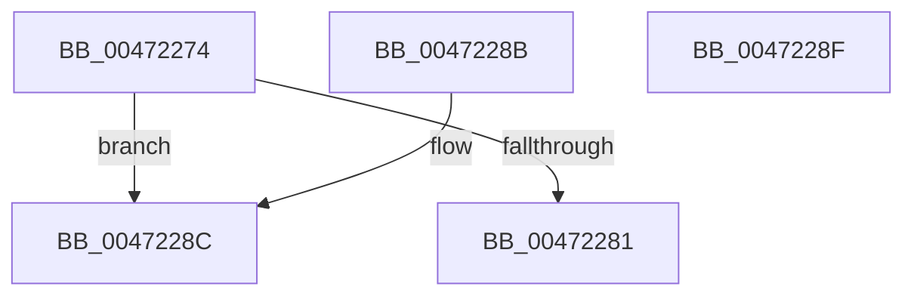

# WmipAlign

- RVA: `0x00472274`–`0x00472290` (길이 `28` bytes)
- VA: `0x0000000140472274`
- 실행 섹션: `.text`
- PDB 이름 있음: `예`; PDB Function 태그: `아니요`
- unwind 정보 RVA: `0x000DB714`
- 디코드: `14`개 명령, `28/28` bytes 표시
- 미해석 바이트: `0` (있으면 어셈블리에 `.byte`로 보존)

> 이 문서는 커널 이미지의 기계어와 PDB 기호를 분석해 생성했습니다. 4번과 5번은 함수 원형과 자료형을 바이너리 사용 방식에서 추정한 C 해석이며 원본 소스 복구 결과는 아닙니다.

## 1. Dependencies

- 직접 호출 지점: **0**; 고유 호출 대상: **0**
- 직접 호출자로 확인된 함수: **2**
- RIP 상대 이미지 참조: **0**

### Outgoing calls
- 직접 디코드된 call 명령이 없습니다.

### Direct callers
- [WmipDereferenceEvent](../../page/AC/WmipDereferenceEvent_function_00ACE6E4.md) at `0x00ACE78B`
- [WmipDereferenceEvent](../../page/AC/WmipDereferenceEvent_function_00ACE6E4.md) at `0x00ACE7CE`
- [sub_00B2FEB2](../../page/B2/Unknown_function_00B2FEB2.md) at `0x00B2FEC1`

### Static image references
- 디코드된 RIP-relative 메모리 참조가 없습니다.

## 2. Other-region calls and transfers

- 다른 실행 섹션으로 향하는 call: **0**
- 별도 외부 분기/꼬리 이동을 확인하지 못했습니다.

## 3. Assembly (complete function range)

```asm
00472274  8B 02                           mov eax, dword ptr [rdx]
00472276  FF C9                           dec ecx
00472278  44 8D 04 08                     lea r8d, [rax + rcx]
0047227C  44 3B C0                        cmp r8d, eax
0047227F  72 0B                           jb 0x14047228c
00472281  F7 D1                           not ecx
00472283  B0 01                           mov al, 1
00472285  41 23 C8                        and ecx, r8d
00472288  89 0A                           mov dword ptr [rdx], ecx
0047228A  C3                              ret
0047228B  CC                              int3
0047228C  32 C0                           xor al, al
0047228E  C3                              ret
0047228F  CC                              int3
```

## 4. C-style interpretation (structured pseudocode)

```c
__int64 __fastcall WmipAlign(int a1, __int64 a2)
{
    __int64 result;

    a1 = (unsigned int)((a1) - 1);
    if (((unsigned int)((unsigned int)(*(unsigned int *)(a2)) + a1 * 1)) < ((unsigned int)((unsigned int)(*(unsigned int *)(a2))))) goto loc_0047228C;
    a1 = (unsigned int)(~(a1));
    a1 = (unsigned int)((a1) & ((unsigned int)((unsigned int)(*(unsigned int *)(a2)) + a1 * 1)));
    *(unsigned int *)(a2) = a1;
    return 1;
loc_0047228C:
    result = 0;
    return result;
}
```

## 5. (Beta) C Style

```c
int64_t WmipAlign(int32_t Arg1, void *Arg2)
{
    uint8_t *arg2 = (uint8_t *)Arg2;

    int64_t result;

    Arg1 = (uint32_t)((Arg1) - 1);
    if (((uint32_t)((uint32_t)(*(uint32_t *)(arg2)) + Arg1 * 1)) < ((uint32_t)((uint32_t)(*(uint32_t *)(arg2))))) goto loc_0047228C;
    Arg1 = (uint32_t)(~(Arg1));
    Arg1 = (uint32_t)((Arg1) & ((uint32_t)((uint32_t)(*(uint32_t *)(arg2)) + Arg1 * 1)));
    *(uint32_t *)(arg2) = Arg1;
    return 1;
loc_0047228C:
    result = 0;
    return result;
}
```

### 관측된 메모리 오프셋

구조체 형식이 확인되지 않은 접근은 인자 기준의 오프셋으로만 기록했습니다.

| 기준 인자 | 오프셋 표현 | 폭 (bit) | 접근 |
|---|---:|---:|---|
| `Arg2` | `+ 0x0` | `32` | `R` |
| `Arg2` | `+ 0x0` | `32` | `W` |

## 6. Execution-region graph

[열기: 2D/3D 그래프와 함수 탐색 컨트롤 패널](../../../control-panel.html?section=text&rva=0x00472274&view=graph)

- 2D 그래프는 위에서 아래로 흐르고, 3D 그래프는 빈 공간을 드래그해 회전합니다. Shift+드래그는 이동, 휠은 확대·축소, 함수 노드 선택은 대상 보고서 이동입니다.

### Static fallback


