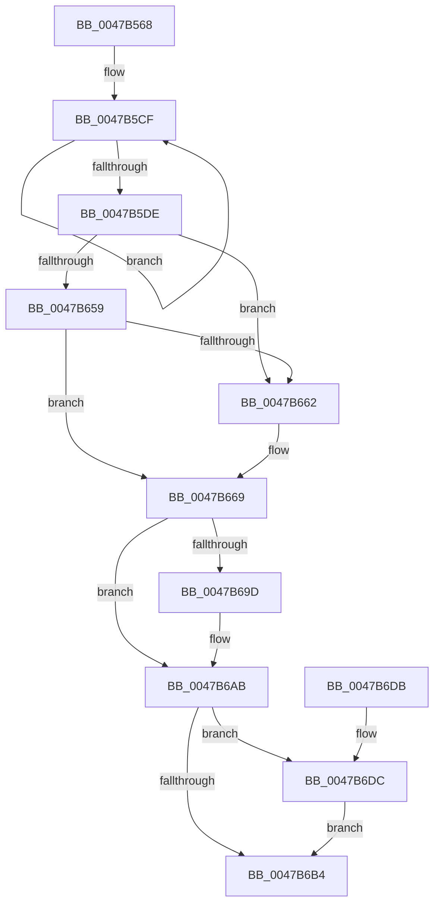

# WmipDeregisterRegEntry

- RVA: `0x0047B568`–`0x0047B6E8` (길이 `384` bytes)
- VA: `0x000000014047B568`
- 실행 섹션: `.text`
- PDB 이름 있음: `예`; PDB Function 태그: `아니요`
- unwind 정보 RVA: `0x000AD6C0`
- 디코드: `94`개 명령, `384/384` bytes 표시
- 미해석 바이트: `0` (있으면 어셈블리에 `.byte`로 보존)

> 이 문서는 커널 이미지의 기계어와 PDB 기호를 분석해 생성했습니다. 4번과 5번은 함수 원형과 자료형을 바이너리 사용 방식에서 추정한 C 해석이며 원본 소스 복구 결과는 아닙니다.

## 1. Dependencies

- 직접 호출 지점: **14**; 고유 호출 대상: **8**
- 직접 호출자로 확인된 함수: **2**
- RIP 상대 이미지 참조: **4**

### Outgoing calls
- `0x0047B5AD` → [KeWaitForSingleObject](../20/KeWaitForSingleObject_function_0020E6B0.md) (function, `0x0020E6B0`)
- `0x0047B5B9` → [KeAcquireSpinLockRaiseToDpc](../20/KeAcquireSpinLockRaiseToDpc_function_00208470.md) (function, `0x00208470`)
- `0x0047B5E7` → [KeReleaseSpinLock](../39/KeReleaseSpinLock_function_00392BA0.md) (function, `0x00392BA0`)
- `0x0047B600` → [KeReleaseMutantEx](../39/KeReleaseMutantEx_function_00396850.md) (function, `0x00396850`)
- `0x0047B608` → [WmipUnreferenceRegEntry](WmipUnreferenceRegEntry_function_0047B6F0.md) (function, `0x0047B6F0`)
- `0x0047B61F` → [KeWaitForSingleObject](../20/KeWaitForSingleObject_function_0020E6B0.md) (function, `0x0020E6B0`)
- `0x0047B639` → [KeWaitForSingleObject](../20/KeWaitForSingleObject_function_0020E6B0.md) (function, `0x0020E6B0`)
- `0x0047B645` → [KeAcquireSpinLockRaiseToDpc](../20/KeAcquireSpinLockRaiseToDpc_function_00208470.md) (function, `0x00208470`)
- `0x0047B679` → [KeReleaseSpinLock](../39/KeReleaseSpinLock_function_00392BA0.md) (function, `0x00392BA0`)
- `0x0047B692` → [KeReleaseMutantEx](../39/KeReleaseMutantEx_function_00396850.md) (function, `0x00396850`)
- `0x0047B6A6` → [ObfDereferenceObjectWithTag](../2F/ObfDereferenceObjectWithTag_function_002F78E0.md) (function, `0x002F78E0`)
- `0x0047B6B7` → [WmipRemoveDS](../../page/9D/WmipRemoveDS_function_009DD7D8.md) (function, `0x009DD7D8`)
- `0x0047B6C6` → [ExFreeToNPagedLookasideList](../38/ExFreeToNPagedLookasideList_function_0038D9D0.md) (function, `0x0038D9D0`)
- `0x0047B6E1` → [ObfDereferenceObjectWithTag](../2F/ObfDereferenceObjectWithTag_function_002F78E0.md) (function, `0x002F78E0`)

### Direct callers
- [WmipRegisterDevice](../../page/9E/WmipRegisterDevice_function_009E2808.md) at `0x009E297B`
- [WmipDeregisterDevice](../../page/A7/WmipDeregisterDevice_function_00A7F9D4.md) at `0x00A7FA6E`

### Static image references
- `0x0047B58F` → RVA `0x00EFFA60` (`.data`; read)
- `0x0047B5B2` → RVA `0x00EFFC28` (`.data`; read)
- `0x0047B64D` → RVA `0x00E68450` (`.data`; read/write)
- `0x0047B6BF` → RVA `0x00E28D00` (`.data`; read)

## 2. Other-region calls and transfers

- 다른 실행 섹션으로 향하는 call: **1**
  - `0x0047B6B7` → [WmipRemoveDS](../../page/9D/WmipRemoveDS_function_009DD7D8.md) (`.text` → `PAGE`)
- 별도 외부 분기/꼬리 이동을 확인하지 못했습니다.

## 3. Assembly (complete function range)

```asm
0047B568  48 89 5C 24 10                  mov qword ptr [rsp + 0x10], rbx
0047B56D  48 89 7C 24 18                  mov qword ptr [rsp + 0x18], rdi
0047B572  55                              push rbp
0047B573  48 8B EC                        mov rbp, rsp
0047B576  48 83 EC 50                     sub rsp, 0x50
0047B57A  83 65 E4 00                     and dword ptr [rbp - 0x1c], 0
0047B57E  48 8D 45 E8                     lea rax, [rbp - 0x18]
0047B582  48 83 64 24 20 00               and qword ptr [rsp + 0x20], 0
0047B588  48 8B D9                        mov rbx, rcx
0047B58B  48 89 45 F0                     mov qword ptr [rbp - 0x10], rax
0047B58F  48 8D 0D CA 44 A8 00            lea rcx, [rip + 0xa844ca]
0047B596  48 8D 45 E8                     lea rax, [rbp - 0x18]
0047B59A  C7 45 E0 01 00 06 00            mov dword ptr [rbp - 0x20], 0x60001
0047B5A1  45 33 C9                        xor r9d, r9d
0047B5A4  48 89 45 E8                     mov qword ptr [rbp - 0x18], rax
0047B5A8  45 33 C0                        xor r8d, r8d
0047B5AB  33 D2                           xor edx, edx
0047B5AD  E8 FE 30 D9 FF                  call 0x14020e6b0
0047B5B2  48 8D 0D 6F 46 A8 00            lea rcx, [rip + 0xa8466f]
0047B5B9  E8 B2 CE D8 FF                  call 0x140208470
0047B5BE  8A D0                           mov dl, al
0047B5C0  48 8D 45 E0                     lea rax, [rbp - 0x20]
0047B5C4  48 89 43 28                     mov qword ptr [rbx + 0x28], rax
0047B5C8  0F 0D 4B 30                     prefetchw byte ptr [rbx + 0x30]
0047B5CC  8B 43 30                        mov eax, dword ptr [rbx + 0x30]
0047B5CF  8B C8                           mov ecx, eax
0047B5D1  81 C9 00 00 00 A0               or ecx, 0xa0000000
0047B5D7  F0 0F B1 4B 30                  lock cmpxchg dword ptr [rbx + 0x30], ecx
0047B5DC  75 F1                           jne 0x14047b5cf
0047B5DE  48 8D 0D 43 46 A8 00            lea rcx, [rip + 0xa84643]
0047B5E5  8B F8                           mov edi, eax
0047B5E7  E8 B4 75 F1 FF                  call 0x140392ba0
0047B5EC  BA 01 00 00 00                  mov edx, 1
0047B5F1  4C 8D 4D 10                     lea r9, [rbp + 0x10]
0047B5F5  48 8D 0D 64 44 A8 00            lea rcx, [rip + 0xa84464]
0047B5FC  44 8D 42 03                     lea r8d, [rdx + 3]
0047B600  E8 4B B2 F1 FF                  call 0x140396850
0047B605  48 8B CB                        mov rcx, rbx
0047B608  E8 E3 00 00 00                  call 0x14047b6f0
0047B60D  48 83 64 24 20 00               and qword ptr [rsp + 0x20], 0
0047B613  48 8D 4D E0                     lea rcx, [rbp - 0x20]
0047B617  45 33 C9                        xor r9d, r9d
0047B61A  45 33 C0                        xor r8d, r8d
0047B61D  33 D2                           xor edx, edx
0047B61F  E8 8C 30 D9 FF                  call 0x14020e6b0
0047B624  48 83 64 24 20 00               and qword ptr [rsp + 0x20], 0
0047B62A  48 8D 0D 2F 44 A8 00            lea rcx, [rip + 0xa8442f]
0047B631  45 33 C9                        xor r9d, r9d
0047B634  45 33 C0                        xor r8d, r8d
0047B637  33 D2                           xor edx, edx
0047B639  E8 72 30 D9 FF                  call 0x14020e6b0
0047B63E  48 8D 0D E3 45 A8 00            lea rcx, [rip + 0xa845e3]
0047B645  E8 26 CE D8 FF                  call 0x140208470
0047B64A  4C 8B 13                        mov r10, qword ptr [rbx]
0047B64D  FF 0D FD CD 9E 00               dec dword ptr [rip + 0x9ecdfd]
0047B653  49 39 5A 08                     cmp qword ptr [r10 + 8], rbx
0047B657  75 09                           jne 0x14047b662
0047B659  4C 8B 4B 08                     mov r9, qword ptr [rbx + 8]
0047B65D  49 39 19                        cmp qword ptr [r9], rbx
0047B660  74 07                           je 0x14047b669
0047B662  B9 03 00 00 00                  mov ecx, 3
0047B667  CD 29                           int 0x29
0047B669  4D 89 11                        mov qword ptr [r9], r10
0047B66C  48 8D 0D B5 45 A8 00            lea rcx, [rip + 0xa845b5]
0047B673  8A D0                           mov dl, al
0047B675  4D 89 4A 08                     mov qword ptr [r10 + 8], r9
0047B679  E8 22 75 F1 FF                  call 0x140392ba0
0047B67E  BA 01 00 00 00                  mov edx, 1
0047B683  4C 8D 4D 10                     lea r9, [rbp + 0x10]
0047B687  48 8D 0D D2 43 A8 00            lea rcx, [rip + 0xa843d2]
0047B68E  44 8D 42 03                     lea r8d, [rdx + 3]
0047B692  E8 B9 B1 F1 FF                  call 0x140396850
0047B697  0F BA E7 1C                     bt edi, 0x1c
0047B69B  72 0E                           jb 0x14047b6ab
0047B69D  48 8B 4B 10                     mov rcx, qword ptr [rbx + 0x10]
0047B6A1  BA 44 66 6C 74                  mov edx, 0x746c6644
0047B6A6  E8 35 C2 E7 FF                  call 0x1402f78e0
0047B6AB  48 8B 4B 18                     mov rcx, qword ptr [rbx + 0x18]
0047B6AF  48 85 C9                        test rcx, rcx
0047B6B2  75 28                           jne 0x14047b6dc
0047B6B4  48 8B CB                        mov rcx, rbx
0047B6B7  E8 1C 21 56 00                  call 0x1409dd7d8
0047B6BC  48 8B D3                        mov rdx, rbx
0047B6BF  48 8D 0D 3A D6 9A 00            lea rcx, [rip + 0x9ad63a]
0047B6C6  E8 05 23 F1 FF                  call 0x14038d9d0
0047B6CB  48 8B 5C 24 68                  mov rbx, qword ptr [rsp + 0x68]
0047B6D0  48 8B 7C 24 70                  mov rdi, qword ptr [rsp + 0x70]
0047B6D5  48 83 C4 50                     add rsp, 0x50
0047B6D9  5D                              pop rbp
0047B6DA  C3                              ret
0047B6DB  CC                              int3
0047B6DC  BA 44 66 6C 74                  mov edx, 0x746c6644
0047B6E1  E8 FA C1 E7 FF                  call 0x1402f78e0
0047B6E6  EB CC                           jmp 0x14047b6b4
```

## 4. C-style interpretation (structured pseudocode)

```c
__int64 __fastcall WmipDeregisterRegEntry(__int64 a1, int a2, int a3, int a4)
{
    __int64 result;
    __int64 v_rsp;
    unsigned __int64 v_stack_m18;
    unsigned __int64 v_stack_m20;
    unsigned int v_stack_m24;
    unsigned int v_stack_m28;
    unsigned __int64 v_stack_m38;
    unsigned __int64 v_stack_p10;
    unsigned __int64 v_stack_p18;
    unsigned __int64 v_stack_p8;

    v_stack_p10 = v_rbx;
    v_stack_p18 = v_rdi;
    v_rsp = (v_rsp) - (80);
    v_stack_m18 = v_stack_m20;
    v_stack_m28 = 0x60001ULL;
    a4 = 0;
    v_stack_m20 = v_stack_m20;
    a3 = 0;
    a2 = 0;
    result = KeWaitForSingleObject(v_rip + 11027658, a2, a3, a4);
    result = KeAcquireSpinLockRaiseToDpc(v_rip + 11028079, a2, a3, a4);
    *(unsigned __int64 *)(a1 + 40) = v_stack_m28;
loc_0047B5CF:
    a1 = (unsigned int)(((unsigned int)((unsigned int)((unsigned int)(*(unsigned int *)(a1 + 48))))) | (0xA0000000ULL));
    if (condition_is_not_equal) goto loc_0047B5CF;
    result = KeReleaseSpinLock(v_rip + 11028035, (unsigned __int8)(result), a3, a4);
    result = KeReleaseMutantEx(v_rip + 11027556, 1, 1 + 3, v_stack_p8);
    result = WmipUnreferenceRegEntry(a1, 1, 1 + 3, v_stack_p8);
    a4 = 0;
    a3 = 0;
    a2 = 0;
    result = KeWaitForSingleObject(v_stack_m28, a2, a3, a4);
    a4 = 0;
    a3 = 0;
    a2 = 0;
    result = KeWaitForSingleObject(v_rip + 11027503, a2, a3, a4);
    result = KeAcquireSpinLockRaiseToDpc(v_rip + 11027939, a2, a3, a4);
    if ((*(unsigned __int64 *)(*(unsigned __int64 *)(a1) + 8)) != a1) goto loc_0047B662;
    if ((*(unsigned __int64 *)(*(unsigned __int64 *)(a1 + 8))) != a1) {
        a1 = 3;
    }
    *(unsigned __int64 *)(*(unsigned __int64 *)(a1 + 8)) = *(unsigned __int64 *)(a1);
    *(unsigned __int64 *)(*(unsigned __int64 *)(a1) + 8) = *(unsigned __int64 *)(a1 + 8);
    result = KeReleaseSpinLock(v_rip + 11027893, (unsigned __int8)(result), a3, *(unsigned __int64 *)(a1 + 8));
    result = KeReleaseMutantEx(v_rip + 11027410, 1, 1 + 3, v_stack_p8);
    if ((*(unsigned __int64 *)(*(unsigned __int64 *)(a1 + 8))) >= a1) {
        a1 = *(unsigned __int64 *)(a1 + 16);
        a2 = 0x746C6644ULL;
        result = ObfDereferenceObjectWithTag(a1, a2, 1 + 3, v_stack_p8);
    }
    if (*(unsigned __int64 *)(a1 + 24) != 0) goto loc_0047B6DC;
loc_0047B6B4:
    result = WmipRemoveDS(a1, a2, 1 + 3, v_stack_p8);
    result = ExFreeToNPagedLookasideList(v_rip + 10147386, a1, 1 + 3, v_stack_p8);
    v_rsp = (v_rsp) + (80);
    return result;
loc_0047B6DC:
    result = ObfDereferenceObjectWithTag(v_rip + 10147386, (unsigned int)(0x746C6644ULL), 1 + 3, v_stack_p8);
    goto loc_0047B6B4;
}
```

## 5. (Beta) C Style

```c
int64_t WmipDeregisterRegEntry(void *Arg1, int32_t Arg2, int32_t Arg3, int32_t Arg4)
{
    uint8_t *arg1 = (uint8_t *)Arg1;

    int64_t result;
    int64_t local_rsp;
    uint64_t v_stack_m18;
    uint64_t v_stack_m20;
    uint32_t v_stack_m24;
    uint32_t v_stack_m28;
    uint64_t v_stack_m38;
    uint64_t v_stack_p10;
    uint64_t v_stack_p18;
    uint64_t v_stack_p8;

    v_stack_p10 = local_rbx;
    v_stack_p18 = local_rdi;
    local_rsp = (local_rsp) - (80);
    v_stack_m18 = v_stack_m20;
    v_stack_m28 = 0x60001ULL;
    Arg4 = 0;
    v_stack_m20 = v_stack_m20;
    Arg3 = 0;
    Arg2 = 0;
    result = KeWaitForSingleObject(v_rip + 11027658, Arg2, Arg3, Arg4);
    result = KeAcquireSpinLockRaiseToDpc(v_rip + 11028079, Arg2, Arg3, Arg4);
    *(uint64_t *)(arg1 + 0x28) = v_stack_m28;
loc_0047B5CF:
    Arg1 = (uint32_t)(((uint32_t)((uint32_t)((uint32_t)(*(uint32_t *)(arg1 + 0x30))))) | (0xA0000000ULL));
    if (condition_is_not_equal) goto loc_0047B5CF;
    result = KeReleaseSpinLock(v_rip + 11028035, (uint8_t)(result), Arg3, Arg4);
    result = KeReleaseMutantEx(v_rip + 11027556, 1, 1 + 3, v_stack_p8);
    result = WmipUnreferenceRegEntry(Arg1, 1, 1 + 3, v_stack_p8);
    Arg4 = 0;
    Arg3 = 0;
    Arg2 = 0;
    result = KeWaitForSingleObject(v_stack_m28, Arg2, Arg3, Arg4);
    Arg4 = 0;
    Arg3 = 0;
    Arg2 = 0;
    result = KeWaitForSingleObject(v_rip + 11027503, Arg2, Arg3, Arg4);
    result = KeAcquireSpinLockRaiseToDpc(v_rip + 11027939, Arg2, Arg3, Arg4);
    if ((*(uint64_t *)(*(uint64_t *)(arg1) + 0x8)) != Arg1) goto loc_0047B662;
    if ((*(uint64_t *)(*(uint64_t *)(arg1 + 0x8))) != Arg1) {
        Arg1 = 3;
    }
    *(uint64_t *)(*(uint64_t *)(arg1 + 0x8)) = *(uint64_t *)(arg1);
    *(uint64_t *)(*(uint64_t *)(arg1) + 0x8) = *(uint64_t *)(arg1 + 0x8);
    result = KeReleaseSpinLock(v_rip + 11027893, (uint8_t)(result), Arg3, *(uint64_t *)(arg1 + 0x8));
    result = KeReleaseMutantEx(v_rip + 11027410, 1, 1 + 3, v_stack_p8);
    if ((*(uint64_t *)(*(uint64_t *)(arg1 + 0x8))) >= Arg1) {
        Arg1 = *(uint64_t *)(arg1 + 0x10);
        Arg2 = 0x746C6644ULL;
        result = ObfDereferenceObjectWithTag(Arg1, Arg2, 1 + 3, v_stack_p8);
    }
    if (*(uint64_t *)(arg1 + 0x18) != 0) goto loc_0047B6DC;
loc_0047B6B4:
    result = WmipRemoveDS(Arg1, Arg2, 1 + 3, v_stack_p8);
    result = ExFreeToNPagedLookasideList(v_rip + 10147386, Arg1, 1 + 3, v_stack_p8);
    local_rsp = (local_rsp) + (80);
    return result;
loc_0047B6DC:
    result = ObfDereferenceObjectWithTag(v_rip + 10147386, (uint32_t)(0x746C6644ULL), 1 + 3, v_stack_p8);
    goto loc_0047B6B4;
}
```

### 관측된 메모리 오프셋

구조체 형식이 확인되지 않은 접근은 인자 기준의 오프셋으로만 기록했습니다.

| 기준 인자 | 오프셋 표현 | 폭 (bit) | 접근 |
|---|---:|---:|---|
| `Arg1` | `+ 0x0` | `64` | `R` |
| `Arg1` | `+ 0x8` | `64` | `R` |
| `Arg1` | `+ 0x10` | `64` | `R` |
| `Arg1` | `+ 0x18` | `64` | `R` |
| `Arg1` | `+ 0x28` | `64` | `W` |
| `Arg1` | `+ 0x30` | `8` | `R` |
| `Arg1` | `+ 0x30` | `32` | `R` |

## 6. Execution-region graph

[열기: 2D/3D 그래프와 함수 탐색 컨트롤 패널](../../../control-panel.html?section=text&rva=0x0047B568&view=graph)

- 2D 그래프는 위에서 아래로 흐르고, 3D 그래프는 빈 공간을 드래그해 회전합니다. Shift+드래그는 이동, 휠은 확대·축소, 함수 노드 선택은 대상 보고서 이동입니다.

### Static fallback


