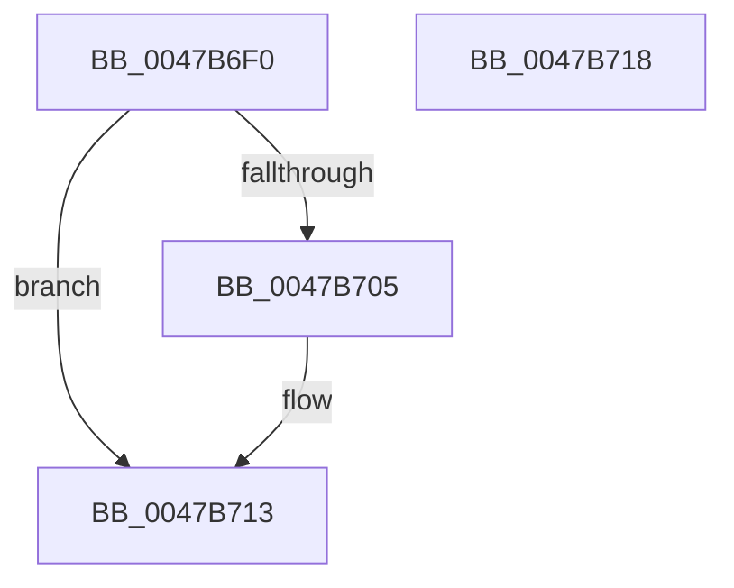

# WmipUnreferenceRegEntry

- RVA: `0x0047B6F0`–`0x0047B719` (길이 `41` bytes)
- VA: `0x000000014047B6F0`
- 실행 섹션: `.text`
- PDB 이름 있음: `예`; PDB Function 태그: `아니요`
- unwind 정보 RVA: `0x0005C788`
- 디코드: `13`개 명령, `41/41` bytes 표시
- 미해석 바이트: `0` (있으면 어셈블리에 `.byte`로 보존)

> 이 문서는 커널 이미지의 기계어와 PDB 기호를 분석해 생성했습니다. 4번과 5번은 함수 원형과 자료형을 바이너리 사용 방식에서 추정한 C 해석이며 원본 소스 복구 결과는 아닙니다.

## 1. Dependencies

- 직접 호출 지점: **1**; 고유 호출 대상: **1**
- 직접 호출자로 확인된 함수: **12**
- RIP 상대 이미지 참조: **0**

### Outgoing calls
- `0x0047B70E` → [KeSetEvent](../33/KeSetEvent_function_0033F310.md) (function, `0x0033F310`)

### Direct callers
- [WmipDeregisterRegEntry](WmipDeregisterRegEntry_function_0047B568.md) at `0x0047B608`
- [WmipRegistrationWorker](../../page/9D/WmipRegistrationWorker_function_009DD820.md) at `0x009DD923`
- [WmipEventNotification](../../page/9D/WmipEventNotification_function_009DF9D0.md) at `0x009DFA11`
- [WmipForwardWmiIrp](../../page/9E/WmipForwardWmiIrp_function_009E0DB4.md) at `0x009E0E63`
- [WmipForwardWmiIrp](../../page/9E/WmipForwardWmiIrp_function_009E0DB4.md) at `0x009E0FB2`
- [WmipForwardWmiIrp](../../page/9E/WmipForwardWmiIrp_function_009E0DB4.md) at `0x009E0FD2`
- [WmipForwardWmiIrp](../../page/9E/WmipForwardWmiIrp_function_009E0DB4.md) at `0x009E1018`
- [WmipRegisterDevice](../../page/9E/WmipRegisterDevice_function_009E2808.md) at `0x009E28F8`
- [WmipRegisterDevice](../../page/9E/WmipRegisterDevice_function_009E2808.md) at `0x009E2934`
- [WmipUpdateRegistration](../../page/9E/WmipUpdateRegistration_function_009E2BA4.md) at `0x009E2BCD`
- [IoWMIRegistrationControl](../../page/9E/IoWMIRegistrationControl_function_009E2D60.md) at `0x009E2E70`
- [WmipFreeTraceDeviceList](../../page/9E/WmipFreeTraceDeviceList_function_009E4780.md) at `0x009E479E`
- [IoWMISystemControl](../../page/A4/IoWMISystemControl_function_00A4EB04.md) at `0x00A4ED00`
- [WmipDeregisterDevice](../../page/A7/WmipDeregisterDevice_function_00A7F9D4.md) at `0x00A7FA66`
- [WmipDeregisterDevice](../../page/A7/WmipDeregisterDevice_function_00A7F9D4.md) at `0x00A7FA7C`
- [sub_00B3C02C](../../page/B3/Unknown_function_00B3C02C.md) at `0x00B3C073`
- [sub_00B3C216](../../page/B3/Unknown_function_00B3C216.md) at `0x00B3C489`

### Static image references
- 디코드된 RIP-relative 메모리 참조가 없습니다.

## 2. Other-region calls and transfers

- 다른 실행 섹션으로 향하는 call: **0**
- 별도 외부 분기/꼬리 이동을 확인하지 못했습니다.

## 3. Assembly (complete function range)

```asm
0047B6F0  48 83 EC 28                     sub rsp, 0x28
0047B6F4  83 C8 FF                        or eax, 0xffffffff
0047B6F7  F0 0F C1 41 30                  lock xadd dword ptr [rcx + 0x30], eax
0047B6FC  FF C8                           dec eax
0047B6FE  A9 FF FF FF 00                  test eax, 0xffffff
0047B703  75 0E                           jne 0x14047b713
0047B705  48 8B 49 28                     mov rcx, qword ptr [rcx + 0x28]
0047B709  45 33 C0                        xor r8d, r8d
0047B70C  33 D2                           xor edx, edx
0047B70E  E8 FD 3B EC FF                  call 0x14033f310
0047B713  48 83 C4 28                     add rsp, 0x28
0047B717  C3                              ret
0047B718  CC                              int3
```

## 4. C-style interpretation (structured pseudocode)

```c
__int64 __fastcall WmipUnreferenceRegEntry(__int64 a1, int a2, int a3)
{
    __int64 result;
    __int64 v_rsp;

    v_rsp = (v_rsp) - (40);
    result = (unsigned int)((result) | (0xFFFFFFFFULL));
    result = (unsigned int)((result) - 1);
    if ((((unsigned int)(result)) & (0xFFFFFFULL)) == 0) {
        a1 = *(unsigned __int64 *)(a1 + 40);
        a3 = 0;
        a2 = 0;
        result = KeSetEvent(a1, a2, a3, a4);
    }
    v_rsp = (v_rsp) + (40);
    return result;
}
```

## 5. (Beta) C Style

```c
int64_t WmipUnreferenceRegEntry(void *Arg1, int32_t Arg2, int32_t Arg3)
{
    uint8_t *arg1 = (uint8_t *)Arg1;

    int64_t result;
    int64_t local_rsp;

    local_rsp = (local_rsp) - (40);
    result = (uint32_t)((result) | (0xFFFFFFFFULL));
    result = (uint32_t)((result) - 1);
    if ((((uint32_t)(result)) & (0xFFFFFFULL)) == 0) {
        Arg1 = *(uint64_t *)(arg1 + 0x28);
        Arg3 = 0;
        Arg2 = 0;
        result = KeSetEvent(Arg1, Arg2, Arg3, a4);
    }
    local_rsp = (local_rsp) + (40);
    return result;
}
```

### 관측된 메모리 오프셋

구조체 형식이 확인되지 않은 접근은 인자 기준의 오프셋으로만 기록했습니다.

| 기준 인자 | 오프셋 표현 | 폭 (bit) | 접근 |
|---|---:|---:|---|
| `Arg1` | `+ 0x28` | `64` | `R` |
| `Arg1` | `+ 0x30` | `32` | `R/W` |

## 6. Execution-region graph

[열기: 2D/3D 그래프와 함수 탐색 컨트롤 패널](../../../control-panel.html?section=text&rva=0x0047B6F0&view=graph)

- 2D 그래프는 위에서 아래로 흐르고, 3D 그래프는 빈 공간을 드래그해 회전합니다. Shift+드래그는 이동, 휠은 확대·축소, 함수 노드 선택은 대상 보고서 이동입니다.

### Static fallback


