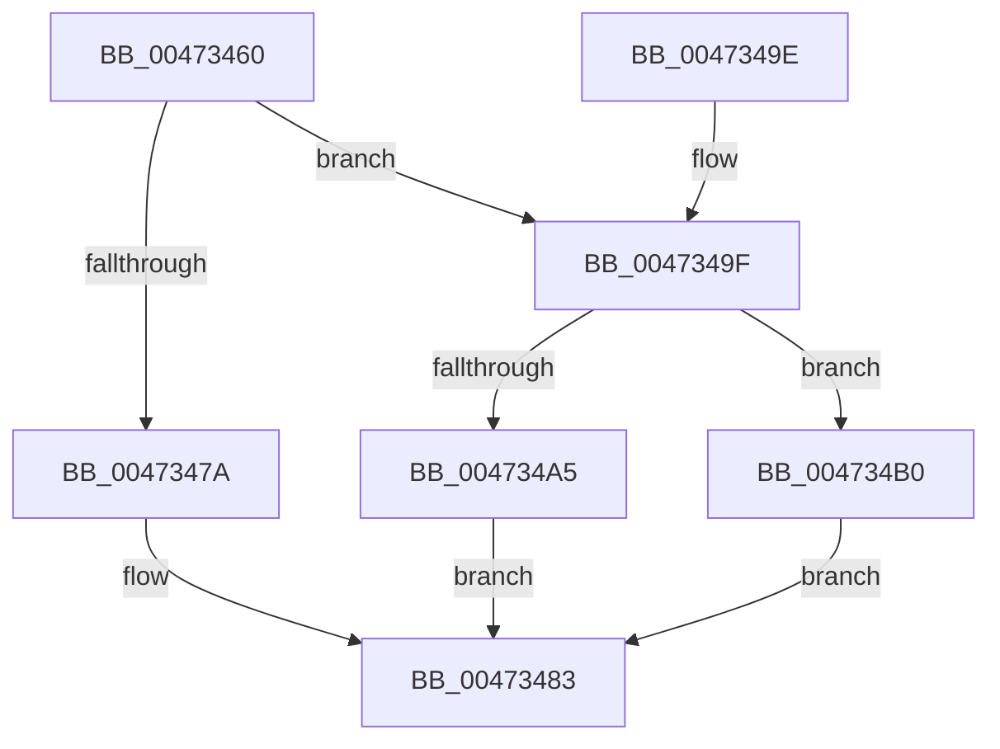

# XmAccumImmediate

- RVA: `0x00473460`–`0x004734BA` (길이 `90` bytes)
- VA: `0x0000000140473460`
- 실행 섹션: `.text`
- PDB 이름 있음: `예`; PDB Function 태그: `아니요`
- unwind 정보 RVA: `0x00087C88`
- 디코드: `27`개 명령, `90/90` bytes 표시
- 미해석 바이트: `0` (있으면 어셈블리에 `.byte`로 보존)

> 이 문서는 커널 이미지의 기계어와 PDB 기호를 분석해 생성했습니다. 4번과 5번은 함수 원형과 자료형을 바이너리 사용 방식에서 추정한 C 해석이며 원본 소스 복구 결과는 아닙니다.

## 1. Dependencies

- 직접 호출 지점: **5**; 고유 호출 대상: **5**
- 직접 호출자로 확인된 함수: **0**
- RIP 상대 이미지 참조: **0**

### Outgoing calls
- `0x00473469` → [XmSetDataType](XmSetDataType_function_004734C0.md) (function, `0x004734C0`)
- `0x0047347A` → [XmGetCodeByte](XmGetCodeByte_function_00473678.md) (function, `0x00473678`)
- `0x0047348A` → [XmSetDestinationValue](XmSetDestinationValue_function_004734EC.md) (function, `0x004734EC`)
- `0x004734A5` → [XmGetWordImmediate](XmGetWordImmediate_function_004731DC.md) (function, `0x004731DC`)
- `0x004734B0` → [XmGetLongImmediate](../56/XmGetLongImmediate_function_0056DC70.md) (function, `0x0056DC70`)

### Direct callers
- 이 함수 시작 RVA로 연결되는 직접 call은 확인되지 않았습니다. 간접 호출은 완전히 역산할 수 없습니다.

### Static image references
- 디코드된 RIP-relative 메모리 참조가 없습니다.

## 2. Other-region calls and transfers

- 다른 실행 섹션으로 향하는 call: **0**
- 별도 외부 분기/꼬리 이동을 확인하지 못했습니다.

## 3. Assembly (complete function range)

```asm
00473460  40 53                           push rbx
00473462  48 83 EC 20                     sub rsp, 0x20
00473466  48 8B D9                        mov rbx, rcx
00473469  E8 52 00 00 00                  call 0x1404734c0
0047346E  44 8B 43 78                     mov r8d, dword ptr [rbx + 0x78]
00473472  48 8B CB                        mov rcx, rbx
00473475  45 85 C0                        test r8d, r8d
00473478  75 25                           jne 0x14047349f
0047347A  E8 F9 01 00 00                  call 0x140473678
0047347F  44 0F B6 C0                     movzx r8d, al
00473483  48 8D 53 18                     lea rdx, [rbx + 0x18]
00473487  48 8B CB                        mov rcx, rbx
0047348A  E8 5D 00 00 00                  call 0x1404734ec
0047348F  B8 01 00 00 00                  mov eax, 1
00473494  44 89 43 6C                     mov dword ptr [rbx + 0x6c], r8d
00473498  48 83 C4 20                     add rsp, 0x20
0047349C  5B                              pop rbx
0047349D  C3                              ret
0047349E  CC                              int3
0047349F  41 83 F8 01                     cmp r8d, 1
004734A3  75 0B                           jne 0x1404734b0
004734A5  E8 32 FD FF FF                  call 0x1404731dc
004734AA  44 0F B7 C0                     movzx r8d, ax
004734AE  EB D3                           jmp 0x140473483
004734B0  E8 BB A7 0F 00                  call 0x14056dc70
004734B5  44 8B C0                        mov r8d, eax
004734B8  EB C9                           jmp 0x140473483
```

## 4. C-style interpretation (structured pseudocode)

```c
__int64 __fastcall XmAccumImmediate(__int64 a1)
{
    __int64 result;
    __int64 v_rsp;

    v_rsp = (v_rsp) - (32);
    result = XmSetDataType(a1, a2, a3, a4);
    if ((unsigned int)((unsigned int)(*(unsigned int *)(a1 + 120))) != 0) goto loc_0047349F;
    result = XmGetCodeByte(a1, a2, (unsigned int)(*(unsigned int *)(a1 + 120)), a4);
loc_00473483:
    result = XmSetDestinationValue(a1, a1 + 24, (unsigned __int8)(result), a4);
    *(unsigned int *)(a1 + 108) = (unsigned int)((unsigned __int8)(result));
    v_rsp = (v_rsp) + (32);
    return 1;
loc_0047349F:
    if (((unsigned int)((unsigned __int8)(result))) != 1) goto loc_004734B0;
    result = XmGetWordImmediate(a1, a1 + 24, (unsigned __int8)(result), a4);
    goto loc_00473483;
loc_004734B0:
    result = XmGetLongImmediate(a1, a1 + 24, (unsigned __int16)(result), a4);
    goto loc_00473483;
}
```

## 5. (Beta) C Style

```c
int64_t XmAccumImmediate(void *Arg1)
{
    uint8_t *arg1 = (uint8_t *)Arg1;

    int64_t result;
    int64_t local_rsp;

    local_rsp = (local_rsp) - (32);
    result = XmSetDataType(Arg1, a2, a3, a4);
    if ((uint32_t)((uint32_t)(*(uint32_t *)(arg1 + 0x78))) != 0) goto loc_0047349F;
    result = XmGetCodeByte(Arg1, a2, (uint32_t)(*(uint32_t *)(arg1 + 0x78)), a4);
loc_00473483:
    result = XmSetDestinationValue(Arg1, Arg1 + 24, (uint8_t)(result), a4);
    *(uint32_t *)(arg1 + 0x6C) = (uint32_t)((uint8_t)(result));
    local_rsp = (local_rsp) + (32);
    return 1;
loc_0047349F:
    if (((uint32_t)((uint8_t)(result))) != 1) goto loc_004734B0;
    result = XmGetWordImmediate(Arg1, Arg1 + 24, (uint8_t)(result), a4);
    goto loc_00473483;
loc_004734B0:
    result = XmGetLongImmediate(Arg1, Arg1 + 24, (uint16_t)(result), a4);
    goto loc_00473483;
}
```

### 관측된 메모리 오프셋

구조체 형식이 확인되지 않은 접근은 인자 기준의 오프셋으로만 기록했습니다.

| 기준 인자 | 오프셋 표현 | 폭 (bit) | 접근 |
|---|---:|---:|---|
| `Arg1` | `+ 0x18` | `64` | `R` |
| `Arg1` | `+ 0x6C` | `32` | `W` |
| `Arg1` | `+ 0x78` | `32` | `R` |

## 6. Execution-region graph

[열기: 2D/3D 그래프와 함수 탐색 컨트롤 패널](../../../control-panel.html?section=text&rva=0x00473460&view=graph)

- 2D 그래프는 위에서 아래로 흐르고, 3D 그래프는 빈 공간을 드래그해 회전합니다. Shift+드래그는 이동, 휠은 확대·축소, 함수 노드 선택은 대상 보고서 이동입니다.

### Static fallback


