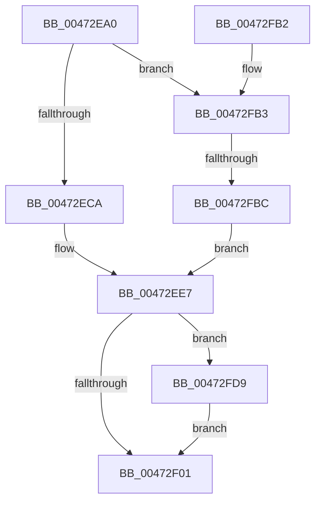

# XmAddOperands

- RVA: `0x00472EA0`–`0x00472FEB` (길이 `331` bytes)
- VA: `0x0000000140472EA0`
- 실행 섹션: `.text`
- PDB 이름 있음: `예`; PDB Function 태그: `예`
- unwind 정보 RVA: `0x000AC550`
- 디코드: `97`개 명령, `331/331` bytes 표시
- 미해석 바이트: `0` (있으면 어셈블리에 `.byte`로 보존)

> 이 문서는 커널 이미지의 기계어와 PDB 기호를 분석해 생성했습니다. 4번과 5번은 함수 원형과 자료형을 바이너리 사용 방식에서 추정한 C 해석이며 원본 소스 복구 결과는 아닙니다.

## 1. Dependencies

- 직접 호출 지점: **1**; 고유 호출 대상: **1**
- 직접 호출자로 확인된 함수: **4**
- RIP 상대 이미지 참조: **1**

### Outgoing calls
- `0x00472EF1` → [XmStoreResult](XmStoreResult_function_004739FC.md) (function, `0x004739FC`)

### Direct callers
- [XmIncOp](XmIncOp_function_00472D70.md) at `0x00472D7D`
- [XmAdcOp](../57/XmAdcOp_function_00576C70.md) at `0x00576C7A`
- [XmAddOp](../57/XmAddOp_function_00576C90.md) at `0x00576C96`
- [XmXaddOp](../57/XmXaddOp_function_00576D70.md) at `0x00576D82`

### Static image references
- `0x00472F05` → RVA `0x0001A190` (`.rdata`; read)

## 2. Other-region calls and transfers

- 다른 실행 섹션으로 향하는 call: **0**
- call이 아닌 외부 분기/꼬리 이동: **1**
  - `0x00472FB6` → [sub_006F3D92](../6F/Unknown_function_006F3D92.md) (`tail-transfer`)

## 3. Assembly (complete function range)

```asm
00472EA0  48 89 5C 24 08                  mov qword ptr [rsp + 8], rbx
00472EA5  48 89 74 24 18                  mov qword ptr [rsp + 0x18], rsi
00472EAA  57                              push rdi
00472EAB  48 83 EC 20                     sub rsp, 0x20
00472EAF  8B 41 78                        mov eax, dword ptr [rcx + 0x78]
00472EB2  45 33 C0                        xor r8d, r8d
00472EB5  44 89 44 24 38                  mov dword ptr [rsp + 0x38], r8d
00472EBA  8B FA                           mov edi, edx
00472EBC  4C 8B D9                        mov r11, rcx
00472EBF  41 8B D8                        mov ebx, r8d
00472EC2  85 C0                           test eax, eax
00472EC4  0F 85 E9 00 00 00               jne 0x140472fb3
00472ECA  02 51 6C                        add dl, byte ptr [rcx + 0x6c]
00472ECD  41 8D 70 07                     lea esi, [r8 + 7]
00472ED1  8A 49 68                        mov cl, byte ptr [rcx + 0x68]
00472ED4  8D 04 11                        lea eax, [rcx + rdx]
00472ED7  3A C1                           cmp al, cl
00472ED9  88 44 24 38                     mov byte ptr [rsp + 0x38], al
00472EDD  0F 92 C3                        setb bl
00472EE0  40 3A D7                        cmp dl, dil
00472EE3  8B 54 24 38                     mov edx, dword ptr [rsp + 0x38]
00472EE7  41 0F 92 C0                     setb r8b
00472EEB  49 8B CB                        mov rcx, r11
00472EEE  41 0B D8                        or ebx, r8d
00472EF1  E8 06 0B 00 00                  call 0x1404739fc
00472EF6  41 83 7B 7C 1E                  cmp dword ptr [r11 + 0x7c], 0x1e
00472EFB  0F 85 D8 00 00 00               jne 0x140472fd9
00472F01  45 8B 43 10                     mov r8d, dword ptr [r11 + 0x10]
00472F05  4C 8D 15 84 72 BA FF            lea r10, [rip - 0x458d7c]
00472F0C  8B CA                           mov ecx, edx
00472F0E  83 E1 0F                        and ecx, 0xf
00472F11  8B C2                           mov eax, edx
00472F13  48 C1 E8 04                     shr rax, 4
00472F17  83 E0 0F                        and eax, 0xf
00472F1A  46 0F B6 0C 10                  movzx r9d, byte ptr [rax + r10]
00472F1F  42 0F B6 04 11                  movzx eax, byte ptr [rcx + r10]
00472F24  45 8B 53 6C                     mov r10d, dword ptr [r11 + 0x6c]
00472F28  44 03 C8                        add r9d, eax
00472F2B  41 0F B6 43 68                  movzx eax, byte ptr [r11 + 0x68]
00472F30  41 F7 D1                        not r9d
00472F33  83 E0 0F                        and eax, 0xf
00472F36  41 C1 E1 02                     shl r9d, 2
00472F3A  45 33 C8                        xor r9d, r8d
00472F3D  03 C7                           add eax, edi
00472F3F  41 83 E1 04                     and r9d, 4
00472F43  45 33 C8                        xor r9d, r8d
00472F46  45 8B C2                        mov r8d, r10d
00472F49  41 83 E0 0F                     and r8d, 0xf
00472F4D  44 03 C0                        add r8d, eax
00472F50  8B C2                           mov eax, edx
00472F52  45 33 C1                        xor r8d, r9d
00472F55  41 83 E0 10                     and r8d, 0x10
00472F59  45 33 C1                        xor r8d, r9d
00472F5C  F7 D8                           neg eax
00472F5E  8B C2                           mov eax, edx
00472F60  1B C9                           sbb ecx, ecx
00472F62  45 33 53 68                     xor r10d, dword ptr [r11 + 0x68]
00472F66  44 33 D2                        xor r10d, edx
00472F69  F7 D1                           not ecx
00472F6B  83 E1 40                        and ecx, 0x40
00472F6E  41 83 E0 BF                     and r8d, 0xffffffbf
00472F72  44 0B C1                        or r8d, ecx
00472F75  8B CE                           mov ecx, esi
00472F77  48 8B 74 24 40                  mov rsi, qword ptr [rsp + 0x40]
00472F7C  D3 E8                           shr eax, cl
00472F7E  41 D3 EA                        shr r10d, cl
00472F81  44 33 D3                        xor r10d, ebx
00472F84  C1 E0 07                        shl eax, 7
00472F87  48 8B 5C 24 30                  mov rbx, qword ptr [rsp + 0x30]
00472F8C  41 33 C0                        xor eax, r8d
00472F8F  41 C1 E2 0B                     shl r10d, 0xb
00472F93  25 80 00 00 00                  and eax, 0x80
00472F98  41 33 C0                        xor eax, r8d
00472F9B  44 33 D0                        xor r10d, eax
00472F9E  41 81 E2 00 08 00 00            and r10d, 0x800
00472FA5  44 33 D0                        xor r10d, eax
00472FA8  45 89 53 10                     mov dword ptr [r11 + 0x10], r10d
00472FAC  48 83 C4 20                     add rsp, 0x20
00472FB0  5F                              pop rdi
00472FB1  C3                              ret
00472FB2  CC                              int3
00472FB3  83 F8 03                        cmp eax, 3
00472FB6  0F 85 D6 0D 28 00               jne 0x1406f3d92
00472FBC  41 8B 43 68                     mov eax, dword ptr [r11 + 0x68]
00472FC0  BE 1F 00 00 00                  mov esi, 0x1f
00472FC5  8B 49 6C                        mov ecx, dword ptr [rcx + 0x6c]
00472FC8  03 CF                           add ecx, edi
00472FCA  3B CF                           cmp ecx, edi
00472FCC  0F 92 C3                        setb bl
00472FCF  8D 14 01                        lea edx, [rcx + rax]
00472FD2  3B D0                           cmp edx, eax
00472FD4  E9 0E FF FF FF                  jmp 0x140472ee7
00472FD9  41 8B 43 10                     mov eax, dword ptr [r11 + 0x10]
00472FDD  83 E0 FE                        and eax, 0xfffffffe
00472FE0  0B C3                           or eax, ebx
00472FE2  41 89 43 10                     mov dword ptr [r11 + 0x10], eax
00472FE6  E9 16 FF FF FF                  jmp 0x140472f01
```

## 4. C-style interpretation (structured pseudocode)

```c
__int64 __fastcall XmAddOperands(__int64 a1, int a2, int a3)
{
    __int64 result;
    __int64 v_r10;
    __int64 v_rbx;
    __int64 v_rsp;
    unsigned int v_stack_p10;
    unsigned __int64 v_stack_p18;
    unsigned __int64 v_stack_p8;

    v_stack_p8 = v_rbx;
    v_stack_p18 = v_rsi;
    v_rsp = (v_rsp) - (32);
    a3 = 0;
    v_stack_p10 = 0;
    if ((unsigned int)((unsigned int)(*(unsigned int *)(a1 + 120))) != 0) goto loc_00472FB3;
    a2 = (unsigned __int8)((a2) + (*(unsigned __int8 *)(a1 + 108)));
    v_stack_p10 = (unsigned __int8)(*(unsigned __int8 *)(a1 + 104) + a2 * 1);
    v_rbx = (((unsigned __int8)(*(unsigned __int8 *)(a1 + 104) + a2 * 1)) < ((unsigned __int8)(*(unsigned __int8 *)(a1 + 104)))) ? 1 : 0;
loc_00472EE7:
    a3 = (((unsigned __int8)(a2)) < ((unsigned __int8)((unsigned int)(a2)))) ? 1 : 0;
    v_rbx = (unsigned int)((v_rbx) | (a3));
    result = XmStoreResult(a1, (unsigned int)(v_stack_p10), a3, a4);
    if ((*(unsigned int *)(a1 + 124)) != 30) goto loc_00472FD9;
loc_00472F01:
    a1 = (unsigned int)(((unsigned int)((unsigned int)((unsigned int)(v_stack_p10)))) & (15));
    result = ((unsigned int)((unsigned int)((unsigned int)(v_stack_p10)))) >> (4);
    result = (unsigned int)((result) & (15));
    a4 = (unsigned int)((*(unsigned __int8 *)(result + v_rip - 4558204 * 1)) + ((unsigned int)(*(unsigned __int8 *)(a1 + v_rip - 4558204 * 1))));
    a4 = (unsigned int)(~(a4));
    result = (unsigned int)((*(unsigned __int8 *)(a1 + 104)) & (15));
    a4 = (unsigned int)((a4) << (2));
    a4 = (unsigned int)((a4) ^ ((unsigned int)((unsigned int)(*(unsigned int *)(a1 + 16)))));
    result = (unsigned int)((result) + ((unsigned int)((unsigned int)(a2))));
    a4 = (unsigned int)((a4) & (4));
    a4 = (unsigned int)((a4) ^ ((unsigned int)((unsigned int)(*(unsigned int *)(a1 + 16)))));
    a3 = (unsigned int)(((unsigned int)((unsigned int)((unsigned int)(*(unsigned int *)(a1 + 108))))) & (15));
    a3 = (unsigned int)((a3) + ((unsigned int)(result)));
    a3 = (unsigned int)((a3) ^ ((unsigned int)(a4)));
    a3 = (unsigned int)((a3) & (16));
    a3 = (unsigned int)((a3) ^ ((unsigned int)(a4)));
    result = (unsigned int)(-((unsigned int)((unsigned int)((unsigned int)(v_stack_p10)))));
    v_r10 = (unsigned int)(((unsigned int)(*(unsigned int *)(a1 + 108))) ^ (*(unsigned int *)(a1 + 104)));
    v_r10 = (unsigned int)((v_r10) ^ ((unsigned int)((unsigned int)(v_stack_p10))));
    a1 = (unsigned int)(~(a1));
    a1 = (unsigned int)((a1) & (64));
    a3 = (unsigned int)((a3) & (0xFFFFFFBFULL));
    a3 = (unsigned int)((a3) | ((unsigned int)(a1)));
    result = (unsigned int)(((unsigned int)((unsigned int)((unsigned int)(v_stack_p10)))) >> ((unsigned __int8)((unsigned int)((unsigned int)(a3 + 7)))));
    v_r10 = (unsigned int)((v_r10) >> ((unsigned __int8)((unsigned int)((unsigned int)(a3 + 7)))));
    v_r10 = (unsigned int)((v_r10) ^ ((unsigned int)(v_rbx)));
    result = (unsigned int)((result) << (7));
    result = (unsigned int)((result) ^ (a3));
    v_r10 = (unsigned int)((v_r10) << (11));
    result = (unsigned int)((result) & (128));
    result = (unsigned int)((result) ^ (a3));
    v_r10 = (unsigned int)((v_r10) ^ ((unsigned int)(result)));
    v_r10 = (unsigned int)((v_r10) & (0x800ULL));
    v_r10 = (unsigned int)((v_r10) ^ ((unsigned int)(result)));
    *(unsigned int *)(a1 + 16) = (unsigned int)(v_r10);
    v_rsp = (v_rsp) + (32);
    return result;
loc_00472FB3:
    a1 = (unsigned int)(((unsigned int)(*(unsigned int *)((unsigned int)((unsigned int)(a3 + 7)) + 108))) + ((unsigned int)((unsigned int)(a2))));
    v_rbx = (((unsigned int)(a1)) < ((unsigned int)((unsigned int)(a2)))) ? 1 : 0;
    goto loc_00472EE7;
loc_00472FD9:
    result = (unsigned int)(((unsigned int)(*(unsigned int *)(a1 + 16))) & (0xFFFFFFFEULL));
    result = (unsigned int)((result) | ((unsigned int)(v_rbx)));
    *(unsigned int *)(a1 + 16) = (unsigned int)(result);
    goto loc_00472F01;
}
```

## 5. (Beta) C Style

```c
int64_t XmAddOperands(void *Arg1, int32_t Arg2, int32_t Arg3)
{
    uint8_t *arg1 = (uint8_t *)Arg1;

    int64_t result;
    int64_t local_r10;
    int64_t local_rbx;
    int64_t local_rsp;
    uint32_t v_stack_p10;
    uint64_t v_stack_p18;
    uint64_t v_stack_p8;

    v_stack_p8 = local_rbx;
    v_stack_p18 = local_rsi;
    local_rsp = (local_rsp) - (32);
    Arg3 = 0;
    v_stack_p10 = 0;
    if ((uint32_t)((uint32_t)(*(uint32_t *)(arg1 + 0x78))) != 0) goto loc_00472FB3;
    Arg2 = (uint8_t)((Arg2) + (*(uint8_t *)(arg1 + 0x6C)));
    v_stack_p10 = (uint8_t)(*(uint8_t *)(arg1 + 0x68) + Arg2 * 1);
    local_rbx = (((uint8_t)(*(uint8_t *)(arg1 + 0x68) + Arg2 * 1)) < ((uint8_t)(*(uint8_t *)(arg1 + 0x68)))) ? 1 : 0;
loc_00472EE7:
    Arg3 = (((uint8_t)(Arg2)) < ((uint8_t)((uint32_t)(Arg2)))) ? 1 : 0;
    local_rbx = (uint32_t)((local_rbx) | (Arg3));
    result = XmStoreResult(Arg1, (uint32_t)(v_stack_p10), Arg3, a4);
    if ((*(uint32_t *)(arg1 + 0x7C)) != 30) goto loc_00472FD9;
loc_00472F01:
    Arg1 = (uint32_t)(((uint32_t)((uint32_t)((uint32_t)(v_stack_p10)))) & (15));
    result = ((uint32_t)((uint32_t)((uint32_t)(v_stack_p10)))) >> (4);
    result = (uint32_t)((result) & (15));
    a4 = (uint32_t)((*(uint8_t *)(result + v_rip - 0x458D7C * 1)) + ((uint32_t)(*(uint8_t *)(arg1 + v_rip - 0x458D7C * 1))));
    a4 = (uint32_t)(~(a4));
    result = (uint32_t)((*(uint8_t *)(arg1 + 0x68)) & (15));
    a4 = (uint32_t)((a4) << (2));
    a4 = (uint32_t)((a4) ^ ((uint32_t)((uint32_t)(*(uint32_t *)(arg1 + 0x10)))));
    result = (uint32_t)((result) + ((uint32_t)((uint32_t)(Arg2))));
    a4 = (uint32_t)((a4) & (4));
    a4 = (uint32_t)((a4) ^ ((uint32_t)((uint32_t)(*(uint32_t *)(arg1 + 0x10)))));
    Arg3 = (uint32_t)(((uint32_t)((uint32_t)((uint32_t)(*(uint32_t *)(arg1 + 0x6C))))) & (15));
    Arg3 = (uint32_t)((Arg3) + ((uint32_t)(result)));
    Arg3 = (uint32_t)((Arg3) ^ ((uint32_t)(a4)));
    Arg3 = (uint32_t)((Arg3) & (16));
    Arg3 = (uint32_t)((Arg3) ^ ((uint32_t)(a4)));
    result = (uint32_t)(-((uint32_t)((uint32_t)((uint32_t)(v_stack_p10)))));
    local_r10 = (uint32_t)(((uint32_t)(*(uint32_t *)(arg1 + 0x6C))) ^ (*(uint32_t *)(arg1 + 0x68)));
    local_r10 = (uint32_t)((local_r10) ^ ((uint32_t)((uint32_t)(v_stack_p10))));
    Arg1 = (uint32_t)(~(Arg1));
    Arg1 = (uint32_t)((Arg1) & (64));
    Arg3 = (uint32_t)((Arg3) & (0xFFFFFFBFULL));
    Arg3 = (uint32_t)((Arg3) | ((uint32_t)(Arg1)));
    result = (uint32_t)(((uint32_t)((uint32_t)((uint32_t)(v_stack_p10)))) >> ((uint8_t)((uint32_t)((uint32_t)(Arg3 + 7)))));
    local_r10 = (uint32_t)((local_r10) >> ((uint8_t)((uint32_t)((uint32_t)(Arg3 + 7)))));
    local_r10 = (uint32_t)((local_r10) ^ ((uint32_t)(local_rbx)));
    result = (uint32_t)((result) << (7));
    result = (uint32_t)((result) ^ (Arg3));
    local_r10 = (uint32_t)((local_r10) << (11));
    result = (uint32_t)((result) & (128));
    result = (uint32_t)((result) ^ (Arg3));
    local_r10 = (uint32_t)((local_r10) ^ ((uint32_t)(result)));
    local_r10 = (uint32_t)((local_r10) & (0x800ULL));
    local_r10 = (uint32_t)((local_r10) ^ ((uint32_t)(result)));
    *(uint32_t *)(arg1 + 0x10) = (uint32_t)(local_r10);
    local_rsp = (local_rsp) + (32);
    return result;
loc_00472FB3:
    Arg1 = (uint32_t)(((uint32_t)(*(uint32_t *)((uint32_t)((uint32_t)(Arg3 + 0x7)) + 0x6C))) + ((uint32_t)((uint32_t)(Arg2))));
    local_rbx = (((uint32_t)(Arg1)) < ((uint32_t)((uint32_t)(Arg2)))) ? 1 : 0;
    goto loc_00472EE7;
loc_00472FD9:
    result = (uint32_t)(((uint32_t)(*(uint32_t *)(arg1 + 0x10))) & (0xFFFFFFFEULL));
    result = (uint32_t)((result) | ((uint32_t)(local_rbx)));
    *(uint32_t *)(arg1 + 0x10) = (uint32_t)(result);
    goto loc_00472F01;
}
```

### 관측된 메모리 오프셋

구조체 형식이 확인되지 않은 접근은 인자 기준의 오프셋으로만 기록했습니다.

| 기준 인자 | 오프셋 표현 | 폭 (bit) | 접근 |
|---|---:|---:|---|
| `Arg1` | `+ 0x68` | `8` | `R` |
| `Arg1` | `+ 0x68` | `32` | `R` |
| `Arg1` | `+ 0x6C` | `8` | `R` |
| `Arg1` | `+ 0x6C` | `32` | `R` |
| `Arg1` | `+ 0x78` | `32` | `R` |

## 6. Execution-region graph

[열기: 2D/3D 그래프와 함수 탐색 컨트롤 패널](../../../control-panel.html?section=text&rva=0x00472EA0&view=graph)

- 2D 그래프는 위에서 아래로 흐르고, 3D 그래프는 빈 공간을 드래그해 회전합니다. Shift+드래그는 이동, 휠은 확대·축소, 함수 노드 선택은 대상 보고서 이동입니다.

### Static fallback


