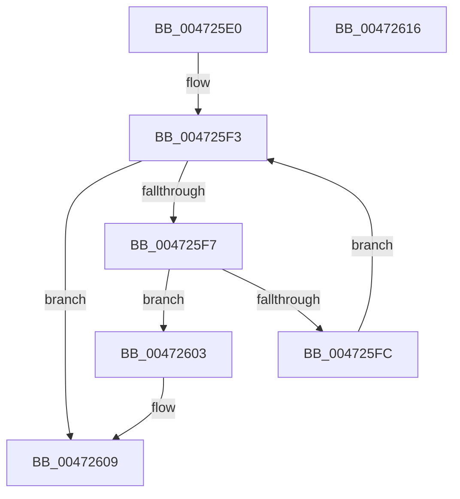

# XmBsfOp

- RVA: `0x004725E0`–`0x00472617` (길이 `55` bytes)
- VA: `0x00000001404725E0`
- 실행 섹션: `.text`
- PDB 이름 있음: `예`; PDB Function 태그: `아니요`
- unwind 정보 RVA: `0x0005C788`
- 디코드: `20`개 명령, `55/55` bytes 표시
- 미해석 바이트: `0` (있으면 어셈블리에 `.byte`로 보존)

> 이 문서는 커널 이미지의 기계어와 PDB 기호를 분석해 생성했습니다. 4번과 5번은 함수 원형과 자료형을 바이너리 사용 방식에서 추정한 C 해석이며 원본 소스 복구 결과는 아닙니다.

## 1. Dependencies

- 직접 호출 지점: **1**; 고유 호출 대상: **1**
- 직접 호출자로 확인된 함수: **0**
- RIP 상대 이미지 참조: **0**

### Outgoing calls
- `0x0047260C` → [XmStoreResult](XmStoreResult_function_004739FC.md) (function, `0x004739FC`)

### Direct callers
- 이 함수 시작 RVA로 연결되는 직접 call은 확인되지 않았습니다. 간접 호출은 완전히 역산할 수 없습니다.

### Static image references
- 디코드된 RIP-relative 메모리 참조가 없습니다.

## 2. Other-region calls and transfers

- 다른 실행 섹션으로 향하는 call: **0**
- 별도 외부 분기/꼬리 이동을 확인하지 못했습니다.

## 3. Assembly (complete function range)

```asm
004725E0  48 83 EC 28                     sub rsp, 0x28
004725E4  8B 41 10                        mov eax, dword ptr [rcx + 0x10]
004725E7  45 33 C0                        xor r8d, r8d
004725EA  8B 51 6C                        mov edx, dword ptr [rcx + 0x6c]
004725ED  83 C8 40                        or eax, 0x40
004725F0  89 41 10                        mov dword ptr [rcx + 0x10], eax
004725F3  85 D2                           test edx, edx
004725F5  74 12                           je 0x140472609
004725F7  F6 C2 01                        test dl, 1
004725FA  75 07                           jne 0x140472603
004725FC  41 FF C0                        inc r8d
004725FF  D1 EA                           shr edx, 1
00472601  EB F0                           jmp 0x1404725f3
00472603  83 E0 BF                        and eax, 0xffffffbf
00472606  89 41 10                        mov dword ptr [rcx + 0x10], eax
00472609  41 8B D0                        mov edx, r8d
0047260C  E8 EB 13 00 00                  call 0x1404739fc
00472611  48 83 C4 28                     add rsp, 0x28
00472615  C3                              ret
00472616  CC                              int3
```

## 4. C-style interpretation (structured pseudocode)

```c
__int64 __fastcall XmBsfOp(__int64 a1, __int64 a2, int a3)
{
    __int64 result;
    __int64 v_rsp;

    v_rsp = (v_rsp) - (40);
    a3 = 0;
    result = (unsigned int)(((unsigned int)(*(unsigned int *)(a1 + 16))) | (64));
    *(unsigned int *)(a1 + 16) = (unsigned int)(result);
loc_004725F3:
    if ((unsigned int)((unsigned int)(*(unsigned int *)(a1 + 108))) == 0) goto loc_00472609;
    if ((((unsigned __int8)((unsigned int)(*(unsigned int *)(a1 + 108)))) & (1)) != 0) goto loc_00472603;
    a3 = (unsigned int)((a3) + 1);
    a2 = (unsigned int)(((unsigned int)(*(unsigned int *)(a1 + 108))) >> (1));
    goto loc_004725F3;
loc_00472603:
    result = (unsigned int)((result) & (0xFFFFFFBFULL));
    *(unsigned int *)(a1 + 16) = (unsigned int)(result);
loc_00472609:
    result = XmStoreResult(a1, (unsigned int)(a3), a3, a4);
    v_rsp = (v_rsp) + (40);
    return result;
}
```

## 5. (Beta) C Style

```c
int64_t XmBsfOp(void *Arg1, int64_t Arg2, int32_t Arg3)
{
    uint8_t *arg1 = (uint8_t *)Arg1;

    int64_t result;
    int64_t local_rsp;

    local_rsp = (local_rsp) - (40);
    Arg3 = 0;
    result = (uint32_t)(((uint32_t)(*(uint32_t *)(arg1 + 0x10))) | (64));
    *(uint32_t *)(arg1 + 0x10) = (uint32_t)(result);
loc_004725F3:
    if ((uint32_t)((uint32_t)(*(uint32_t *)(arg1 + 0x6C))) == 0) goto loc_00472609;
    if ((((uint8_t)((uint32_t)(*(uint32_t *)(arg1 + 0x6C)))) & (1)) != 0) goto loc_00472603;
    Arg3 = (uint32_t)((Arg3) + 1);
    Arg2 = (uint32_t)(((uint32_t)(*(uint32_t *)(arg1 + 0x6C))) >> (1));
    goto loc_004725F3;
loc_00472603:
    result = (uint32_t)((result) & (0xFFFFFFBFULL));
    *(uint32_t *)(arg1 + 0x10) = (uint32_t)(result);
loc_00472609:
    result = XmStoreResult(Arg1, (uint32_t)(Arg3), Arg3, a4);
    local_rsp = (local_rsp) + (40);
    return result;
}
```

### 관측된 메모리 오프셋

구조체 형식이 확인되지 않은 접근은 인자 기준의 오프셋으로만 기록했습니다.

| 기준 인자 | 오프셋 표현 | 폭 (bit) | 접근 |
|---|---:|---:|---|
| `Arg1` | `+ 0x10` | `32` | `R` |
| `Arg1` | `+ 0x10` | `32` | `W` |
| `Arg1` | `+ 0x6C` | `32` | `R` |

## 6. Execution-region graph

[열기: 2D/3D 그래프와 함수 탐색 컨트롤 패널](../../../control-panel.html?section=text&rva=0x004725E0&view=graph)

- 2D 그래프는 위에서 아래로 흐르고, 3D 그래프는 빈 공간을 드래그해 회전합니다. Shift+드래그는 이동, 휠은 확대·축소, 함수 노드 선택은 대상 보고서 이동입니다.

### Static fallback


