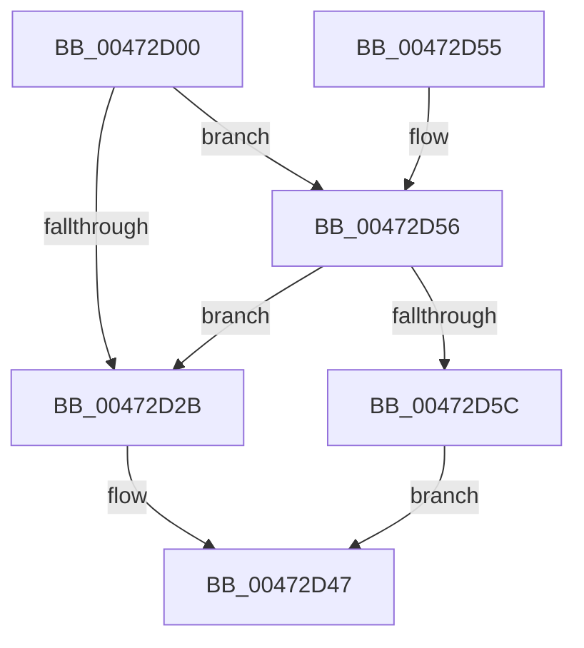

# XmCallOp

- RVA: `0x00472D00`–`0x00472D66` (길이 `102` bytes)
- VA: `0x0000000140472D00`
- 실행 섹션: `.text`
- PDB 이름 있음: `예`; PDB Function 태그: `아니요`
- unwind 정보 RVA: `0x0009D5D8`
- 디코드: `31`개 명령, `102/102` bytes 표시
- 미해석 바이트: `0` (있으면 어셈블리에 `.byte`로 보존)

> 이 문서는 커널 이미지의 기계어와 PDB 기호를 분석해 생성했습니다. 4번과 5번은 함수 원형과 자료형을 바이너리 사용 방식에서 추정한 C 해석이며 원본 소스 복구 결과는 아닙니다.

## 1. Dependencies

- 직접 호출 지점: **3**; 고유 호출 대상: **1**
- 직접 호출자로 확인된 함수: **0**
- RIP 상대 이미지 참조: **0**

### Outgoing calls
- `0x00472D2F` → [XmPushStack](XmPushStack_function_00473088.md) (function, `0x00473088`)
- `0x00472D3A` → [XmPushStack](XmPushStack_function_00473088.md) (function, `0x00473088`)
- `0x00472D5F` → [XmPushStack](XmPushStack_function_00473088.md) (function, `0x00473088`)

### Direct callers
- 이 함수 시작 RVA로 연결되는 직접 call은 확인되지 않았습니다. 간접 호출은 완전히 역산할 수 없습니다.

### Static image references
- 디코드된 RIP-relative 메모리 참조가 없습니다.

## 2. Other-region calls and transfers

- 다른 실행 섹션으로 향하는 call: **0**
- 별도 외부 분기/꼬리 이동을 확인하지 못했습니다.

## 3. Assembly (complete function range)

```asm
00472D00  48 89 5C 24 08                  mov qword ptr [rsp + 8], rbx
00472D05  57                              push rdi
00472D06  48 83 EC 20                     sub rsp, 0x20
00472D0A  8A 81 8A 00 00 00               mov al, byte ptr [rcx + 0x8a]
00472D10  48 8B D9                        mov rbx, rcx
00472D13  8B 79 68                        mov edi, dword ptr [rcx + 0x68]
00472D16  F6 D8                           neg al
00472D18  1B D2                           sbb edx, edx
00472D1A  83 E2 02                        and edx, 2
00472D1D  FF C2                           inc edx
00472D1F  89 51 78                        mov dword ptr [rcx + 0x78], edx
00472D22  81 79 70 9A 00 00 00            cmp dword ptr [rcx + 0x70], 0x9a
00472D29  75 2B                           jne 0x140472d56
00472D2B  0F B7 51 3A                     movzx edx, word ptr [rcx + 0x3a]
00472D2F  E8 54 03 00 00                  call 0x140473088
00472D34  8B 53 14                        mov edx, dword ptr [rbx + 0x14]
00472D37  48 8B CB                        mov rcx, rbx
00472D3A  E8 49 03 00 00                  call 0x140473088
00472D3F  0F B7 43 52                     movzx eax, word ptr [rbx + 0x52]
00472D43  66 89 43 3A                     mov word ptr [rbx + 0x3a], ax
00472D47  89 7B 14                        mov dword ptr [rbx + 0x14], edi
00472D4A  48 8B 5C 24 30                  mov rbx, qword ptr [rsp + 0x30]
00472D4F  48 83 C4 20                     add rsp, 0x20
00472D53  5F                              pop rdi
00472D54  C3                              ret
00472D55  CC                              int3
00472D56  83 79 7C 20                     cmp dword ptr [rcx + 0x7c], 0x20
00472D5A  75 CF                           jne 0x140472d2b
00472D5C  8B 51 14                        mov edx, dword ptr [rcx + 0x14]
00472D5F  E8 24 03 00 00                  call 0x140473088
00472D64  EB E1                           jmp 0x140472d47
```

## 4. C-style interpretation (structured pseudocode)

```c
__int64 __fastcall XmCallOp(__int64 a1, int a2)
{
    __int64 result;
    __int64 v_rsp;
    unsigned __int64 v_stack_p8;

    v_stack_p8 = v_rbx;
    v_rsp = (v_rsp) - (32);
    result = (unsigned __int8)(-(*(unsigned __int8 *)(a1 + 138)));
    a2 = (unsigned int)((a2) & (2));
    a2 = (unsigned int)((a2) + 1);
    *(unsigned int *)(a1 + 120) = a2;
    if ((*(unsigned int *)(a1 + 112)) != 154) goto loc_00472D56;
loc_00472D2B:
    result = XmPushStack(a1, *(unsigned __int16 *)(a1 + 58), a3, a4);
    result = XmPushStack(a1, (unsigned int)(*(unsigned int *)(a1 + 20)), a3, a4);
    *(unsigned __int16 *)(a1 + 58) = (unsigned __int16)(*(unsigned __int16 *)(a1 + 82));
loc_00472D47:
    *(unsigned int *)(a1 + 20) = (unsigned int)((unsigned int)(*(unsigned int *)(a1 + 104)));
    v_rsp = (v_rsp) + (32);
    return *(unsigned __int16 *)(a1 + 82);
loc_00472D56:
    if ((*(unsigned int *)(a1 + 124)) != 32) goto loc_00472D2B;
    result = XmPushStack(a1, (unsigned int)(*(unsigned int *)(a1 + 20)), a3, a4);
    goto loc_00472D47;
}
```

## 5. (Beta) C Style

```c
int64_t XmCallOp(void *Arg1, int32_t Arg2)
{
    uint8_t *arg1 = (uint8_t *)Arg1;

    int64_t result;
    int64_t local_rsp;
    uint64_t v_stack_p8;

    v_stack_p8 = local_rbx;
    local_rsp = (local_rsp) - (32);
    result = (uint8_t)(-(*(uint8_t *)(arg1 + 0x8A)));
    Arg2 = (uint32_t)((Arg2) & (2));
    Arg2 = (uint32_t)((Arg2) + 1);
    *(uint32_t *)(arg1 + 0x78) = Arg2;
    if ((*(uint32_t *)(arg1 + 0x70)) != 154) goto loc_00472D56;
loc_00472D2B:
    result = XmPushStack(Arg1, *(uint16_t *)(arg1 + 0x3A), a3, a4);
    result = XmPushStack(Arg1, (uint32_t)(*(uint32_t *)(arg1 + 0x14)), a3, a4);
    *(uint16_t *)(arg1 + 0x3A) = (uint16_t)(*(uint16_t *)(arg1 + 0x52));
loc_00472D47:
    *(uint32_t *)(arg1 + 0x14) = (uint32_t)((uint32_t)(*(uint32_t *)(arg1 + 0x68)));
    local_rsp = (local_rsp) + (32);
    return *(uint16_t *)(arg1 + 0x52);
loc_00472D56:
    if ((*(uint32_t *)(arg1 + 0x7C)) != 32) goto loc_00472D2B;
    result = XmPushStack(Arg1, (uint32_t)(*(uint32_t *)(arg1 + 0x14)), a3, a4);
    goto loc_00472D47;
}
```

### 관측된 메모리 오프셋

구조체 형식이 확인되지 않은 접근은 인자 기준의 오프셋으로만 기록했습니다.

| 기준 인자 | 오프셋 표현 | 폭 (bit) | 접근 |
|---|---:|---:|---|
| `Arg1` | `+ 0x14` | `32` | `R` |
| `Arg1` | `+ 0x14` | `32` | `W` |
| `Arg1` | `+ 0x3A` | `16` | `R` |
| `Arg1` | `+ 0x3A` | `16` | `W` |
| `Arg1` | `+ 0x52` | `16` | `R` |
| `Arg1` | `+ 0x68` | `32` | `R` |
| `Arg1` | `+ 0x70` | `32` | `R` |
| `Arg1` | `+ 0x78` | `32` | `W` |
| `Arg1` | `+ 0x7C` | `32` | `R` |
| `Arg1` | `+ 0x8A` | `8` | `R` |

## 6. Execution-region graph

[열기: 2D/3D 그래프와 함수 탐색 컨트롤 패널](../../../control-panel.html?section=text&rva=0x00472D00&view=graph)

- 2D 그래프는 위에서 아래로 흐르고, 3D 그래프는 빈 공간을 드래그해 회전합니다. Shift+드래그는 이동, 휠은 확대·축소, 함수 노드 선택은 대상 보고서 이동입니다.

### Static fallback


