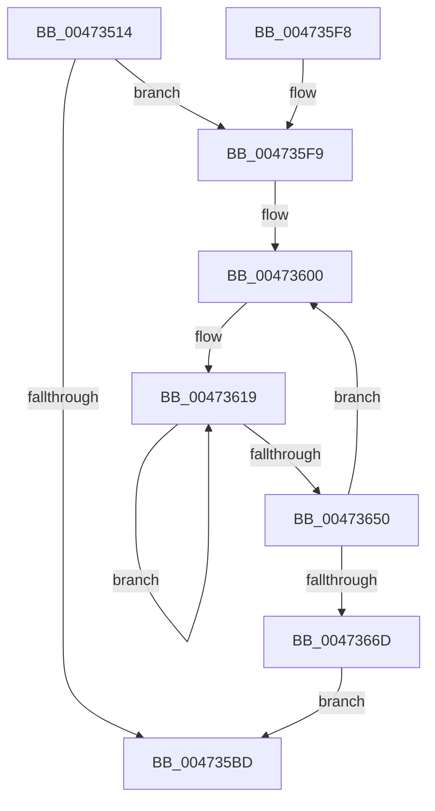

# XmEmulateStream

- RVA: `0x00473514`–`0x00473672` (길이 `350` bytes)
- VA: `0x0000000140473514`
- 실행 섹션: `.text`
- PDB 이름 있음: `예`; PDB Function 태그: `아니요`
- unwind 정보 RVA: `0x000AC5AC`
- 디코드: `84`개 명령, `350/350` bytes 표시
- 미해석 바이트: `0` (있으면 어셈블리에 `.byte`로 보존)

> 이 문서는 커널 이미지의 기계어와 PDB 기호를 분석해 생성했습니다. 4번과 5번은 함수 원형과 자료형을 바이너리 사용 방식에서 추정한 C 해석이며 원본 소스 복구 결과는 아닙니다.

## 1. Dependencies

- 직접 호출 지점: **4**; 고유 호출 대상: **3**
- 직접 호출자로 확인된 함수: **1**
- RIP 상대 이미지 참조: **17**

### Outgoing calls
- `0x004735A7` → [setjmp](../6B/setjmp_function_006BBCE0.md) (function, `0x006BBCE0`)
- `0x0047361C` → [XmGetCodeByte](XmGetCodeByte_function_00473678.md) (function, `0x00473678`)
- `0x00473647` → [guard_dispatch_icall](../6B/guard_dispatch_icall_function_006BAAD0.md) (function, `0x006BAAD0`)
- `0x0047365E` → [guard_dispatch_icall](../6B/guard_dispatch_icall_function_006BAAD0.md) (function, `0x006BAAD0`)

### Direct callers
- [XmEmulateInterrupt](../56/XmEmulateInterrupt_function_005600F0.md) at `0x0056016B`

### Static image references
- `0x00473523` → RVA `0x00E11840` (`.data`; read)
- `0x0047352F` → RVA `0x00E118E0` (`.data`; read)
- `0x00473539` → RVA `0x00E11858` (`.data`; write)
- `0x00473543` → RVA `0x00E1185C` (`.data`; write)
- `0x0047354D` → RVA `0x00E11860` (`.data`; write)
- `0x00473557` → RVA `0x00E11864` (`.data`; write)
- `0x00473561` → RVA `0x00E1186C` (`.data`; write)
- `0x0047356B` → RVA `0x00E11870` (`.data`; write)
- `0x00473575` → RVA `0x00E11874` (`.data`; write)
- `0x00473580` → RVA `0x00E1187E` (`.data`; write)
- `0x0047358C` → RVA `0x00E11878` (`.data`; write)
- `0x00473597` → RVA `0x00E1187A` (`.data`; write)
- `0x004735A1` → RVA `0x00E11854` (`.data`; write)
- `0x004735B3` → RVA `0x00E11814` (`.data`; write)
- `0x004735F9` → RVA `0x00000000` (`image boundary/outside`; read)
- `0x00473607` → RVA `0x00019F90` (`.rdata`; read)
- `0x00473663` → RVA `0x00E11814` (`.data`; read)

## 2. Other-region calls and transfers

- 다른 실행 섹션으로 향하는 call: **0**
- 별도 외부 분기/꼬리 이동을 확인하지 못했습니다.

## 3. Assembly (complete function range)

```asm
00473514  48 89 5C 24 08                  mov qword ptr [rsp + 8], rbx
00473519  4C 89 4C 24 20                  mov qword ptr [rsp + 0x20], r9
0047351E  57                              push rdi
0047351F  48 83 EC 30                     sub rsp, 0x30
00473523  48 8D 05 16 E3 99 00            lea rax, [rip + 0x99e316]
0047352A  48 89 44 24 20                  mov qword ptr [rsp + 0x20], rax
0047352F  48 8D 0D AA E3 99 00            lea rcx, [rip + 0x99e3aa]
00473536  41 8B 01                        mov eax, dword ptr [r9]
00473539  89 05 19 E3 99 00               mov dword ptr [rip + 0x99e319], eax
0047353F  41 8B 41 04                     mov eax, dword ptr [r9 + 4]
00473543  89 05 13 E3 99 00               mov dword ptr [rip + 0x99e313], eax
00473549  41 8B 41 08                     mov eax, dword ptr [r9 + 8]
0047354D  89 05 0D E3 99 00               mov dword ptr [rip + 0x99e30d], eax
00473553  41 8B 41 0C                     mov eax, dword ptr [r9 + 0xc]
00473557  89 05 07 E3 99 00               mov dword ptr [rip + 0x99e307], eax
0047355D  41 8B 41 10                     mov eax, dword ptr [r9 + 0x10]
00473561  89 05 05 E3 99 00               mov dword ptr [rip + 0x99e305], eax
00473567  41 8B 41 14                     mov eax, dword ptr [r9 + 0x14]
0047356B  89 05 FF E2 99 00               mov dword ptr [rip + 0x99e2ff], eax
00473571  41 8B 41 18                     mov eax, dword ptr [r9 + 0x18]
00473575  89 05 F9 E2 99 00               mov dword ptr [rip + 0x99e2f9], eax
0047357B  41 0F B7 41 1C                  movzx eax, word ptr [r9 + 0x1c]
00473580  66 89 05 F7 E2 99 00            mov word ptr [rip + 0x99e2f7], ax
00473587  41 0F B7 41 1E                  movzx eax, word ptr [r9 + 0x1e]
0047358C  66 89 05 E5 E2 99 00            mov word ptr [rip + 0x99e2e5], ax
00473593  41 0F B7 C0                     movzx eax, r8w
00473597  66 89 15 DC E2 99 00            mov word ptr [rip + 0x99e2dc], dx
0047359E  48 8B D4                        mov rdx, rsp
004735A1  89 05 AD E2 99 00               mov dword ptr [rip + 0x99e2ad], eax
004735A7  E8 34 87 24 00                  call 0x1406bbce0
004735AC  48 8B 5C 24 20                  mov rbx, qword ptr [rsp + 0x20]
004735B1  8B D0                           mov edx, eax
004735B3  89 05 5B E2 99 00               mov dword ptr [rip + 0x99e25b], eax
004735B9  85 C0                           test eax, eax
004735BB  74 3C                           je 0x1404735f9
004735BD  8B 43 18                        mov eax, dword ptr [rbx + 0x18]
004735C0  48 8B 4C 24 58                  mov rcx, qword ptr [rsp + 0x58]
004735C5  89 01                           mov dword ptr [rcx], eax
004735C7  8B 43 1C                        mov eax, dword ptr [rbx + 0x1c]
004735CA  89 41 04                        mov dword ptr [rcx + 4], eax
004735CD  8B 43 20                        mov eax, dword ptr [rbx + 0x20]
004735D0  89 41 08                        mov dword ptr [rcx + 8], eax
004735D3  8B 43 24                        mov eax, dword ptr [rbx + 0x24]
004735D6  89 41 0C                        mov dword ptr [rcx + 0xc], eax
004735D9  8B 43 2C                        mov eax, dword ptr [rbx + 0x2c]
004735DC  89 41 10                        mov dword ptr [rcx + 0x10], eax
004735DF  8B 43 30                        mov eax, dword ptr [rbx + 0x30]
004735E2  89 41 14                        mov dword ptr [rcx + 0x14], eax
004735E5  8B 43 34                        mov eax, dword ptr [rbx + 0x34]
004735E8  48 8B 5C 24 40                  mov rbx, qword ptr [rsp + 0x40]
004735ED  89 41 18                        mov dword ptr [rcx + 0x18], eax
004735F0  8B C2                           mov eax, edx
004735F2  48 83 C4 30                     add rsp, 0x30
004735F6  5F                              pop rdi
004735F7  C3                              ret
004735F8  CC                              int3
004735F9  48 8D 3D 00 CA B8 FF            lea rdi, [rip - 0x473600]
00473600  C7 43 74 03 00 00 00            mov dword ptr [rbx + 0x74], 3
00473607  48 8D 05 82 69 BA FF            lea rax, [rip - 0x45967e]
0047360E  48 83 A3 88 00 00 00 00         and qword ptr [rbx + 0x88], 0
00473616  48 89 03                        mov qword ptr [rbx], rax
00473619  48 8B CB                        mov rcx, rbx
0047361C  E8 57 00 00 00                  call 0x140473678
00473621  0F B6 C8                        movzx ecx, al
00473624  89 4B 70                        mov dword ptr [rbx + 0x70], ecx
00473627  48 8B 03                        mov rax, qword ptr [rbx]
0047362A  0F B7 0C 48                     movzx ecx, word ptr [rax + rcx*2]
0047362E  0F B6 C1                        movzx eax, cl
00473631  66 89 4B 50                     mov word ptr [rbx + 0x50], cx
00473635  48 8B CB                        mov rcx, rbx
00473638  89 43 7C                        mov dword ptr [rbx + 0x7c], eax
0047363B  0F B6 43 51                     movzx eax, byte ptr [rbx + 0x51]
0047363F  48 8B 84 C7 90 79 00 00         mov rax, qword ptr [rdi + rax*8 + 0x7990]
00473647  E8 84 74 24 00                  call 0x1406baad0
0047364C  85 C0                           test eax, eax
0047364E  74 C9                           je 0x140473619
00473650  8B 43 7C                        mov eax, dword ptr [rbx + 0x7c]
00473653  48 8B CB                        mov rcx, rbx
00473656  48 8B 84 C7 40 7B 00 00         mov rax, qword ptr [rdi + rax*8 + 0x7b40]
0047365E  E8 6D 74 24 00                  call 0x1406baad0
00473663  8B 15 AB E1 99 00               mov edx, dword ptr [rip + 0x99e1ab]
00473669  85 D2                           test edx, edx
0047366B  74 93                           je 0x140473600
0047366D  E9 4B FF FF FF                  jmp 0x1404735bd
```

## 4. C-style interpretation (structured pseudocode)

```c
__int64 __fastcall XmEmulateStream(__int64 a1, unsigned __int16 a2, unsigned __int16 a3, __int64 a4)
{
    __int64 result;
    __int64 v_rsp;
    unsigned __int64 v_stack_m18;
    unsigned __int64 v_stack_p20;
    unsigned __int64 v_stack_p8;

    v_stack_p8 = v_rbx;
    v_stack_p20 = a4;
    v_rsp = (v_rsp) - (48);
    v_stack_m18 = v_rip + 10085142;
    *(unsigned int *)(v_rip + 10085145) = (unsigned int)((unsigned int)(*(unsigned int *)(a4)));
    *(unsigned int *)(v_rip + 10085139) = (unsigned int)((unsigned int)(*(unsigned int *)(a4 + 4)));
    *(unsigned int *)(v_rip + 10085133) = (unsigned int)((unsigned int)(*(unsigned int *)(a4 + 8)));
    *(unsigned int *)(v_rip + 10085127) = (unsigned int)((unsigned int)(*(unsigned int *)(a4 + 12)));
    *(unsigned int *)(v_rip + 10085125) = (unsigned int)((unsigned int)(*(unsigned int *)(a4 + 16)));
    *(unsigned int *)(v_rip + 10085119) = (unsigned int)((unsigned int)(*(unsigned int *)(a4 + 20)));
    *(unsigned int *)(v_rip + 10085113) = (unsigned int)((unsigned int)(*(unsigned int *)(a4 + 24)));
    *(unsigned __int16 *)(v_rip + 10085111) = (unsigned __int16)(*(unsigned __int16 *)(a4 + 28));
    *(unsigned __int16 *)(v_rip + 10085093) = (unsigned __int16)(*(unsigned __int16 *)(a4 + 30));
    *(unsigned __int16 *)(v_rip + 10085084) = a2;
    *(unsigned int *)(v_rip + 10085037) = a3;
    result = setjmp(v_rip + 10085290, v_rsp, a3, a4);
    *(unsigned int *)(v_rip + 10084955) = (unsigned int)(result);
    if ((unsigned int)(result) == 0) goto loc_004735F9;
loc_004735BD:
    *(unsigned int *)(v_stack_p20) = (unsigned int)((unsigned int)(*(unsigned int *)(v_stack_m18 + 24)));
    *(unsigned int *)(v_stack_p20 + 4) = (unsigned int)((unsigned int)(*(unsigned int *)(v_stack_m18 + 28)));
    *(unsigned int *)(v_stack_p20 + 8) = (unsigned int)((unsigned int)(*(unsigned int *)(v_stack_m18 + 32)));
    *(unsigned int *)(v_stack_p20 + 12) = (unsigned int)((unsigned int)(*(unsigned int *)(v_stack_m18 + 36)));
    *(unsigned int *)(v_stack_p20 + 16) = (unsigned int)((unsigned int)(*(unsigned int *)(v_stack_m18 + 44)));
    *(unsigned int *)(v_stack_p20 + 20) = (unsigned int)((unsigned int)(*(unsigned int *)(v_stack_m18 + 48)));
    *(unsigned int *)(v_stack_p20 + 24) = (unsigned int)((unsigned int)(*(unsigned int *)(v_stack_m18 + 52)));
    v_rsp = (v_rsp) + (48);
    return (unsigned int)((unsigned int)((unsigned int)((unsigned int)(result))));
loc_004735F9:
loc_00473600:
    *(unsigned int *)(v_stack_p8 + 116) = 3;
    *(unsigned __int64 *)(v_stack_p8) = v_rip - 4560510;
loc_00473619:
    result = XmGetCodeByte(v_stack_p8, (unsigned int)((unsigned int)(result)), a3, a4);
    *(unsigned int *)(v_stack_p8 + 112) = (unsigned int)((unsigned __int8)(result));
    *(unsigned __int16 *)(v_stack_p8 + 80) = (unsigned __int16)(*(unsigned __int16 *)(*(unsigned __int64 *)(v_stack_p8) + (unsigned __int8)(result) * 2));
    *(unsigned int *)(v_stack_p8 + 124) = (unsigned int)((unsigned __int8)(*(unsigned __int16 *)(*(unsigned __int64 *)(v_stack_p8) + (unsigned __int8)(result) * 2)));
    result = guard_dispatch_icall(v_stack_p8, (unsigned int)((unsigned int)(result)), a3, a4);
    if ((unsigned int)(result) == 0) goto loc_00473619;
    result = guard_dispatch_icall(v_stack_p8, (unsigned int)((unsigned int)(result)), a3, a4);
    if ((unsigned int)((unsigned int)(*(unsigned int *)(v_rip + 10084779))) == 0) goto loc_00473600;
    goto loc_004735BD;
}
```

## 5. (Beta) C Style

```c
int64_t XmEmulateStream(int64_t Arg1, uint16_t Arg2, uint16_t Arg3, void *Arg4)
{
    uint8_t *arg4 = (uint8_t *)Arg4;

    int64_t result;
    int64_t local_rsp;
    uint64_t v_stack_m18;
    uint64_t v_stack_p20;
    uint64_t v_stack_p8;

    v_stack_p8 = local_rbx;
    v_stack_p20 = Arg4;
    local_rsp = (local_rsp) - (48);
    v_stack_m18 = v_rip + 10085142;
    *(uint32_t *)(v_rip + 0x99E319) = (uint32_t)((uint32_t)(*(uint32_t *)(arg4)));
    *(uint32_t *)(v_rip + 0x99E313) = (uint32_t)((uint32_t)(*(uint32_t *)(arg4 + 0x4)));
    *(uint32_t *)(v_rip + 0x99E30D) = (uint32_t)((uint32_t)(*(uint32_t *)(arg4 + 0x8)));
    *(uint32_t *)(v_rip + 0x99E307) = (uint32_t)((uint32_t)(*(uint32_t *)(arg4 + 0xC)));
    *(uint32_t *)(v_rip + 0x99E305) = (uint32_t)((uint32_t)(*(uint32_t *)(arg4 + 0x10)));
    *(uint32_t *)(v_rip + 0x99E2FF) = (uint32_t)((uint32_t)(*(uint32_t *)(arg4 + 0x14)));
    *(uint32_t *)(v_rip + 0x99E2F9) = (uint32_t)((uint32_t)(*(uint32_t *)(arg4 + 0x18)));
    *(uint16_t *)(v_rip + 0x99E2F7) = (uint16_t)(*(uint16_t *)(arg4 + 0x1C));
    *(uint16_t *)(v_rip + 0x99E2E5) = (uint16_t)(*(uint16_t *)(arg4 + 0x1E));
    *(uint16_t *)(v_rip + 0x99E2DC) = Arg2;
    *(uint32_t *)(v_rip + 0x99E2AD) = Arg3;
    result = setjmp(v_rip + 10085290, local_rsp, Arg3, Arg4);
    *(uint32_t *)(v_rip + 0x99E25B) = (uint32_t)(result);
    if ((uint32_t)(result) == 0) goto loc_004735F9;
loc_004735BD:
    *(uint32_t *)(v_stack_p20) = (uint32_t)((uint32_t)(*(uint32_t *)(v_stack_m18 + 0x18)));
    *(uint32_t *)(v_stack_p20 + 0x4) = (uint32_t)((uint32_t)(*(uint32_t *)(v_stack_m18 + 0x1C)));
    *(uint32_t *)(v_stack_p20 + 0x8) = (uint32_t)((uint32_t)(*(uint32_t *)(v_stack_m18 + 0x20)));
    *(uint32_t *)(v_stack_p20 + 0xC) = (uint32_t)((uint32_t)(*(uint32_t *)(v_stack_m18 + 0x24)));
    *(uint32_t *)(v_stack_p20 + 0x10) = (uint32_t)((uint32_t)(*(uint32_t *)(v_stack_m18 + 0x2C)));
    *(uint32_t *)(v_stack_p20 + 0x14) = (uint32_t)((uint32_t)(*(uint32_t *)(v_stack_m18 + 0x30)));
    *(uint32_t *)(v_stack_p20 + 0x18) = (uint32_t)((uint32_t)(*(uint32_t *)(v_stack_m18 + 0x34)));
    local_rsp = (local_rsp) + (48);
    return (uint32_t)((uint32_t)((uint32_t)((uint32_t)(result))));
loc_004735F9:
loc_00473600:
    *(uint32_t *)(v_stack_p8 + 0x74) = 3;
    *(uint64_t *)(v_stack_p8) = v_rip - 4560510;
loc_00473619:
    result = XmGetCodeByte(v_stack_p8, (uint32_t)((uint32_t)(result)), Arg3, Arg4);
    *(uint32_t *)(v_stack_p8 + 0x70) = (uint32_t)((uint8_t)(result));
    *(uint16_t *)(v_stack_p8 + 0x50) = (uint16_t)(*(uint16_t *)(*(uint64_t *)(v_stack_p8) + (uint8_t)(result) * 2));
    *(uint32_t *)(v_stack_p8 + 0x7C) = (uint32_t)((uint8_t)(*(uint16_t *)(*(uint64_t *)(v_stack_p8) + (uint8_t)(result) * 2)));
    result = guard_dispatch_icall(v_stack_p8, (uint32_t)((uint32_t)(result)), Arg3, Arg4);
    if ((uint32_t)(result) == 0) goto loc_00473619;
    result = guard_dispatch_icall(v_stack_p8, (uint32_t)((uint32_t)(result)), Arg3, Arg4);
    if ((uint32_t)((uint32_t)(*(uint32_t *)(v_rip + 0x99E1AB))) == 0) goto loc_00473600;
    goto loc_004735BD;
}
```

### 관측된 메모리 오프셋

구조체 형식이 확인되지 않은 접근은 인자 기준의 오프셋으로만 기록했습니다.

| 기준 인자 | 오프셋 표현 | 폭 (bit) | 접근 |
|---|---:|---:|---|
| `Arg4` | `+ 0x0` | `32` | `R` |
| `Arg4` | `+ 0x4` | `32` | `R` |
| `Arg4` | `+ 0x8` | `32` | `R` |
| `Arg4` | `+ 0xC` | `32` | `R` |
| `Arg4` | `+ 0x10` | `32` | `R` |
| `Arg4` | `+ 0x14` | `32` | `R` |
| `Arg4` | `+ 0x18` | `32` | `R` |
| `Arg4` | `+ 0x1C` | `16` | `R` |
| `Arg4` | `+ 0x1E` | `16` | `R` |

## 6. Execution-region graph

[열기: 2D/3D 그래프와 함수 탐색 컨트롤 패널](../../../control-panel.html?section=text&rva=0x00473514&view=graph)

- 2D 그래프는 위에서 아래로 흐르고, 3D 그래프는 빈 공간을 드래그해 회전합니다. Shift+드래그는 이동, 휠은 확대·축소, 함수 노드 선택은 대상 보고서 이동입니다.

### Static fallback


