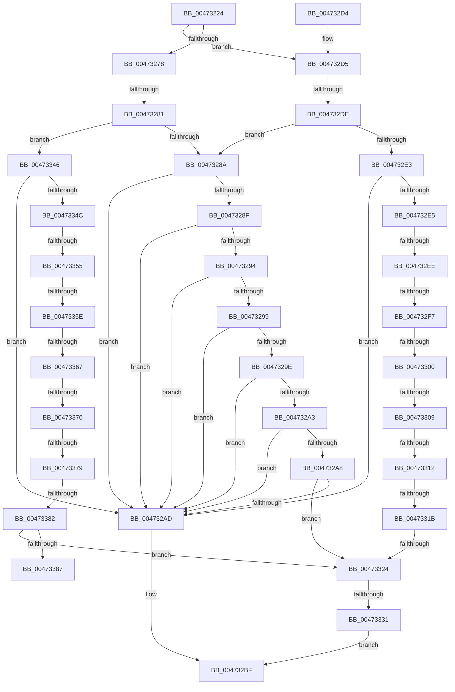

# XmEvaluateAddressSpecifier

- RVA: `0x00473224`–`0x00473395` (길이 `369` bytes)
- VA: `0x0000000140473224`
- 실행 섹션: `.text`
- PDB 이름 있음: `예`; PDB Function 태그: `예`
- unwind 정보 RVA: `0x000AC574`
- 디코드: `97`개 명령, `369/369` bytes 표시
- 미해석 바이트: `0` (있으면 어셈블리에 `.byte`로 보존)

> 이 문서는 커널 이미지의 기계어와 PDB 기호를 분석해 생성했습니다. 4번과 5번은 함수 원형과 자료형을 바이너리 사용 방식에서 추정한 C 해석이며 원본 소스 복구 결과는 아닙니다.

## 1. Dependencies

- 직접 호출 지점: **3**; 고유 호출 대상: **3**
- 직접 호출자로 확인된 함수: **22**
- RIP 상대 이미지 참조: **0**

### Outgoing calls
- `0x00473242` → [XmGetCodeByte](XmGetCodeByte_function_00473678.md) (function, `0x00473678`)
- `0x004732BA` → [XmGetRegisterAddress](XmGetRegisterAddress_function_00473778.md) (function, `0x00473778`)
- `0x0047338A` → [XmGetWordImmediate](XmGetWordImmediate_function_004731DC.md) (function, `0x004731DC`)

### Direct callers
- [XmGroup2ByByte](XmGroup2ByByte_function_00472620.md) at `0x0047263F`
- [XmGroup45General](XmGroup45General_function_00472A80.md) at `0x00472A9F`
- [XmGroup1Immediate](XmGroup1Immediate_function_00472B20.md) at `0x00472B3F`
- [XmMoveGeneral](XmMoveGeneral_function_004730F0.md) at `0x0047310B`
- [XmGroup1General](XmGroup1General_function_00473160.md) at `0x0047317B`
- [XmBitScanGeneral](../57/XmBitScanGeneral_function_005760F0.md) at `0x00576115`
- [XmEffectiveOffset](../57/XmEffectiveOffset_function_00576180.md) at `0x005761AC`
- [XmGeneralBitOffset](../57/XmGeneralBitOffset_function_00576200.md) at `0x00576229`
- [XmGeneralRegister](../57/XmGeneralRegister_function_005762B0.md) at `0x005762D5`
- [XmGroup2By1](../57/XmGroup2By1_function_00576330.md) at `0x0057634B`
- [XmGroup2ByCL](../57/XmGroup2ByCL_function_00576390.md) at `0x005763AB`
- [XmGroup3General](../57/XmGroup3General_function_005763F0.md) at `0x0057640F`
- [XmGroup7General](../57/XmGroup7General_function_00576490.md) at `0x005764AA`
- [XmGroup8BitOffset](../57/XmGroup8BitOffset_function_005764F0.md) at `0x00576519`
- [XmImulImmediate](../57/XmImulImmediate_function_00576640.md) at `0x00576669`
- [XmLoadSegment](../57/XmLoadSegment_function_005766C0.md) at `0x005766F2`
- [XmMoveImmediate](../57/XmMoveImmediate_function_005767E0.md) at `0x005767FB`
- [XmMoveSegment](../57/XmMoveSegment_function_00576830.md) at `0x0057684A`
- [XmMoveXxGeneral](../57/XmMoveXxGeneral_function_005768A0.md) at `0x005768C1`
- [XmPopGeneral](../57/XmPopGeneral_function_00576950.md) at `0x00576975`
- [XmSetccByte](../57/XmSetccByte_function_00576AD0.md) at `0x00576AE7`
- [XmShiftDouble](../57/XmShiftDouble_function_00576B10.md) at `0x00576B39`

### Static image references
- 디코드된 RIP-relative 메모리 참조가 없습니다.

## 2. Other-region calls and transfers

- 다른 실행 섹션으로 향하는 call: **0**
- call이 아닌 외부 분기/꼬리 이동: **17**
  - `0x0047327B` → [sub_006F3DB6 + 0x18F](../6F/Unknown_function_006F3DB6.md) (`tail-transfer`)
  - `0x004732D8` → [sub_006F3DB6](../6F/Unknown_function_006F3DB6.md) (`tail-transfer`)
  - `0x004732E8` → [sub_006F3DB6 + 0x17D](../6F/Unknown_function_006F3DB6.md) (`tail-transfer`)
  - `0x004732F1` → [sub_006F3DB6 + 0x15E](../6F/Unknown_function_006F3DB6.md) (`tail-transfer`)
  - `0x004732FA` → [sub_006F3DB6 + 0x13F](../6F/Unknown_function_006F3DB6.md) (`tail-transfer`)
  - `0x00473303` → [sub_006F3DB6 + 0x56](../6F/Unknown_function_006F3DB6.md) (`tail-transfer`)
  - `0x0047330C` → [sub_006F3DB6 + 0x120](../6F/Unknown_function_006F3DB6.md) (`tail-transfer`)
  - `0x00473315` → [sub_006F3DB6 + 0x101](../6F/Unknown_function_006F3DB6.md) (`tail-transfer`)
  - `0x0047331E` → [sub_006F3DB6 + 0xE2](../6F/Unknown_function_006F3DB6.md) (`tail-transfer`)
  - `0x0047332B` → [sub_006F3DB6 + 0x370](../6F/Unknown_function_006F3DB6.md) (`tail-transfer`)
  - `0x0047334F` → [sub_006F3DB6 + 0x358](../6F/Unknown_function_006F3DB6.md) (`tail-transfer`)
  - `0x00473358` → [sub_006F3DB6 + 0x237](../6F/Unknown_function_006F3DB6.md) (`tail-transfer`)
  - `0x00473361` → [sub_006F3DB6 + 0x347](../6F/Unknown_function_006F3DB6.md) (`tail-transfer`)
  - `0x0047336A` → [sub_006F3DB6 + 0x339](../6F/Unknown_function_006F3DB6.md) (`tail-transfer`)
  - `0x00473373` → [sub_006F3DB6 + 0x32B](../6F/Unknown_function_006F3DB6.md) (`tail-transfer`)
  - `0x0047337C` → [sub_006F3DB6 + 0x31E](../6F/Unknown_function_006F3DB6.md) (`tail-transfer`)
  - `0x00473390` → [sub_006F3DB6 + 0x364](../6F/Unknown_function_006F3DB6.md) (`tail-transfer`)

## 3. Assembly (complete function range)

```asm
00473224  48 89 5C 24 08                  mov qword ptr [rsp + 8], rbx
00473229  48 89 6C 24 10                  mov qword ptr [rsp + 0x10], rbp
0047322E  48 89 74 24 18                  mov qword ptr [rsp + 0x18], rsi
00473233  57                              push rdi
00473234  48 83 EC 20                     sub rsp, 0x20
00473238  33 ED                           xor ebp, ebp
0047323A  48 8B DA                        mov rbx, rdx
0047323D  8B F5                           mov esi, ebp
0047323F  48 8B F9                        mov rdi, rcx
00473242  E8 31 04 00 00                  call 0x140473678
00473247  0F B6 C0                        movzx eax, al
0047324A  8B C8                           mov ecx, eax
0047324C  40 88 AF 8E 00 00 00            mov byte ptr [rdi + 0x8e], bpl
00473253  44 8B C0                        mov r8d, eax
00473256  C1 E9 06                        shr ecx, 6
00473259  41 83 E0 07                     and r8d, 7
0047325D  C1 E8 03                        shr eax, 3
00473260  83 E0 07                        and eax, 7
00473263  89 03                           mov dword ptr [rbx], eax
00473265  8D 14 CD 00 00 00 00            lea edx, [rcx*8]
0047326C  41 0B D0                        or edx, r8d
0047326F  40 38 AF 89 00 00 00            cmp byte ptr [rdi + 0x89], bpl
00473276  75 5D                           jne 0x1404732d5
00473278  83 FA 10                        cmp edx, 0x10
0047327B  0F 86 C4 0C 28 00               jbe 0x1406f3f45
00473281  83 FA 18                        cmp edx, 0x18
00473284  0F 86 BC 00 00 00               jbe 0x140473346
0047328A  83 EA 19                        sub edx, 0x19
0047328D  74 1E                           je 0x1404732ad
0047328F  83 EA 01                        sub edx, 1
00473292  74 19                           je 0x1404732ad
00473294  83 EA 01                        sub edx, 1
00473297  74 14                           je 0x1404732ad
00473299  83 EA 01                        sub edx, 1
0047329C  74 0F                           je 0x1404732ad
0047329E  83 EA 01                        sub edx, 1
004732A1  74 0A                           je 0x1404732ad
004732A3  83 EA 01                        sub edx, 1
004732A6  74 05                           je 0x1404732ad
004732A8  83 FA 01                        cmp edx, 1
004732AB  75 77                           jne 0x140473324
004732AD  41 8B D0                        mov edx, r8d
004732B0  C6 87 8E 00 00 00 01            mov byte ptr [rdi + 0x8e], 1
004732B7  48 8B CF                        mov rcx, rdi
004732BA  E8 B9 04 00 00                  call 0x140473778
004732BF  48 8B 5C 24 30                  mov rbx, qword ptr [rsp + 0x30]
004732C4  48 8B 6C 24 38                  mov rbp, qword ptr [rsp + 0x38]
004732C9  48 8B 74 24 40                  mov rsi, qword ptr [rsp + 0x40]
004732CE  48 83 C4 20                     add rsp, 0x20
004732D2  5F                              pop rdi
004732D3  C3                              ret
004732D4  CC                              int3
004732D5  83 FA 10                        cmp edx, 0x10
004732D8  0F 86 D8 0A 28 00               jbe 0x1406f3db6
004732DE  83 FA 18                        cmp edx, 0x18
004732E1  77 A7                           ja 0x14047328a
004732E3  74 C8                           je 0x1404732ad
004732E5  83 EA 11                        sub edx, 0x11
004732E8  0F 84 45 0C 28 00               je 0x1406f3f33
004732EE  83 EA 01                        sub edx, 1
004732F1  0F 84 1D 0C 28 00               je 0x1406f3f14
004732F7  83 EA 01                        sub edx, 1
004732FA  0F 84 F5 0B 28 00               je 0x1406f3ef5
00473300  83 EA 01                        sub edx, 1
00473303  0F 84 03 0B 28 00               je 0x1406f3e0c
00473309  83 EA 01                        sub edx, 1
0047330C  0F 84 C4 0B 28 00               je 0x1406f3ed6
00473312  83 EA 01                        sub edx, 1
00473315  0F 84 9C 0B 28 00               je 0x1406f3eb7
0047331B  83 FA 01                        cmp edx, 1
0047331E  0F 84 74 0B 28 00               je 0x1406f3e98
00473324  40 38 AF 8F 00 00 00            cmp byte ptr [rdi + 0x8f], bpl
0047332B  0F 84 F5 0D 28 00               je 0x1406f4126
00473331  83 7F 78 01                     cmp dword ptr [rdi + 0x78], 1
00473335  0F B7 C6                        movzx eax, si
00473338  0F 45 C6                        cmovne eax, esi
0047333B  89 87 80 00 00 00               mov dword ptr [rdi + 0x80], eax
00473341  E9 79 FF FF FF                  jmp 0x1404732bf
00473346  0F 84 61 FF FF FF               je 0x1404732ad
0047334C  83 EA 11                        sub edx, 0x11
0047334F  0F 84 B9 0D 28 00               je 0x1406f410e
00473355  83 EA 01                        sub edx, 1
00473358  0F 84 8F 0C 28 00               je 0x1406f3fed
0047335E  83 EA 01                        sub edx, 1
00473361  0F 84 96 0D 28 00               je 0x1406f40fd
00473367  83 EA 01                        sub edx, 1
0047336A  0F 84 7F 0D 28 00               je 0x1406f40ef
00473370  83 EA 01                        sub edx, 1
00473373  0F 84 68 0D 28 00               je 0x1406f40e1
00473379  83 EA 01                        sub edx, 1
0047337C  0F 84 52 0D 28 00               je 0x1406f40d4
00473382  83 FA 01                        cmp edx, 1
00473385  75 9D                           jne 0x140473324
00473387  48 8B CF                        mov rcx, rdi
0047338A  E8 4D FE FF FF                  call 0x1404731dc
0047338F  90                              nop
00473390  E9 85 0D 28 00                  jmp 0x1406f411a
```

## 4. C-style interpretation (structured pseudocode)

```c
__int64 __fastcall XmEvaluateAddressSpecifier(__int64 a1, __int64 a2)
{
    __int64 result;
    __int64 v_rbp;
    __int64 v_rsp;
    unsigned __int64 v_stack_p10;
    unsigned __int64 v_stack_p18;
    unsigned __int64 v_stack_p8;

    v_stack_p8 = v_rbx;
    v_stack_p10 = v_rbp;
    v_stack_p18 = v_rsi;
    v_rsp = (v_rsp) - (32);
    v_rbp = 0;
    result = XmGetCodeByte(a1, a2, a3, a4);
    *(unsigned __int8 *)(a1 + 142) = 0;
    a1 = (unsigned int)(((unsigned int)((unsigned int)((unsigned __int8)(result)))) >> (6));
    a3 = (unsigned int)(((unsigned int)((unsigned int)((unsigned __int8)(result)))) & (7));
    result = (unsigned int)(((unsigned __int8)(result)) >> (3));
    result = (unsigned int)((result) & (7));
    *(unsigned int *)(a2) = (unsigned int)(result);
    a2 = (unsigned int)((a1 * 8) | ((unsigned int)(a3)));
    if ((*(unsigned __int8 *)(a1 + 137)) != 0) goto loc_004732D5;
    if (((unsigned int)(a2)) <= 24) goto loc_00473346;
loc_0047328A:
    a2 = (unsigned int)((a2) - (25));
    if (condition_is_equal) goto loc_004732AD;
    a2 = (unsigned int)((a2) - (1));
    if (condition_is_equal) goto loc_004732AD;
    a2 = (unsigned int)((a2) - (1));
    if (condition_is_equal) goto loc_004732AD;
    a2 = (unsigned int)((a2) - (1));
    if (condition_is_equal) goto loc_004732AD;
    a2 = (unsigned int)((a2) - (1));
    if (condition_is_equal) goto loc_004732AD;
    a2 = (unsigned int)((a2) - (1));
    if (condition_is_equal) goto loc_004732AD;
    if (((unsigned int)(a2)) != 1) goto loc_00473324;
loc_004732AD:
    *(unsigned __int8 *)(a1 + 142) = 1;
    result = XmGetRegisterAddress(a1, (unsigned int)((unsigned int)(a3)), a3, a4);
loc_004732BF:
    v_rsp = (v_rsp) + (32);
    return result;
loc_004732D5:
    if (((unsigned int)((unsigned int)((unsigned int)(a3)))) > 24) goto loc_0047328A;
    if (((unsigned int)((unsigned int)((unsigned int)(a3)))) == 24) goto loc_004732AD;
    a2 = (unsigned int)(((unsigned int)((unsigned int)(a3))) - (17));
    a2 = (unsigned int)((a2) - (1));
    a2 = (unsigned int)((a2) - (1));
    a2 = (unsigned int)((a2) - (1));
    a2 = (unsigned int)((a2) - (1));
    a2 = (unsigned int)((a2) - (1));
loc_00473324:
    result = (unsigned __int16)(v_stack_p18);
    if ((*(unsigned int *)(a1 + 120)) != 1) { result = (unsigned int)(v_stack_p18); }
    *(unsigned int *)(a1 + 128) = (unsigned int)(result);
    goto loc_004732BF;
loc_00473346:
    if ((*(unsigned int *)(a1 + 120)) == 1) goto loc_004732AD;
    a2 = (unsigned int)((a2) - (17));
    a2 = (unsigned int)((a2) - (1));
    a2 = (unsigned int)((a2) - (1));
    a2 = (unsigned int)((a2) - (1));
    a2 = (unsigned int)((a2) - (1));
    a2 = (unsigned int)((a2) - (1));
    if (((unsigned int)(a2)) != 1) goto loc_00473324;
    result = XmGetWordImmediate(a1, a2, a3, a4);
}
```

## 5. (Beta) C Style

```c
int64_t XmEvaluateAddressSpecifier(void *Arg1, void *Arg2)
{
    uint8_t *arg1 = (uint8_t *)Arg1;
    uint8_t *arg2 = (uint8_t *)Arg2;

    int64_t result;
    int64_t local_rbp;
    int64_t local_rsp;
    uint64_t v_stack_p10;
    uint64_t v_stack_p18;
    uint64_t v_stack_p8;

    v_stack_p8 = local_rbx;
    v_stack_p10 = local_rbp;
    v_stack_p18 = local_rsi;
    local_rsp = (local_rsp) - (32);
    local_rbp = 0;
    result = XmGetCodeByte(Arg1, Arg2, a3, a4);
    *(uint8_t *)(arg1 + 0x8E) = 0;
    Arg1 = (uint32_t)(((uint32_t)((uint32_t)((uint8_t)(result)))) >> (6));
    a3 = (uint32_t)(((uint32_t)((uint32_t)((uint8_t)(result)))) & (7));
    result = (uint32_t)(((uint8_t)(result)) >> (3));
    result = (uint32_t)((result) & (7));
    *(uint32_t *)(arg2) = (uint32_t)(result);
    Arg2 = (uint32_t)((Arg1 * 8) | ((uint32_t)(a3)));
    if ((*(uint8_t *)(arg1 + 0x89)) != 0) goto loc_004732D5;
    if (((uint32_t)(Arg2)) <= 24) goto loc_00473346;
loc_0047328A:
    Arg2 = (uint32_t)((Arg2) - (25));
    if (condition_is_equal) goto loc_004732AD;
    Arg2 = (uint32_t)((Arg2) - (1));
    if (condition_is_equal) goto loc_004732AD;
    Arg2 = (uint32_t)((Arg2) - (1));
    if (condition_is_equal) goto loc_004732AD;
    Arg2 = (uint32_t)((Arg2) - (1));
    if (condition_is_equal) goto loc_004732AD;
    Arg2 = (uint32_t)((Arg2) - (1));
    if (condition_is_equal) goto loc_004732AD;
    Arg2 = (uint32_t)((Arg2) - (1));
    if (condition_is_equal) goto loc_004732AD;
    if (((uint32_t)(Arg2)) != 1) goto loc_00473324;
loc_004732AD:
    *(uint8_t *)(arg1 + 0x8E) = 1;
    result = XmGetRegisterAddress(Arg1, (uint32_t)((uint32_t)(a3)), a3, a4);
loc_004732BF:
    local_rsp = (local_rsp) + (32);
    return result;
loc_004732D5:
    if (((uint32_t)((uint32_t)((uint32_t)(a3)))) > 24) goto loc_0047328A;
    if (((uint32_t)((uint32_t)((uint32_t)(a3)))) == 24) goto loc_004732AD;
    Arg2 = (uint32_t)(((uint32_t)((uint32_t)(a3))) - (17));
    Arg2 = (uint32_t)((Arg2) - (1));
    Arg2 = (uint32_t)((Arg2) - (1));
    Arg2 = (uint32_t)((Arg2) - (1));
    Arg2 = (uint32_t)((Arg2) - (1));
    Arg2 = (uint32_t)((Arg2) - (1));
loc_00473324:
    result = (uint16_t)(v_stack_p18);
    if ((*(uint32_t *)(arg1 + 0x78)) != 1) { result = (uint32_t)(v_stack_p18); }
    *(uint32_t *)(arg1 + 0x80) = (uint32_t)(result);
    goto loc_004732BF;
loc_00473346:
    if ((*(uint32_t *)(arg1 + 0x78)) == 1) goto loc_004732AD;
    Arg2 = (uint32_t)((Arg2) - (17));
    Arg2 = (uint32_t)((Arg2) - (1));
    Arg2 = (uint32_t)((Arg2) - (1));
    Arg2 = (uint32_t)((Arg2) - (1));
    Arg2 = (uint32_t)((Arg2) - (1));
    Arg2 = (uint32_t)((Arg2) - (1));
    if (((uint32_t)(Arg2)) != 1) goto loc_00473324;
    result = XmGetWordImmediate(Arg1, Arg2, a3, a4);
}
```

### 관측된 메모리 오프셋

구조체 형식이 확인되지 않은 접근은 인자 기준의 오프셋으로만 기록했습니다.

| 기준 인자 | 오프셋 표현 | 폭 (bit) | 접근 |
|---|---:|---:|---|
| `Arg1` | `+ 0x78` | `32` | `R` |
| `Arg1` | `+ 0x80` | `32` | `W` |
| `Arg1` | `+ 0x89` | `8` | `R` |
| `Arg1` | `+ 0x8E` | `8` | `W` |
| `Arg1` | `+ 0x8F` | `8` | `R` |
| `Arg2` | `+ 0x0` | `32` | `W` |

## 6. Execution-region graph

[열기: 2D/3D 그래프와 함수 탐색 컨트롤 패널](../../../control-panel.html?section=text&rva=0x00473224&view=graph)

- 2D 그래프는 위에서 아래로 흐르고, 3D 그래프는 빈 공간을 드래그해 회전합니다. Shift+드래그는 이동, 휠은 확대·축소, 함수 노드 선택은 대상 보고서 이동입니다.

### Static fallback


