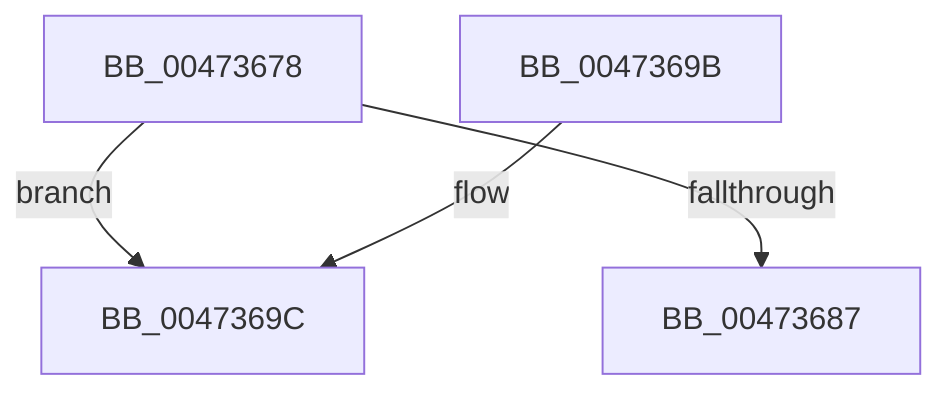

# XmGetCodeByte

- RVA: `0x00473678`–`0x004736AE` (길이 `54` bytes)
- VA: `0x0000000140473678`
- 실행 섹션: `.text`
- PDB 이름 있음: `예`; PDB Function 태그: `아니요`
- unwind 정보 RVA: `0x0007A1AC`
- 디코드: `16`개 명령, `54/54` bytes 표시
- 미해석 바이트: `0` (있으면 어셈블리에 `.byte`로 보존)

> 이 문서는 커널 이미지의 기계어와 PDB 기호를 분석해 생성했습니다. 4번과 5번은 함수 원형과 자료형을 바이너리 사용 방식에서 추정한 C 해석이며 원본 소스 복구 결과는 아닙니다.

## 1. Dependencies

- 직접 호출 지점: **2**; 고유 호출 대상: **2**
- 직접 호출자로 확인된 함수: **14**
- RIP 상대 이미지 참조: **0**

### Outgoing calls
- `0x0047368F` → [x86BiosTranslateAddress](x86BiosTranslateAddress_function_004736C0.md) (function, `0x004736C0`)
- `0x004736A8` → [longjmp](../4F/longjmp_function_004FD5F0.md) (function, `0x004FD5F0`)

### Direct callers
- [XmGroup2ByByte](XmGroup2ByByte_function_00472620.md) at `0x0047264A`
- [XmMoveRegImmediate](XmMoveRegImmediate_function_00473000.md) at `0x00473039`
- [XmEvaluateAddressSpecifier](XmEvaluateAddressSpecifier_function_00473224.md) at `0x00473242`
- [XmShortJump](XmShortJump_function_004733A0.md) at `0x004733A9`
- [XmGetImmediateSourceValue](XmGetImmediateSourceValue_function_0047340C.md) at `0x00473417`
- [XmGetImmediateSourceValue](XmGetImmediateSourceValue_function_0047340C.md) at `0x00473438`
- [XmAccumImmediate](XmAccumImmediate_function_00473460.md) at `0x0047347A`
- [XmEmulateStream](XmEmulateStream_function_00473514.md) at `0x0047361C`
- [XmGroup8BitOffset](../57/XmGroup8BitOffset_function_005764F0.md) at `0x00576524`
- [XmImmediateEnter](../57/XmImmediateEnter_function_005765A0.md) at `0x005765B7`
- [XmPortImmediate](../57/XmPortImmediate_function_005769A0.md) at `0x005769A9`
- [XmShiftDouble](../57/XmShiftDouble_function_00576B10.md) at `0x00576B4B`
- [XmEvaluateIndexSpecifier](../57/XmEvaluateIndexSpecifier_function_00578928.md) at `0x00578941`
- [XmEvaluateIndexSpecifier](../57/XmEvaluateIndexSpecifier_function_00578928.md) at `0x00578A12`
- [XmEvaluateIndexSpecifier](../57/XmEvaluateIndexSpecifier_function_00578928.md) at `0x00578A22`
- [XmEvaluateIndexSpecifier](../57/XmEvaluateIndexSpecifier_function_00578928.md) at `0x00578A35`
- [XmEvaluateIndexSpecifier](../57/XmEvaluateIndexSpecifier_function_00578928.md) at `0x00578A48`
- [XmEvaluateIndexSpecifier](../57/XmEvaluateIndexSpecifier_function_00578928.md) at `0x00578A63`
- [XmEvaluateIndexSpecifier](../57/XmEvaluateIndexSpecifier_function_00578928.md) at `0x00578AAE`
- [XmEvaluateIndexSpecifier](../57/XmEvaluateIndexSpecifier_function_00578928.md) at `0x00578AC1`
- [XmEvaluateIndexSpecifier](../57/XmEvaluateIndexSpecifier_function_00578928.md) at `0x00578AD4`
- [sub_006F3DB6](../6F/Unknown_function_006F3DB6.md) at `0x006F3E40`
- [sub_006F3DB6](../6F/Unknown_function_006F3DB6.md) at `0x006F3E8E`
- [sub_006F3DB6](../6F/Unknown_function_006F3DB6.md) at `0x006F3EAD`
- [sub_006F3DB6](../6F/Unknown_function_006F3DB6.md) at `0x006F3ECC`
- [sub_006F3DB6](../6F/Unknown_function_006F3DB6.md) at `0x006F3EEB`
- [sub_006F3DB6](../6F/Unknown_function_006F3DB6.md) at `0x006F3F0A`
- [sub_006F3DB6](../6F/Unknown_function_006F3DB6.md) at `0x006F3F29`
- [sub_006F3DB6](../6F/Unknown_function_006F3DB6.md) at `0x006F3FC4`
- [sub_006F3DB6](../6F/Unknown_function_006F3DB6.md) at `0x006F3FD5`
- [sub_006F3DB6](../6F/Unknown_function_006F3DB6.md) at `0x006F4028`
- [sub_006F3DB6](../6F/Unknown_function_006F3DB6.md) at `0x006F4039`
- [sub_006F3DB6](../6F/Unknown_function_006F3DB6.md) at `0x006F4050`
- [sub_006F3DB6](../6F/Unknown_function_006F3DB6.md) at `0x006F405E`
- [sub_006F3DB6](../6F/Unknown_function_006F3DB6.md) at `0x006F40A7`
- [sub_006F3DB6](../6F/Unknown_function_006F3DB6.md) at `0x006F40B8`
- [sub_006F416A](../6F/Unknown_function_006F416A.md) at `0x006F416A`

### Static image references
- 디코드된 RIP-relative 메모리 참조가 없습니다.

## 2. Other-region calls and transfers

- 다른 실행 섹션으로 향하는 call: **0**
- 별도 외부 분기/꼬리 이동을 확인하지 못했습니다.

## 3. Assembly (complete function range)

```asm
00473678  48 83 EC 28                     sub rsp, 0x28
0047367C  0F B7 41 46                     movzx eax, word ptr [rcx + 0x46]
00473680  8B 51 14                        mov edx, dword ptr [rcx + 0x14]
00473683  3B D0                           cmp edx, eax
00473685  77 15                           ja 0x14047369c
00473687  66 FF 41 14                     inc word ptr [rcx + 0x14]
0047368B  0F B7 49 3A                     movzx ecx, word ptr [rcx + 0x3a]
0047368F  E8 2C 00 00 00                  call 0x1404736c0
00473694  8A 00                           mov al, byte ptr [rax]
00473696  48 83 C4 28                     add rsp, 0x28
0047369A  C3                              ret
0047369B  CC                              int3
0047369C  48 81 C1 A0 00 00 00            add rcx, 0xa0
004736A3  BA 0E 00 00 00                  mov edx, 0xe
004736A8  E8 43 9F 08 00                  call 0x1404fd5f0
004736AD  CC                              int3
```

## 4. C-style interpretation (structured pseudocode)

```c
__int64 __fastcall XmGetCodeByte(__int64 a1)
{
    __int64 result;
    __int64 v_rsp;

    v_rsp = (v_rsp) - (40);
    if (((unsigned int)((unsigned int)(*(unsigned int *)(a1 + 20)))) > ((unsigned int)(*(unsigned __int16 *)(a1 + 70)))) goto loc_0047369C;
    result = x86BiosTranslateAddress(*(unsigned __int16 *)(a1 + 58), (unsigned int)(*(unsigned int *)(a1 + 20)), a3, a4);
    v_rsp = (v_rsp) + (40);
    return *(unsigned __int8 *)(result);
loc_0047369C:
    a1 = (*(unsigned __int16 *)(a1 + 58)) + (160);
    result = longjmp(a1, 14, a3, a4);
    return result;
}
```

## 5. (Beta) C Style

```c
int64_t XmGetCodeByte(void *Arg1)
{
    uint8_t *arg1 = (uint8_t *)Arg1;

    int64_t result;
    int64_t local_rsp;

    local_rsp = (local_rsp) - (40);
    if (((uint32_t)((uint32_t)(*(uint32_t *)(arg1 + 0x14)))) > ((uint32_t)(*(uint16_t *)(arg1 + 0x46)))) goto loc_0047369C;
    result = x86BiosTranslateAddress(*(uint16_t *)(arg1 + 0x3A), (uint32_t)(*(uint32_t *)(arg1 + 0x14)), a3, a4);
    local_rsp = (local_rsp) + (40);
    return *(uint8_t *)(result);
loc_0047369C:
    Arg1 = (*(uint16_t *)(arg1 + 0x3A)) + (160);
    result = longjmp(Arg1, 14, a3, a4);
    return result;
}
```

### 관측된 메모리 오프셋

구조체 형식이 확인되지 않은 접근은 인자 기준의 오프셋으로만 기록했습니다.

| 기준 인자 | 오프셋 표현 | 폭 (bit) | 접근 |
|---|---:|---:|---|
| `Arg1` | `+ 0x14` | `16` | `R/W` |
| `Arg1` | `+ 0x14` | `32` | `R` |
| `Arg1` | `+ 0x3A` | `16` | `R` |
| `Arg1` | `+ 0x46` | `16` | `R` |

## 6. Execution-region graph

[열기: 2D/3D 그래프와 함수 탐색 컨트롤 패널](../../../control-panel.html?section=text&rva=0x00473678&view=graph)

- 2D 그래프는 위에서 아래로 흐르고, 3D 그래프는 빈 공간을 드래그해 회전합니다. Shift+드래그는 이동, 휠은 확대·축소, 함수 노드 선택은 대상 보고서 이동입니다.

### Static fallback


