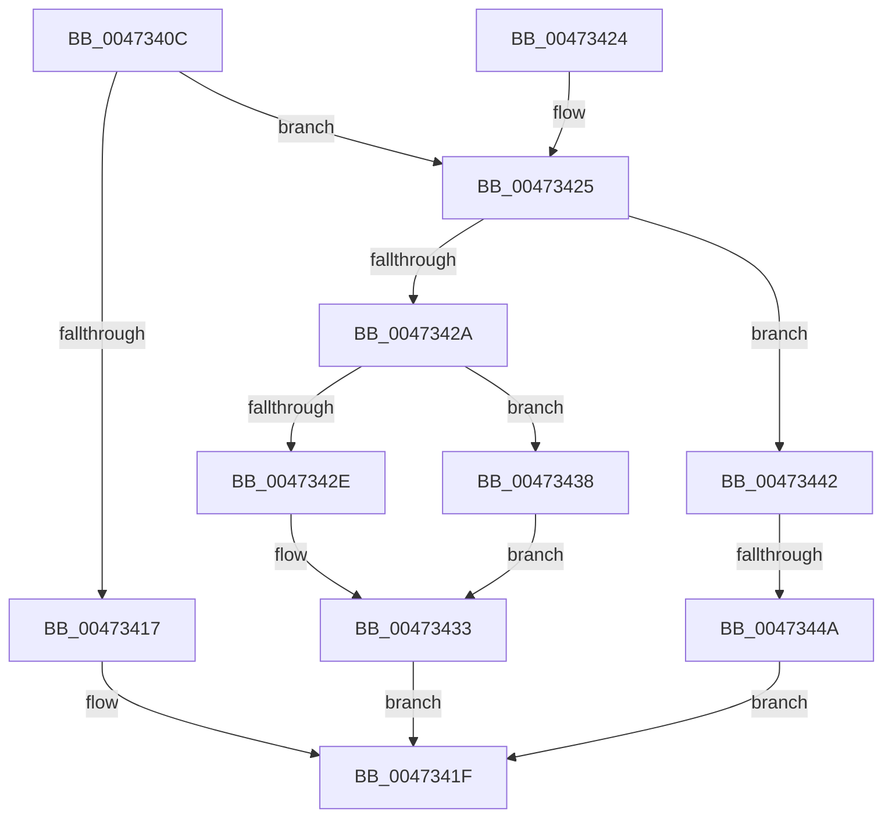

# XmGetImmediateSourceValue

- RVA: `0x0047340C`–`0x00473451` (길이 `69` bytes)
- VA: `0x000000014047340C`
- 실행 섹션: `.text`
- PDB 이름 있음: `예`; PDB Function 태그: `예`
- unwind 정보 RVA: `0x00064778`
- 디코드: `23`개 명령, `69/69` bytes 표시
- 미해석 바이트: `0` (있으면 어셈블리에 `.byte`로 보존)

> 이 문서는 커널 이미지의 기계어와 PDB 기호를 분석해 생성했습니다. 4번과 5번은 함수 원형과 자료형을 바이너리 사용 방식에서 추정한 C 해석이며 원본 소스 복구 결과는 아닙니다.

## 1. Dependencies

- 직접 호출 지점: **4**; 고유 호출 대상: **3**
- 직접 호출자로 확인된 함수: **6**
- RIP 상대 이미지 참조: **0**

### Outgoing calls
- `0x00473417` → [XmGetCodeByte](XmGetCodeByte_function_00473678.md) (function, `0x00473678`)
- `0x0047342E` → [XmGetWordImmediate](XmGetWordImmediate_function_004731DC.md) (function, `0x004731DC`)
- `0x00473438` → [XmGetCodeByte](XmGetCodeByte_function_00473678.md) (function, `0x00473678`)
- `0x0047344A` → [XmGetLongImmediate](../56/XmGetLongImmediate_function_0056DC70.md) (function, `0x0056DC70`)

### Direct callers
- [XmGroup1Immediate](XmGroup1Immediate_function_00472B20.md) at `0x00472B50`
- [XmByteImmediate](../57/XmByteImmediate_function_00576150.md) at `0x0057615F`
- [XmGroup3General](../57/XmGroup3General_function_005763F0.md) at `0x00576429`
- [XmImulImmediate](../57/XmImulImmediate_function_00576640.md) at `0x0057667A`
- [XmMoveImmediate](../57/XmMoveImmediate_function_005767E0.md) at `0x00576809`
- [XmPushImmediate](../57/XmPushImmediate_function_005769E0.md) at `0x00576A01`

### Static image references
- 디코드된 RIP-relative 메모리 참조가 없습니다.

## 2. Other-region calls and transfers

- 다른 실행 섹션으로 향하는 call: **0**
- call이 아닌 외부 분기/꼬리 이동: **1**
  - `0x00473444` → [sub_006F416A](../6F/Unknown_function_006F416A.md) (`tail-transfer`)

## 3. Assembly (complete function range)

```asm
0047340C  48 83 EC 28                     sub rsp, 0x28
00473410  8B 41 78                        mov eax, dword ptr [rcx + 0x78]
00473413  85 C0                           test eax, eax
00473415  75 0E                           jne 0x140473425
00473417  E8 5C 02 00 00                  call 0x140473678
0047341C  0F B6 C0                        movzx eax, al
0047341F  48 83 C4 28                     add rsp, 0x28
00473423  C3                              ret
00473424  CC                              int3
00473425  83 F8 01                        cmp eax, 1
00473428  75 18                           jne 0x140473442
0047342A  85 D2                           test edx, edx
0047342C  75 0A                           jne 0x140473438
0047342E  E8 A9 FD FF FF                  call 0x1404731dc
00473433  0F B7 C0                        movzx eax, ax
00473436  EB E7                           jmp 0x14047341f
00473438  E8 3B 02 00 00                  call 0x140473678
0047343D  0F BE C0                        movsx eax, al
00473440  EB F1                           jmp 0x140473433
00473442  85 D2                           test edx, edx
00473444  0F 85 20 0D 28 00               jne 0x1406f416a
0047344A  E8 21 A8 0F 00                  call 0x14056dc70
0047344F  EB CE                           jmp 0x14047341f
```

## 4. C-style interpretation (structured pseudocode)

```c
__int64 __fastcall XmGetImmediateSourceValue(__int64 a1, int a2)
{
    __int64 result;
    __int64 v_rsp;

    v_rsp = (v_rsp) - (40);
    if ((unsigned int)((unsigned int)(*(unsigned int *)(a1 + 120))) != 0) goto loc_00473425;
    result = XmGetCodeByte(a1, a2, a3, a4);
loc_0047341F:
    v_rsp = (v_rsp) + (40);
    return (unsigned __int8)(result);
loc_00473425:
    if (((unsigned int)((unsigned __int8)(result))) != 1) goto loc_00473442;
    if (a2 != 0) goto loc_00473438;
    result = XmGetWordImmediate(a1, a2, a3, a4);
loc_00473433:
    goto loc_0047341F;
loc_00473438:
    result = XmGetCodeByte(a1, a2, a3, a4);
    goto loc_00473433;
loc_00473442:
    result = XmGetLongImmediate(a1, a2, a3, a4);
    goto loc_0047341F;
}
```

## 5. (Beta) C Style

```c
int64_t XmGetImmediateSourceValue(void *Arg1, int32_t Arg2)
{
    uint8_t *arg1 = (uint8_t *)Arg1;

    int64_t result;
    int64_t local_rsp;

    local_rsp = (local_rsp) - (40);
    if ((uint32_t)((uint32_t)(*(uint32_t *)(arg1 + 0x78))) != 0) goto loc_00473425;
    result = XmGetCodeByte(Arg1, Arg2, a3, a4);
loc_0047341F:
    local_rsp = (local_rsp) + (40);
    return (uint8_t)(result);
loc_00473425:
    if (((uint32_t)((uint8_t)(result))) != 1) goto loc_00473442;
    if (Arg2 != 0) goto loc_00473438;
    result = XmGetWordImmediate(Arg1, Arg2, a3, a4);
loc_00473433:
    goto loc_0047341F;
loc_00473438:
    result = XmGetCodeByte(Arg1, Arg2, a3, a4);
    goto loc_00473433;
loc_00473442:
    result = XmGetLongImmediate(Arg1, Arg2, a3, a4);
    goto loc_0047341F;
}
```

### 관측된 메모리 오프셋

구조체 형식이 확인되지 않은 접근은 인자 기준의 오프셋으로만 기록했습니다.

| 기준 인자 | 오프셋 표현 | 폭 (bit) | 접근 |
|---|---:|---:|---|
| `Arg1` | `+ 0x78` | `32` | `R` |

## 6. Execution-region graph

[열기: 2D/3D 그래프와 함수 탐색 컨트롤 패널](../../../control-panel.html?section=text&rva=0x0047340C&view=graph)

- 2D 그래프는 위에서 아래로 흐르고, 3D 그래프는 빈 공간을 드래그해 회전합니다. Shift+드래그는 이동, 휠은 확대·축소, 함수 노드 선택은 대상 보고서 이동입니다.

### Static fallback


