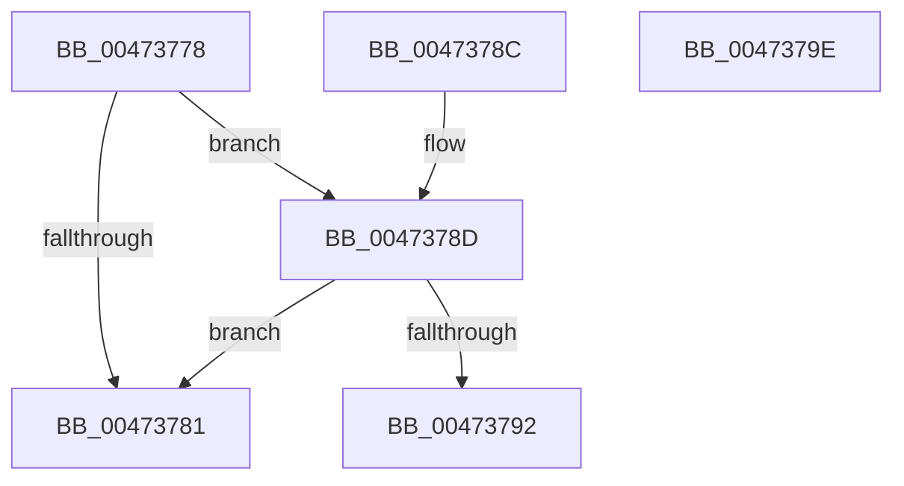

# XmGetRegisterAddress

- RVA: `0x00473778`–`0x0047379F` (길이 `39` bytes)
- VA: `0x0000000140473778`
- 실행 섹션: `.text`
- PDB 이름 있음: `예`; PDB Function 태그: `아니요`
- unwind 정보 RVA: `0x000DB714`
- 디코드: `15`개 명령, `39/39` bytes 표시
- 미해석 바이트: `0` (있으면 어셈블리에 `.byte`로 보존)

> 이 문서는 커널 이미지의 기계어와 PDB 기호를 분석해 생성했습니다. 4번과 5번은 함수 원형과 자료형을 바이너리 사용 방식에서 추정한 C 해석이며 원본 소스 복구 결과는 아닙니다.

## 1. Dependencies

- 직접 호출 지점: **0**; 고유 호출 대상: **0**
- 직접 호출자로 확인된 함수: **4**
- RIP 상대 이미지 참조: **0**

### Outgoing calls
- 직접 디코드된 call 명령이 없습니다.

### Direct callers
- [XmMoveRegImmediate](XmMoveRegImmediate_function_00473000.md) at `0x00473028`
- [XmMoveGeneral](XmMoveGeneral_function_004730F0.md) at `0x00473126`
- [XmMoveGeneral](XmMoveGeneral_function_004730F0.md) at `0x0047314C`
- [XmGroup1General](XmGroup1General_function_00473160.md) at `0x0047319E`
- [XmGroup1General](XmGroup1General_function_00473160.md) at `0x004731C1`
- [XmEvaluateAddressSpecifier](XmEvaluateAddressSpecifier_function_00473224.md) at `0x004732BA`

### Static image references
- 디코드된 RIP-relative 메모리 참조가 없습니다.

## 2. Other-region calls and transfers

- 다른 실행 섹션으로 향하는 call: **0**
- 별도 외부 분기/꼬리 이동을 확인하지 못했습니다.

## 3. Assembly (complete function range)

```asm
00473778  83 79 78 00                     cmp dword ptr [rcx + 0x78], 0
0047377C  4C 8B C1                        mov r8, rcx
0047377F  74 0C                           je 0x14047378d
00473781  8B C2                           mov eax, edx
00473783  48 83 C0 06                     add rax, 6
00473787  48 8D 04 81                     lea rax, [rcx + rax*4]
0047378B  C3                              ret
0047378C  CC                              int3
0047378D  83 FA 04                        cmp edx, 4
00473790  72 EF                           jb 0x140473781
00473792  8D 4A FC                        lea ecx, [rdx - 4]
00473795  49 8D 40 19                     lea rax, [r8 + 0x19]
00473799  48 8D 04 88                     lea rax, [rax + rcx*4]
0047379D  C3                              ret
0047379E  CC                              int3
```

## 4. C-style interpretation (structured pseudocode)

```c
__int64 __fastcall XmGetRegisterAddress(__int64 a1, __int64 a2)
{
    __int64 result;

    if ((*(unsigned int *)(a1 + 120)) == 0) goto loc_0047378D;
loc_00473781:
    result = ((unsigned int)((unsigned int)(a2))) + (6);
    return a1 + result * 4;
loc_0047378D:
    if (((unsigned int)(a2)) < 4) goto loc_00473781;
    return a1 + 25 + a2 - 4 * 4;
}
```

## 5. (Beta) C Style

```c
int64_t XmGetRegisterAddress(void *Arg1, int64_t Arg2)
{
    uint8_t *arg1 = (uint8_t *)Arg1;

    int64_t result;

    if ((*(uint32_t *)(arg1 + 0x78)) == 0) goto loc_0047378D;
loc_00473781:
    result = ((uint32_t)((uint32_t)(Arg2))) + (6);
    return Arg1 + result * 4;
loc_0047378D:
    if (((uint32_t)(Arg2)) < 4) goto loc_00473781;
    return Arg1 + 25 + Arg2 - 4 * 4;
}
```

### 관측된 메모리 오프셋

구조체 형식이 확인되지 않은 접근은 인자 기준의 오프셋으로만 기록했습니다.

| 기준 인자 | 오프셋 표현 | 폭 (bit) | 접근 |
|---|---:|---:|---|
| `Arg1` | `+ 0x0 + rax*4` | `64` | `R` |
| `Arg1` | `+ 0x0 + rcx*4` | `64` | `R` |
| `Arg1` | `+ 0x19` | `64` | `R` |
| `Arg1` | `+ 0x78` | `32` | `R` |

## 6. Execution-region graph

[열기: 2D/3D 그래프와 함수 탐색 컨트롤 패널](../../../control-panel.html?section=text&rva=0x00473778&view=graph)

- 2D 그래프는 위에서 아래로 흐르고, 3D 그래프는 빈 공간을 드래그해 회전합니다. Shift+드래그는 이동, 휠은 확대·축소, 함수 노드 선택은 대상 보고서 이동입니다.

### Static fallback


